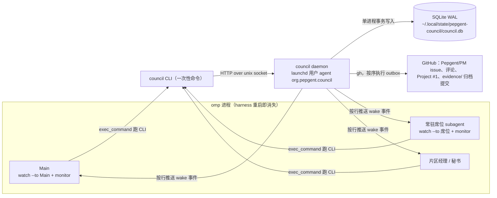

# 议会 daemon 方案（审阅后定稿）

本方案落实用户的两条直接指令：

- U104：“主控不再当消息总线：工人和席位的常规状态写进 issue 或文件，主控按批次读，不每条消息都唤醒，此项是重大的流程变更，需要合理的设计”
- U105：“投票不要使用irc，用可并发修改的机制，由程序控制后写入，所有的投票和议题管理均交给程序自动处理，issue写入同样也交由程序实现，程序需要是daemon，并且可以配合exec command monitor订阅，而不需要额外的主动通知机制。”

要编码的规则以 pepgent-soroi `AGENTS.md`（soroi `f6659e9` 起，C1–C5 已从 `LEDGER.md` 移入）为准：D1-12（C2-3）、D1-16、D1-17、“异步总线（D1-18）”、C2-1、C3-2、C4-1、C4-2、C4-3。`LEDGER.md` 只用来查 `(U)` 原话。

管理层五份审阅见同目录 `review-*.md`。Main 已逐项裁定（§13），本文按裁定定稿，实现见 PM 仓 `tools/council/`，可行性与端到端证据见 [`feasibility.md`](feasibility.md)。

## 1. 总体结构



- **daemon 是议程、行版本、选票、仲裁、状态记录的唯一写方。** CLI 只经 unix socket 请求 daemon；daemon 在一个 SQLite 事务里校验、写入、重新求值各行、重算各席队首，同时追加事件和 GitHub 写入任务（outbox）。
- **GitHub 是发布面。** issue 标题、正文、评论、Project 状态和 `evidence/` 归档都由 daemon 从数据库生成，人和 agent 不手写。
- **唤醒只靠事件流。** 订阅者用 `exec_command` 跑 `council watch --to X`，`monitor` 条件统一为 `^EVT `。daemon 不调 `peer_send`、不写 `agent://`，没有第二条通知渠道。

## 2. 代码位置

PM 仓（本地 `/Users/mouriya/Ext/code/pepgent/pepgent-pm`）`tools/council/`，不进任何产品包：

| 路径 | 内容 |
|---|---|
| `src/domain.ts` | 席位、分类、职能领域、选择、引用、状态等领域类型与边界解析 |
| `src/tally.ts` | 纯函数：资格席位、门槛、行求值、队列顺序与各席队首 |
| `src/store.ts` | SQLite 模式与读写 |
| `src/council.ts` | 命令处理：每条命令一个事务，求值、事件、outbox |
| `src/render.ts` | issue 正文、评论、归档文件的 Markdown |
| `src/github.ts` | outbox 执行器（`gh issue`、`gh project`、Git Data API） |
| `src/daemon.ts` | unix socket HTTP 服务、事件扇出 |
| `src/cli.ts`、`bin/council` | 命令行 |
| `src/config.ts` | 运行配置；`COUNCIL_*` 变量供端到端测试实例使用 |
| `launchd/org.pepgent.council.plist` | launchd 用户 agent 定义 |
| `test/council.test.ts` | 规则测试（`bun test`） |
| `README.md` | 各角色使用说明 |

运行时为 Bun（`bun:sqlite`、`Bun.serve({ unix })`、`Bun.YAML`），无第三方运行时依赖；`typescript` 与 `@types/bun` 只用于 `bunx tsc` 类型检查。

## 3. 存储与并发写入

- 所有写入都是“CLI 请求 → daemon 事务 → 提交”。daemon 单进程、`bun:sqlite` 同步 API，事务天然依次执行，多席同时投票互不覆盖（feasibility §1、§8）。
- 选票表只追加：同一席位对同一行版本重投，以最后一张为准，旧票保留在历史与归档中；行修订后旧版本的票自然不再计入。
- outbox 与状态变化同一事务写入，daemon 内循环按序执行；执行失败的项保留并在 30 秒后重试，后面的项等待，保持发布顺序。立案分步记录进度（先记 issue 号，再记 Project 条目），重试从断点继续，不会重复建 issue（feasibility §8.1）。

## 4. 领域类型

完整定义见 `src/domain.ts`。要点：

- `SeatId`：`Coordination`（Main + governance-desk，合计 1 票）、`ClaudeHigh`、`Argon`、`LeadMentor`、`ArgonGovernance`、`SoroiKeeperOpus`、`SoroiKeeperGpt`、`OmompOptimizer`。
- `Category`：意图 / 技术 / 串联 / 实现 / 治理（D1-17 的五类标签），只用于意图否决与仲裁。
- `Domain`（职能领域，与分类分开表达）：`governance`（组织制度、派工、提效、PM 错误路径）、`globalArchitecture`（全局产品架构）、`design`（改 soroi `design/*.md`）。起草者在行上声明；对应专责席可以自行认领（`council claim`），认领记录在案且不随修订丢失。
- `Choice`：`approve` | `oppose(counterexample)` | `veto(citation)`。没有“暂定否决”这个选择：无引用的否决由 CLI 拒收，“暂定”意见写进理由。
- `Citation`：`user`（U 编号）| `session`（会话 id 与 entry）| `blockingFact`（已实证的主路径阻断事实）。
- `Outcome`（行的终局结果，一旦写入不再改变）：`passed` | `rejected(veto)` | `rejected(threshold)` | `withdrawn`。
- `AgendaState`：`filing`（等 PM issue 建好）→ `open` → `decided` → `archived`。
- `StatusKind`：`progress` | `note` | `blocked` | `all_done` | `alert` | `dependency`。

## 5. 计票规则（`tally.ts`）

### 5.1 资格席位（按行、按职能领域）

- 基础四席：Coordination、ClaudeHigh、Argon、LeadMentor。
- 行的职能领域含 `governance`：加 ArgonGovernance。ArgonGovernance 收到每个议程的 `agenda.opened` 门铃，可对任何一行认领治理领域，从而成为该行资格席位（起草标签不能排除治理席，审阅 divergent CE1、Argon CE3、ArgonGovernance CE-3、LeadMentor CE-2A）。
- 行的职能领域含 `globalArchitecture`：加 SoroiKeeperOpus 与 SoroiKeeperGpt 两席，不论谁发起（AGENTS D1-12“对应产品全景席一并独立参投”按两席解读；steady R-3、divergent CE2、LeadMentor CE-2B）。两席也可自行认领该领域。
- 议程由 SoroiKeeperOpus、SoroiKeeperGpt 或 OmompOptimizer 发起：发起席参投该议程每一行。
- 门槛：`⌈3/4 × 资格席位数⌉`（4 席 3、5 席 4、6 席 5、7 席 6）。
- 修订或认领改变资格席位后，按新资格集合计票，新加入的席位收到投票请求（steady CE-3）。

### 5.2 否决与仲裁（D1-16、D1-17）

- Argon 的意图 / 缺失设计否决：必须引用 `user` 或 `session`，`blockingFact` 被拒收（Argon V2）；仅在行的有效分类为“意图”或行标为缺失设计时成立。
- ArgonGovernance 的治理否决：引用 `user`、`session` 或 `blockingFact` 皆可；只在它是该行资格席位时可投（即该行属治理领域）。
- 没有引用的否决：CLI 拒收，提示改投附反例的反对或在理由中写“暂定”。
- 分类争议：Argon 对非意图、非缺失设计行投否决时，daemon 在投票的同一事务里发起仲裁并唤醒 LeadMentor；Argon 也可不投否决、直接 `council dispute` 发起（LeadMentor CE-3）。仲裁不等其他席位投齐。
- LeadMentor 判“意图”：有效分类改为意图，Argon 的否决随即成立。判为其他类：Argon 的意图否决作废（记录原因），daemon 重新请求 Argon 投该行。

### 5.3 行求值顺序

只看当前版本、未作废的票：

1. 已有终局结果：不再变化。
2. 有成立的否决：立即 `rejected(veto)`，不等其他席位。
3. 有待仲裁的分类争议：`disputed`。
4. 有反对票：`contested`（有效反例未清零），立即唤醒发起人。
5. 资格席位未投齐：`voting`。
6. 投齐：赞成数达门槛为 `passed`，否则 `rejected(threshold)`。

“投齐才落槌”对齐 D1-12 的“参投职能席位逐条投票”与 Argon 的必需参与；但争议、反例、仲裁通知都在发生时立即发出，不等投齐（ArgonGovernance §6.1）。

### 5.4 反例的清零（Main 裁定 1）

反例只能由三条途径清零：反对席改投、发起人修订该行、发起人撤回该行。`council rebut` 记录发起人的源头实证反驳、发评论并唤醒反对席，但不改变计票——现行规则没有指定第三方裁定反例有效性。

### 5.5 议程结案

议程所有行都有终局结果时转 `decided`：发最终评论、正文定稿、Project Status 设 Done、若仍开启则关闭 issue，随后归档。**行一通过就向该行 `notify` 地址发 `row.passed`**，不等整案结案或归档（ArgonGovernance CE-2）；行的职能领域含 `design` 时同时通知 Argon 回写设计正文（Argon I5）。

## 6. 队列与投票准入

- 排序：只排已立案（PM issue 已建）的 `open` 议程，P0→P1→P2→P3，同级按 PM issue 号 FIFO（与现行规则一致；`filing` 议程不进队列，所以正式投票总在 PM issue 存在之后，Argon T1）。
- 每席队首：排序中第一个“该席仍有未投当前版本资格行”的议程。
- **准入：** 首次投某行当前版本时，该行所在议程必须是该席队首，否则拒收并提示（LeadMentor CE-1、Argon T2）。对已投过的行改投随时可以。
- **门铃：** 某席的队首议程变化，或队首议程中该席待投的行出现新项（新提案、修订、认领、仲裁作废），向该席地址发一条 `vote.request`。新来的 P0 会抢占为队首。

## 7. 事件流

### 7.1 行格式与过滤

```
EVT <seq> <utc> @<收件人> <kind> <agenda|-> key=value … | <一句话摘要>
```

- 一个收件人一行。每个事件都有 `wake` 属性：`council watch --to X` 只推送发给 X 的 wake 事件；`council digest --reader X` 按游标读出发给 X 的全部事件（wake 在前，状态记录附全文），读后推进游标。唤醒集合只在 daemon 路由表一处定义，订阅者 monitor 统一用 `^EVT `（divergent §2）。
- 每次被唤醒，订阅者先跑一次 `council digest --reader X`，以它为准办理。
- daemon 停止或重启时 watch 进程以非零码退出，unified-exec 立即发“异常返回”通知唤醒订阅者，订阅者重新挂 watch（feasibility §8.1、§10 实测），不另设心跳。

### 7.2 路由表

| kind | 触发 | 收件人（wake） | 只进 digest |
|---|---|---|---|
| `vote.request` | 某席队首变化或待投行新增 | 该席地址；Coordination、ClaudeHigh 的地址是 `Main` | — |
| `agenda.opened` | PM issue 建好、议程开放 | ArgonGovernance | Main、SoroiKeeperOpus、SoroiKeeperGpt |
| `arbitration.request` | 分类争议发起 | LeadMentor | — |
| `arbitration.ruled` | LeadMentor 裁定 | Argon | — |
| `row.contested` | 行出现新的反对票 | 发起人地址 | — |
| `counter.rebutted` | 发起人记录反驳 | 反对席地址 | — |
| `row.passed` | 行通过 | 该行 `notify` 地址；`design` 领域行加 Argon | Main |
| `row.rejected` / `row.withdrawn` | 行否决、未通过或撤回 | 发起人地址（Main 发起时不唤醒） | Main |
| `agenda.decided` | 议程全部行有结果 | — | Main |
| `agenda.archived` | 归档提交完成 | Secretary（更新 LEDGER 决策索引） | Main |
| `seat.enter` | 席位进场 | — | Main（Main 裁定 2） |
| `seat.retire` | 席位退役 | Main | — |
| `status.blocked` / `status.all_done` / `status.alert` | 状态发布 | Main | — |
| `status.progress` / `status.note` | 状态发布 | — | Main |
| `status.dependency` | 前置已合入等仅需送达的依赖事实 | `--to` 列出的受益片区经理 | Main |

**Main 的唤醒集合：** Coordination 与 ClaudeHigh 的 `vote.request`、Main 发起议程的 `row.contested`、对 ClaudeHigh 反例的 `counter.rebutted`、`seat.retire`、`status.blocked`、`status.all_done`、`status.alert`。普通进度、议程进展、计票结果、进场都只进 digest。

## 8. 状态通道（主控不当总线）

- 工人仍把 `STARTED / PR / BLOCKED / DONE / ALL_DONE` 及依赖变化写在原 issue/PR（C4-1），不接触 council。
- 片区经理按 U107 用 peer 单向巡查工人，把观察结果用 `council status post` 发布：普通进度 `progress`；`blocked`、`all_done`；跨席位前置合入、越界、反复失败、watchdog/hook 告警或由此停工、安全或硬件紧急情况用 `alert`；仅需送达受益方、不需 Main 改排期的“前置已合入”用 `dependency --to AreaMgr<受益仓>`（ArgonGovernance CE-5）。
- 席位、哨兵、秘书的常规汇报用 `progress`/`note`，需要 Main 决定的事项用 `alert`，不把普通进度改标 `alert`。
- Main 在办完被唤醒的事项后、或在自己的推进节点跑 `council digest --reader Main`，一次读完积压；不设 `digest.ready`（T4）。
- daemon 的状态记录是上报方观察的副本，不是工人运行状态的权威；送达和恢复仍以片区经理实际观察为准（C4-2）。

## 9. GitHub 写入与归档

| 时机 | 写入 |
|---|---|
| `propose` 后 | 建 issue（标题 `[P1] D25：<title>`，标签 `decision`，正文为决策项表）。Project #1 会自动收录 PM 新 issue，daemon 查到该条目后设 Status 为 In progress（找不到才 `item-add`）。完成后议程开放、发门铃。 |
| 每次投票、修订、撤回、认领、反驳、争议、仲裁、行结果 | 发一条评论（选票原文含逐行选择、反例或引用、分类意见、理由），并重渲染正文（同一议程连续多次重渲染只执行最后一次）。 |
| 议程 `decided` | 发“已定案”评论、正文定稿，Project Status 设 Done；Project 工作流可能已自动关闭 issue，所以先查状态、仍开启才关闭，已关闭不算错误。 |
| `decided` 之后 | Git Data API 在 PM `main` 上一次提交写入 `evidence/decisions/<D>-<slug>.md`（定稿表、修订 / 仲裁 / 反驳记录）和 `evidence/votes/<D>-<Seat>.md`（该席各轮原票，标注作废原因；文件按席位命名，票内记录在席 agent）。完成后议程转 `archived`。 |

- **源头与生命周期（T1）：** 议程归档前，议程、行、选票以 daemon 数据库为准，issue 正文是程序发布面、禁止手改；归档后，PM `evidence/` 中的文件是持久记录，daemon 不再写该议程。D24 及以前的决策不迁移，生产编号从 D25 起。
- 归档经 API 直接提交，不使用任何本地 checkout，与他人在 PM 本地仓的工作互不干扰（T8）。

## 10. 托管与起停

- launchd 用户 agent `~/Library/LaunchAgents/org.pepgent.council.plist`（源文件 `tools/council/launchd/`）：`RunAtLoad`、`KeepAlive`，`PATH` 含 mise shims 与 `/opt/homebrew/bin`，日志 `~/.local/state/pepgent-council/daemon.log`。父进程是 launchd，harness 重启不影响它。
- 起停：`council daemon install | start | stop | restart | status`（`status` 同时显示 socket 健康信息与当前有 watch 连接的地址，供 Main 在 harness 重启后核对哪些席位尚未重新订阅）。
- GitHub 身份为 gh 当前账号 RiriAgent。

## 11. 订阅与 park（T3）

### 11.1 各角色

| 角色 | 订阅 | 被唤醒后 |
|---|---|---|
| Main | `council watch --to Main` + monitor `^EVT ` | `council digest --reader Main`；Coordination 投票自己投或派 governance-desk；ClaudeHigh 投票请求按议程新派一个 claude-high 实例（brief 写 D 编号与行版本，`--seat ClaudeHigh --as <实例名>`）；处理 retire 与状态告警 |
| Argon(Sol)、ArgonGovernance(Sol)、LeadMentor、SoroiKeeper*、OmompOptimizer | `council watch --to <席位>` + monitor `^EVT ` | `digest`，再 `council queue --seat <席位>`，审阅后 `council vote`；ArgonGovernance 收到 `agenda.opened` 时判断是否认领治理领域 |
| ClaudeHigh | 不订阅；每议程一个新实例 | 投完即结束 |
| 片区经理 | `council watch --to AreaMgr<仓>`（接 `row.passed`、`status.dependency`） | 送达工人并观察恢复 |
| 秘书 | `council watch --to Secretary`（接 `agenda.archived`） | 更新 LEDGER 决策索引 |

席位进场（含 429 顶岗）由 Main 执行 `council seat enter --seat <席位> --as <agent>`；投票只接受在席 agent（Coordination 与 ClaudeHigh 接受任何具名实例并记录）。

### 11.2 park 设置

- 实测：subagent 空闲超过 `task.agentIdleTtlMs` 被 park 后，watch 进程随会话结束，订阅失效（feasibility §5）。按 U104/U105 与 Argon V1，不用 Main 或 relay 逐次唤醒，改为关闭常驻订阅者所在进程的 idle park。
- 7 分钟的来源：Main 进程是 `omp --resume <session>`，cwd 为 pepgent-soroi，没有 `--config`，也没有 `PI_CONFIG_FILES`，所以 `.omp/settings/soroi.yml` 并未加载；`omp config get task.agentIdleTtlMs` 返回 420000，来自 omp 内置默认值。harness 重启沿用原启动参数，无法追加 `--config`。
- 做法：在 pepgent-soroi 新建项目层设置 `.omp/config.yml`，只写 `task.agentIdleTtlMs: 0`（0 = 空闲 subagent 常驻到进程退出）。只对 cwd 为 pepgent-soroi 的 omp 进程生效，不改发布文件 `soroi.yml`，tern 工人在其他仓不受影响。该文件由 Main 创建，harness 重启后生效。
- 代价与约束：同一进程所有空闲 subagent 都不再落盘，内存随运行时间增长（同负载对比见 feasibility §9）。按规则“办完即结束”的一次性实例（governance-desk、每议程的 claude-high、巡检员）仍由派出方在取得结果后释放，不因关闭 park 而改成常驻。

## 12. CLI 命令

见 `council help` 与 `tools/council/README.md`。提案 YAML 字段：`title`、`slug`（归档文件名，kebab-case）、`priority`、`facts`、`rows[]`（`what`/`where`/`how`/`tradeoff`/`category`/`missingDesign`/`domains`/`notify`）。`propose` 校验发起权：只有 Coordination、Argon、ArgonGovernance、SoroiKeeperOpus、SoroiKeeperGpt、OmompOptimizer 可以立案（steady R-9）。

## 13. 取舍定案（Main 依五份审阅裁定）

| 项 | 定案 |
|---|---|
| T1 | 议程、行、选票以 daemon 数据库为准，issue 正文由程序生成；归档后 PM `evidence/` 为持久记录。C4-3 条文由 Main 改。 |
| T2 | 程序强制 P0→P3、同级 issue 号 FIFO，拒收乱序首投；只在队首变化时门铃。 |
| T3 | 关闭常驻订阅者所在进程的 idle park（§11.2），不采用 Main 或 relay 逐次唤醒（Argon V1）。 |
| T4 | 不发 `digest.ready`。 |
| T5 | claude-high 与 lead-mentor 定义经 `exec_command` 运行 CLI（两者已实测），不改 `tools:`，不设投递目录。 |
| T6 | 按 D1-16：Argon 意图否决必须引用 U；ArgonGovernance 可引用 U 或已实证阻断事实；无引用的否决拒收；分类争议在否决投出时即发起仲裁，也可单独发起。 |
| T7 | 资格按行、按条目实际所属职能领域计算；全局产品架构行两席产品全景参投；修订或认领改变资格后新席位收到请求。 |
| T8 | GitHub Git Data API，一个议程一次提交，不建专用 clone；Done 自动关闭不使 outbox 卡住。 |
| T9 | 立案、排队、计票、发布交给 daemon；`design/` 回写归 Argon，不交秘书（Argon V3）。待替换条文见 §14。 |
| ClaudeHigh 席 | 投票请求发给 `@Main`，Main 每议程新派一个 claude-high 实例（steady CE-1、divergent CE4）。 |
| 整案放行锁 | 不设；行一通过即通知（ArgonGovernance CE-2）。 |
| 反例清零 | 只靠反对席改投、修订、撤回；`rebut` 只记录与通知（Main 裁定 1）。 |
| `seat.enter` | 只进 digest；`seat.retire` 唤醒 Main（Main 裁定 2）。 |

## 14. 需由规则文本所有者替换的条文

daemon 投产后，以下仍指向秘书人工立案 / 排队 / 计票、`area-<仓>.md` 状态文件或 issue 正文为源头的文本需一次替换（不留新旧双轨）。清单合并 steady §4 表、divergent T9 与 ArgonGovernance §7：

| 文本 | 现行内容 | 替换为 |
|---|---|---|
| `AGENTS.md` D1-12 统一提案入口（约 :25–26） | 草案写 `local://decisions/` 后指令 Secretary 立案；Secretary 在 `local://state/decision-queue.md` 排队 | 有发起权的席位直接 `council propose`；daemon 按 P0→P3、同级 issue 号 FIFO 强制排序与准入 |
| `AGENTS.md` C3-2（约 :69） | 治理承接者负责“组织投票、反例回应、结论送达” | 承接者起草并用 `council propose/revise/rebut` 提交；收票、计票、发布由 daemon 完成 |
| `AGENTS.md` C4-1（约 :80） | 普通进度写 `local://state/area-<仓>.md`；BLOCKED 等“报主会话” | 用 `council status post`（kind 见 design §8）；并按 U107 写片区经理 peer 单向巡查 |
| `AGENTS.md` C4-3 第 1 项（约 :83） | 决策表以 PM issue 正文为准 | 决策表由议会 daemon 管理，PM issue 正文为其发布、禁止手改；归档后以 PM `evidence/` 为持久记录 |
| `AGENTS.md` 工作方法（约 :114） | PM issue、计票、证据归档交秘书 | 决策立案、计票、发布、归档由 daemon；秘书保留 LEDGER 索引等非决策记录 |
| `.omp/skills/decision-vote/SKILL.md` §1、§2、§4 | 秘书立案、排队、IRC 收票、计票、归档 | 改写为 `council` 命令流程（README 为准） |
| `.omp/agents/secretary.md`（约 :18–21、:24、:32） | 立案、排队、计票、Project、选票归档；汇总 `area-*.md` | 删除上述职责；订阅 `Secretary` 接 `agenda.archived` 更新 LEDGER 索引；仍不改 `design/` |
| `.omp/agents/governance-desk.md`（约 :22–23） | 组织投票；结论写回原 issue | 用 `council` 提交与修订；ClaudeHigh 由 Main 按 `vote.request` 派新实例 |
| `.omp/agents/argon.md`、`argon-sol.md` | （补充）订阅与投票方式；`design` 领域行通过后的回写 | 常驻挂 `council watch --to Argon`；收到 `row.passed` 回写 `design/` |
| `.omp/agents/argon-governance.md`、`argon-governance-sol.md` 第 20 条（约 :39） | 直接指令 Secretary 立案和排队 | `council propose`；订阅 `ArgonGovernance` 接 `agenda.opened` 并按需 `council claim --domain governance` |
| `.omp/agents/omomp-optimizer.md`（约 :50） | 发给 Secretary 按 P3 开 issue | `council propose --seat OmompOptimizer` |
| `.omp/agents/soroi-keeper-opus.md`、`soroi-keeper-gpt.md`（约 :63） | 指令 Secretary 按 P1 开 issue | `council propose`；订阅本席接 `vote.request`，可认领 `globalArchitecture` |
| `.omp/agents/lead-mentor.md`（约 :29） | 选票写文件并回复 | 订阅 `LeadMentor`；用 `council vote/arbitrate`（理由可先写 `/tmp` 文件再 `@` 引用） |
| `.omp/agents/claude-high.md`（约 :29） | 只写 `local://` 与 `evidence/votes/` | 允许在 `/tmp` 写选票正文并用 `council vote --seat ClaudeHigh` 投票 |
| `.omp/agents/area-manager.md`（约 :21、:28、:36、:37） | 普通进度写 `area-<仓>.md`；向 Main 报告 | `council status post`；订阅 `AreaMgr<仓>` 接 `row.passed`、`status.dependency` 后送达 |
| `LEDGER.md` R6 状态行 | “PM issue、提案队列与计票归档交 `secretary` 代办” | 改为议会 daemon |
| pepgent-soroi `.omp/config.yml`（新建） | — | `task:\n  agentIdleTtlMs: 0`（§11.2） |

## 15. 验收

- `bun test`：18 项规则测试（门槛、四/五/六席、反例与改投、修订作废与新席位请求、治理领域认领与否决、全局架构双席、发起部门参投、发起权、意图否决引用、仲裁两种裁定、单独争议、队列准入与抢占、门铃、路由、状态通道、进场退役）。
- 端到端（feasibility §8）：测试实例 D900 在 [PM#40](https://github.com/Pepgent/PM/issues/40) 跑完立案 → 订阅席位被唤醒投票 → 两进程并发投票 → 反例 → 认领治理领域 → 反驳 → 修订作废与重投 → lead-mentor 定义实例投票 → 行通过即通知片区经理 → 定案 → Project Done → 关闭 → 一次提交归档。
- 生产实例由 launchd 托管运行，Main 自身订阅由 Main 在切换后实测。
