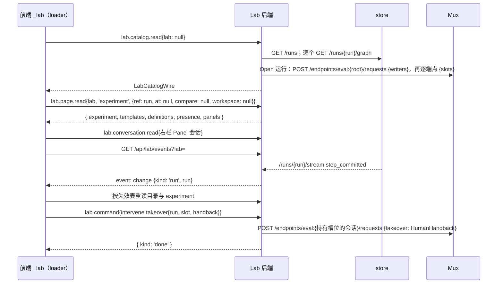

# D12 Pepgent Lab 公开线契约（D7-17、D7-18 的补全）

起草：LabWireClone（Claude 族，leader 01a195a6 的分身，依据 U21）。评审输入：argon 意图基线 `evidence/argon/D12-intent.md`（红线 V-1 至 V-6）；讨论者 D12Steady、D12Divergent（各两轮）；逐叶子覆盖审计 `evidence/decisions/D12-coverage.md`（task:mid，对第一稿找出 51 条来源缺口）。本表补全 D7 接口草图中未写完的公开线契约，并对 D5 §3.6、D7-05、D7-10、D7-11、D7-18 与 PR39 做有限修订；修订处逐条写在“通过后要改的文档与代码”。权限与身份口径与已通过的 D11-A 一致：D11-49（讨论写权限）、D11-29A/B（审批范围与“自己的实验”）、D11-30（不开放自助建 Lab）、D11-47C（每个事实只由一处携带）。

依据缩写（行号均为当前工作树）：

| 缩写 | 文件 |
| --- | --- |
| D3…D10 | `pepgent-pm/evidence/decisions/D3-network-mux.md` … `D10-repo-delivery.md` |
| web/… | `Pepgent/Pepgent` `origin/main`（16fe1f2）的 `apps/web/src/…` |
| PR39 | [Pepgent/Pepgent#39](https://github.com/Pepgent/Pepgent/pull/39)（LAB-10，未合并）`protocol/lab/library.ts` |
| contract | `Pepgent/soroi` `packages/store/src/contract.ts`（D10-10 后归仓 A） |
| remote/… | `Pepgent/remote` 的 `src/…` |
| mux | `Pepgent/omp-rpc-mux` 的 `README.md` |
| rpc.md | `omp://rpc.md` |
| B21 | eng-web 的阻塞上报 [Pepgent#21 评论 6554819439](https://github.com/Pepgent/Pepgent/issues/21#issuecomment-6554819439) |
| COV | `evidence/decisions/D12-coverage.md` 的缺口编号 G01–G51 |

## 框架

**要回答的问题（B21 ①–④）。** D7 的接口草图（D7:110-222）定义了 `LabBridge` 的方法签名、`LabPage` 的 13 个值、`LabChange`、3 个页面的线数据和大部分命令，但 `LabCatalogWire`、`LabPageParams` 被引用而未定义（D7:118-119）；其余十页是“其余页面同理”（D7:141-148）；`project.*`、`repo.*` 的载荷是 `/* … */`、`LabCommandResult` 未定义（D7:121、177-180）；外部类型在 Lab 仓里从哪里来没有写（B21 ④）。D10-08 规定 wire schema、持久化格式、ADT variant 和权限矩阵回领导小组投票。LAB 后端（eng-lab3）与 WEB 投影（eng-web）是同仓两个 owner（D10-09），这份契约是他们之间的接缝。

**不变的前提（D7 已定）。** 线上只放权威方自己的形状，服务端不拼文案、不算布局；投影是客户端纯函数，把线数据投影成现有 `*Fixture` 视图类型（D7-17）。一个读目录、一个读页面、一个命令联合；SSE 推送变更通知，浏览器重读（D7-18）。18 个 `LabSnapshot` 字段各自的权威源（D7:87-106）。前端只经 Lab 后端（D2-18）。

**argon 基线（(U) 依据见基线原文）。** 13 页与全部命令必须完整定义（V-1）；无来源字段不出线或为 `null`，D9 判为 `U`，不得造数（V-2）；前端视图契约保留（V-3）；harness 只有 `'omp'`（V-4）；草稿与 dry run 不进 store、无重放（V-5）；guest 只读、student 启动经审批（V-6）。

**覆盖审计的处理原则。** 对第一稿的 51 条缺口：有权威源而本页没带的，补进线数据；权威方已有、只缺字段的，补字段并写明拥有方；D2–D7 没有任何权威源、且 F 流程走不到的，按 D8-16 的规则列入 D9 输入（见“第一版无来源字段”），投影留空，不造数。

## 决策表

| ID | what | where | how | 取舍 | 分类 | 缺失部分或设计补充? |
| --- | --- | --- | --- | --- | --- | --- |
| D12-01 | **外部形状的消费来源（B21 ④）** | `apps/web` 依赖；`src/protocol/lab/external/` | 有已发布产物的权威方，消费它的产物：store 以 git 依赖引用仓 A 的 `contract` 模块（与 D10-10 仓 B 同一做法，不钉版本，lockfile 记录实际 commit），`import type` 进 `protocol/lab`，Lab 的 store 客户端直接用其 zod schema；remote 由 `remote schema` 输出生成 TS（remote/model.rs:1-4 规定的消费方式）；omp 由 omp 发布的 `rpc-wire.schema.json` 生成（rpc.md:1726-1748）。没有已发布产物的，转录并在文件头写明来源：Mux 取 mux README，在途槽位取 D5 §3.6 加 D12-14。外部响应在 Lab 入口解析一次，浏览器在网络边界解析一次 | **选定：** 引用或生成，不手抄有产物的契约。第一稿的手抄版已经与实际契约不一致：contract 的 `GraphNode` 有 `capture` 字段和 `AbortedCall` 变体、`ComparisonPair` 有 `SameValue`（contract.ts:140-212）；remote 的 `ContentDigest` 带 `sha256:` 前缀（remote/model.rs:150-163）。**备选：** 全部转录：D10-10 已以“形成第二源头”否决复制契约（D10:22）。D10:63 不采纳 Lab 引用契约包的理由是“新的设计补充，不在本表”，本表就是该设计补充 | 串联 | 是：Lab 对仓 A 契约的依赖 |
| D12-02 | **线协议总则** | `src/protocol/lab/` 全部类型 | ① Lab 自有的 id 是不透明品牌字符串：`LabId` = Better Auth organization id，`MemberId` = member id，`UserId` = user id，其余为各表主键；store 拥有的 id、序号、哈希、时刻直接取 contract 推导的类型，不另加品牌；原型字面量联合按 D7-17 放宽。② 时刻是 ISO 8601 UTC 字符串（`Instant`）。③ 用户内容是语言中性 `string`，后端不发 `LabText`。④ Lab 行以 `*Wire` 出线，只含业务事实；worktree 路径、私钥路径、Better Auth 内部表、凭据不出线。⑤ 产物引用是属主限定串 `ArtifactRef = store:<sha256> \| discussion:<DiscussionArtifactId>`，与原型 `${string}:${string}` 同形；讨论产物行的 id 只能是 `discussion:` 一支。⑥ 无参页面的参数是精确空对象：类型 `NoParams = Record<string, never>`，运行时 schema `z.object({}).strict()`，带任何字段（例如旧的 `{tab}`）都被拒绝。⑦ `LabBridge` 返回解包后的成功值；server function 外层仍是 `OperationResult`，失败抛 `OperationFailure`（web/client/api/call.ts） | **选定：** 一个属主限定引用让 `lab_open_artifact`、`discussion.load`、数据集页对两类产物一视同仁（D7-05、D7-07）；外部 id 沿用权威方类型，投影不需要类型断言（D12Divergent）。**备选：** 两个 id 字段分开：每个引用处都要成对出现。**备选：** `Record<never, never>`：多余字段可以通过（导师反例） | 技术 | 否 |
| D12-03 | **RPC 面** | `src/rpc/lab.ts` | 六个 server function（POST，经 `runLabOperation`）：`lab.catalog.read{lab: LabId \| null}`（`null` 取当前用户的第一个 Lab）；`lab.page.read{lab, page, params}`；`lab.command{command}`；`lab.conversation.read{conversation}` → `ConversationDetailWire`；`lab.conversation.models{conversation}` → `ConversationModelsWire`（对该会话自己那一代发 `get_available_models` 与 `get_state`，停驻时按 D7-15 先开新的一代）；`lab.conversation.markRead{conversation}`（D12-12）。PR39 的 `lab.library.read` 并入 `lab.page.read('nodes')`，`lab.library.command` 并入 `lab.command`。相对 PR39 的形状改动：`LibraryConversationDraft`、`NodeVersionDisplay` 去掉 `unavailable` 变体，`LibraryCommit` 去掉 `cache` 结果（主路径）；`staged` 加 `definition` 与 `reason`；usage 改为页面读取时对每个定义预取 | **选定：** 维持 D7-18 的一个读目录、一个读页面、一个命令联合；会话是独立的读取单位（讨论页与各页右栏共用），按会话读消息和模型。**备选：** 认可 PR39 的每域一对函数：契约分散，D7-18 已否决（D7:78）。**备选：** 各页内嵌右栏会话的消息：读一页要对每个 Panel 会话取 transcript，且每条消息都使整页重读（D12Divergent） | 技术 | 是：D7-15 的读路径与会话读取 |
| D12-04 | **`LabCatalogWire`（B21 ①）** | `lab.catalog.read`；壳层 loader | 目录含：当前用户所属的全部 Lab，每个带 `openRuns`（该 Lab 处于 `Open` 的运行，`experiment_ext.lab_id` 连 store `GET /runs?state=Open`）；选中 Lab 的账户与 `grants`；成员；项目（含创建者）；实验；讨论。**实验** = 该 Lab 每条 `experiment_ext` 对应的运行，加上未绑定运行的草稿；每个 `ExperimentWire` 带 `ext`、store 运行行、该运行最新提交的 `RunGraph`、在途槽位（根端点 `writers` 后逐端点 `slots`）、草稿与 `pending_launch`，以及 Lab 由“运行的根 session → `conversation`”连接得到的 `conversation` 与 `owner`。**讨论** = 该 Lab 全部 `Discussion` 会话的 `DiscussionHeaderWire`，按创建时刻降序：会话、`originated/bound` 运行、结论 id。随消息变化的最后一条消息与当前成员的已读时刻不在目录，见 D12-08。**目录与页面、会话读取不重复携带同一条记录**（与 D11-47C“每个事实只由一处携带”同一原则）：页面只带目录没有的事实。投影口径：实验列表的 `progress`、`where`、`now`、`updated`、`needs_you` 从图与槽位算（D7:93）；`progress.total` 无来源；项目的项数 = 该项目的实验数 + 讨论数 | **选定：** 跨页共用的实验与讨论只在目录出现一次，目录只随稳定事实失效；按 D7 已通过的读法带全图（D7:93）。**备选：** 目录只带 `GET /runs` 行，图按页取：首页、列表、设置页的摘要列都缺来源。**备选：** 讨论头连同最后一条消息放在目录：每条消息结束都使目录整份重读（D12Divergent） | 串联 | 否 |
| D12-05 | **`LabPageParams`（B21 ②）** | `lab.page.read` | `NoParams`：`home`、`automation`、`datasets`、`discussions`、`clusters`、`connectCluster`、`containers`、`settings`。`experiments`：`{ from: Instant; until: Instant }`（泳道时间窗）。`experiment`：`{ ref: run \| draft; at: Seq \| null; compare: RunId \| null; workspace: { step; position } \| null }`——回看 `GET /runs/{run}/graph?at=`、对比 `GET /compare`、Runner Workspace `GET /volumes/{run}/{step}/{position}`。`flowEditor`：`{ draft }`。`discussion`：`{ conversation }`。`nodes`：`{ version: Version \| null }`。`settings` 一次返回四个标签（覆盖 D7:106 的 `{tab}`：标签栏同时显示四类计数，且目录已带成员、项目、讨论） | **选定：** 参数只放路由与页面上的显式选择；聚焦项目、选中行仍是页面状态（D7-16）。**备选：** `settings{tab}`：另需一份跨标签计数摘要 | 技术 | 是：修订 D7:106 |
| D12-06 | **实验类页面：`experiments`、`experiment`、`flowEditor`** | `LabPageWire` | `experiments`：`{ templates, panels }`，运行与草稿取自目录；实际时段取目录图中调用的 `startedAt/endedAt` 与槽位的 `startedAt`（D12-14），按调用的模板经 `templates` 的设备（P3）归泳道；计划时段取草稿节点估时（缺省用节点定义的 `estimateMinutes`）；冲突由投影算出（D7:96）。`experiment`：`{ rewind, comparison, workspace, templates, definitions, presence, panels }`，实验本身取自目录（`ref` 对应的 `ExperimentWire`）；`rewind` 是 `at` 非空时 `GET /runs/{run}/graph?at=` 的回看图；“派生自”取 `graph.derivedFrom`；`definitions` 给节点参数默认值；`presence` 只来自 Mux，槽位在目录的 `slots`。`flowEditor`：`{ palette, templates, panels }`，草稿取自目录，`palette` 是库默认分支的定义，可用性从目录运行与模板算出（D7:98）。**草稿编码 `DraftCanvas` 只存语义：** 节点（函数、参数覆盖、上游、所属分组 `arm`、估时、来源 plan/AI 建议）、阶段名；列由拓扑深度、泳道由 `arm` 与模板设备在客户端算出。草稿只在 `lab.sqlite`，不进 store（D6-12） | **选定：** 编辑器的位置由依赖关系与分组决定，后端不存坐标（D7-17；argon 基线 2 禁止坐标出线）。**备选：** 存 `column`、`lane`：后端持有布局坐标 | 串联 | 是：`DraftCanvas` 编码此前未定义（web/server/lab/schema.ts:82） |
| D12-07 | **节点库与自动化页：`nodes`、`automation`** | `LabPageWire`；PR39；`automation_rule`、`automation_run` | `nodes`：`{ library, usage, draftReferences, templates, version, panels }`。`library` 是 PR39 的 `LibrarySnapshot`（按 D12-03 修改）；`staged[]` 带服务端从暂存源码导出的 `definition` 与暂存理由 `reason`；`usage` 是对每个定义调 `GET /functions/{name}/usage` 的结果；`draftReferences` 由 LAB-11b 并入（D10-11(a)）。`automation`：`{ rules, runs, panels }`，结构见 D12-09 | **选定：** 节点库线数据沿用 PR39 已实现的形状，只改主路径之外的变体。**备选：** 浏览器解析暂存源码：要把 TS AST 导出搬进前端包 | 串联 | 否 |
| D12-08 | **讨论、数据集、算力、容器、设置、首页** | `LabPageWire` | `discussions`：`{ activity, selected }`，`activity` 是各讨论的最后一条消息（时刻、角色、正文，停驻会话按 P2 读取）与当前成员的已读时刻，`selected` 是要打开的讨论 id：目录讨论列表第一条（创建时刻最新者），没有讨论时为 `null`；`discussion`：`{ activity, selected }`，`selected` 是参数指定的讨论。**讨论正文只经 `lab.conversation.read` 读取**，页面不内嵌：讨论页 loader 读页面后按 `selected` 读会话详情，右栏 Panel 同样按会话读。`ConversationDetailWire` 是任一根会话的详情：消息（omp `get_messages`，停驻按 P2 不唤醒）、附件、结论、装载上下文、该会话的讨论产物、根会话 `human_irc_queue` 中未投递的人类消息；会话头、运行关系、`pending_launch` 在目录，不重复。`datasets`：`{ artifacts, contexts, references, objectSizes, valueRuns, volumes, templates, panels }`，store 产出取目录图中的 `file` 值及节点、环境、运行来历，`volumes` 是各已结束远程调用的卷清单，`valueRuns` 是 `GET /values/{hash}/runs`。`clusters`：`{ templates, jobs, presence, panels }`（D7 原形）。`connectCluster`：`{ templates }`，只读。`containers`：`{ images, templates, jobs, definitions, panels }`，`images` 按 P15 从 images 检出导出（含文本文件内容），`definitions` 用于统计绑定节点数；**Komodo 构建记录与镜像仓库标签按 D8-16 不进第一版**。`settings`：`{ members, roles, invitations, repos, repoActivity, library, agentTemplates, ompVersion, discussionActivity, panels }`。`home`：`{ reports, activity, milestones, templates, jobs, discussionActivity, panels }`。各页 `panels` 是当前用户在本页的 Panel 会话头 | **选定：** 每页只放 D7 字段表（D7:87-106）列出的权威源，跨页数据在目录；会话正文只有一个读取位置（D12-03、D11-47C）；随消息变化的事实只在页面，由 `conversation` 频道失效。**备选：** 页面内嵌选中讨论的详情：同一会话详情有两个公开读取位置（导师反例） | 串联 | 否 |
| D12-09 | **自动化规则的结构与运行事实** | `automation_rule`、`automation_run`；LAB-09；D7-10 | 规则：`{ name, enabled, scope, trigger, when, conditions, then, creator }`。`trigger` 是 `event{run_started \| run_ended \| run_aborted} \| schedule{cron}`；仪器触发（P8）按 D8-16 不进第一版，列入 D9，公开类型不含该变体。`when`、`conditions`、`then` 是作者写的步骤 `{ text, detail, actor }`，`actor` 为 `automatic`、`agent{template}`（Lab 库 `.omp/agents` 的定义名）或 `approval`。触发后，Lab 按 D7-10：`then` 含 `approval` 步时运行停在 `waiting`，`action` 是用步骤与触发事实填好的 prompt 文本；批准后开 `Automation` 会话。**该会话与其他 Lab 会话一样是装着 soroi 定制的 Main 根会话（D7-04）**；规则步骤与触发事实一起写进它的 prompt：`conditions` 由它判断，`agent{template}` 步由它用该模板派出子 agent（D5-17）。`automation.dismiss` 把 `waiting` 变为 `skipped`。运行：`trigger` 事实 `event{run, event, at} \| schedule{at} \| manual{by, at}`，结束时刻 `endedAt`，会话经 `conversation.automation_run_id` 连接得到。批准权限按 D11-29A：`approval:any` 可批任意运行；`approval:ownExperiments` 只可批事件触发、且触发运行的 `owner` 是本人的运行（与 D11-29B 同一口径） | **选定：** 条件交给 Main 判断，不另造条件语言；步骤是用户内容，原型的步骤、执行者名称都有来源（COV G51）。**备选：** 用模板直接作为根会话：不再是 Main，失去 `soroi_eval` 与 Lab host tools（D12Divergent）。**备选：** 审批放进会话、在条件判断之后：要新增 host tool 并改 D7-10 的状态顺序；本表审批人看到的是已填好触发事实的 prompt。**备选：** 公开类型保留 `instrument`：把 D8-16 排除的能力重新引入契约（导师反例） | 串联 | 是：规则结构此前只有原型 |
| D12-10 | **命令联合与结果（B21 ③）** | `src/protocol/lab/command.ts`；`lab.command` | 完整联合、逐 `kind` 的结果映射与逐 `kind` 的权限表见“命令与结果”一节，补全 D7:177-180。**结果语义：** `LabCommandResult<C> = LabCommandOutput[C['kind']]`，每个 `kind` 显式写出，不设兜底映射；结果表示拥有方已经受理并记下这一改动，不是后续执行的结果。`discussion.create` 在 `conversation` 行写入后返回其 id，根会话在第一条 prompt 时按 D7-04 启动；`discussion.prompt`、`panel.prompt` 在消息进入 `human_irc_queue` 后返回，投递与回复经 `conversation` 频道到达；`intervene.*`、`run.abort` 返回拥有方端点的受理结论（D7-09）。**智能体模板按 D7-11 编辑：** 文件改动写进设置页 agents 标签 Panel 会话的 worktree（`agentTemplate.writeFile`、`agentTemplate.removeFile`），模板的“草稿”就是该会话相对默认分支的未合入改动；`agentTemplate.saveVersion{conversation, id}` 即对 `.omp/agents/<id>` 路径的一次 `library.merge`（D7:71）；PR39 的合入路径由 `nodes/*.ts` 放宽到也含 `.omp/agents/**`。**Lab 由部署种子创建，没有 `lab.create`**（D11-30 不开放自助建 Lab）。**权限（Better Auth 判定，与 D11-49、D11-29A 一致）：** 新增语句 `lab: write`，授予 owner、researcher、student，不授予 guest；每个 `kind` 恰有一条权限规则（见权限表）：`discussion.create`、`discussion.prompt` 按 D11-49 的 `discussion: [create, prompt]`；`lab.update` 要 Better Auth 的 `organization: update`；`member.*` 要 `manageMembers`；`library.*`、`agentTemplate.*`、`repo.*` 要 `editLibrary`（D10-12）；`experiment.approve`、`automation.approve` 按 D11-29A 的 `approval`；其余要 `write`。会话类写入另要求操作者是该会话的 `owner`（D11-49 的口径）。`project.*` 只要求 `write`：argon 裁定与用户原意不冲突。报告由 `lab_publish_report` 写入，GUI 无报告写命令（原型 `report` 对话框只读，web/client/contracts/lab-home.ts:16）。第一版不含：`image.build`、`template.bind`（D8-16 的 Komodo 构建与模板写入）、`cluster.connect`、`sandbox.create`、`job.restart`、`job.destroy`、shell、预构建检查 | **选定：** guest 只读由 Better Auth 语句表达（V-6），会话写入限所有者（一人一会话）。**备选：** “成员即可写”：guest 能写，违反 V-6。**备选：** 浏览器提交模板整份文件集：D7-11 第 2 轮已否决，会冲掉别的会话已合入的改动 | 串联 | 是：D7:177-180 的省略部分；权限语句 `write` |
| D12-11 | **GUI 介入的交回** | `intervene.takeover`、`intervene.answer`；D5 §3.6 | 命令带 `GuiHandback = { fields: Record<string, GuiReturned> }`，`GuiReturned` 为数值、字符串、布尔或 `file{artifact: ArtifactRef}`。Lab 把它转成 D5 的 `HumanHandback{slot, by: 当前 UserId, fields: Record<string, Returned>}` 发给持有槽位的会话端点；文件值按 P16 落到该会话可读的路径。store 的 `Handback` 由 eval 插件在提交时生成，不出现在 GUI 线上 | **选定：** 每层用拥有方的形状：GUI 输入、端点请求（D5）、store 提交（D6）。**备选：** GUI 直接发 store `Handback`：越过 eval 插件这一拥有方 | 串联 | 否 |
| D12-12 | **讨论已读** | 新表 `conversation_read{conversation, member, readAt}`；`lab.conversation.markRead{conversation}` | 未读是当前查看成员自己的状态：成员打开一个讨论时，前端调 `lab.conversation.markRead`，Lab 记下该成员读到的时刻。它不是 `LabCommand`，只要求有效会话与目标 Lab 的成员身份，**guest 也可调用**：它只记录调用者本人的阅读位置，不改变任何共享的 Lab 事实。`discussions`、`discussion`、首页与设置页的 `activity` 带当前成员的 `readAt` 与最后一条消息时刻，未读由投影比较 | **选定：** 按成员记已读，任何能读讨论的成员（含 guest）都有自己的未读状态。argon 依 (U)（`01a18e1f #e818d410`、`#e3692177`；`01a192a2 #ed4570ad`）裁定：个人阅读位置不属于 V-6 禁止的领域写入（`evidence/votes/D12-argon.md`）。**备选：** guest 不持久化已读：guest 的未读没有来源（导师提议）。**备选：** 只记所有者的已读：其他成员看到的是所有者的状态（D12Steady）。**备选：** 浏览器本地存储：换设备即丢失，不是权威事实 | 串联 | 是：原型字段此前无权威源 |
| D12-13 | **字节与上传面** | `src/app/routes/api/lab/*` | 各路由的方法、参数、请求体、响应与媒体类型见“HTTP 路由”一节（下文）。要点：`GET /api/lab/objects/{sha}`、`GET /api/lab/artifacts/{id}` 不变（D7-18）；**`artifact.upload` 改为 `POST /api/lab/conversations/{conversation}/artifacts?name=&role=`**，请求体是原始字节，返回 `ArtifactMetaWire`，其 `id` 就是之后在 `GuiHandback`、`discussion.load` 中使用的 `ArtifactRef`；新增 Mux 文件代理两条（列目录、读文件，D3:89-90）与 store 卷文件代理一条（D6:152），都只读。认证同 D7-18 | **选定：** 字节走 HTTP，命令联合只带结构化数据。**备选：** D7 原写的 `artifact.upload{bytes: Blob}`：JSON 载荷不适合大文件 | 技术 | 是：files 与 Runner Workspace 的浏览器入口 |
| D12-14 | **在途槽位补起始时刻、版本与输入（修订 D5 §3.6）** | omp-soroi eval 插件的控制端点 `slots`；仓 B | `SlotState.running` 与 `SlotState.awaiting_human` 都增加 `startedAt: Instant`、`version: Version`（该调用实际使用的节点版本）；`running` 另增加 `inputs: AtomName[]`（`awaiting_human` 已有 `inputs`）。插件在调用开始时已知这些事实。投影按 `version` 关联节点定义，不用当前库默认分支代替 | **选定：** 在途节点的时段、版本与参数只有插件知道（COV G11、G49）。**备选：** 投影用当前库定义：调用期间库可能已前进，把当前状态冒充执行事实 | 串联 | 是：D5 §3.6 补字段 |
| D12-15 | **节点定义的分组与默认估时** | lab-library 编写约定；PR39 的 TS AST 导出（D10-11(c)） | 每个节点在 JSDoc 必须写 `@group dev \| char \| calc` 与 `@estimateMinutes <非负整数>`；导出为 `NodeDefinition.group: NodeGroup`、`estimateMinutes: number`，`NodeGroup = 'dev' \| 'char' \| 'calc'` 与前端视图契约同一枚举（web/client/contracts/lab-experiments.ts:8）。与 D10-11(c) 同为静态读取，不执行节点代码；导出只针对按约定编写的节点（主路径）。lab-library README 写明这一约定 | **选定：** 节点的业务元数据随节点源码，权威在库（D7-11），必填使前端必填字段有来源。**备选：** 可选字段：前端只能造默认值（D12Steady）。**备选：** Lab 表存一份节点元数据：与库源码各自变化 | 串联 | 是：COV G14、G15 |
| D12-16 | **Lab host tools 与 Lab 表的字段补充（修订 D7-05、D7-02）** | `src/server/lab/tools.ts`；`schema.ts` | `lab_publish_report` 输入加 `project`、`tags: string[]`、`sources: ArtifactRef[]`，`body` 是 Markdown（`$$…$$` 公式，`\tag{}` 编号；图写作 ``）；Lab 发布时从该会话 `get_state` 记下模型。`lab_save_artifact` 输入加 `sources: ArtifactRef[]`（这份产物依据了哪些产物）。`lab_propose_changes` 输入加 `assignments: { item: discussion \| experiment; project; reason }[]`。表的补列：`report.project_id/tags/sources/model`、`artifact_meta.created_at/sources`（名称与大小取自快照文件本身）、`conclusion.created_at`、`draft.updated_at`、`project.created_by`、`conversation.created_at`、新表 `conversation_read`（D12-12）、`library_repo.description`、`library_staging.reason`、`automation_rule.created_by` 与步骤 JSON、`automation_run.ended_at`；`discussion_context.artifact_id` 存 `ArtifactRef`，去掉指向 `artifact_meta` 的外键 | **选定：** 这些都是 Lab 或 agent 产生时就知道的事实，在写入处记下（COV G05–G09、G16、G19、G21、G37、G38、G46、G48）。**备选：** 从正文或文件名猜：投影不确定 | 串联 | 是 |
| D12-17 | **事件与流的帧形** | `GET /api/lab/events?lab=`、`/api/lab/agents/{id}/stream`、`/api/lab/jobs/{run}/tail` | `events`：每帧 `event: change`，`data` 是一个 `LabChange`（D7:130-132 的联合，原样列在“事件”一节：`catalog`、`run{run}`、`conversation{id}`、`automation`、`library`、`compute`）；`conversation` 频道只在一条消息结束（`message_end`）和 Lab 侧事实变化时发出，流式文字走 `watchAgent`。**Panel 会话头属于各页的 `panels`：** Panel 会话由 `panel.prompt` 新建，发起命令的页面在命令返回后让自己的 loader 失效；Panel 会话改变时 Lab 发 `conversation{id}`，`panels` 含该 id 的页面重读。`agents/{id}/stream`：每帧 `data` 是 `AgentStreamFrame`（`{kind: 'omp_line', line}` 或 `{kind: 'mux', frame}`），`line` 是原样的 omp JSONL 文本。`jobs/{run}/tail`：每帧 `{ observedAt, text }`，`text` 是 `remote tail` 的整段快照，`observedAt` 是 Lab 取到它的时刻。频道到读取的失效表见下文 | **选定：** 通知只说“哪个切片变了”（D7-08）；帧外层统一包装，字符串行与 Mux 控制帧在 SSE 文本上无歧义。**备选：** 每个读方帧都发 `conversation`：每个 token 使整页重读。**备选：** 给 Panel 头另设频道：改 D7 的 `LabChange` 联合 | 技术 | 否 |

## 类型定义

文件布局：`src/protocol/lab/external/`（D12-01）、`ids.ts`、`rows.ts`、`catalog.ts`、`pages.ts`、`command.ts`、`events.ts`，每个类型同时导出 zod schema。外部类型名以权威方产物中的导出名为准。

### 外部类型（D12-01）

```ts
// ---- external/store.ts：import type 自仓 A 的 contract 模块（contract.ts） ----
export type {
  Value, Capture, NodeVersionRecord, RunState, CallStatus, GraphNode, GraphEdge, RunGraph, RunSummary,
  FunctionVersionUsage, ComparisonPair, RunComparison, VolumeManifest, ValueUsage, Activity,
} from 'pepgent-store/contract'
export type RunId = RunSummary['run']                           // store 拥有的 id 与时刻直接取 contract 推导的类型，不另加品牌
export type SessionId = RunSummary['holder']
export type Seq = RunGraph['at']
export type Hash = NodeVersionRecord['version']                 // 64 位小写 hex
export type AtomName = string
export type FnName = string
export type Version = Hash
export type FunctionUsage = FunctionVersionUsage[]              // GET /functions/{name}/usage（contract FunctionUsageSchema）
export type Change = Extract<RunGraph['derivedFrom'], object>['changes'][number]   // contract ChangeSchema 推导的类型
export type Committed = { kind: 'Committed'; step: Seq; position: number }

// ---- external/remote.ts：由 `remote schema` 生成（remote/model.rs） ----
// 生成产物中 Lab 用到的：TemplateName、BackendKind、TemplateInfo、Lifecycle、RunSummary（此处导出名为 RemoteRunSummary）、RunStatus

// ---- external/omp.ts：由 omp 的 rpc-wire.schema.json 生成（rpc.md:1726-1748） ----
// 生成产物中 Lab 用到的：AgentMessage（导出名 OmpMessage）、Model（导出名 OmpModel）

// ---- external/mux.ts：转录自 mux README（与 D3 §4 一致） ----
export type AgentId = string & { readonly __brand: 'AgentId' }
export type Generation = string
export type Where = { kind: 'local'; host: string } | { kind: 'remote'; runId: string }
export type OmpLine = string
export type Presence = { agentId: AgentId; since: Instant; generation: { id: Generation; where: Where; since: Instant } | null }
export type FileEntry = { path: string; bytes: number; kind: 'file' | 'dir' }
export type MuxReaderFrame =                                   // ReaderDown 中除 OmpLine 外的帧
  | { type: 'mux_welcome'; prefix: string; generation: Generation | null }
  | { type: 'mux_generation_started'; generation: Generation; where: Where }
  | { type: 'mux_generation_exited'; generation: Generation; code: number }

// ---- external/eval.ts：转录自 D5 §3.6（D5-plugins-eval.md:112-125、294-313），加 D12-14 ----
export type SlotId = string
export type FieldKind = 'number' | 'string' | 'boolean' | 'file'
export type Shape = { kind: 'single'; type: FieldKind } | { kind: 'record'; fields: Record<string, FieldKind> }
export type SlotState =
  | { kind: 'running'; body: 'Program' | 'Agent'; env: TemplateName | 'central'; agentId?: AgentId; remoteRun?: string
      startedAt: Instant; version: Version; inputs: AtomName[] }            // D12-14
  | { kind: 'awaiting_human'; request: string; inputs: AtomName[]; shape: Shape; startedAt: Instant; version: Version }   // D12-14
```

### id 与 Lab 行（D12-02、D12-16）

```ts
// ---- ids.ts ----
export type Instant = string                                             // ISO 8601 UTC；与 contract 的时刻同为 string
export type NoParams = Record<string, never>                             // 运行时 z.object({}).strict()：精确空对象
export type LabId = string & { readonly __brand: 'LabId' }               // Better Auth organization.id
export type UserId = string & { readonly __brand: 'UserId' }             // Better Auth user.id
export type MemberId = string & { readonly __brand: 'MemberId' }         // Better Auth member.id
export type ProjectId = string & { readonly __brand: 'ProjectId' }
export type ConversationId = string & { readonly __brand: 'ConversationId' }
export type DraftId = string & { readonly __brand: 'DraftId' }
export type ConclusionId = string & { readonly __brand: 'ConclusionId' }
export type AutomationRuleId = string & { readonly __brand: 'AutomationRuleId' }
export type AutomationRunId = string & { readonly __brand: 'AutomationRunId' }
export type ReportId = string & { readonly __brand: 'ReportId' }
export type MilestoneId = string & { readonly __brand: 'MilestoneId' }
export type InvitationId = string & { readonly __brand: 'InvitationId' }
export type LibraryRepoId = string & { readonly __brand: 'LibraryRepoId' }
export type DiscussionArtifactId = string & { readonly __brand: 'DiscussionArtifactId' }   // artifact_meta.id
export type StoreArtifactRef = `store:${string}`                         // store:<Hash>
export type DiscussionArtifactRef = `discussion:${string}`               // discussion:<DiscussionArtifactId>
export type ArtifactRef = StoreArtifactRef | DiscussionArtifactRef

// ---- rows.ts ----
export type LabRole = 'owner' | 'researcher' | 'student' | 'guest'
export type LabGlyph = 'robot' | 'flask' | 'puzzle'
export type AvatarTone = 'ink' | 'teal' | 'orange' | 'blue'
export type LabGrants = {                                                // Better Auth 判定的结果（D7-03、D10-12、D11-29A、D11-49、D12-10）
  write: boolean; discussion: { create: boolean; prompt: boolean }
  startWithoutApproval: boolean; approve: 'any' | 'own_experiments' | 'none'
  buildImages: boolean; manageMembers: boolean; editLibrary: boolean; updateLab: boolean   // updateLab = organization:update
}
export type LabWire = { id: LabId; name: string; glyph: LabGlyph | null; description: string | null; openRuns: RunId[] }
export type MemberWire = {
  id: MemberId; user: UserId; name: string; email: string; role: LabRole
  profile: { avatarTone: AvatarTone | null; initials: string | null; description: string | null
             mainProject: ProjectId | null; gpuHoursQuota: number | null }
}
export type AccountWire = { user: UserId; name: string; email: string; member: MemberId; role: LabRole; grants: LabGrants }
export type ProjectWire = { id: ProjectId; lab: LabId; name: string; description: string | null; archived: boolean; createdBy: MemberId }
export type ConversationOrigin =                                         // D7:188-191
  | { kind: 'Discussion'; name: string; project: ProjectId | null; archived: boolean }
  | { kind: 'Panel'; page: LabPage; scope: string }
  | { kind: 'Automation'; rule: AutomationRuleId; automationRun: AutomationRunId }
export type ConversationWire = { id: ConversationId; lab: LabId; owner: MemberId; origin: ConversationOrigin
                                 agent: AgentId | null; session: SessionId | null; createdAt: Instant }
export type DraftWire = { id: DraftId; lab: LabId; project: ProjectId | null
                          origin: { discussion: ConversationId; retroRun: RunId | null }
                          canvas: DraftCanvas; savedVersion: number; updatedAt: Instant }
export type PendingLaunchWire = { conversation: ConversationId; draft: DraftId; at: Instant; state: 'awaiting_approval' | 'sent' }
export type ExperimentExtWire = { run: RunId; number: string; name: string; project: ProjectId | null; draft: DraftId | null }
export type ArtifactRole = 'raw' | 'figure' | 'log' | 'verdict' | 'metadata' | 'report' | 'conclusion' | 'draft' | 'analysis' | 'todo'
export type ArtifactMetaWire = { id: DiscussionArtifactRef; conversation: ConversationId; hash: Hash; name: string
                                 size: number; source: string | null; role: ArtifactRole; sources: ArtifactRef[]; createdAt: Instant }
export type ChangeRow = { kind: 'add' | 'change' | 'remove'; text: string }
export type Assignment = { item: { kind: 'discussion'; conversation: ConversationId } | { kind: 'experiment'; run: RunId }
                           project: ProjectId; reason: string }
export type AttachmentWire = { id: string; conversation: ConversationId; toolCallId: string } & (
  | { kind: 'plan'; draft: DraftId; title: string; plan: { text: string; node: string }[] }
  | { kind: 'conclusion'; conclusion: ConclusionId }
  | { kind: 'references'; artifacts: ArtifactRef[] }
  | { kind: 'changes'; target: string; rows: ChangeRow[]; assignments: Assignment[] })
export type ConclusionWire = { id: ConclusionId; conversation: ConversationId; text: string; evidence: string
                               pendingRun: RunId | null; createdAt: Instant
                               confirmation: { kind: 'pending' } | { kind: 'confirmed'; at: Instant; by: MemberId } }
export type ReportWire = { id: ReportId; lab: LabId; conversation: ConversationId | null; project: ProjectId | null
                           title: string; body: string; figures: ArtifactRef[]; tags: string[]; sources: ArtifactRef[]
                           model: { provider: string; id: string } | null; createdAt: Instant }
export type ActivityWire = { id: string; lab: LabId; actor: MemberId | null; project: ProjectId | null
                             kind: string; text: string; at: Instant }  // 只记 Lab 自己产生的事件（D7-02）
export type MilestoneWire = { id: MilestoneId; lab: LabId; project: ProjectId | null; title: string
                              description: string | null; dueAt: Instant | null; completedAt: Instant | null }
export type InvitationWire = { id: InvitationId; email: string; role: LabRole; sentAt: Instant; inviter: MemberId }
export type LibraryRepoWire = { id: LibraryRepoId; remoteUrl: string; branch: string; description: string
                                publicKey: string | null; checkout: { head: string; sequence: number; fetchedAt: Instant; ahead: number } }
export type HumanIrcQueueWire = { msg: string; principal: UserId; body: string; queuedAt: Instant }
```

### 草稿编码（D12-06；`draft.canvas` 列存其 JSON）

```ts
export type DraftCanvas = {
  title: string
  description: string
  stages: { name: string }[]                  // 第 i 个名字标注拓扑深度为 i 的那一组节点
  nodes: DraftNode[]
}
export type DraftNode = {
  id: string                                  // 画布内唯一
  fn: FnName                                  // 节点库函数名
  from: string[]                              // 上游 DraftNode.id
  inputs: { parameter: string; expression: string }[]   // 覆盖的参数；值是 TS 表达式文本，与 NodeDefinition.parameters[].defaultValue 同一写法
  arm: string | null                          // 实验分组（如对照组），用户内容
  estimateMinutes: number | null              // 计划时长；只作估时，不是执行证据；缺省时投影取 NodeDefinition.estimateMinutes
  origin: 'plan' | 'ai_suggestion'
}
// lab_propose_experiment{title, plan} 建草稿：每个 plan 步一个节点，from = 前一步，arm = null，origin = 'plan'
```

### 节点库（PR39 按 D12-03、D12-15 修改）

```ts
export type NodeParameter = { name: string; type: string; optional: boolean; defaultValue: string | null }  // defaultValue 是 TS 表达式原文，不求值
export type NodeReturnField = { name: string; type: string }
export type NodeDefinition = {
  name: FnName; path: string; signature: string
  parameters: NodeParameter[]; returns: string; fields: NodeReturnField[]
  body: { kind: 'Program' | 'Agent' | 'Human'; source: string }
  defaultEnvironment: string | null; template: TemplateName | null
  documentation: string; source: string
  artifacts: { field: string; type: string }[]
  group: NodeGroup; estimateMinutes: number                           // D12-15，lab-library 约定必填
}
export type NodeGroup = 'dev' | 'char' | 'calc'                       // 与 web/client/contracts/lab-experiments.ts:8 同一枚举
export type LibrarySnapshot = {
  commit: string; sequence: number; nodes: NodeDefinition[]
  staged: { fn: FnName; changes: { base: string; source: string }; reason: string; definition: NodeDefinition }[]
  drafts: { conversation: ConversationId; paths: string[]; behind: number }[]   // 含 .omp/agents/** 的未合入改动
}
export type LibraryVersionDetails = { record: NodeVersionRecord; display: { kind: 'commit_sequence'; sequence: number } }
export type AgentTemplateWire = {                                     // D7-11：Lab 库 .omp/agents 的 omp agent 定义
  id: string; harness: 'omp'; description: string; models: string[]  // models 取自 frontmatter
  files: { path: string; contents: string }[]                         // 默认分支（中心检出）上的文件
  lastCommit: { commit: string; sequence: number; at: Instant }
  drafts: { conversation: ConversationId; paths: string[] }[]        // 各会话未合入的该模板文件改动
}
```

### 自动化（D12-09）

```ts
export type AutomationActor = { kind: 'automatic' } | { kind: 'agent'; template: string } | { kind: 'approval' }
export type AutomationStep = { text: string; detail: string; actor: AutomationActor }
export type AutomationTrigger =
  | { kind: 'event'; event: 'run_started' | 'run_ended' | 'run_aborted' }
  | { kind: 'schedule'; cron: string }
export type AutomationScope = { kind: 'lab' } | { kind: 'focused_project' } | { kind: 'project'; project: ProjectId }
export type AutomationRuleInput = { lab: LabId; name: string; enabled: boolean; scope: AutomationScope; trigger: AutomationTrigger
                                    when: AutomationStep[]; conditions: AutomationStep[]; then: AutomationStep[] }
export type AutomationRuleWire = AutomationRuleInput & { id: AutomationRuleId; creator: MemberId }
export type AutomationTriggerFact =
  | { kind: 'event'; run: RunId; event: 'run_started' | 'run_ended' | 'run_aborted'; at: Instant }
  | { kind: 'schedule'; at: Instant }
  | { kind: 'manual'; by: MemberId; at: Instant }
export type AutomationRunWire = { id: AutomationRunId; rule: AutomationRuleId; trigger: AutomationTriggerFact
                                  createdAt: Instant; endedAt: Instant | null; conversation: ConversationId | null
                                  state: { kind: 'waiting'; action: string } | { kind: 'running' } | { kind: 'ok' | 'failed' | 'skipped' } }
```

### 目录、会话与页面（D12-04 至 D12-08）

```ts
// ---- catalog.ts ----
export type SlotWire = { writerSession: SessionId; slot: SlotId; fn: FnName; state: SlotState }
export type ExperimentWire = {
  ext: ExperimentExtWire | null
  run: RunSummary | null
  graph: RunGraph | null                      // 最新提交
  slots: SlotWire[]                           // 只有 Open 运行有
  draft: DraftWire | null                     // 未绑定运行的草稿，或绑定运行的来源草稿
  pendingLaunch: PendingLaunchWire | null
  conversation: ConversationId                // 运行：根 session 对应的会话；草稿：origin.discussion
  owner: MemberId                             // 该会话的所有者
}
export type DiscussionHeaderWire = {           // 稳定事实，只随 catalog 频道失效
  conversation: ConversationWire              // origin.kind = 'Discussion'
  runs: { run: RunId; relation: 'originated' | 'bound' }[]
  conclusions: ConclusionId[]
}
export type DiscussionActivityWire = {         // 随消息变化，只在页面，随 conversation 频道失效
  conversation: ConversationId
  lastMessage: { at: Instant; role: 'user' | 'assistant'; text: string } | null
  readAt: Instant | null                      // 当前成员（D12-12）
}
export type LabCatalogWire = {
  labs: LabWire[]; lab: LabId; account: AccountWire
  members: MemberWire[]; projects: ProjectWire[]
  experiments: ExperimentWire[]; discussions: DiscussionHeaderWire[]   // discussions 按创建时刻降序
}

// ---- 会话详情：lab.conversation.read（讨论页与各页右栏共用）；会话头、运行关系、pending_launch 在目录或页面 panels，不重复 ----
export type ConversationDetailWire = {
  conversation: ConversationId
  messages: OmpMessage[]
  attachments: AttachmentWire[]
  conclusions: ConclusionWire[]
  context: ArtifactRef[]                      // discussion_context
  artifacts: ArtifactMetaWire[]               // 本会话的讨论产物
  ircQueue: HumanIrcQueueWire[]
}
export type ConversationModelsWire = { current: OmpModel; available: OmpModel[] }

// ---- pages.ts ----
export type LabPage = 'home' | 'experiments' | 'experiment' | 'flowEditor' | 'nodes' | 'automation' | 'datasets'
  | 'discussions' | 'discussion' | 'clusters' | 'connectCluster' | 'containers' | 'settings'
export type LabPageParams = {
  home: NoParams
  experiments: { from: Instant; until: Instant }
  experiment: { ref: { kind: 'run'; run: RunId } | { kind: 'draft'; draft: DraftId }; at: Seq | null
                compare: RunId | null; workspace: { step: Seq; position: number } | null }
  flowEditor: { draft: DraftId }
  nodes: { version: Version | null }
  automation: NoParams
  datasets: NoParams
  discussions: NoParams
  discussion: { conversation: ConversationId }
  clusters: NoParams
  connectCluster: NoParams
  containers: NoParams
  settings: NoParams
}
export type TemplateMetadata = {                                             // P3
  image: string; devices: string[]
  mounts: { path: string; access: 'rw' | 'ro' | 'device' }[]
  resources: { cpu: number; memoryGiB: number; gpu: number; diskGiB: number; maxRuntimeHours: number
               priority: 'low' | 'normal' | 'high'; boundClusters: string[]; primaryCluster: string | null
               selector: string | null; allowPreemptible: boolean; deviceAccess: boolean; outboundNetwork: boolean }
}
export type TemplateWire = TemplateInfo & { metadata: TemplateMetadata }
export type JobWire = { run: RemoteRunSummary; status: RunStatus }
export type ImageDefinition = {                                               // P15
  name: string; path: string; base: string
  dependencies: { name: string; version: string; kind: 'base' | 'sdk' | 'python_package' | 'internal_library' | 'files' | 'runtime_config' }[]
  files: { path: string; size: number; contents: string | null }[]           // contents：文本文件全文，二进制为 null
}
export type MemberStatusWire = { member: MemberId; grants: LabGrants; lastActiveAt: Instant | null; online: boolean
                                 gpuHoursUsed: number | null }               // P9：无来源时 null，D9 判为 U
export type VolumeWire = { run: RunId; step: Seq; position: number; manifest: VolumeManifest }

export type LabPageWire = {
  home: { reports: ReportWire[]; activity: ActivityWire[]; milestones: MilestoneWire[]
          templates: TemplateWire[]; jobs: JobWire[]; discussionActivity: DiscussionActivityWire[]; panels: ConversationWire[] }
  experiments: { templates: TemplateWire[]; panels: ConversationWire[] }          // 草稿与运行在目录
  experiment: { rewind: RunGraph | null; comparison: RunComparison | null; workspace: VolumeManifest | null
                templates: TemplateWire[]; definitions: NodeDefinition[]; presence: Presence[]; panels: ConversationWire[] }
  flowEditor: { palette: NodeDefinition[]; templates: TemplateWire[]; panels: ConversationWire[] }   // 草稿在目录
  nodes: { library: LibrarySnapshot; usage: { fn: FnName; versions: FunctionUsage }[]
           draftReferences: { draft: DraftId; fns: FnName[] }[]; templates: TemplateWire[]
           version: LibraryVersionDetails | null; panels: ConversationWire[] }
  automation: { rules: AutomationRuleWire[]; runs: AutomationRunWire[]; panels: ConversationWire[] }
  datasets: { artifacts: ArtifactMetaWire[]; contexts: { conversation: ConversationId; artifacts: ArtifactRef[] }[]
              references: AttachmentWire[]; objectSizes: { content: Hash; size: number }[]
              valueRuns: { content: Hash; runs: ValueUsage[] }[]; volumes: VolumeWire[]
              templates: TemplateWire[]; panels: ConversationWire[] }
  discussions: { activity: DiscussionActivityWire[]; selected: ConversationId | null }   // selected = 目录 discussions[0]；详情经 lab.conversation.read
  discussion: { activity: DiscussionActivityWire[]; selected: ConversationId }
  clusters: { templates: TemplateWire[]; jobs: JobWire[]; presence: Presence[]; panels: ConversationWire[] }
  connectCluster: { templates: TemplateWire[] }
  containers: { images: ImageDefinition[]; templates: TemplateWire[]; jobs: JobWire[]
                definitions: NodeDefinition[]; panels: ConversationWire[] }
  settings: { members: MemberStatusWire[]; roles: { role: LabRole; grants: LabGrants }[]; invitations: InvitationWire[]
              repos: LibraryRepoWire[]; repoActivity: ActivityWire[]
              library: { commit: string; sequence: number; nodes: FnName[] }
              agentTemplates: AgentTemplateWire[]; ompVersion: string                 // ompVersion：P18
              discussionActivity: DiscussionActivityWire[]; panels: ConversationWire[] }
}

// ---- 前端接缝（D7:117-123 补全）----
export interface LabBridge {
  readCatalog(lab: LabId | null): Promise<LabCatalogWire>
  readPage<P extends LabPage>(lab: LabId, page: P, params: LabPageParams[P]): Promise<LabPageWire[P]>
  readConversation(conversation: ConversationId): Promise<ConversationDetailWire>
  markRead(conversation: ConversationId): Promise<void>                                // lab.conversation.markRead（D12-12）
  readModels(conversation: ConversationId): Promise<ConversationModelsWire>
  send<C extends LabCommand>(command: C): Promise<LabCommandOutput[C['kind']]>
  uploadArtifact(conversation: ConversationId, name: string, role: ArtifactRole, bytes: Blob): Promise<ArtifactMetaWire>
  subscribe(lab: LabId, onChange: (change: LabChange) => void): () => void            // SSE /api/lab/events
  watchAgent(agent: AgentId, onFrame: (frame: AgentStreamFrame) => void): () => void   // SSE /api/lab/agents/{id}/stream
  watchJobTail(run: string, onTail: (tail: JobTailFrame) => void): () => void          // SSE /api/lab/jobs/{run}/tail
}
```

### 命令与结果（D12-10、D12-11）

```ts
// ---- command.ts ----
export type HumanIrcGuiOp =                                                             // D7:184-185
  | { op: 'enqueue'; msg: string; body: string } | { op: 'edit'; msg: string; body: string } | { op: 'withdraw'; msg: string }
export type DeriveAt = Committed | { kind: 'InFlight'; writerSession: SessionId; slot: SlotId }   // D7:181-183
export type GuiReturned =
  | { kind: 'number'; value: number } | { kind: 'string'; value: string } | { kind: 'boolean'; value: boolean }
  | { kind: 'file'; artifact: ArtifactRef }                                            // P16
export type GuiHandback = { fields: Record<string, GuiReturned> }                      // 单个输出用字段名 "value"（D5:130）

export type LabCommand =
  | { kind: 'lab.update'; lab: LabId; name: string; glyph: LabGlyph; description: string }
  | { kind: 'member.invite'; lab: LabId; email: string; role: LabRole }                // 重发即再次邀请同一邮箱
  | { kind: 'member.role'; member: MemberId; role: LabRole }
  | { kind: 'member.quota'; member: MemberId; gpuHours: number | null }                // null = 不限
  | { kind: 'member.remove'; member: MemberId }
  | { kind: 'project.create'; lab: LabId; name: string; description: string }
  | { kind: 'project.rename'; project: ProjectId; name: string }
  | { kind: 'project.merge'; project: ProjectId; into: ProjectId }
  | { kind: 'project.archive'; project: ProjectId }
  | { kind: 'repo.connect'; lab: LabId; remoteUrl: string; branch: string; description: string }
  | { kind: 'repo.sync'; repo: LibraryRepoId }
  | { kind: 'repo.rotate'; repo: LibraryRepoId }
  | { kind: 'repo.disconnect'; repo: LibraryRepoId }
  | { kind: 'agentTemplate.writeFile'; conversation: ConversationId; path: string; contents: string }   // 写进该 Panel 会话 worktree 的 .omp/agents/**
  | { kind: 'agentTemplate.removeFile'; conversation: ConversationId; path: string }
  | { kind: 'agentTemplate.saveVersion'; conversation: ConversationId; id: string }   // = library.merge 该模板的路径（D7:71）
  | { kind: 'discussion.create'; lab: LabId; project: ProjectId | null; name: string }
  | { kind: 'discussion.prompt'; conversation: ConversationId; msg: string; text: string }   // = 根会话 human_irc enqueue（D7-09）
  | { kind: 'discussion.load'; conversation: ConversationId; artifacts: ArtifactRef[] }
  | { kind: 'discussion.bind'; conversation: ConversationId; run: RunId }
  | { kind: 'discussion.rename'; conversation: ConversationId; name: string }
  | { kind: 'discussion.move'; conversation: ConversationId; project: ProjectId | null }
  | { kind: 'discussion.archive'; conversation: ConversationId }
  | { kind: 'conclusion.confirm'; conclusion: ConclusionId }
  | { kind: 'panel.prompt'; lab: LabId; panel: { page: LabPage; scope: string }; msg: string; text: string }
  | { kind: 'panel.model'; conversation: ConversationId; provider: string; modelId: string }   // 任一会话（D7-15）
  | { kind: 'human.irc'; to: AgentId; op: HumanIrcGuiOp }
  | { kind: 'draft.save'; draft: DraftId; canvas: DraftCanvas }
  | { kind: 'draft.discard'; draft: DraftId }
  | { kind: 'experiment.start'; draft: DraftId }
  | { kind: 'experiment.approve'; draft: DraftId }
  | { kind: 'experiment.update'; run: RunId; name: string; project: ProjectId | null }
  | { kind: 'intervene.takeover'; run: RunId; slot: SlotId; handback: GuiHandback }
  | { kind: 'intervene.answer'; run: RunId; slot: SlotId; handback: GuiHandback }
  | { kind: 'intervene.derive'; run: RunId; at: DeriveAt; changes: Change[] }
  | { kind: 'run.abort'; run: RunId }
  | { kind: 'library.stage'; lab: LabId; fn: FnName; changes: [{ kind: 'source'; source: string }]; reason: string }
  | { kind: 'library.apply'; lab: LabId; conversation: ConversationId; fns: FnName[] }
  | { kind: 'library.merge'; lab: LabId; conversation: ConversationId; paths: string[] }   // nodes/*.ts 或 .omp/agents/**
  | { kind: 'library.sync'; lab: LabId; conversation: ConversationId }
  | { kind: 'automation.rule.create'; rule: AutomationRuleInput }
  | { kind: 'automation.rule.update'; id: AutomationRuleId; rule: AutomationRuleInput }
  | { kind: 'automation.rule.delete'; id: AutomationRuleId }
  | { kind: 'automation.run'; rule: AutomationRuleId }
  | { kind: 'automation.approve'; run: AutomationRunId }
  | { kind: 'automation.dismiss'; run: AutomationRunId }
  | { kind: 'milestone.create'; lab: LabId; project: ProjectId | null; title: string; description: string; dueAt: Instant | null }
  | { kind: 'milestone.complete'; milestone: MilestoneId }

type Done = { kind: 'done' }
type LibraryCommit = { commit: string; paths: string[] }
export type LabCommandOutput = {
  'lab.update': Done
  'member.invite': { kind: 'invited'; invitation: InvitationId }
  'member.role': Done
  'member.quota': Done
  'member.remove': Done
  'project.create': { kind: 'created'; project: ProjectId }
  'project.rename': Done
  'project.merge': Done
  'project.archive': Done
  'repo.connect': { kind: 'connected'; repo: LibraryRepoId; publicKey: string }
  'repo.sync': { kind: 'synced'; head: string }
  'repo.rotate': { kind: 'rotated'; publicKey: string }
  'repo.disconnect': Done
  'agentTemplate.writeFile': Done
  'agentTemplate.removeFile': Done
  'agentTemplate.saveVersion': LibraryCommit & { kind: 'merged' }
  'discussion.create': { kind: 'created'; conversation: ConversationId }
  'discussion.prompt': Done
  'discussion.load': Done
  'discussion.bind': Done
  'discussion.rename': Done
  'discussion.move': Done
  'discussion.archive': Done
  'conclusion.confirm': Done
  'panel.prompt': { kind: 'prompted'; conversation: ConversationId }
  'panel.model': Done
  'human.irc': Done
  'draft.save': { kind: 'saved'; savedVersion: number }
  'draft.discard': Done
  'experiment.start': { kind: 'launch'; state: 'awaiting_approval' | 'sent' }
  'experiment.approve': Done
  'experiment.update': Done
  'intervene.takeover': Done
  'intervene.answer': Done
  'intervene.derive': { kind: 'derived'; run: RunId }
  'run.abort': Done
  'library.stage': { kind: 'staged'; fn: FnName }
  'library.apply': LibraryCommit & { kind: 'applied'; staging: 'cleared' | 'retained' }
  'library.merge': LibraryCommit & { kind: 'merged' }
  'library.sync': { kind: 'synced'; conversation: ConversationId }
  'automation.rule.create': { kind: 'created'; rule: AutomationRuleId }
  'automation.rule.update': Done
  'automation.rule.delete': Done
  'automation.run': { kind: 'started'; run: AutomationRunId }
  'automation.approve': Done
  'automation.dismiss': Done
  'milestone.create': { kind: 'created'; milestone: MilestoneId }
  'milestone.complete': Done
}
export type LabCommandResult<C extends LabCommand> = LabCommandOutput[C['kind']]       // D7:121 引用的结果类型
```

**逐命令权限**（Better Auth 判定角色语句；“owner”指该会话的 `conversation.owner` 等于操作者在目标 Lab 的 `member.id`，D11-49 口径；运行与草稿的会话见 `ExperimentWire.conversation`）

| `kind` | 权限 |
| --- | --- |
| `lab.update` | `organization: update` |
| `member.invite`、`member.role`、`member.quota`、`member.remove` | `manageMembers` |
| `project.create`、`project.rename`、`project.merge`、`project.archive` | `write` |
| `repo.connect`、`repo.sync`、`repo.rotate`、`repo.disconnect` | `editLibrary` |
| `agentTemplate.writeFile`、`agentTemplate.removeFile`、`agentTemplate.saveVersion` | `editLibrary`，且是该 Panel 会话的 owner |
| `discussion.create` | `discussion: create` |
| `discussion.prompt` | `discussion: prompt`，且是该讨论的 owner |
| `discussion.load`、`discussion.bind`、`discussion.rename`、`discussion.move`、`discussion.archive` | `write`，且是该讨论的 owner |
| `conclusion.confirm` | `write`，且是该结论所在会话的 owner |
| `panel.prompt` | `write`；Panel 会话不存在时以操作者为 owner 新建，存在时须是其 owner |
| `panel.model` | `write`，且是该会话的 owner |
| `human.irc` | `write`，且是该 agent 所属运行的会话 owner |
| `draft.save`、`draft.discard`、`experiment.start` | `write`，且是草稿所属讨论的 owner；`experiment.start` 的 `pending_launch.state` 由 `startWithoutApproval` 决定（D7-06） |
| `experiment.approve` | `approval: any`；或 `approval: ownExperiments` 且草稿所属讨论的 owner 是操作者（D11-29A、D11-29B） |
| `experiment.update`、`intervene.takeover`、`intervene.answer`、`intervene.derive`、`run.abort` | `write`，且是该运行的会话 owner |
| `library.stage` | `editLibrary` |
| `library.apply`、`library.merge`、`library.sync` | `editLibrary`，且是参数中会话的 owner |
| `automation.rule.create`、`automation.rule.update`、`automation.rule.delete`、`automation.run` | `write` |
| `automation.approve`、`automation.dismiss` | `approval: any`；或 `approval: ownExperiments` 且该运行由事件触发、触发运行的 owner 是操作者 |
| `milestone.create`、`milestone.complete` | `write` |

### HTTP 路由（D12-13、D12-17）

| 方法与路径 | 参数 | 请求体 | 成功响应 | 权限 |
| --- | --- | --- | --- | --- |
| `GET /api/lab/events?lab=` | `lab: LabId` | — | `text/event-stream`，每帧 `event: change`、`data: LabChange` | 调用者是 `lab` 的成员 |
| `GET /api/lab/agents/{id}/stream` | `id: AgentId` | — | `text/event-stream`，每帧 `data: AgentStreamFrame` | 调用者是该 agent 所属 Lab 的成员（归属见表下） |
| `GET /api/lab/jobs/{run}/tail` | `run`：remote 作业 id | — | `text/event-stream`，每帧 `data: JobTailFrame`；作业最新事实为 `removed` 时不开流（D7-18） | 调用者是本中心任一 Lab 的成员（remote home 由 Lab 容器持有，作业不按 Lab 划分，D7-19；算力页列出的就是这份作业表） |
| `GET /api/lab/objects/{sha}` | `sha: Hash` | — | 对象字节，`application/octet-stream`；媒体类型由投影取 `Value.file.media` | 调用者是本中心任一 Lab 的成员（store 每个中心一份，对象按内容寻址） |
| `GET /api/lab/artifacts/{id}` | `id: DiscussionArtifactId` | — | 快照字节，`application/octet-stream` | 调用者是该产物所在会话所属 Lab 的成员 |
| `POST /api/lab/conversations/{conversation}/artifacts?name=&role=` | `conversation: ConversationId`；`name: string`；`role: ArtifactRole` | 原始字节（`Content-Type` 不参与存储） | `application/json`，`ArtifactMetaWire`；其 `id` 即后续使用的 `ArtifactRef` | `write`，且是该会话的 owner |
| `GET /api/lab/agents/{id}/files?dir=` | `id: AgentId`；`dir`：相对路径 | — | `application/json`，`FileEntry[]` | 同 `agents/{id}/stream` |
| `GET /api/lab/agents/{id}/files/{path}` | `id: AgentId`；`path`：相对路径 | — | 文件字节，`application/octet-stream` | 同 `agents/{id}/stream` |
| `GET /api/lab/volumes/{run}/{step}/{position}/files/{path}` | store 的运行、步、位置与卷内路径 | — | 文件字节，`application/octet-stream` | 调用者是该运行所属 Lab 的成员（`experiment_ext.lab_id`） |
| `/api/auth/*` | Better Auth | Better Auth | Better Auth | 公开（D11-30） |

**读取范围与归属。** 同一 Lab 的成员（含 guest）可以读取该 Lab 的全部会话，包括别人的讨论与 Panel 会话（argon 基线：读取不按角色或所有者隐藏）；`panels` 只列出当前用户自己的 Panel 会话头，是页面的选择范围，不是读取权限。agent 的所属 Lab：根 agent 是 `conversation.agent`，取该会话的 `lab`；子 agent 取它所在运行（槽位的 `agentId` 或 Mux 在线条目所关联的运行）的 `experiment_ext.lab_id`。`lab.conversation.read`、`lab.conversation.models` 同样要求调用者是该会话所属 Lab 的成员。

六个 server function（D12-03）都是 `POST`，请求体是对应输入的 JSON，响应是 `OperationResult` 包住的输出；`lab.conversation.markRead` 输出为空。

### 事件（D12-17）

```ts
// ---- events.ts ----
export type LabChange =                                                                 // D7:130-132，不变
  | { kind: 'catalog' } | { kind: 'run'; run: RunId } | { kind: 'conversation'; id: ConversationId }
  | { kind: 'automation' } | { kind: 'library' } | { kind: 'compute' }
export type AgentStreamFrame = { kind: 'omp_line'; line: OmpLine } | { kind: 'mux'; frame: MuxReaderFrame }
export type JobTailFrame = { observedAt: Instant; text: string }
// GET /api/lab/events?lab=        event: change；data: LabChange
// GET /api/lab/agents/{id}/stream data: AgentStreamFrame
// GET /api/lab/jobs/{run}/tail    data: JobTailFrame
```

| 频道 | 什么时候发 | 失效的读取 |
| --- | --- | --- |
| `catalog` | Lab、成员、邀请、项目、`experiment_ext`、草稿、`pending_launch`、讨论头（名称、项目、归档、运行关系、结论）的任一事实变化；store 生命周期流的任一事件 | 目录；`home`、`experiments`、`settings`、`discussions`、`discussion` |
| `run` | 该运行的 store 运行流事件；它任一写方端点的槽位变化 | 目录；同一运行的 `experiment`；`datasets` |
| `conversation` | 该会话一条消息结束（`message_end`）；附件、结论正文、装载上下文、当前成员已读、人类消息队列变化；Panel 会话头改变 | 该会话的 `lab.conversation.read`；`discussions`、`discussion`、`home`、`settings`（`activity` 与 `discussionActivity`）；`panels` 含该会话的页面；`datasets` |
| `automation` | `automation_rule`、`automation_run` 变化 | `automation`；`home` |
| `library` | 库默认分支、`library_staging`、会话未合入改动、`.omp/agents` 变化 | `nodes`、`flowEditor`、`experiment`、`containers`、`settings` |
| `compute` | remote 作业列表或状态变化（有订阅者时定期发现，D7-12）；Mux 在线变化 | `clusters`、`containers`、`home`、`experiment` |

## 第一版无来源字段（D8-16 规则，列入 D9 输入）

这些视图字段在 D2–D7 与本表中都没有权威源，且任何 F 流程走不到：线上不出现，投影留空，D9 判为 `U`。原型里的演示值不得作为数据。

| 视图字段（web/client/contracts） | 缺什么 | COV |
| --- | --- | --- |
| `home.progress.phase`、`.detail` | 研究阶段与整体进展叙述 | G10 |
| `home.clusters.*`、`clusters.clusters[].health/load/gpu/cpu/nodeCount/handshakeAge`、`gpuNodePatterns`、`gateways`、`containers.clusterAvailability` | 集群健康与容量（P4） | — |
| `experimentFlows[].description`（未绑定草稿的运行） | 没有草稿的运行无研究描述 | G13 |
| `experimentFlows[].remainingMinutes` | 未提交的后续调用不可知 | G47 |
| `nodes[].status` 的 `failed_verdict/flagged`、`tableVerdict`、`detail.verdict`、`artifactContracts`、`datasets.artifacts[].role/verdict/contract`（实验产物） | 产物契约与判据（D10-11(b)） | — |
| `clusters.containers[].state` 的 failed 与 exited 之分、`images[].liveContainers[].state` 同 | remote 不记退出结果 | G22 |
| `clusters.containers[].logs[].time/severity`、`containers[].host`、`resources.used` | remote tail 是纯文本快照；调度宿主与用量（P4） | G23 |
| `containers.images[].group/note/dependencies[].source/reason/change`、`files[].modified/change`、`layers[].size`、`occupancy[].layer/change`、`builds` | images 仓库与镜像仓库的这些事实不在 P15；Komodo 构建与标签按 D8-16 不进第一版 | G24、G25、G27–G30、G33、G34 |
| `images[].terminal`、`shellTranscript`、`agents[].scratch` 的容器与终端、`connectCluster` 的安装日志、注册令牌、连接测试结果 | 交互 shell（P6）、接入向导执行方（P7） | — |
| `settings.repositories[].images`、`imageDependencies`、仓库与模板的 on-push、凭据注入等开关 | 库仓库与镜像的依赖关系、仓库自动化策略 | G39、G40 |
| `settings.agents[].targets`、`models[].purpose`、`entries[].source` 的 `repository` 分支 | omp agent 定义没有这些项 | G42、G43、G50 |
| `automation.rules[].triggerKind` 的 `instrument` 与相应运行 | 仪器事件（P8），按 D8-16 不进第一版；公开类型不含该变体 | — |
| `settings.members[].gpuHours.used` | 资源计量（P9）；`gpuHoursUsed` 为 `null` | — |

## 占位（设计阶段先假定能工作）

沿用 D7 的 P1–P13（D7:278-291；P1 的定义导出已由 D10-11(c) 与 D12-15 定案，产物契约部分列入 D9）。本表新增或展开：

| 占位 | 假定 |
| --- | --- |
| P3（展开） | remote 模板能返回 `TemplateMetadata`（见类型定义），即 D2-09 的“GUI 展示所需字段” |
| P14 对象大小 | store `GET /objects/{sha}` 响应带 `Content-Length`，Lab 读响应头即可得到大小 |
| P15 镜像定义导出 | Lab 能从 images 检出读出每个镜像的 `ImageDefinition`（D7-13“从中读出依赖、文件、层”） |
| P16 GUI 交回中的文件 | Lab 把 `ArtifactRef` 的字节放进持有槽位会话可读的位置，以 D5 `Returned.file{path, placement}` 交给端点 |
| P17 智能体模板使用次数 | 设置页“使用次数”能从会话记录统计；第一版投影不显示 |
| P18 omp 版本 | Lab 能读出所装 omp 的版本（D7-11“`harnessVersion` 取容器里 omp 的版本”） |
| P19 仓 A 契约依赖 | `Pepgent/Pepgent` 能以 git 依赖引用仓 A 的 `contract` 模块（D10-10） |

## 主路径时序（WEB-02 的读取与失效）



## 通过后要改的文档与代码

| 文档或代码 | 位置 | 改成什么 |
| --- | --- | --- |
| `pepgent-pm/evidence/decisions/D7-lab-backend.md` | D7-05、D7-10、D7-11、D7-18 行，字段表 `settings` 行（D7:106），接口草图（D7:116-185） | 接口草图与 D7-18 的线契约改为指向本表；server function 加 `lab.conversation.read`、`lab.conversation.models`；`artifact.upload` 改为 D12-13 的路由；`settings` 读取无参；D7-05 的三个 host tool 输入按 D12-16；D7-10 的规则结构按 D12-09；D7-11 的模板编辑命令按 D12-10 |
| `pepgent-pm/evidence/decisions/D5-plugins-eval.md` | §3.6 `SlotState`（D5:295-297） | 按 D12-14 补 `startedAt`、`version`、`inputs` |
| `pepgent-pm/evidence/decisions/D10-repo-delivery.md` | D10-10 行与 D10:63 | 写明 Pepgent/Pepgent 也以 git 依赖引用仓 A 的 `contract`（D12-01） |
| `pepgent-pm/evidence/decisions/D8-mvp-scope.md` | §5.4 清单 | 加入本表“第一版无来源字段” |
| `Pepgent/Pepgent` PR39 | `rpc/lab.ts`、`protocol/lab/library.ts`、`server/lab/library*.ts`、`server/lab/access.ts` | 并入统一读写面（D12-03）；`staged` 加 `definition`、`reason`；去掉 `unavailable`、`cache`；合入路径含 `.omp/agents/**`；`NodeDefinition` 加 `group`、`estimateMinutes`（D12-15）；access control 加 `write` 语句（D12-10） |
| `Pepgent/Pepgent` `server/lab/schema.ts` | D12-16 所列各表 | 按 D12-16 补列与改外键 |
| `Pepgent/lab-library` | README 节点编写约定 | `@group`、`@estimateMinutes` JSDoc 约定（D12-15） |
| omp-soroi eval 插件（仓 B） | 控制端点 `slots` | D12-14 的三个字段 |
| `Pepgent/Pepgent` LAB/WEB 切片 issue | #13 LAB-04、#14 LAB-05、#16 LAB-06、#17 LAB-07a、#20 LAB-07b、#24 LAB-08、#19 LAB-09、#15 LAB-10、#22 LAB-11a、#18 LAB-11b、#11 LAB-12；#21 WEB-02 至 #29 WEB-07 | 秘书评论：契约以 D12 为准，列出各切片落在本表的哪几行 |
