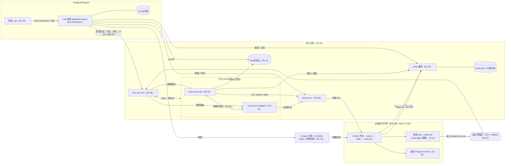

# D2 组件图与归属

依据缩写（行号均为当前工作树）：

| 缩写 | 文件 |
| --- | --- |
| PB | `pepgent-pm/evidence/argon/pivot-baseline.md` |
| RC | `pepgent-pm/evidence/argon/rulings-C.md` |
| BS | `pepgent-pm/evidence/argon/bootstrap.md` |
| inv/… | `pepgent-pm/evidence/inv/…` |
| LEDGER | `pepgent-soroi/LEDGER.md`（U 编号的用户原话） |
| design/… | `pepgent-soroi/design/…` |

## 框架

argon 的转向基线第二节把五类职责移出了 soroi：远程作业与工作卷进出归独立的 `Pepgent/remote`；跨机器的 omp RPC 桥接和多读方事件流复用，归“独立网络层 + 中心化 omp RPC 多路复用器”；对话历史、会话状态机和 IRC 归宿主 omp；AI4S 业务面归 `Pepgent/Pepgent`；主机与环境声明归 `Pepgent/iac` 和 `homelab-tf`（PB:24-39）。第三节列出由此必需的五项新组件或契约：网络层与 RPC Mux、store 数据服务边界、远程 `Program`/`Agent` 的载荷与发现契约、两个插件之间的闭合契约，以及 Lab 业务后端（PB:43-58）。

D2 回答的问题是：每项状态由哪个组件持有，组件在哪个仓库、以什么进程运行，它向谁暴露接口、消费谁的接口，生命周期从哪里开始、在哪里结束。划分组件的标准是“谁是状态的权威，谁确认生命周期结束”，不按部署在哪台机器、由谁调用或历史上怎么叫来划分。跨组件调用一律是请求权威方并等待结论，不另建第二份状态源。

本表只定归属和边界，不定 MVP 范围；各组件的接口细节（payload、schema、实现语言、认证方案）留给后续决策表。

硬约束如下：

- soroi 只是 omp 的扩展组件，不修改 omp 宿主代码（LEDGER:11-13 U1；LEDGER:61-63 U13；RC:12-17）；
- remote 对 soroi 零感知（RC:39-43）；
- 网络层与 Mux 独立存在（RC:148-151）；
- 不恢复外部调度控制面（BS:18-20）；
- 不把旧 Paseo daemon 或 `apps/hub` 当作新的 Mux 或 soroi 后端（PB:78-80）；
- 允许采用成熟、协议友好的开源方案（LEDGER:61-63 U13）；
- 全流程交付，不擅自收缩范围（LEDGER:17-19 U2）；
- soroi 的最小功能集合是一个完整的 omp 定制，要走通用户说过的所有流程，并能作为 Pepgent 的 agent 核心（U23，由 Main 逐字转述，待秘书登记进 LEDGER）。见 D2-25 与“U23 流程覆盖”。

## 决策表

| ID | what（职责） | where（仓库；进程/主机） | how（暴露/消费的接口；持有的权威状态；生命周期起止锚点） | 取舍（选定 vs 朴素方案 vs 实质不同的方案；理由） | 分类 | 缺失部分或设计补充? |
| --- | --- | --- | --- | --- | --- | --- |
| D2-01 | **omp 宿主（不动）**。AI harness 核心：会话、transcript、四态生命周期、IRC 总线、工具执行、`--mode rpc` | 上游 omp 发行版，不修改，装在中心主机（D2-20）和 omp-agent 镜像（D2-11）里。`Pepgent/oh-my-pi` fork 在组件图中没有角色 | **暴露：** `ExtensionAPI`、`AgentRegistry`、`AgentLifecycleManager`、`RpcClient` 与 `--mode rpc`、hooks、host tools（RC:16）。**权威：** agent transcript（`.jsonl`，`SessionManager`）、subagent 身份与四态、IRC 投递（PB:32-34；design/subagent.md:30-35）。**生命周期：** 进程由 D2-08 启动，进程退出即结束；session 文件比进程活得久，可以唤醒（design/subagent.md:19） | **选定：** 用上游二进制，所有定制都通过插件接入。**朴素方案：** 以 `Pepgent/oh-my-pi` fork 作为构建来源。不改代码的 fork 只增加同步成本，没有收益。**实质不同的方案：** fork 后为 eval 增加运行时后端。已被 C-1 否决（RC:12-17）。不考虑两侧版本是否一致（design/subagent.md:12） | 意图 | 否 |
| D2-02 | **omp-soroi-eval 插件**。`soroi_eval`（检查、dry run、正式运行）、未消费提醒、并发批次；中间件：本机运行 `Program`，经 remote 运行远程 `Program`，捕获 `Agent` 并生成每次调用的 `soroi_return` schema，捕获 `Human`，取回文件；store 客户端；介入控制端点（中止捕获、交给 `Human`） | `Pepgent/omp-soroi-eval`。在每个中心 omp 进程（主 agent 和 `fork` 分身）里作为插件加载；`Agent` 体会话中禁用（RC:96-102） | **消费：** omp `ExtensionAPI`；store 服务的读取与提交接口（D2-04）；remote CLI（D2-09）；subagent 插件的进程内 spawn 接口（D2-05）；Mux 的控制端点注册（D2-08）。**权威：** 只持有进程内的在途捕获；正式记录一律交给 D2-04，本插件不再自己打开 DuckLake（现状见 inv/r-eval.md:99-103）。**生命周期：** 一次 eval 调用从工具调用开始；dry run 在返回时结束，正式运行在 store 确认提交时结束。每次捕获嵌套在调用内：节点开始运行时开始，产出被交回或中止确认后结束 | **选定：** 插件作为 store 的客户端。**朴素方案：** 保留现在每个 omp 进程内嵌 DuckLake 的做法。但中心主机上并存多个 omp 进程，另有远程拷回汇入和 GUI 读取，都需要单一写方，这一方案不成立。**实质不同的方案：** 在某个指定的 omp 进程里托管 store 服务。store 的生命周期会跟着一次聊天会话走，没有 omp 会话时 GUI 也读不到 | 技术 | 是：远程中间件、`Human` 体、介入端点（inv/r-eval.md:144-147） |
| D2-03 | **omp-soroi-subagent 插件**。soroi subagent 进程：spawn，把 RPC 驱动的会话登记进 `AgentRegistry`，生命周期与 IRC 对标内置，交回工具在主侧执行，带人类来源的 IRC 入口，经 remote 作业远程启动 | `Pepgent/omp-soroi-subagent`。主进程加载为 supervisor 角色，每个子进程加载为 child 角色（design/subagent.md:28） | **消费：** omp 的注册表、生命周期和 IRC 总线；Mux 承载进程流（D2-08）；remote 承载远程启动（D2-11）。**权威：** 不新增状态；`<id>.soroi.json` 只是重启参数的索引（design/subagent.md:35），状态权威仍是 `AgentRegistry`。**生命周期：** agent 层是 omp 的四态；进程层每一代从 Mux 打开流开始，到进程退出（停驻或 kill）结束。必须按 C-4 改嵌套限制，按 C-5 删除 fallback（RC:96-102,117-121） | **选定：** 保留为独立插件，并在本机已验证的主路径上增量补齐（design/subagent.md:39-45）。**朴素方案：** 与 eval 插件合成一个仓库。subagent 也服务于非 eval 场景，合并会混淆进程归属。**实质不同的方案：** 回到内置进程内 subagent。用户已否决（PB:17；RC:124） | 技术 | 是：远程启动、Mux 传输、人类 IRC、中心分身嵌套（design/subagent.md:47-52） |
| D2-04 | **store 服务**（store.md 里的“soroi 服务”）。中心副本的唯一写方与权威，职责包括： • 接收 eval 正式步的一次提交； • 写入介入产生的 `Human` 捕获和派生运行记录； • 收下远程运行拷出的 tar，把批次目录在一次提交中汇入； • 管理按内容寻址的对象； • 每次正式写入后同步更新 FTS 派生表； • 提供读取与查询（图、时间轴、来源、比较）； • 每次提交后推送变更； • 提交时保存节点文件字节，供回看旧版本 | 新仓库 `Pepgent/store`（名称待定）。中心主机上一个常驻进程；数据是 DuckLake（SQLite 目录库 + Parquet）加对象目录，都放在中心主机文件系统上（design/store.md:45-46） | **暴露（HTTP）：** • 提交一步； • 对象 GET，作为 remote copy-in 的来源； • 每次远程运行一个 tar PUT 目标，即 copy-out（inv/r-remote.md:79）； • 查询； • 变更订阅（SSE）。 **消费：** 无上游，是叶子权威。**权威：** 中心副本，含事件表即时间轴（design/store.md:62-80）。**生命周期：** 服务进程独立于任何 omp 会话。每次汇入以收到 PUT 开始，以 DuckLake 提交完成结束，此时权威从远程批次目录转到中心副本（design/store.md:68） | **选定：** 独立的单写方服务。**朴素方案：** 各 omp 进程直连 DuckLake，Lab 后端直读。这样有多个写方；copy-out 的 PUT 需要常驻监听方；没有 omp 进程时 GUI 也要能读（inv/s-store.md:178-202）。**实质不同的方案：** 由 Lab 后端托管 store。分层会倒置：平台建在 soroi 之上（design/layers.md:3），而 eval 会依赖业务应用。本服务只接收只增不改的记录，从不决定下一步运行什么，所以不是被否定的调度 daemon（BS:18-20）。DuckDB 与 DuckLake 为 MIT，SQLite 为公有领域；目录库可换成 PostgreSQL（PostgreSQL License）。**归属待 argon 裁决：** store 属于 soroi 引擎（PB:12；design/store.md:3），而“soroi 只是 omp 扩展组件”（U1）。本表把它定为 omp 插件之外的独立进程，理由是 C-1 只约束“宿主侧能力”（RC:12），store 服务不是宿主侧能力 | 意图 | 是：PB:49-50 要求补齐的服务边界 |
| D2-05 | **插件间闭合（Agent 节点）**。eval 与 subagent 的分工 | 同一中心 omp 进程里的两个插件之间 | eval 负责捕获：按节点返回类型生成 `soroi_return` schema，接收 typed 结果和 `File` 路径，交给中间件取回文件。subagent 负责进程、生命周期、IRC 和 host tool 往返。两者之间是插件间的进程内调用，具体契约留给后续决策表。不允许没调交回工具就拿最后一条回复当结果（RC:117-121）；中心 `fork` 分身可以启动 subagent，`Agent` 体不能调用 eval，远程 agent 不能再开远程 agent（RC:96-102） | **选定：** 进程内 API。**朴素方案：** eval 让模型去调用 `soroi_task`。捕获必须确定，不能经模型转手（PB:15）。**实质不同的方案：** 两个插件合并成一个。见 D2-03 | 串联 | 是：PB:55-56 |
| D2-06 | **人类介入的通路**。改值、改函数体或参数、接管 agent 三种介入的归属 | 入口在 Lab 后端（D2-14）；控制在中心 omp 进程里的 eval 插件和 subagent 插件，经 Mux 路由（D2-08）；记录在 store 服务（D2-04） | **改值：** GUI → Lab 后端 → Mux → 持有该运行的 eval 插件。插件中止在途捕获（本机取消；远程用 `remote abort`；`Agent` 中止当前轮），等到中止结论后，经 store 提交 `Human` 捕获，再唤醒主 agent，提醒中标明这是人类介入产出的值（design/intervention.md:9-17；RC:203）。**改函数体或参数：** Lab 后端请求持有该运行的插件派生正式运行（design/intervention.md:19-25）。**接管 agent：** Lab 后端 → Mux → subagent 插件 → omp IRC，消息带人类来源，可排队、撤回、编辑（design/intervention.md:27-29；RC:207-208）。**权威：** 在途捕获归 eval 插件，记录归 store | **选定：** 请求在途状态的拥有方，等它给出结论。**朴素方案：** Lab 后端直接往 store 写 `Human` 捕获，插件自行察觉。这跳过了拥有方对中止的确认，在途捕获可能在被替代后才交回。**实质不同的方案：** 由 store 服务受理介入。store 不持有在途运行，理由同上 | 串联 | 是：I-1 至 I-3（RC:201-209） |
| D2-07 | **独立网络层**。远程容器和主机能连到中心的 Mux 与 store 服务；遵循标准 OCI 行为，业务容器不需要额外特权（RC:149） | 由 `Pepgent/iac` 声明（soroic 现有 NetBird 与 NAT，inv/r-iac.md:34-35,60）；测试主机由 `homelab-tf` 声明；容器使用默认网络 | **暴露：** 可路由的 `REMOTE_MUX` 地址和 store URL，由 remote 在启动时注入（inv/r-remote.md:133）。**权威：** 无运行时状态，属于基础设施声明。**生命周期：** 跟随基础设施 | **选定：** OCI 网络加已有的 NetBird 网格（NetBird 客户端为 BSD-3-Clause，服务端组件为 AGPL-3.0）。**朴素方案：** 走公网 HTTPS 入口，暴露面过大。**实质不同的方案：** 每次运行由 remote 或业务容器各自建隧道，违背 PB:31 | 技术 | 是：Slurm 计算节点如何寻址 |
| D2-08 | **中心化 omp RPC Mux**。持有每个 `omp --mode rpc` 进程的唯一传输：中心本机的进程由它启动，远程进程拨入。每条流一个写方、多个只读订阅方（会话事件；远程批次进度经同一连接推送）。把控制请求（人类 IRC、介入）路由到各 omp 进程注册的插件端点。不持有 agent 状态，不做调度 | 新仓库 `Pepgent/omp-rpc-mux`；中心主机上一个常驻进程 | **暴露：** • 启动本机流，或接受远程拨入； • 写方挂接； • 读方订阅； • 控制端点注册与路由。 **消费：** omp RPC JSONL 协议（design/subagent.md:64-68）。**权威：** 只有“当前存在哪些连接”这一项。**生命周期：** 每条流从启动或拨入开始，到进程退出或断开结束；agent 状态仍归 `AgentRegistry` | **选定：** 专用 Mux，本机与远程只差在启动位置和连接方式（design/subagent.md:16）。**朴素方案：** supervisor 自持 stdio，再把事件转发一份。远程拨入仍需一个端点，GUI 也需要一个统一的订阅点，最后仍会长出一个 Mux。**实质不同的方案：** 通用消息总线（如 NATS，Apache-2.0）加 omp 适配层。留给网络层决策表评估。复用 Paseo `apps/hub` 被禁止（PB:80）。用户原话指定了组件形态（PB:30） | 技术 | 是：PB:47-48 |
| D2-09 | **remote**。范围不变：模板目录与单次作业生命周期；三个后端共享抽象，先实现 Komodo（RC:163）。新增模板写入操作，供 Lab 的容器页和集群页绑定镜像 | `Pepgent/remote`。CLI 由中心主机上的 eval 中间件调用（Lab 后端也调用它读模板和状态）；步骤镜像 `remote-step`（inv/r-remote.md:172） | **暴露：** `templates`、`run`、`status`、`tail`、`abort`、`remove`，以及新增的模板写入（inv/r-remote.md:79）。**权威：** 模板目录和作业生命周期（inv/r-remote.md:67,78）。**生命周期：** 临时 volume 在最外层，copy-in、body、copy-out 依次嵌套在内（inv/r-remote.md:80） | **选定：** 模板目录只在 remote 一处，通过 remote 的接口写入。**朴素方案：** 改模板目录走 iac 或 git，UI 无法完成“构建 → 绑定”。**实质不同的方案：** Lab 后端另存一份模板表，形成第二源头（inv/s-remote.md:263） | 技术 | 是：模板写入操作，以及 GUI 展示所需字段（inv/s-remote.md:253） |
| D2-10 | **远程 `Program` 载荷的归属**。谁把节点 TS 及其依赖做成目标环境可执行的单元 | soroi 一侧：eval 中间件生成载荷（节点文件、本地依赖、库的 `package.json`、runner），经 store 服务的对象 GET 作为 copy-in 输入；remote 只看到一个模板，其 body 运行 runner | 版本身份必须覆盖实际执行的东西（BS:128）；返回的标量和 `File` 写进 volume，随 copy-out 回到 store 服务（D2-04），再由中间件交回。具体形态留给远程契约决策表 | **选定：** 由 soroi 侧打包。**朴素方案：** 只发命令字符串。用户已否定（RC:160）。**实质不同的方案：** 让 remote 理解 TS。违背零感知（RC:43） | 串联 | 是：PB:51-53 |
| D2-11 | **远程 `Agent` 的部署与服务发现**。 • **部署：** omp-agent 镜像，内含 omp、soroi 插件和设置，不含凭据；库的检出经 copy-in 进入。 • **发现：** remote 模板目录中 body 运行 `omp --mode rpc` 并拨入 `REMOTE_MUX` 的模板。 • **启动：** 一次 remote 作业是外层生命周期，agent 进程的一代是内层。 • **唤醒：** 开一次新作业，把 transcript 拷入 | 镜像定义在 `Pepgent/images`（D2-13）；模板在 remote 的目录里 | **生命周期：** 作业从 `run` 开始，到 copy-out 完成、`remove` 结束；agent 进程的一代从拨入开始，到退出结束，嵌套在作业内；agent 身份与状态仍归主侧 `AgentRegistry`（design/subagent.md:19）。transcript 放在哪里是占位（design/subagent.md:154） | **选定：** 用 remote 的模板目录兼作服务发现，不另建登记表。**朴素方案：** 用 SSH 主机清单 `ssh.json`（design/subagent.md:134）。它不是 OCI 路径，也会形成第二份登记。**实质不同的方案：** 独立服务注册中心（如 Consul，BUSL-1.1，协议不友好）。被否 | 串联 | 是：PB:54；design/subagent.md:24,52 |
| D2-12 | **节点库与 agent 定义**。持久化的节点函数 TS 文件、依赖（`package.json`）、`Agent` 节点用的 agent 定义、技能和规则（即 `AgentTemplate`）；GUI 节点库页的数据源 | 每个 Lab 一个 git 仓库，首个 Lab 用新仓库 `Pepgent/lab-library`（名称待定）。在中心主机上检出，作为中心 omp 进程的 cwd（`<cwd>/nodes/<name>.ts`，inv/r-eval.md:68；`.omp/agents/`） | **权威：** 仓库默认分支上的当前定义。Lab 后端在人确认后以 commit 写入；eval 直接 import 并传参（inv/s-node-library.md:27-31）。版本是文件内容哈希（design/eval.md:76）；store 在提交时保存节点文件字节，所以旧版本始终可以查看（design/layers.md:52）。**生命周期：** 一个文件版本在 commit 时产生，此后不变 | **选定：** git。**朴素方案：** 把文件放进 store 的对象存储，另建名字映射表。store 会同时成为“当前定义”的权威，混淆值和源码。**实质不同的方案：** 定义存进 Lab 数据库，节点无法在目标环境按普通 TS 还原执行（RC:160） | 技术 | 是：E-4（BS:143-144） |
| D2-13 | **镜像构建与镜像仓库**。运行环境模板用的业务镜像、omp-agent 镜像的定义、构建与存放 | 新仓库 `Pepgent/images` 存放定义；用 Pepgent Komodo（inv/r-iac.md:84-95）的 Build 构建；镜像仓库用 CNCF Distribution（Apache-2.0），部署在 iac 声明的主机上 | Lab 容器页 → 提交到 images 仓库 → 经 Komodo Core API 触发 Build → 推送 → 通过 D2-09 的模板写入绑定到模板。**权威：** 定义归 images 仓库，构建产物归镜像仓库，构建运行记录归 Komodo | **选定：** Komodo Build（GPL-3.0，以服务方式使用；已部署，remote 已对接 Core）。**朴素方案：** GitHub Actions 构建。没有界面触发和本地仓库。**实质不同的方案：** 直接用 BuildKit 服务（Apache-2.0），需要另运维一套构建器 | 技术 | 是：BS:120 |
| D2-14 | **Pepgent Lab 业务后端**。替换静态 `LabBridge`（PB:75-80）。持有业务状态：labs、成员、项目、讨论元数据、实验元数据（运行 id 的索引、名称、标签）、自动化规则、设置。作为 GUI 的门面，对接 store（读取与订阅）、Mux（agent 流与控制）、remote（集群、模板、状态）、Komodo Build 和库仓库 | `Pepgent/Pepgent` 的 `apps/web` 服务端：新增 `server/lab`、对应的 server functions 与 SSE 路由，与 TanStack Start 同在一个 Node 进程；部署在中心主机 | **暴露：** server functions 加 SSE，沿用 `OperationResult` 约定（inv/r-pepgent.md:289-300）。**权威：** 业务库（SQL，引擎留待后续决策表）。实验只存运行 id，运行状态一律从 store 读，不复制。**生命周期：** web 进程 | **选定：** 放在 apps/web 服务层，沿用已有的接缝与约定（PB:80 允许）。**朴素方案：** 即选定方案。**实质不同的方案：** 独立仓库 `Pepgent/lab-server`。多一个进程和一套协议，目前没有收益 | 技术 | 是：PB:57-58 |
| D2-15 | **讨论与中心 omp 主会话**。每个讨论是一个中心 omp 主会话，一人一会话（inv/s-pepgent.md:97-98）。讨论可装载产物作为上下文，并从讨论里启动实验；一次实验是根 omp 会话下的一次 soroi 运行（inv/r-eval.md:104） | 中心主机；由 Lab 后端经 Mux 启动；cwd 是 Lab 库的检出（D2-12） | Lab 后端是写方，转交用户的 prompt；GUI 是 Mux 上的读方；transcript 归 omp；Lab 库只存会话 id 索引。**生命周期：** 会话随讨论创建而开始；进程空闲停驻，有消息时唤醒，与 omp 一致 | **选定：** 讨论即 omp 主会话。**朴素方案：** Lab 后端自建对话循环。偏离以 omp 为核心（U13）。**实质不同的方案：** 每个实验另起一个无人对话的 agent，丢掉“从讨论启动实验”的业务形态（PB:66） | 串联 | 是 |
| D2-16 | **自动化**。按运行事件（开始、结束）触发动作，例如起一个中心会话起草复盘，带审批门禁（design/layers.md:67-69） | Lab 后端进程内，订阅 store 的变更流 | 规则存在 Lab 库；事件来自 D2-04；动作经 D2-08 启动会话。**生命周期：** 一条规则从启用到停用；每次触发是一次独立记录 | **选定：** 放在 Lab 后端。**朴素方案：** 外部 cron。拿不到运行事件。**实质不同的方案：** n8n（Sustainable Use License，不是 OSI 协议）或 Temporal（MIT），对当前规模过重 | 技术 | 是 |
| D2-17 | **身份与成员**。成员、项目、角色归 Lab 后端；认证机制留到 Lab 后端决策表 | `Pepgent/Pepgent` 服务层 | 旧业务仓的 Keycloak 等设计已作废，不能直接恢复（inv/s-pepgent.md:83,195）。本表只定归属 | **选定：** 本表只定归属。**朴素方案：** 单用户、本机访问，不满足多成员的 Lab 业务。**实质不同的方案：** 外部 IdP 走 OIDC，留到后续决策表评估 | 技术 | 是（占位） |
| D2-18 | **Pepgent 前端**。保留 `_lab` 的 17 个页面；把 `LabBridge` 的 fixture 换成调用 D2-14 的异步服务，切换后删除 fixture | `Pepgent/Pepgent` 的 `apps/web` renderer | 只调用 D2-14，不直连 store 或 Mux；renderer 仍只经注入的 `PepgentBridge` 取数据（inv/r-pepgent.md:238） | **选定：** 门面模式。**朴素方案：** 即选定方案。**实质不同的方案：** GUI 直连 store 和 Mux，打破 renderer 边界，认证也要分散到多处去做 | 实现 | 否（现有组件，范围变化） |
| D2-19 | **旧 Paseo、`_app` 与 `apps/hub`**。保持不动，不复用为 Mux 或 soroi 后端 | `Pepgent/Pepgent` | 用户原话是“先不动”“现有的ai应该完全用不了”（inv/s-pepgent.md:104；PB:80） | **选定：** 不动。删还是留，等页面做完再议，本表不裁决 | 意图 | 否 |
| D2-20 | **中心主机**。运行 Lab 后端、Mux、store 服务、中心 omp 进程，以及 remote CLI 的 home。eval 只在这里运行（design/eval.md:166-168） | VM 由 `Pepgent/iac` 声明；其上的服务以 Komodo Stack 部署，Stack 定义放在 `Pepgent/deploy`（D2-23） | **权威：** 主机身份与网络归 iac；服务进程由 Komodo 起停。**生命周期：** VM 由 iac 的 apply 创建、销毁；服务随 Stack 部署和移除 | **选定：** 一台中心主机。**朴素方案：** 复用现有 `soroic-komodo` VM，会和 Komodo 本体争用资源。**实质不同的方案：** 拆成多台 VM，目前没有负载依据 | 技术 | 是 |
| D2-21 | **`Pepgent/iac` 的范围变化**。在现有 soroic 主机、Komodo VM 和 NetBird（inv/r-iac.md:34-45）之外，新增中心主机 VM、镜像仓库主机，以及 D2-07 所需的网络地址 | `Pepgent/iac` | 遵守该仓库的 owner wrapper 与端口租约规则（inv/r-iac.md:134-140） | **选定：** 放进 Pepgent 自己的 iac。**朴素方案：** 即选定方案。**实质不同的方案：** 全部放到 homelab-tf，混淆个人 homelab 与 Pepgent 环境的归属 | 技术 | 是 |
| D2-22 | **`homelab-tf` 的范围**。只承担 Slurm 与 Komodo 的小型测试 VM（LEDGER:25-27 U4）；Komodo 测试主机的 Stack 归相应的 workload 仓库（inv/r-homelab-tf.md:172） | `homelab-tf` | homelab-tf 中没有 Slurm 声明（inv/r-homelab-tf.md:161）；Slurm 测试 VM 属于新增工作 | **选定：** 按用户推荐的路径。**替代方案：** 放进 `Pepgent/iac`，与“在 homelab tf 里启动 vm”的原话不符 | 意图 | 是 |
| D2-23 | **部署仓库**。Pepgent 服务（Lab web、Mux、store）的 Komodo ResourceSync 与 Stack | 新仓库 `Pepgent/deploy` | 服务只需 compose，归 Komodo 部署；凭据由该仓库按既定路径注入，不手工粘贴 | **选定：** 一个 workload 仓库。**朴素方案：** 每个服务仓库各带自己的 Stack，ResourceSync 会分散到多处。**实质不同的方案：** 由 iac 部署应用，违背应用归属判据 | 实现 | 是 |
| D2-24 | **其余现有仓库的角色**。`Pepgent/soroi`：soroi 的设计文档（含 store 的数据契约），并作为 D2-25 的发行仓。`Pepgent/PM`：决策与排期。`Pepgent/pepgent-doc`：旧原型副本，原型已移入 `Pepgent/Pepgent`（inv/s-pepgent.md:45）。`Pepgent/oh-my-pi`：无角色 | 各自现有仓库（inv/r-github.md:34-44） | pepgent-doc 与 oh-my-pi 不进组件图；是否归档是仓库管理操作，不在本表 | 只定角色 | 实现 | 否 |
| D2-25 | **soroi omp 定制（一个可安装的整体）**。U23 要求 soroi 的最小功能集合“一定是一个完整的omp定制，并且能走通我说的所有流程，并且能作为pepgent的agent核心”。内容： • 插件 `omp-soroi-eval`、`omp-soroi-subagent`； • 设置覆盖（主侧设置，以及子进程的 `personality: none`、审批策略等，inv/r-subagent.md:64-66）； • agent 定义（写 eval 步的主 agent 角色、`Agent` 体子 agent 角色）； • 技能（逐步消费 atom 的写法、节点函数编写、介入后继续消费）； • 规则（三语句、无魔法值、穷尽解构等，design/eval.md:124-139）。 装好它、再接上 store 服务（D2-04）与 Mux（D2-08）的 omp，不依赖 Pepgent 也能走通下文“U23 流程覆盖”中的每条流程 | `Pepgent/soroi` 从设计文档仓扩为发行仓：一个 omp 插件包，`omp.extensions` 列出两个插件入口（两插件仓作为依赖引入）；同包内放 `agents/`、`skills/`、`rules/` 能力目录和一份设置覆盖文件。另带一份 compose，起 store 服务与 Mux，供脱离 Pepgent 单独走通全部流程。**安装：** 中心主机上以 `omp plugin install`（用户范围）安装；omp-agent 镜像（D2-11）构建时执行同一条安装，所以中心与远程是同一份定制（design/subagent.md:17） | **暴露给 Pepgent（agent 核心的调用面）：** • omp RPC：prompt、steer、abort、会话事件，经 Mux； • 插件在 Mux 注册的控制端点：介入、人类 IRC（D2-06）； • 运行记录：经 store 服务的 HTTP 读取与订阅。 **Lab 后端的调用方式：** 经 Mux 启动 `omp --mode rpc` 并带上 soroi 设置覆盖，cwd 为 Lab 库检出（D2-12）；Lab 后端是写方，发 prompt。伴随服务地址（store URL、Mux URL）经环境变量注入；凭据不进包（design/subagent.md:128）。**发现依据：** 插件包可带 `skills/`（inv/o-skills.md:165-172），扩展包的 agent 目录参与 task agent 发现（inv/o-placement.md:38）。**权威：** 定制内容归 `Pepgent/soroi` 的发布版本，没有运行时状态。**生命周期：** 一次安装从 install 开始，到被替换或卸载结束；运行时跟随 omp 进程 | **选定：** 一个发行包，中心和镜像同源安装。**朴素方案：** 两个插件各自 `plugin link`，设置、agent 定义手工拷贝（现状，inv/r-eval.md:53）。这不是可安装的整体，中心与远程容易不对标。**实质不同的方案：** 只把定制烘进 omp-agent 镜像，不发包。中心主机若不跑在容器里就无法同源安装，也无法脱离 Pepgent 单独验证。另开 `Pepgent/soroi-dist` 仓库会多一个仓，而 `Pepgent/soroi` 本来就是 soroi 的门面 | 意图 | 是：U23 |

## U23 流程覆盖

U23 要求定制“能走通我说的所有流程”。下表把用户说过的每条流程对应到负责它的条目，不因“最小”裁掉任何一条。

| 流程 | 负责的条目 |
| --- | --- |
| 逐步 eval，消费未消费的 atom，`fork` 并发与批次汇总 | D2-02、D2-25（技能与规则） |
| dry run 与正式运行（dry run 不写 store） | D2-02、D2-04 |
| `Program`、`Agent`、`Human` 三种捕获 | D2-02、D2-05、D2-06 |
| store 落盘与历史时间轴 | D2-04 |
| 按身份复用 | D2-02、D2-04 |
| 远程运行与远程捕获（`Program` 和 `Agent`，单层远程） | D2-09、D2-10、D2-11、D2-04、D2-07 |
| subagent 生命周期与 IRC（含唤醒早已死掉的 session） | D2-03、D2-01、D2-08 |
| 人类介入：改值、派生运行、接管 agent | D2-06 |
| GUI 读取与订阅（含远程运行中的进度） | D2-04、D2-08、D2-14、D2-18 |
| 节点库：持久化、import 后传参、版本、展示 | D2-12、D2-04 |
| 运行事件与自动化 | D2-04、D2-16 |
| 作为 Pepgent 的 agent 核心被调用 | D2-25、D2-14、D2-15 |

U23 的最后一句是“最后能在这个基础上知道pepgent和soroi之间缺失的点，线，面”。这项差距盘点要在 D2-25 能脱离 Pepgent 走通上表全部流程之后进行，不在本表里预先下结论。

## 组件与接口图

## 仓库

### 需要新开的仓库（owner：Pepgent，名称待投票确认）

| 仓库 | 用途 | 对应条目 |
| --- | --- | --- |
| `Pepgent/store` | store 服务：中心副本的单一写方、对象、汇入、FTS、查询与订阅 | D2-04 |
| `Pepgent/omp-rpc-mux` | 中心化 omp RPC 多路复用器 | D2-08 |
| `Pepgent/images` | 业务镜像与 omp-agent 镜像的定义 | D2-11、D2-13 |
| `Pepgent/deploy` | Pepgent 服务的 Komodo ResourceSync 与 Stack | D2-23 |
| `Pepgent/lab-library` | 首个 Lab 的节点库、依赖与 agent 定义（每个 Lab 一个） | D2-12 |

### 范围变化的现有仓库

| 仓库 | 变化 |
| --- | --- |
| `Pepgent/omp-soroi-eval` | 进程内 DuckLake 改为 store 客户端；新增远程中间件、`Human` 体、介入控制端点；`Agent` 节点改为运行在 subagent 插件上 |
| `Pepgent/omp-soroi-subagent` | 进程流改走 Mux；新增远程启动、人类 IRC 入口；中心分身可再开 subagent；删除 fallback |
| `Pepgent/remote` | 新增模板写入操作；新增 omp-agent 与 runner 两类模板 |
| `Pepgent/Pepgent` | 新增 Lab 后端，前端换掉 fixture；旧 Paseo 线保持不动 |
| `Pepgent/iac` | 新增中心主机 VM、镜像仓库主机、网络地址 |
| `homelab-tf` | 新增 Slurm 与 Komodo 测试 VM |
| `Pepgent/soroi` | 扩为 D2-25 的发行仓（插件包、agent 定义、技能、规则、设置覆盖、单独验证用的 compose）。设计文档跟进：`store.md` 里的“soroi 服务”指向 D2-04；`soroi.md` 的组成表注明 store 服务、Mux 是外部进程 |
| `Pepgent/pepgent-doc`、`Pepgent/oh-my-pi` | 不在组件图中 |

## 占位（先假定能工作）

| 占位 | 假定 |
| --- | --- |
| 人类来源的 IRC 注入 | 插件能把带人类来源标记的消息交给 omp 的 IRC 总线，并能撤回、编辑排队中的消息（BS:183 探针 1(c)） |
| 控制端点 | 中心 omp 进程里的插件能向 Mux 注册控制端点并接收路由过来的请求 |
| Mux 承载 RPC 流 | omp `RpcClient` 的自定义 `spawn` 传输能经 Mux 承载本机流和远程流（design/subagent.md:66） |
| 远程批次进度推送 | 远程 agent 批次目录的变化能经它的 Mux 连接推送给读方（design/store.md:107） |
| 远程 transcript | 远程 agent 的 transcript 与 blob 能随 copy-out 回到主侧，并能在唤醒时拷入（design/subagent.md:154） |
| 远程 Program runner | runner 能在 body 镜像里还原并执行节点 TS 及其依赖（RC:160） |
| 派生运行的执行者 | 持有原运行的中心 omp 进程能按已存的步重新执行受影响的部分 |
| Slurm 节点连回中心 | Slurm 计算节点能经网络层访问 Mux 与 store |
| Komodo Build API | 经 Core API 触发 Build 并推送到镜像仓库可行 |
| 认证 | Lab 后端能识别当前用户 |
| 包内的规则与设置 | 插件包能带上规则目录，设置覆盖能随包下发并经 `--config` 生效（inv/r-subagent.md:64）；技能和 agent 定义的随包发现已有文档依据（inv/o-skills.md:165-172；inv/o-placement.md:38） |

## 交 argon 与投票时需要注意的条目

- **D2-04 的归属（意图）：** store 是 soroi 引擎的权威（PB:12），用户又说 soroi 只是 omp 扩展组件（U1）。本表把 store 服务定为 omp 插件之外的独立进程，仓库名不带 soroi，依据是 C-1 只约束宿主侧能力（RC:12）。需要 argon 引用 (U) 原文确认或否决。
- **D2-08 由 Mux 启动本机中心进程：** 这是“Mux 只是复用器”的扩展理解。如果判为越界，退回 D2-08 的朴素方案（supervisor 自持 stdio 并转发），其余条目不受影响。
- **D2-12 每个 Lab 一个库仓库：** 依据是原型设置页中的“代码库”（inv/r-pepgent.md:210），但用户没有原话指定。
- **D2-25 的边界（意图）：** U23 要求“完整的omp定制”走通所有流程，而 store 落盘、远程运行、GUI 订阅都需要 store 服务和 Mux 这两个 omp 之外的进程。本表的做法是：定制本身只含 omp 侧内容，store 服务与 Mux 是它声明的伴随服务，由同一发行仓的 compose 一起拉起。需要 argon 裁决这是否满足“完整的omp定制”，还是要求把这两个服务也算进定制本身。
