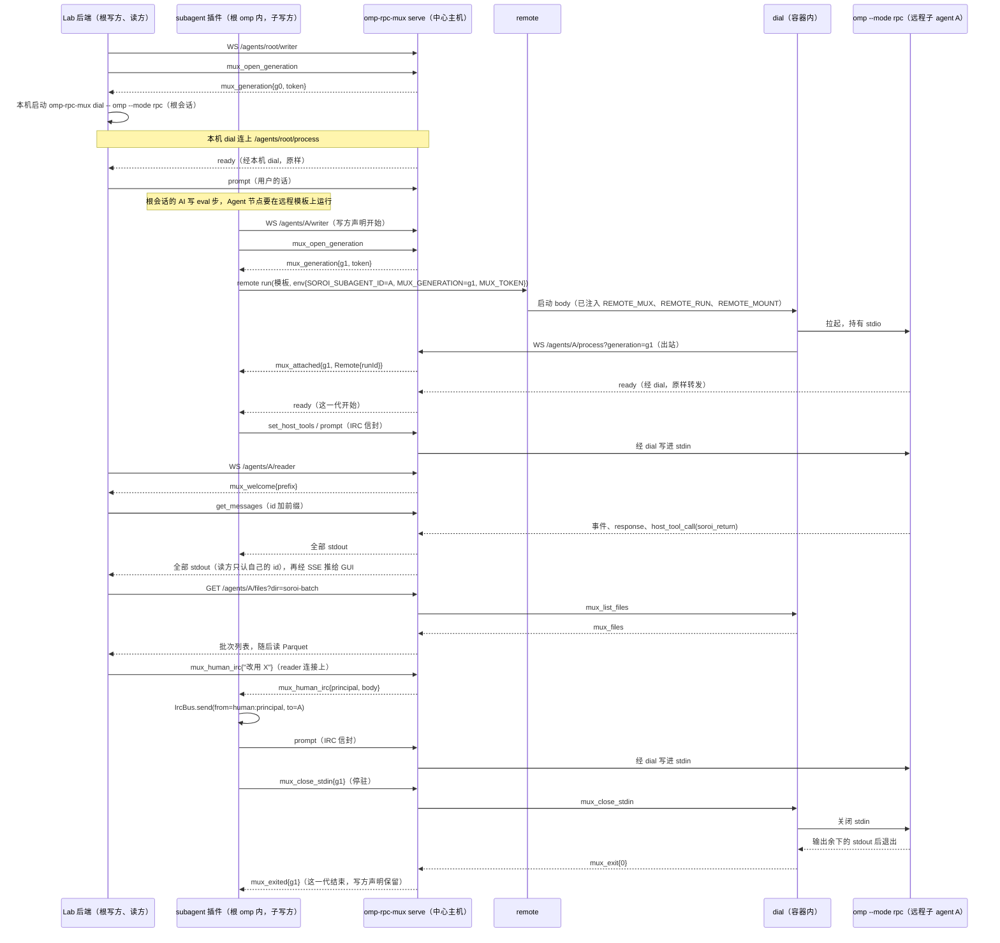

# D3 独立网络层与中心化 omp RPC 多路复用器

起草：DrafterD3Net（Claude 族）。评审输入：导师 D3Mentor，讨论者 D3Steady（稳健）、D3Divergent（发散）。它们的意见已在下表的取舍列中处理。本文与 `decisions/D2-components.md`（D2-07、D2-08、D2-11、D2-15、D2-20、D2-23、D2-25）以及 `argon/D2-rulings.md` 对齐，并与 D4（remote 拨入形态）、D6（在途进度与控制端点）核对过。

## 1. 问题与依据

用户已经定下这个组件的形态，只把实现交给我们：

> 然后怎么连回来soroi，应该是在独立的网络层中，有中心化的omp rpc多路复用器，怎么实现怎么干的你别管，反正在一个网络里，这也应该是oci标准行为，而不需要其他能力

（U `01a18e3a #09e1cc92`，`argon/rulings-C.md:166-167`）

用户还提了三项要求：

- **GUI 能看见任意 agent，RPC 要做只读多路复用。**“rpc实际上本来就要额外做只读层面的多路复用”（U `01a18e1f #2dbf970b`，`rulings-C.md:169-170`）。
- **人工接管走 IRC。**来源可辨，是一条普通 user prompt，“乃至被人类编辑”（U `#7bfe3696`，`rulings-C.md:172-173`）。
- **远程 agent 对标主 agent。**“只改连接方式变成远程连接，远程启动……只需要补充，部署，服务发现”（U `#9c291fe2`，`rulings-C.md:203-204`）。

实现上的约束：

- 只能做插件，生命周期和 IRC 要全方位对标内置 subagent（U `01a18f4a #f488be08`，`rulings-C.md:27-28`）。
- 可以用成熟、开源、协议友好的现成方案，但 harness 核心必须是 omp（U13，`rulings-C.md:23-24`）。
- soroi 是独立的 omp 定制，不依赖 omomp，也没有 fork/分身（U24，`D2-components.md:185`）。
- 最小功能集是一套完整的 omp 定制，能走通所有流程，并作为 Pepgent 的 agent 核心（U23，`pepgent-soroi/LEDGER.md:224-231`）。

argon 已裁定：Mux 独立成仓 `Pepgent/omp-rpc-mux`，由 soroi 发行仓的 compose 作为外部伴随组件引入（`argon/D2-rulings.md:17-18`）。仍归技术项、由领导小组投票的 `【暂定】` 有三项：进程归属的细节、帧格式、远程批次进度怎样经网络层可见（`rulings-C.md:89,92,174`）。

现状：

| 对象 | 现状 | 依据 |
| --- | --- | --- |
| remote | 启动时注入 `REMOTE_MUX`；网络层“不归 remote，也不归调用方” | `pepgent-remote/design/remote.md:26,37,88`；`inv/r-remote.md:133,194` |
| subagent 插件的传输 | 只有本机 `Bun.spawn` 的 stdin/stdout | `pepgent-omp-soroi-subagent/src/main/rpc-process.ts:45-92` |
| 远程启动、部署和发现 | 还没做 | `soroi/design/subagent.md:52` |
| RPC 宿主 | 看不到 soroi subagent | `subagent.md:50`；`inv/s-subagent.md:128,154` |
| stdio | 一对 stdio 只属于启动它的一方 | `subagent.md:68` |
| 服务发现 | 缺一份登记，说明哪些机器能启动对标的 omp | `subagent.md:138` |

## 2. 组件归属（采用 D2）

| 组件 | 归属 | 依据 |
| --- | --- | --- |
| `omp-rpc-mux`：`serve` 常驻进程，加随 agent 镜像分发的 `dial` | 独立仓库 `Pepgent/omp-rpc-mux`。`serve` 是中心主机上的常驻进程，以 Komodo Stack 部署，定义在 `Pepgent/deploy`；soroi 发行仓的 compose 也会把它拉起 | `D2-components.md:45,57,60`；`argon/D2-rulings.md:18` |
| 网络层底座 | `Pepgent/iac` 声明：soroic 现有的 NetBird 与 NAT，以及中心主机的网络地址 | `D2-components.md:44,58` |
| 子 agent 的写方 | `omp-soroi-subagent` 插件（D5）；介入的控制端点在 `omp-soroi-eval` | `D2-components.md:40,43` |
| 根 agent（讨论会话）的写方，以及 GUI 的读方 | Lab 后端 | `D2-components.md:51-52,55` |
| 能启动 agent 的地方 | remote 的模板目录 | `D2-components.md:48`；`remote.md:34` |

## 3. 决策表

最后一列标“是”的行属于缺失部分或设计补充。

| ID | what | where | how | 取舍 | 分类 | 缺失/补充 |
| --- | --- | --- | --- | --- | --- | --- |
| D3-01 | 网络层底座 | 中心主机与各后端宿主机：Komodo 的 Docker 主机、Slurm 计算节点、k8s 节点 | 用宿主机级的 NetBird mesh，peer 装在宿主机上，不装在容器里。容器只做普通的出站连接，由宿主机路由进 mesh。`REMOTE_MUX` 用 mesh DNS 名。许可证：NetBird 客户端是 BSD-3；management、signal、relay 自 v0.53 起是 AGPLv3。我们原样自托管，不修改也不分发，不触发 AGPL 义务 | 符合“反正在一个网络里……不需要其他能力”：容器不需要 tun、NET_ADMIN 或 sidecar。iac 已有 NetBird 基线（`r-iac.md:34,50,85`；`D2-components.md:44`）。<br>不选的方案：<br>• Tailscale+Headscale：同样成熟，但组织里没有现成基线；<br>• Nebula：要另行发证；<br>• 公网 TLS：不是“独立的网络层”，输入输出还得改用公网预签名 URL；<br>• SSH 反向隧道：违背用户的“反对用 ssh”（`rulings-C.md:208`）；<br>• Docker 或 k8s 原生网络：只在单个集群内有效 | 技术 | 是 |
| D3-02 | mux 的进程形态 | 中心主机，`Pepgent/omp-rpc-mux` | `omp-rpc-mux serve` 是常驻进程，监听中心主机的 mesh 地址。内存里只有连接表与路由，不落盘，也不启动任何进程（leader 裁决 D）。同一个二进制带 `dial` 子命令（D3-04）。用 Rust 写，与 remote 同栈：tokio，单个静态二进制，跨平台 | 不嵌进 omp 插件：违反“不归调用方”（`remote.md:37`），有多个根会话时在线列表也会被拆散。<br>不复用 `apps/hub`：它是一对一的 E2EE 中继，没有扇出和写方声明（`r-pepgent.md:156-168`；`D2-components.md:28,56`）。<br>不用 NATS 或 Redis Streams：写方声明、读方 id 命名空间照样要自己写；历史本来就从 transcript 读（`subagent.md:23`），broker 的持久化用不上。<br>不依赖 omp-peers、tern 或任何 omomp 插件（U24） | 串联 | 是 |
| D3-03 | 寻址 | mux 的 URL 空间 | `REMOTE_MUX` 是 mux 的根 URL，例如 `ws://mux.<mesh 域>:<port>`，remote 从 `[network].mux` 读出后注入。路径按 omp agent id 区分：`/agents/{id}/writer`、`/agents/{id}/process`、`/agents/{id}/reader`、`/agents`、`/agents/events`、`/agents/{id}/files…`、`/endpoints/{name}`（第 4 节） | id 就是 omp `AgentRegistry` 里的 id，不另造身份。mux 只认 id，不理解 agent 树 | 技术 | 是 |
| D3-04 | 远程进程怎样连回 | agent 镜像（D2-11、D2-13） | 远程模板的 body 是 `omp-rpc-mux dial -- omp --mode rpc …`。dial 在容器里拉起 omp，向 `REMOTE_MUX/agents/{id}/process` 发起出站 WebSocket，把 stdout 逐行上送，把收到的行写进 stdin | 只需要出站连接，中心主机不用连进容器，这就是 OCI 标准的网络行为。dial 是 omp stdio 的唯一持有者，omp 本身毫无变化（U `#f488be08`）。这与 D4 的 `Attach/Accept` 形态一致，只是命名不同 | 技术 | 是 |
| D3-05 | 线协议 | mux 的每条 WebSocket | 一条 text 消息是一行 JSONL。omp RPC 帧原样转发，mux 不改写也不解析 stdout。mux 自己的帧一律用 `mux_` 前缀的 `type`，omp 不用这个前缀；这些帧不进 omp 的 stdin。第一版固定 RPC v1：写方不发 `negotiate_protocol`，读方也不能发 | 复用 omp 的帧，就是“omp rpc 多路复用器”的本义。<br>固定 v1 的原因：现有插件按 v1 逐行解析（`rpc-process.ts:99-130`），而 v2 分块是整个进程一起切换的（`omp://rpc.md:37-72`）。改用 v2 时，写方和所有读方都要换成 `RpcFrameDecoder` | 技术 | 是 |
| D3-06 | 三种角色：一个写方，读方只读 | mux | **process：**每个 agent 至多一个在线进程，一律由 dial 持有 stdio 并连上来，本机与远程相同。<br>**writer：**每个 agent 恰好一个。只有它能发会改变状态的命令，以及 `host_tool_result`、`host_uri_result`。<br>**reader：**任意多个。收到这个 agent 的全部 stdout，只能发白名单里的只读命令：`get_state`、`get_messages`、`get_messages_page`、`get_session_stats`；`set_event_filter`、`set_subagent_subscription`、`negotiate_protocol` 不在白名单里。读方命令的 id 由 mux 加上它分配的前缀 `r{conn}:`；response 广播给所有连接，各方只认自己的 id。<br>**凭据：**writer 和 reader 的凭据由 `Pepgent/deploy` 按既定路径注入；process 用写方为这一代申请的 token | “一个写方，多个读方”（`subagent.md:23`）。<br>广播 response 可行，因为现有插件本来就忽略不认识的 id（`rpc-process.ts:133-137`），mux 不用解析 stdout。<br>event filter 对整个进程生效，读方一改就会破坏写方的状态镜像（`omp://rpc.md:919-927`；`agent-session.ts:135-150`）。<br>D3Steady 主张读方只被动接收、快照由写方发布；本表不采用：快照是副本，直接向 transcript 的持有者，即 omp 进程（`subagent.md:33`）读取才是读源头 | 串联 | 是 |
| D3-07 | 生命周期与锚点 | mux 与写方 | 写方声明（外层）包着进程代（内层）：<br>① 写方打开 `/writer`，声明开始；<br>② 写方发 `mux_open_generation`，拿到 `generation` 和 `token`；<br>③ 写方在本机启动 `omp-rpc-mux dial -- omp --mode rpc …`，或调用 `remote run`（其 body 是同一条 dial）；dial 连上 `/process`；<br>④ 写方收到 omp 的 `ready`，这一代开始；<br>⑤ 停驻：写方发 `mux_close_stdin`；mux 转给 dial，dial 关掉 stdin 并读完 stdout；进程退出后，写方收到 `mux_exited`，这一代结束；<br>⑥ 唤醒：在同一个声明里开新的一代，打开同一份 transcript；<br>⑦ 写方退出：先结束全部在线的代，再关 `/writer`，声明结束 | 写方先连、后启动，保证唯一一次 `ready` 一定送到写方（D3Steady）。<br>声明跨越停驻，所以人类发给已停驻 agent 的 IRC 也能找到写方。<br>待处理的命令和 host 调用属于各自那一代。<br>`running/idle/parked/aborted` 仍由 `AgentRegistry` 持有；mux 只知道“此刻有没有进程连着”（`D2-components.md:45` 的“权威只有连接”）。<br>远程时，一代嵌套在一次 remote 作业里（`D2-components.md:48`） | 技术 | 是 |
| D3-08 | 本机进程也由写方用 dial 启动 | 写方所在的主机（中心主机） | 本机进程同样由写方以 `omp-rpc-mux dial -- omp --mode rpc …` 启动，dial 持有 stdio 并连上 mux；本机与远程只差在 dial 在哪里运行（写方本机，或 remote 作业的容器里）。mux 只持连接表与路由，不启动进程 | 对齐 leader 裁决 D 与修订后的 D2-08（`D2-components.md:45`），也符合“本机运行和远程运行的区别只在于进程在哪里启动”（`subagent.md:16`）。写方只有一种传输，GUI 因此能看到本机 agent（U `#2dbf970b`）。本机进程是写方的子进程，与写方同在一个环境里，对标的定制和 Lab 库检出自然可见。<br>代价：没有 mux，本机 agent 也起不来；每个本机 agent 多一个 dial 进程。<br>不选：由 supervisor 自持 stdio 再把副本转发给 mux——两种传输、两条读路径，读方读到的是副本 | 技术 | 是 |
| D3-09 | 插件面向 mux 的契约（D5 实现） | `omp-soroi-subagent` 的 `rpc-process.ts` 和 `supervisor.ts` | `RpcProcess` 换成 `MuxWriter` 加 `Generation`。`#launch` 拆成五步：声明、开一代、启动 dial（本机子进程或 `remote run`）、等 `ready`、注册 host 工具、读状态。`pid: number` 换成 `ProcessRef { generation, where: Local{host} \| Remote{runId} }`。写方要分开处理 omp 帧和 `mux_*` 控制帧 | 改造面比“换管道”大（`supervisor.ts:229-260`；`index.ts:44-53`），但不碰 omp 宿主。远程进程没有本机 pid 可言 | 实现 | 否 |
| D3-10 | 根会话与 Pepgent 后端（U23） | Lab 后端与中心主机 | Lab 后端以写方身份打开 `/agents/{root}/writer`，在本机用 `omp-rpc-mux dial -- omp --mode rpc …` 启动根会话，根会话装着完整的 soroi 定制。之后由它转交用户的 prompt、读取结果，这就是“被 Pepgent 后端调用的 agent 核心”。根会话里的插件再按同一套契约启动每个 soroi subagent | 对齐 D2-15（`D2-components.md:52`）。所有 omp（根、本机、远程）只有一条写路径和一条读路径，GUI 能看到任意 agent，包括根 | 串联 | 是 |
| D3-11 | GUI 怎样只读订阅 | Lab 后端与浏览器 | Lab 后端以 reader 身份连上 mux，经它现有的 SSE 推给浏览器（`r-pepgent.md:145`）。浏览器不直连 mux（`D2-components.md:55`）。已停驻或已死的 agent 读它的 transcript，不唤醒（`subagent.md:23`）；在线列表来自 D3-15 | mux 不承担用户鉴权，那不是它持有的状态 | 串联 | 是 |
| D3-12 | 人工接管（IRC） | GUI、Lab 后端、mux、subagent 插件 | GUI 经 Lab 后端，在 `/agents/{id}/reader` 上发 `mux_human_irc{body}`。mux 加上后端认证过的 `principal`，转给这个 agent 的写方。写方插件以 `from = "human:<principal>"` 调用 omp 内置的 `IrcBus.send`，之后与主 agent 发 IRC 走同一条路：内置 bus 负责 ensureLive、唤醒和 steer。插件侧需要区分人类发起的轮次（D5 定，建议用 `HumanObservation` 变体）：回答不交还给 `human:*`，GUI 从读方流里看回答。“被人类编辑”在第一版指发送前的草稿，由 GUI 持有；已发出、未投递的 IRC 的撤回和编辑见占位 P4 | 满足 U `#7bfe3696`：来源可辨，是普通 prompt，走同一条路径。<br>`remove_queued_message` 删不掉 IRC：IRC 在 child 里以 `attribution:"agent"` 进入内置 bridge 的中断队列，不在用户输入队列里（`omp://rpc.md:397-414`；D3Steady 指出 `irc-bridge.ts:263-304`），所以本表不声称已解决。<br>`from` 目前只是字符串，没有 Human ADT；`human:` 是插件约定 | 技术 | 是 |
| D3-13 | 远程运行中的进度怎样可见 | dial、mux、读方 | 两条路：<br>① 交回工具的 `host_tool_call`，以及 `tool_execution_*`、`message_end`，本来就在 RPC 流里，读方实时可见；<br>② 批次目录和仍在写入的产物经同一条 dial 连接读取。读方调用 `GET /agents/{id}/files?dir=` 和 `GET /agents/{id}/files/{path}`，mux 把它们转成 `mux_list_files` 和 `mux_read_file` 送进 dial；dial 只开放 `--root`（即 `REMOTE_MOUNT`）下的文件。读方收到 RPC 事件后，去拉已经改名的 Parquet 批次 | 满足 C-3：运行中可只读读取或订阅，值在写回前不进中心副本（`store.md:70`；`rulings-C.md:88-92`）。也满足 D2-08“经同一连接”和 D6-11 的在途叠加。<br>`store.md:70` 写的是“从它的批次目录读取**或**经网络层订阅”，两者择一即可。每次提交写一个新文件，先写临时名、写完再改名（`store.md:60`），所以列目录得到的文件名就是批次的身份和先后，订阅侧要的“有新批次”由 RPC 事件触发。因此不需要推送 Parquet 字节，mux 也不必搬二进制（D3Divergent）。<br>D6 已确认按此拉取（D6 的 P5）<br>容器始终不需要入站连接 | 技术 | 是 |
| D3-14 | 服务发现：哪里能启动 | remote 的模板目录与中心主机 | 能启动 agent 的地方：中心主机（写方在本机启动 dial），以及 remote 模板目录里 body 为 `omp-rpc-mux dial -- omp --mode rpc` 的模板（`D2-components.md:48`）。`Agent` 节点绑定的运行环境模板（`eval.md:79`）决定在哪个模板上启动。不另建机器登记表 | 补上 `subagent.md:138` 缺的那份登记，同时不出现第二个模板来源（`remote.md:34`） | 串联 | 是 |
| D3-15 | 服务发现：哪些进程在线 | mux | `GET /agents` 返回在线快照，`GET /agents/events` 以 SSE 推送上下线。每项是 `{agentId, writer, generation?: {id, where, since}}`。权威在 mux：一项从进程连上开始，到进程退出结束 | 回答“此刻谁连着、在哪”。身份、父子和四个状态仍以 `AgentRegistry` 为准 | 技术 | 是 |
| D3-16 | `Program` 体与网络层 | remote 模板与网络层 | `Program` 体不走 mux。它只经网络层访问 store 的输入来源和拷出目标（`D2-components.md:44,47`）；输出尾部由 `remote tail` 提供，Slurm 的输出转发也只经网络层（`remote.md:169`）。mux 只服务 omp 进程 | mux 就是“omp rpc”多路复用器。让每个业务镜像都带 dial，正是 remote 已经否决的“每个业务镜像带 runner”。`remote.md:26` 需改为“程序经网络层连回，agent 经多路复用器” | 串联 | 是 |
| D3-17 | 在完整 omp 定制中的位置（U23） | `Pepgent/soroi` 发行仓、agent 镜像、中心主机 | soroi 定制里的插件带 mux 传输，以及一个配置项 `SOROI_MUX_URL`（中心主机上就是 `REMOTE_MUX`）。发行仓的 compose 把 `omp-rpc-mux serve` 作为外部伴随组件拉起；agent 镜像是 omp + 定制 + `omp-rpc-mux dial`（D2-11、D2-13、D2-25）。e2e 先起 mux | argon 已判为符合 U23（`argon/D2-rulings.md:17-18`）。交付物是“omp 定制 + 一个外部伴随组件”。<br>主路径：Lab 后端（即 D2-14 的 Pepgent 后端）声明根写方 → 开一代 → 在本机启动 `omp-rpc-mux dial -- omp --mode rpc` → 后端经写方调用、经读方观察 → 根会话里的 soroi 定制按同一套代契约启动和寻址子 agent。`omp-rpc-mux` 是外部进程边界，不是可选产品，也不是 omomp 或 fork | 串联 | 是 |
| D3-18 | 依赖边界（U24） | mux 与插件 | mux 只依赖 omp 公开的 `--mode rpc`、RPC 帧，以及成熟的外部开源软件（tokio、WebSocket 库、NetBird）。不依赖 omp-peers、tern 或任何 omomp 插件 | U24：soroi 是独立的 omp 定制 | 意图 | 否 |
| D3-19 | 控制端点（介入路由） | mux；注册方是 `omp-soroi-eval`，调用方是 Lab 后端 | 中心 omp 进程里的插件打开 `WS /endpoints/{name}` 注册端点，名字形如 `eval:<根 session id>`。Lab 后端调用 `POST /endpoints/{name}/requests`，正文是不透明的 JSON；mux 转给注册方，再把它的回复原样返回。mux 不解释正文。端点从注册开始，到连接关闭结束 | D2-06、D2-08 的“控制端点注册与路由”（`D2-components.md:43,45`）和 D6 的替代、派生、在途叠加（D6-11、D6-14、D6-16，占位 P6）都要靠它。人类 IRC 按 agent 寻址走 D3-12，介入请求按运行的持有者寻址走这里，二者都不经 store | 串联 | 是 |

## 4. 接口草图（主路径）

```ts
type AgentId = string;            // omp AgentRegistry 的 id
type Generation = string;         // mux 为一次进程分配
type Principal = string;          // Lab 后端认证过的人
type Where = { kind: "local"; host: string } | { kind: "remote"; runId: string };

// —— HTTP / WebSocket（基址 = REMOTE_MUX） ——
// WS   /agents/{id}/writer                                     Authorization: Bearer <writer 凭据>
// WS   /agents/{id}/process?generation={g}&token={t}&host={hostname}[&run={REMOTE_RUN}]   dial 出站（本机与远程相同）
// WS   /agents/{id}/reader                                     Authorization: Bearer <reader 凭据>; X-Principal
// GET  /agents          -> Presence[]
// GET  /agents/events   -> SSE: PresenceEvent
// GET  /agents/{id}/files?dir={rel}  -> FileEntry[]           （经 dial 反向读取）
// GET  /agents/{id}/files/{rel}      -> bytes
// WS   /endpoints/{name}                                       注册控制端点（插件）
// POST /endpoints/{name}/requests    -> 注册方的回复（不透明 JSON）

type OmpLine = string;  // 一行原样的 omp RPC v1 JSONL，直接作为一条 text 消息，不再套一层

type WriterUp =
  | OmpLine                                               // RpcCommand / host_tool_result / host_uri_result → 当前这一代的 stdin
  | { type: "mux_open_generation" }
  | { type: "mux_close_stdin"; generation: Generation };
type WriterDown =
  | OmpLine                                               // 当前这一代的 stdout，原样，含 ready
  | { type: "mux_generation"; generation: Generation; token: string }
  | { type: "mux_attached"; generation: Generation; where: Where }
  | { type: "mux_exited"; generation: Generation; code: number }
  | { type: "mux_human_irc"; principal: Principal; body: string };

type DialUp =
  | OmpLine
  | { type: "mux_exit"; code: number }
  | { type: "mux_files"; req: string; entries: FileEntry[] }
  | { type: "mux_file"; req: string };                     // 字节放在随后的 binary 消息里
type DialDown =
  | OmpLine
  | { type: "mux_close_stdin" }
  | { type: "mux_list_files"; req: string; dir: string }
  | { type: "mux_read_file"; req: string; path: string };

type ReadOnlyCommand = "get_state" | "get_messages" | "get_messages_page" | "get_session_stats";
type ReaderUp =
  | OmpLine                                               // type ∈ ReadOnlyCommand；mux 把 id 改写为 `${prefix}${id}`
  | { type: "mux_human_irc"; body: string };
type ReaderDown =
  | { type: "mux_welcome"; prefix: string; generation: Generation | null }
  | OmpLine                                               // 这个 agent 的全部 stdout
  | { type: "mux_generation_started"; generation: Generation; where: Where }
  | { type: "mux_generation_exited"; generation: Generation; code: number };

type EndpointDown = { type: "mux_request"; req: string; body: unknown };
type EndpointUp = { type: "mux_reply"; req: string; body: unknown };

type Presence = { agentId: AgentId; writer: boolean; generation: { id: Generation; where: Where; since: string } | null };
type PresenceEvent = { kind: "up"; presence: Presence } | { kind: "down"; agentId: AgentId; generation: Generation };
type FileEntry = { path: string; bytes: number; kind: "file" | "dir" };
```

命令行：

```text
omp-rpc-mux serve --listen <mesh 地址:端口> --config <配置；凭据由 Pepgent/deploy 注入>
omp-rpc-mux dial  [--mux $REMOTE_MUX] [--agent $SOROI_SUBAGENT_ID] [--generation $MUX_GENERATION] \
                  [--token $MUX_TOKEN] [--root $REMOTE_MOUNT] -- omp --mode rpc --session … <对标参数>
```

远程启动时，写方调用 `remote run`，请求里的 `env` 是 `{SOROI_SUBAGENT_ID, SOROI_SUBAGENT_PARENT, MUX_GENERATION, MUX_TOKEN}`；`REMOTE_MUX`、`REMOTE_RUN`、`REMOTE_MOUNT` 由 remote 注入（`r-remote.md:133`）。前两个环境变量沿用插件现有的名字（`src/protocol.ts:13-16`）。

## 5. 主路径时序



中心主机上的本机子 agent 用同一时序，只是写方（插件）在本机直接启动 `omp-rpc-mux dial -- omp --mode rpc`，不经过 remote；dial 的行为与容器内完全相同。

## 6. 占位（设计阶段先假定能工作）

| 占位 | 假定 |
| --- | --- |
| P1 mesh 可达 | 各后端的计算节点和容器能出站连到中心主机的 mesh 地址；Slurm 和 k8s 节点经站点路由进 mesh（同 `D2-components.md:174`） |
| P2 人类来源（未验证的 omp 能力） | omp 内置 `IrcBus.send` 接受插件约定的 `from = "human:<principal>"`，收件方渲染来源时能分辨出是人 |
| P3 对标部署 | agent 镜像里有 omp、完整的 soroi 定制和 dial（D2-11、D2-13） |
| P4 已发出 IRC 的撤回和编辑（用户要求“乃至被人类编辑”，第一版未覆盖） | 存在一种插件可以调用的方式，撤回或编辑已经进入内置 IRC 待投递队列的消息（同 `D2-components.md:167`） |
| P5 远程 transcript | 远程 agent 停驻后，transcript 回到主侧可读、可唤醒的位置（D4、D6；`D2-components.md:171`） |
| P6 批次目录的位置 | 远程 agent 的 Parquet 批次在 `REMOTE_MOUNT` 下的 `soroi-batch/`（D6-07，P5） |
| P7 写方所在环境 | Lab 后端与根 omp 所在的中心主机装有 omp、soroi 定制和 `omp-rpc-mux` 二进制，能看到 Lab 库的检出，所以写方在本机经 dial 启动的进程与主侧对标（D2-12、D2-20） |

## 7. 交给投票的开放问题

无。原 Q1（mux 容器内启动本机进程的位置）已因 leader 裁决 D 不再成立：本机进程由写方经 dial 启动，跑在写方所在的环境里（P7）。

## 8. 通过后要改的设计文档

| 文档 | 位置 | 改成什么 |
| --- | --- | --- |
| `pepgent-soroi/design/subagent.md` | “要求”中“一个写方，多个读方”“部署与服务发现”（:23-24） | 写方和读方指向 mux。服务发现 = remote 模板目录 + mux 在线列表 |
| 同上 | “实现”的状态表（:30-37） | 加两行：写方声明和进程代归 mux；在线列表归 mux。传输改为 mux |
| 同上 | 未覆盖第 4 项（:52）、待定（:152-156） | “服务发现的来源”改为 D3-14、D3-15；transcript 的位置留给 P5 |
| 同上 | 占位（:158-164） | 删除“事件流的只读多路复用”，链接 `Pepgent/omp-rpc-mux` 的设计 |
| `pepgent-soroi/design/store.md` | 远程阶段表中的读方（:64）、订阅（:85）、未验证假定（:107） | “经网络层收推送的变化”改为“经 mux 的 RPC 流订阅，并经 mux 的 files 读取批次目录” |
| `pepgent-soroi/design/intervention.md` | 接管 agent（:29） | 人类来源为 `human:<principal>`，经写方进入内置 IRC bus；撤回和编辑指向 P4 |
| `pepgent-soroi/design/soroi.md` | 组成表之后、remote 外部组件那一句 | 加一句：网络层和 `omp-rpc-mux` 是独立的外部组件，soroi 插件是它的写方客户端 |
| `pepgent-remote/design/remote.md` | :26、:75、:88、占位 :166-167、:169 | 程序经网络层连回，agent 经 mux 连回。`REMOTE_MUX` 指向 mux 的根 URL。agent 体为 `omp-rpc-mux dial -- omp --mode rpc`。D3-01、D3-13、D3-16 取代两条占位 |
| 新建 `Pepgent/omp-rpc-mux` 的 `design/mux.md` | — | 写入本文第 3 节的 D3-02 至 D3-08、D3-13、D3-15、D3-19，以及第 4、5 节 |
