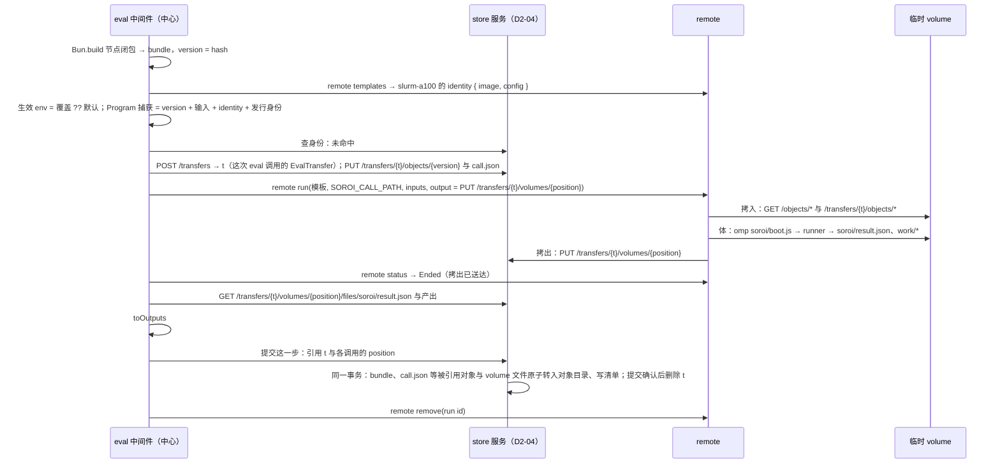
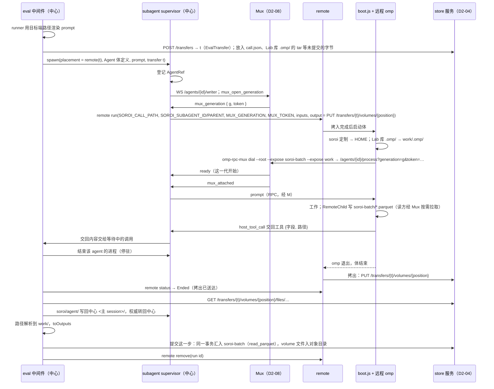

# D4 远程执行的闭合契约：远程 Program、远程 Agent、运行环境模板

起草：DrafterD4Remote（Claude 族）。议题 III（`argon/rulings-C.md:193-209`）。证据路径相对 `pepgent-pm/evidence/`；设计文档相对各仓库根。与 D2（`decisions/D2-components.md`）、D3（`decisions/D3-network-mux.md`）、D5（`decisions/D5-plugins-eval.md`）、D6（`decisions/D6-store-service.md`）对齐，对齐点在各行注明。本稿已按第 1 轮投票（`votes/D4-high.md`、`votes/D4-argon.md`）修订：D4-05、08、09、15、18、22 按反对票的反例改写，D4-02、06、07、10、11、16、17、20 按赞成票附带的建议修改；随后按导师选票（`votes/D3-D6-mentor.md`）修改 D4-03、05、08、12、18、19，对 D4-09、10 的反对意见在 §8 回应；第 2 轮按导师与 task:high 的意见修改 D4-02、05、07、13、18（同步 D4-09、14、15、21 与 §4、§5）。

## 1. 框架

用户把远程执行的难点说得很直接：“你看起来好像是构建命令，而实际上，你还得处理依赖，并把它还原成ts文件，在目标环境执行”（U `01a18e8a #8d913d2f`，`argon/rulings-C.md:194-196`），并追问“package.json怎么办”（U `#f4c96767`，`argon/rulings-C.md:197-198`）。远程 Agent 则“运行肯定是要对标主agent的，否则，omp的定制之类的不生效捕获无从谈起……只改连接方式变成远程连接，远程启动，是生是死全部遵照omp既有的生命周期……只需要补充，部署，服务发现”（U `01a18e1f #9c291fe2`，`argon/rulings-C.md:202-204`；`inv/s-subagent.md:35-36`）。文件进出走标准 OCI 行为：“自动生成的volume……运行时被覆盖……全自动的把文件拷回来”，连回走“独立的网络层中，有中心化的omp rpc多路复用器”（U `01a18e3a #09e1cc92`，`argon/rulings-C.md:199-201`，`inv/s-remote.md:62-64`）。

边界有四条：

- remote 是独立程序，不知道 soroi（U15 `inv/s-remote.md:164-166`；`pepgent-remote/design/remote.md:5`）。
- eval 只在中心主机运行，远程 agent 不能再开远程 agent（U `#5a37a640`、`#3dbd0473`，`argon/rulings-C.md:117-120`）。
- 只有正式运行进 store；远程 agent 本机落盘，结束后随拷贝回集中副本（U `#7ffcea0c`、`#8e0a7e8f`，`inv/s-remote.md:130-146`）。
- eval 里的调用要“非常简单”，模板提前构建（U `01a18e3a #c5030836`，`argon/rulings-C.md:216-218`）。

本文还遵守两条新指令。U23：soroi 的最小功能集合“一定是一个完整的omp定制，并且能走通我说的所有流程，并且能作为pepgent的agent核心”。U24：“不要混淆soroi和omomp……soroi是独立的omp定制”。所以“对标主 agent 的定制”指 soroi 自己的 omp 定制（D2-25），加上中心会话 cwd 里 Lab 库的 project 级定制（D2-12），不是本机 `~/.omp` 或 omomp 的插件、提示词；本文也不使用 fork 或分身的概念。

现状断点：`eval.md:76` 只写“文件即版本……原样发到另一台机器上运行”，`remote.md:75` 只把体当“模板镜像里的一条命令”，中间没有交付单元、依赖来源、入参解码和返回回收（`inv/s-remote.md:206,251`；`inv/s-eval.md:230` G05）。现有 `omp-soroi-eval` 已有可复用的主路径：每次调用起一个独立 Bun 进程，由 `runner.ts <request.json> <result.json>` 动态 import 节点文件并写回结果（`pepgent-omp-soroi-eval/src/runner.ts:1-42`）。但版本只哈希节点文件本身，运行环境固定为 `central`（`src/execute.ts:117-124`，`inv/r-eval.md:79,145`）。远程 Agent 的部署、服务发现，以及 transcript、工件、blob 放在哪里，都还是待定问题（`pepgent-soroi/design/subagent.md:52,152-156`）。单次调用覆盖 env 的语法与三语句规则冲突（`inv/s-eval.md:228` G03；`argon/rulings-C.md:216-221` E-1）。

本文把这三段接成一条主路径：

1. 中心把节点闭包打成一个 bundle，和 runner、输入文件一起，经 remote 的 HTTP GET 拷入临时 volume。还不在中心副本里的字节只经 store 服务的传输暂存区（每次 eval 调用一个），提交时才转入中心副本。
2. 体由同一个 boot 入口运行 Program，或者启动加载 soroi 定制的 omp。
3. 结果随整个 volume 的 tar 按调用位置拷回传输暂存区，由中间件按正式运行或 dry run 分流。

remote 只看到模板名、环境变量和若干 URL，不认识 soroi。

终态由 remote 确认：`Ended` 表示拷出已送达；`EndedUnstarted{ended_at}` 表示排队后被取消、从未开始，没有拷出，中间件不读取暂存区。所有后端的 `remove` 只等到这两种终态之一后清理并记 `removed`，不取消作业；取消只经 `abort`，调用方先 `abort` 再等终态、`remove`（D11-43A/B）。

## 2. 组件归属（与 D2 对齐，leader 裁决 A）

| 部分 | 归属 |
| --- | --- |
| 打包节点闭包、runner/`boot.js`、选择执行位置、env 解析、调用 remote CLI、开传输暂存区、回收结果、远程角色写批次 | `Pepgent/soroi` 的 `packages/omp-soroi`，eval 模块 `src/eval/`（D2-02、D5-01） |
| 远程启动 subagent 进程、开写方连接、generation 与 remote 作业的对应、transcript 拷入拷出 | 同包 subagent 模块 `src/subagent/`（D2-03），其 `launchRemote(spec, template)` 即本文 D4-05、D4-08、D4-09、D4-11、D4-12 |
| `GET /objects/{hash}`、`POST /transfers` 与 `/transfers/{t}/…`（拷入来源、拷出目标、暂存区）、批次汇入 | store 服务，`Pepgent/soroi` 的 `packages/store`（D2-04、D6-01；端点按 D6-07） |
| 临时 volume、拷入拷出、作业生命周期、模板目录 | `Pepgent/remote`（D2-09）；本文只给 `templates` 加一个输出字段（D4-18） |
| `omp-rpc-mux dial`、写方与读方连接、运行中 volume 文件的按需读取 | omp RPC Mux（D2-08，`Pepgent/omp-rpc-mux`；协议按 D3 §4） |
| soroi 约定模板用的镜像 | `Pepgent/images`（D2-13）；本文只规定镜像要满足的约定（D4-08） |
| soroi omp 定制这个可安装的整体 | `Pepgent/soroi` 发行仓（D2-25） |
| Agent 节点用的 project 级 agent 定义、技能、规则 | Lab 库（D2-12），中心会话的 cwd |

## 3. 决策表

分类：意图 / 技术 / 串联 / 实现。“补”列：缺 = 缺失部分，补 = 设计补充，— = 两者都不是。

| ID | what | where | how | 取舍 | 分类 | 补 | 依据 |
| --- | --- | --- | --- | --- | --- | --- | --- |
| D4-01 | 远程 Program 的交付单元是节点闭包的单文件 bundle，不在目标端安装依赖 | `packages/omp-soroi` eval 模块；`src/eval/bundle.ts` | 调用时用 `Bun.build({ entrypoints: [<快照>/nodes/<fn>.ts], target: "bun", format: "esm" })` 打包节点文件、相对 import、`node_modules` 的 JS/TS 包成 `node.js`，目标端由 Bun 执行。检查与构建读 D4-03 的同一私有源快照。节点源码从 `node:module` 或 `module` 只以静态具名导入使用 `isBuiltin`、`builtinModules`；`createRequire`、`Module`、`register`、`registerHooks`、`process.getBuiltinModule` 不在支持范围（D11-44），不是通用沙箱。打不进 bundle 的依赖直接报错交 AI，不等远程运行 | 目标端不安装依赖、不访问 registry，拷入一个闭包文件。系统依赖归模板镜像（D4-03）；静态模块边界使版本覆盖实际执行代码 | 技术 | 缺 | D2-10；D11-42、D11-44；U `#8d913d2f`、`#f4c96767` |
| D4-02 | 节点函数版本 = 它的 bundle 的内容哈希 | `store.md`“身份”；eval 模块的 `fnVersion` | 对 bundle 字节取哈希作为版本，覆盖相对 import 和包依赖。Program 捕获身份 = 节点版本 + 输入身份 + 环境身份（D4-18）+ 发行身份（D14-01）；Agent 公式不变，原有定制身份已含同一发行身份，另加 Lab 库 `.omp/` tar。发行身份是 soroi release artifact 的内容哈希，中心与远程使用同一 artifact。未正式提交的 bundle、源码清单（D6-21）及其他字节先 `PUT /transfers/{t}/objects/{hash}`；正式提交时 store 在同一事务里把被引用字节转入对象目录；已正式提交的 bundle 从 `GET /objects/{hash}` 读取。dry run 的暂存区随 eval 返回删除，不进对象目录 | bundle 覆盖 helper 与依赖，发行身份覆盖 runner、boot、中心执行与回收代码；身份分量是复用契约，不是验收证据。未提交字节只在暂存区 | 串联 | 补 | D6-04、D6-07、D6-21；D14-01 |
| D4-03 | `package.json` 属于节点项目，每次 eval 在私有源快照内恢复依赖；系统级依赖归模板镜像 | Lab 库（D2-12）；eval 打包器；remote 模板镜像 | 每次 eval 对会话 worktree 中被 git 跟踪及未跟踪且未忽略的 regular file 建私有快照，保留未提交改动。快照内按 lockfile 用 `bun install --frozen-lockfile` 恢复依赖，检查器与 `Bun.build` 读同一快照；快照不跨 eval 复用，不以 lockfile 哈希缓存依赖目录，不要求手工安装。节点对 `omp-soroi` 公共构造器的导入解析到当前已加载插件；lab-library 把它声明为 optional peer，不要求手工 symlink（D11-42）。模块 API 边界按 D4-01。远程端不读 `package.json`；二进制工具、Python、CUDA、原生 addon、驱动写进模板镜像 | 检查与构建同源，未提交改动纳入版本；不另维护跨 eval 依赖缓存。依赖系统库的节点使用相应模板 | 技术 | 缺 | D2-12；D11-42、D11-44；U `#f4c96767` |
| D4-04 | 中心和远程走同一条执行路径，执行位置是 ADT | eval 模块的执行器 | `Site = { kind: "central" } \| { kind: "remote"; template }`，与 D5 的 `Placement` 是同一个类型。两种位置都运行 runner bundle 加节点 bundle；入参、`result.json`、回收方式完全相同。差别只在 central 在本机临时目录起进程，remote 经 remote 起作业 | 满足“远程运行的捕获与本机相同”：中心与远程用同一个版本、同一套回收代码。代价：中心调用也要先打包 | 串联 | 补 | `layers.md:20`；现码 `src/execute.ts:179-198` |
| D4-05 | 一次远程调用映射到 remote 的 `RunRequest`，remote 不认识 soroi | eval 模块中间件调用 `remote run`（CLI，stdin 传 JSON）；store 服务端点按 D6-07 | 1. 每次 `soroi_eval` 调用开始时，中间件 `POST /transfers` 建一个 `EvalTransfer` 暂存区 `t`（D4-13），这一步里所有远程调用共用它（dry run 与正式运行相同）。<br>2. 每个调用的请求（D4-06）用确定性编码写成 `soroi/call.json`，与节点 bundle、未提交的输入 File 一样按内容哈希放进 `PUT /transfers/{t}/objects/{hash}`。<br>3. 拷入来源只有两种：<br>　• 已在中心副本里的字节用 `HttpGet` `GET /objects/{hash}`。包括：已正式提交过的节点 bundle、已提交的输入 File，以及 soroi 定制 tar、boot 程序、runner 这类发行物；发行物由部署 init 在 release 导入时（D6-22）把 boot 程序、runner、soroi 定制 tar 各自按内容哈希放进对象目录，之后都从 `/objects/{hash}` 拷入。<br>　• 其余所有未提交字节都在暂存区，用 `HttpGet` `GET /transfers/{t}/objects/{hash}`。包括：`call.json`、尚未正式提交过的节点 bundle、Lab 库 `.omp/` 的 tar、尚未提交的本机产出。<br>4. 字段映射：<br>　• `template`：生效的模板名；<br>　• `mount`：不覆盖，用 `remote templates` 返回的模板默认值；<br>　• `inputs`：`soroi/boot.js`、`soroi/call.json`、节点 bundle、每个输入 File，URL 按第 3 步；<br>　• `env`：只放固定的小值 `SOROI_CALL_PATH=soroi/call.json`；Agent 调用另加 D3 §4 的启动参数与 `SOROI_ROLE`（D4-11）；<br>　• `output`：`HttpPutTar` 到 `PUT /transfers/{t}/volumes/{position}`，`position` 是这个调用在这一步里的位置。<br>中间件以 CLI 调用 remote，类型由 `remote schema` 生成 | 只用 remote 已有的字段和两种已实现的传输方式，不给 remote 加运行接口。一步一个暂存区，这一步的所有远程调用和最后的提交引用同一个 `t`，各调用的 volume 按位置分开；暂存区在调用开始就存在，不依赖运行 id 或步序号。发行物一次提交、处处按哈希读取，不用每次调用重复上传。调用请求走文件而不走环境变量，很大的字符串 atom 也不受环境变量长度限制，remote 的运行记录里也只留下一个路径 | 串联 | 缺 | `remote.md:39-50`；`inv/r-remote.md:116-117,121`；`templates/komodo/example/compose.yaml:27-36`；D2-04、D6-05、D6-07、D6-22；U `#7ffcea0c`；`votes/D3-D6-mentor.md` D4-05 |
| D4-06 | 位置参数的入参形态 | `soroi/call.json` | 参数按位置排列。标量原样传。File 按 D4-05 第 3 步的来源拷到 `<mount>/in/<hash>`，参数改写成 `{ kind: "file", path: "<mount>/in/<hash>" }`，`<mount>` 由中心按模板默认挂载路径展开成绝对路径。节点函数照旧收到可读路径 | 节点函数不需要知道自己在哪运行。文件按内容哈希命名，同一个输入不会重复拷入 | 实现 | 缺 | `eval.md:74`；`src/node.ts:47-56`；`layers.md:12`；D6-07 |
| D4-07 | 扁平输出对象和 File 的回收 | runner；store 传输暂存区；中间件 | 1. runner 以 `<mount>/work` 为 cwd，把扁平 Output 写进 `<mount>/soroi/result.json`，File 字段相对 `work/`。<br>2. 拷出将整个 volume 的 tar 送至 `PUT /transfers/{t}/volumes/{position}`，解进暂存区，不进中心副本或查询。<br>3. 等 remote 终态：`Ended` 确认拷出已送达，随后读暂存区的 `result.json` 与文件并执行 `toOutputs`；`EndedUnstarted{ended_at}` 是排队后取消、从未开始，没有拷出，这次调用记失败、不读暂存区。<br>4. 正式步引用同一 `t` 与调用位置，store 同事务转入被引用字节并写 volume 清单，提交确认后删除 `t`；dry run 全部结果取回后交 AI 并 DELETE 暂存区。<br>5. `remote remove` 只在终态之后清理，不取消作业；需中止先 `abort`（D11-43A） | 拷回工作目录落在 store 传输暂存区，正式与 dry run 只差提交；终态向 remote 查询，不另设通知 | 串联 | 缺 | D6-07；D8 REM-07；D11-WB、D11-43A/B |
| D4-08 | soroi 约定模板：一个入口同时承载 Program 和 Agent | remote 模板；`Pepgent/images` | 镜像提供 `omp`、`omp-rpc-mux` 与系统依赖；体命令 `omp <mount>/soroi/boot.js`（`BUN_BE_BUN=1`），部署时展开挂载路径。boot 从 `REMOTE_MOUNT`、`SOROI_CALL_PATH` 读 call.json，以绝对 argv exec、不经 shell：program 跑 runner；agent 解开 D4-09 的定制，再 exec `omp-rpc-mux dial --root <mount> --expose soroi-batch --expose work -- omp --mode rpc --session <mount>/soroi/agent/<id>.jsonl …`。D3 启动参数 `SOROI_SUBAGENT_ID/PARENT`、`MUX_GENERATION/TOKEN` 由写方经 env 给出；`REMOTE_MUX/RUN/MOUNT` 由 remote 注入，dial 将它们作参数默认值。只开放已改名批次与产物目录，不开放整个 volume。Agent call.json 不带 capture；boot 只按调用配方启动，不创建、校验、持久化捕获身份（D11-28），身份由中心 eval 算出并随正式步提交 store | omp 内嵌 Bun，镜像只需两个程序；模板命令是数据，remote 不解析。捕获身份不耦合到远程启动配方 | 技术 | 补 | D3 §4；D4-09；D11-28 |
| D4-09 | 远程 Agent 的定制：每次启动随拷入带上中心的 soroi omp 定制和 Lab 库的 project 级定制 | subagent 模块的 `launchRemote`；`boot.js` | 拷入两个按内容寻址的 tar，都不含凭据：<br>1. **soroi 定制 tar**：D2-25 的发行 tar（`packages/omp-soroi` 插件包、设置覆盖、soroi 的 agent 定义、技能、规则），中心主 agent 的运行容器也从同一份 tar 安装（D2-20）；部署 init 把它作为 release 事实提交进 store（D6-22），远程从 `GET /objects/{hash}` 拷入。`boot.js` 把它解到 `<mount>/soroi/home`，以 `HOME=<mount>/soroi/home` 启动 omp，让 omp 只从这里加载用户级定制。<br>2. **Lab 库定制 tar**：中心会话 cwd（Lab 库的 worktree，D2-12）里的 `.omp/`（agent 定义、技能、规则），按内容哈希打包，放进暂存区经 `GET /transfers/{t}/objects/{hash}` 拷入。`boot.js` 把它解到远程 cwd `<mount>/work/.omp/`，omp 按 project 级定制加载。<br>本机 `~/.omp` 和 omomp 的任何东西都不进入。omp 可执行文件来自镜像，两侧版本不作考虑 | 远程每一代加载的定制，与中心主 agent 加载的逐字节相同：用户级来自同一份发行 tar，project 级来自同一份 Lab 库 `.omp/`。Agent 节点的 `template` 可以来自发行包或 Lab 库的 `.omp/agents`（D5-17），两者远程都找得到。发版或改 Lab 库后不必重建镜像。不采用的写法：把定制烘焙进镜像，每次发版都要重建，否则就会和中心不一致；D2-11 已采纳本行。不拷 omp 可执行文件，是因为中心可能是 macOS arm64，而远程是 Linux | 意图 + 技术 | 缺 | U `#9c291fe2`；U `01a18f4a #f488be08`（`inv/s-subagent.md:90-91`）；U23；U24；`subagent.md:17,118-128`；`omp://settings.md:26`、`omp://config-usage.md:74`；D2-11、D2-12、D2-20、D5-17 |
| D4-10 | 长期凭据由模板部署的拥有方注入，不进任何 tar，也不进 `RunRequest.env` | 模板的部署声明 | 模型 provider 等密钥由模板所在的部署注入：Komodo Stack 引用 workload repo SOPS 写成的 km Variables；Slurm 用站点自己的密钥机制。`RunRequest.env` 只放调用数据，以及 D3 §4 规定的启动参数 `SOROI_SUBAGENT_ID`、`SOROI_SUBAGENT_PARENT`、`MUX_GENERATION`、`MUX_TOKEN`；`MUX_GENERATION` 与 `MUX_TOKEN` 由 Mux 在 `mux_generation` 帧里签发给写方（D3-07） | 凭据由使用方的拥有者保存和注入。remote 的运行记录 `runs/<run>.json` 会保存原请求（`inv/r-remote.md:121`），所以长期秘密不能走 env；只对一代进程有效的连接令牌可以 | 技术 | 补 | `subagent.md:128`；`omp://providers.md:65`；D3 §4、D3-07 |
| D4-11 | 远程 Agent 经多路复用器连回，RPC 协议原样不变 | `boot.js`；subagent 模块的 supervisor；D3 §4 | 1. supervisor 打开写方连接 `WS /agents/{id}/writer`，带 `Authorization: Bearer <writer 凭据>`，发 `mux_open_generation`，收到 `mux_generation { generation, token }`，把这条连接作为 `RpcProcess` 的传输。<br>2. supervisor 调用 `remote run`，`env` 为 D3 §4 的 `{ SOROI_SUBAGENT_ID, SOROI_SUBAGENT_PARENT, MUX_GENERATION, MUX_TOKEN }`，另加 `SOROI_CALL_PATH` 与 `SOROI_ROLE=RemoteChild`。<br>3. 体里的 `omp-rpc-mux dial --root <mount> --expose soroi-batch --expose work` 出站连接 `WS /agents/{id}/process?generation={g}&token={t}&host={hostname}&run={REMOTE_RUN}`，把 `omp --mode rpc` 的每一行 JSONL 作为一条 text 消息原样转发；写方收到 `mux_attached { generation, where }`，再收到 omp 的 `ready`。<br>4. prompt、IRC、host tool（含交回工具）、host URI 全部照旧。<br>5. 读方订阅 `WS /agents/{id}/reader`。<br>本机 subagent 由 subagent 模块自己启动 `omp-rpc-mux dial --generation g --token t -- omp --mode rpc …`，本机和远程只有一种传输 | 本机和远程只差在进程在哪里启动、怎样连上（`subagent.md:16`），插件不另造协议。generation 由 Mux 分配，写方开的那一代与拨入的进程一一对应（D3-07）。URL、参数、环境变量与帧名逐字取自 D3 §4 | 串联 | 缺 | U `#09e1cc92`；U `#9c291fe2`；`subagent.md:66-68`；`remote.md:26`；D3 §4、D3-07、leader 裁决 D |
| D4-12 | 生命周期嵌套：agent 身份 ⊃ 写方声明 ⊃ remote 作业与 volume ⊃ 体 ⊃ 进程代 | subagent 模块；remote；Mux | 1. agent 身份与四态归中心 AgentRegistry，长期存在。<br>2. supervisor 打开 `/writer` 开始声明，先结束所有在线代再关闭；一个声明可跨多次作业与唤醒。<br>3. `remote run` 返回 RunStarted 开始作业，remote 是确认者。`Ended` 时拷出已送达，中心确认汇入或 transcript 写回后 remove；`EndedUnstarted{ended_at}` 表示排队后取消、从未开始，没有拷出、不读暂存区，等此终态后 remove。所有后端 remove 只等终态后清理并记 removed，不取消；取消只经 abort。<br>4. 拷入完成后 boot 启动体，dial 退出后体结束。<br>5. 代 id 在 remote run 前由 mux_open_generation 分配，从写方收到 ready 到进程退出、stdout 读完、mux_exited 结束。停驻、kill 或结果作业取消时，先结束代、再体、再作业；远程 Agent 保住 transcript 的顺序按 D6-15。作业状态权威是 remote；supervisor 只在作业期间持 run id，sidecar 仅记启动配方 | 生命周期各有权威；拷入先于 ready、拷出晚于退出，作业包住代。停驻释放资源，唤醒重开作业与代 | 串联 | 缺 | D2-11；D3-07；D11-WB、D11-43A/B |
| D4-13 | transcript、blob、工件的位置与权威转移；暂存区的两种来历 | `<mount>/soroi/agent/`；中心 `<主 session>/`；store 服务暂存区 | 1. 作业开始时：中心把 `<id>.jsonl` 和它引用的 blob 打成 `agent.tar`，放进这次作业的暂存区拷入（D4-05）。中心文件是来源，tar 是一次性副本。<br>2. 体运行中：权威是 volume 里的 `soroi/agent/`，只有远程 omp 写。<br>3. 拷出送达后：`soroi/agent/` 的内容写回中心 `<主 session>/<id>.jsonl` 与 blob 目录，权威转回中心；冷复活和 `history://` 照旧读中心文件。<br>暂存区按来历分两种（ADT，D6-07 同步）：<br>• `EvalTransfer { evalCall }`：Agent 节点调用发生在一次 `soroi_eval` 里，用这次 eval 调用的暂存区（D4-05），交给 `launchRemote`；它在 eval 调用返回（dry run）或这一步提交确认（正式运行）时结束。<br>• `AgentGenerationTransfer { agent, generation }`：eval 调用之外的唤醒（例如 IRC 唤醒后再停驻），由 subagent 模块自己 `POST /transfers` 开，拷出写到单卷 `PUT /transfers/{t}/volume`（D6）；transcript 与 blob 写回中心并确认后，subagent 模块显式 `DELETE`。<br>两种都只是传输暂存区，不是 transcript 的权威。运行中的读方经 Mux 看事件流，不读 transcript 文件 | 回答 `subagent.md:154` 的待定问题：transcript 与 store 批次用同一种“运行中在远程、结束后回中心”的锚点，任何时刻只有一处算数。暂存区不依赖运行和步，所以 eval 调用之外的那一次作业也有拷出目标；两种来历各有确定的开始者和结束锚点 | 技术 | 缺 | U `#8e0a7e8f`；`subagent.md:19,93,110,154`；`store.md:68`；D6-07 |
| D4-14 | 远程 Agent 的交回与捕获完成 | 交回工具（host tool，中心执行）；中间件 | 1. 交回工具与本机完全相同：经 RPC 作为 host tool 在中心执行，收下 `{ 字段, 路径 }`，交给正在等待这次调用的 eval 执行。与本机一样，未提交的一步只存在于这次 eval 调用里。路径带执行位置（D5 的 `{ path, placement }`）。<br>2. 中间件让 supervisor 结束这个 agent 的进程。<br>3. remote 报告 `ended` 后，中间件经 `GET /transfers/{t}/volumes/{position}/files/{path}` 读取 `work/` 下的路径，执行 `toOutputs`；捕获到此完成 | 交回通道只有一条，本机和远程相同（C-5，`argon/rulings-C.md:128-133`）。文件在拷出之前不在中心，所以捕获的结束锚点是拷出到达，而不是交回工具被调用 | 串联 | 缺 | U `#49e6867a`；`eval.md:86,94`；D5；D6-07 |
| D4-15 | 远程 Agent 的本机批次与汇入时点 | `<mount>/soroi-batch/`；eval 的 RemoteChild 角色；store | RemoteChild 只产生运行中四列批次：`seq`、`at`、`kind`、`transcript_entry`，kind 仅 `turn \| tool_call \| file_written`；不生成、校验或持久化捕获身份，不带 capture、run_id、step、position（D11-28）。中心 eval 计算捕获身份，正式提交进入 store；store 汇入时补后三列。Parquet 先写 `x.parquet.tmp` 再改名 `x.parquet`。读方收到 RPC 事件后经 Mux files 与 dial 按需读已改名批次，不推送。正式步的同一事务从该调用 `volumes/{position}` 读四列并汇入 agent_progress；dry run 不汇入 | 运行中本机落盘、结束后集中；提交前值不可复用。批次形状与身份计算职责分开 | 技术 | 补 | D3-13；D6-03/04/07；D11-28 |
| D4-16 | 只有一层：远程 agent 不能再开远程 agent | `packages/omp-soroi` 的角色判定 | 角色是 `Main \| LocalChild \| RemoteChild`，由启动方设置的 `SOROI_ROLE` 决定。开远程 agent 只有一条路：写 eval 的中心会话在 `soroi_eval` 里调用 env 为远程的 `Agent` 节点函数。写 eval 的中心会话指主 agent，以及经 subagent 模块派出的中心 agent（D2-02），由启动配方里的 `writesEval` 标记（D5）。由此：<br>• Agent 体会话（本机或远程）以及它们派出的会话都没有 `soroi_eval`，调不了 `Agent` 节点，也就开不了远程 agent；<br>• `RemoteChild` 不注册 `soroi_task`，与 D5 的嵌套门一致；<br>• 容器里没有 remote 的目录和凭据。<br>远程 agent 自己可以用 omp 内置的进程内 task | 一层由结构保证：没有任何工具能从远程触发远程启动，不需要运行时计数或拦截；同一个结构也满足“eval 禁止递归嵌套”。主 agent 和经 subagent 模块派出的中心 agent 照常能调用 `Agent` 节点 | 意图 + 技术 | — | U `#3dbd0473`、`#5a37a640`（`argon/rulings-C.md:117-120`）；U24；`inv/r-eval.md:95`；D5-06、D5-07 |
| D4-17 | 服务发现 = remote 的模板目录，不另建登记 | remote `templates` | 能启动 subagent 的地方，就是 remote 目录里遵守 D4-08 约定的模板；D3-14 的发现条件以同一约定为准。节点作者从 `remote templates` 里选模板名，写成函数默认值，或者在调用时覆盖。部署 = `Pepgent/images` 构建带 `omp` 和 `omp-rpc-mux` 的镜像并登记模板；定制随每次启动拷入（D4-09） | 目录只有 remote 一个权威（`inv/s-remote.md:263`），soroi 不维护第二份机器清单。与 D2-11 的发现规则一致 | 技术 | 缺 | U `#9c291fe2`（部署、服务发现）；`subagent.md:24,130-138`；D2-11、D3-14 |
| D4-18 | 生效 env 的解析，以及不可变环境身份进入捕获身份 | 中间件；remote templates；中心容器 | 1. `生效 env = 本次调用的覆盖 ?? 函数默认 env ?? central`，覆盖按 D4-19 归一到调用。<br>2. 远程环境身份 = registry 镜像 digest + 影响执行的模板配置哈希，由 remote templates 返回 `identity { image, config }`；所有后端（含 Slurm）在读取模板目录时用 `Registry::resolve` 解析。Slurm 的 body、步骤镜像都写 OCI 引用（tag 或 digest），脚本把 `docker://<引用>` 原样交 Apptainer，不用独立 SIF 路径、不在运行前另解析。config 不含部署凭据及每次运行注入变量；Komodo 为 compose 与环境，Slurm 为 partition/QOS、资源、容器运行时与 OCI 引用，k8s 为 Job manifest。中心身份 = 容器镜像 digest + 运行配置哈希，由部署注入。<br>3. Program 捕获 = bundle 版本 + 输入身份 + 环境身份 + 发行身份（D14-01）；发行身份为 soroi release artifact 内容哈希。Agent 不变，定制身份本来就含同一发行身份与本次 Lab `.omp/` tar 身份（D4-09）。身份由中心 eval 算出，远程 boot/RemoteChild 不计算。<br>4. 捕获另存模板名与 remote run id 作溯源展示 | 模板与环境只有其拥有方计算；同名换镜像、配置或发行时不复用旧结果；中心与远程采用同一发行身份 | 技术 | 补 | D11-10、D11-28；D14-01；D4-02 |
| D4-19 | 单次调用覆盖 env 的语法：写在 eval 工具参数里，以调用的产出 atom 名定位，检查器归一化到调用 | `soroi_eval` 工具参数；执行前的检查器 | 新增可选参数 `env: Record<产出 atom 名, 模板名>`。键可以是这次调用产出的任意一个 atom 名；一次运行内名字唯一，所以能唯一定位一次调用。代码本身仍只有三种语句，不出现模板名字面量。<br>检查器先把每个键归并到产出它的调用：同一调用的多个键给同一个模板时归一成一项；给了不同模板时拒绝这一步，返回结构化错误 `env_conflict { call, keys, templates }`；键不是这一步任何调用的产出名时同样拒绝。执行和捕获身份只用归一化后的调用级覆盖。<br>例：代码 `const { curve: curve_2200c, log: log_2200c } = anneal(film, temp_2200c)`，参数 `env: { curve_2200c: "slurm-a100" }` | 不往调用里塞对象或额外参数，不破坏“不定义 object、没有魔法值、调用参数只能是 atom 名”（`eval.md:136-137`），调用仍然简单。D5-09 的 pins 用同一种定位方式，D5-10 已采纳本行。<br>不采用的写法：<br>• `fn.withEnv(t)(a, b)`：嵌套调用；<br>• 把模板当成 atom 参数：改变函数参数个数，而且模板不是数据输入 | 技术 | 补 | U `#c5030836`、`#13abc2a1`、`#276d1776`（`argon/rulings-C.md:216-221`）；`inv/s-eval.md:228`；D5-09、D5-10；`votes/D3-D6-mentor.md` D4-19 |
| D4-20 | 运行级的 env 覆盖不另设机制 | — | 由 D4-19 在各步逐个调用表达。派生运行不按已存的步重跑（leader 裁决 C）：派生运行里新写的步各自带 D4-19 的覆盖，store 只按 D6-16 记派生来源与改动 | assistant 的 004e04da 提过三层覆盖，用户只是附条件认可（`inv/s-remote.md:96-104`），argon 已确认不单设运行级覆盖与 (U) 无冲突（`votes/D4-argon.md` 第一节 4）。运行级覆盖需要一份跨步、跨中心 agent 的运行状态，主路径不需要它 | 技术 | 补 | `argon/pivot-baseline.md:81`；leader 裁决 C；D6-16 |
| D4-21 | dry run 里的远程调用真实执行，结果不进 store | 中间件 | dry run 照常发起远程作业，例如在 Slurm 上试跑算法；拷回后结果交给 AI，这一步所有结果取回后删除暂存区，批次不汇入，捕获不写，对象存储不写。被 pin 住的调用不发起作业。远程 Agent 的 transcript 仍按 D4-13 回到中心 session 目录：它归 omp 管，不属于 store | 满足“在slum里试跑某种算法非常正常”与“dry run根本没有store” | 意图 | — | U `#68d36f55`、`#32b6f7fd`、`#7ffcea0c`（`inv/s-remote.md:116-128`）；D6-07 |
| D4-22 | 远程执行在 soroi 定制里如何打包、安装、被 Pepgent 调用（U23） | `Pepgent/soroi` 单仓：`packages/omp-soroi`、`packages/store`；发行仓（D2-25） | 打包：远程执行的 soroi 一侧全部在一个插件包 `packages/omp-soroi` 里。eval 模块含打包、runner/`boot.js`、`Site` 执行、env 参数、remote 客户端、远程角色写批次；subagent 模块含 `launchRemote`、Mux 写方、generation、transcript 拷入拷出。store 服务在同仓的 `packages/store`。<br>安装：插件包随 D2-25 的 soroi 定制作为一个整体装在中心主机；D4-09 拷到远程的正是这份已安装的整体，所以远程 Agent 与中心加载同一套定制。<br>调用：Pepgent 后端不直接为 soroi 调用 remote，而是经 Mux 驱动中心主 agent，远程执行发生在 `soroi_eval` 内部。Pepgent 只经 `Pepgent/images` 和 remote 的模板写入登记环境，读 remote 的 `templates`、`status`、`tail` 做展示。伴随进程（store 服务、Mux）由 D2-25 声明 | 远程执行不另成一个需要单独安装的组件；所有流程（逐步 eval、两阶段、远程捕获、subagent 生命周期）都在这一套定制里走通。与裁决 A 以及 D2-02、D2-03、D2-25、D5-01、D6-01 一致 | 串联 | 补 | U23；U24；D2-25；leader 裁决 A |

## 4. 接口草图（主路径）

### 4.1 中间件内部类型（`packages/omp-soroi` eval 模块）

```ts
/** 与 D5 的 Placement 是同一个类型。 */
type Site =
	| { readonly kind: "central" }
	| { readonly kind: "remote"; readonly template: TemplateName };

/** 进入捕获身份的运行环境（D4-18）。 */
type EnvIdentity =
	| { readonly kind: "central"; readonly image: ImageDigest; readonly config: ContentHash } // 中心运行容器（D2-20）
	| { readonly kind: "remote"; readonly image: ImageDigest; readonly config: ContentHash }; // 来自 remote templates 的 identity
// 捕获记录另存 templateName 与 remoteRun，不进身份。

/** 节点闭包：bundle 的内容哈希就是函数版本（D4-02）。 */
interface NodeBuild {
	readonly version: ContentHash;
	readonly committed: boolean; // 已正式提交过 → /objects；否则 → /transfers/{t}/objects，提交时由 store 转入
}

/** 传输暂存区的来历（D4-13，D6-07）。 */
type Transfer =
	| { readonly kind: "EvalTransfer"; readonly id: TransferId; readonly evalCall: EvalCallId } // 一次 soroi_eval 一个；dry run 返回或步提交确认后结束
	| { readonly kind: "AgentGenerationTransfer"; readonly id: TransferId; readonly agent: AgentId; readonly generation: Generation }; // 非 eval 唤醒；写回确认后 DELETE

/** 拷出目标：EvalTransfer 按调用位置分卷，AgentGenerationTransfer 只有一卷（D6-07）。 */
type VolumeTarget = { readonly kind: "position"; readonly position: number } | { readonly kind: "single" }; // volumes/{position} | volume

/** Agent 体捕获身份额外的定制身份（D4-18）。 */
interface CustomizationIdentity {
	readonly release: ContentHash; // soroi release artifact
	readonly libraryOmp: ContentHash; // 本次拷入的 Lab 库 .omp/ tar
}

/** 拷入来源（D4-05）。 */
type ObjectSource =
	| { readonly kind: "central"; readonly hash: ContentHash } // GET /objects/{hash}
	| { readonly kind: "transfer"; readonly transfer: TransferId; readonly hash: ContentHash }; // GET /transfers/{t}/objects/{hash}

/** 确定性编码写成 soroi/call.json 的调用请求（D4-05、D4-06、D4-09）；env 里只有 SOROI_CALL_PATH。 */
type CallRequest =
	| {
			readonly kind: "program";
			readonly node: VolumeFile; // "soroi/node.js"
			readonly args: readonly SiteAtomic[];
	  }
	| {
			readonly kind: "agent";
			readonly session: VolumeFile; // "soroi/agent/<id>.jsonl"
			readonly customization: VolumeFile; // "soroi/customization.tar"：D2-25 的 soroi 定制
			readonly library: VolumeFile; // "soroi/library-omp.tar"：Lab 库的 .omp/
			readonly state: VolumeFile | null; // "soroi/agent.tar"；首次启动为 null
			readonly agentDef: string; // Agent 体 agent 定义名（发行包或 Lab 库）
			readonly prompt: string; // 中心用目标端路径渲染好的提示词
	  };
// agent 调用另有 D3 §4 的启动参数：SOROI_SUBAGENT_ID、SOROI_SUBAGENT_PARENT、MUX_GENERATION、MUX_TOKEN；以及 SOROI_ROLE=RemoteChild。

type SiteAtomic = number | string | boolean | { readonly kind: "file"; readonly path: string };

/** runner 写进 <mount>/soroi/result.json。 */
type ProgramResult =
	| { readonly ok: true; readonly output: Output } // File 字段是相对 work/ 的路径
	| { readonly ok: false; readonly error: string };

/** 一次远程调用在中心的进行状态，只存在于这次 eval 调用里（D4-07、D4-14）。 */
type RemoteCall =
	| { readonly kind: "started"; readonly call: CallRef; readonly position: number; readonly run: RemoteRunId }
	| { readonly kind: "returned"; readonly call: CallRef; readonly position: number; readonly run: RemoteRunId; readonly payload: ReturnPayload } // 仅 Agent
	| { readonly kind: "copied"; readonly call: CallRef; readonly position: number }; // remote 已确认 Ended；EndedUnstarted 无拷出，不到此状态
```

### 4.2 `soroi_eval` 参数（D4-19，叠加在 D5 的工具契约上）

```ts
interface SoroiEvalParams {
	readonly code: string;
	readonly mode: "dry_run" | "formal";
	readonly pins?: Record<string, unknown>; // 形状由 D5 定
	/** 单次调用覆盖 env：键是该调用的任一产出 atom 名，值是 remote 模板名。 */
	readonly env?: Record<AtomName, TemplateName>;
}
```

### 4.3 映射成 remote `RunRequest`（dry run 的 Program 调用示例）

`soroi/call.json` 的内容（确定性编码）：`{"args":[2200,{"kind":"file","path":"/work/in/9f2c…"}],"kind":"program","node":"soroi/node.js"}`。

```json
{
  "template": "slurm-a100",
  "env": {
    "SOROI_CALL_PATH": "soroi/call.json"
  },
  "inputs": [
    { "path": "soroi/boot.js", "source": { "kind": "http_get", "url": "http://<store>/objects/<boot-hash>" } },
    { "path": "soroi/call.json", "source": { "kind": "http_get", "url": "http://<store>/transfers/<t>/objects/<call-hash>" } },
    { "path": "soroi/node.js", "source": { "kind": "http_get", "url": "http://<store>/transfers/<t>/objects/<version>" } },
    { "path": "in/9f2c…",      "source": { "kind": "http_get", "url": "http://<store>/objects/9f2c…" } }
  ],
  "output": { "kind": "http_put_tar", "url": "http://<store>/transfers/<t>/volumes/<position>" }
}
```

节点 bundle 若已正式提交过（之前有正式运行用过这个版本），它的 URL 换成 `/objects/<version>`；`<t>` 是这次 eval 调用的暂存区，这一步里每个远程调用共用，各用自己的 `<position>`。Agent 调用的差别：`soroi/node.js` 换成 `soroi/customization.tar` 和 `soroi/library-omp.tar`；非首次启动再加 `soroi/agent.tar`；`env` 多出 D3 §4 的四个启动参数和 `SOROI_ROLE`。

### 4.4 volume 布局（`<mount>` = 模板默认挂载路径）

```text
<mount>/
  soroi/boot.js             runner + boot（eval 模块产物，按哈希拷入）
  soroi/node.js             节点 bundle（Program）
  soroi/customization.tar   soroi omp 定制（Agent）
  soroi/library-omp.tar     Lab 库的 .omp/（Agent）
  soroi/home/               boot 把 soroi 定制解到这里，作为远程 omp 的 HOME
  soroi/agent.tar           transcript + blob（Agent，唤醒时）
  soroi/agent/<id>.jsonl    远程 omp 的 transcript 与 blob（运行中的权威）
  soroi/result.json         Program 的结果
  soroi-batch/*.parquet     远程 Agent 的本机批次（读方经 dial --root 拉取）
  in/<hash>                 输入文件
  work/                     体的 cwd；Program 和 Agent 写出的文件
  work/.omp/                boot 把 Lab 库的 .omp/ 解到这里（Agent）
```

### 4.5 模板约定（Komodo 体，D4-08）

```yaml
body:
  image: <Pepgent/images 构建：omp、omp-rpc-mux 与本环境系统依赖>
  env_file: .env              # 带 SOROI_CALL_PATH、D3 §4 启动参数与 REMOTE_*
  working_dir: ${REMOTE_MOUNT}
  environment: { BUN_BE_BUN: "1" }   # 长期凭据由部署方以 km Variables 注入，见 D4-10
  command: ["omp", "${REMOTE_MOUNT}/soroi/boot.js"]   # compose 部署时展开成绝对路径；boot 之后的 argv 都由 boot 用绝对路径直接 exec
```

### 4.6 store 服务端点（D2-04，按 D6-07、D6-21）

| 方法 | 路径 | 用途 |
| --- | --- | --- |
| POST | `/transfers` | 每次 `soroi_eval` 调用开一个 `EvalTransfer`；eval 之外的唤醒由 subagent 模块开 `AgentGenerationTransfer`；返回 `t` |
| PUT | `/transfers/{t}/objects/{hash}` | 放入所有未提交的字节：`call.json`、未正式提交过的 bundle 与源码清单、Lab 库 `.omp/` tar、`agent.tar`、未提交的产出 |
| GET | `/transfers/{t}/objects/{hash}` | 远程拷入步骤取这些字节 |
| GET | `/objects/{hash}` | 远程拷入步骤取已在中心副本里的字节：已提交的 bundle 与输入，以及部署 init 提交的发行物（soroi 定制 tar、boot、runner，D6-22） |
| PUT | `/transfers/{t}/volumes/{position}` | `EvalTransfer`：远程拷出步骤按调用位置送回整个 volume 的 tar |
| PUT | `/transfers/{t}/volume` | `AgentGenerationTransfer`：唤醒那一次作业的拷出（单卷） |
| GET | `/transfers/{t}/volumes/{position}/files/{path}` | `EvalTransfer`：中间件读取 `result.json`、产出与 `soroi/agent/` |
| GET | `/transfers/{t}/volume/files/{path}` | `AgentGenerationTransfer`：subagent 模块取回 transcript 与 blob |
| DELETE | `/transfers/{t}` | `EvalTransfer`：dry run 在全部结果取回后由中间件删除，正式运行由 store 在提交确认后删除；`AgentGenerationTransfer`：transcript 写回确认后由 subagent 模块删除 |

### 4.7 多路复用器（D3 §4）

| 一方 | 连接 |
| --- | --- |
| supervisor（写方） | `WS /agents/{id}/writer`，`Authorization: Bearer <writer 凭据>`；发 `mux_open_generation`，收 `mux_generation { generation, token }`、`mux_attached`、`mux_exited` |
| 体里的 `omp-rpc-mux dial --root ${REMOTE_MOUNT}` | 出站 `WS /agents/{id}/process?generation={g}&token={t}&host={hostname}&run={REMOTE_RUN}`；一条 text 消息就是一行 omp JSONL；应答 `mux_list_files`、`mux_read_file` |
| 读方 | `WS /agents/{id}/reader`；运行中批次经 `GET /agents/{id}/files?dir=soroi-batch`、`GET /agents/{id}/files/{path}` 拉取 |

### 4.8 remote `templates` 的新增字段（D4-18）

```ts
interface TemplateInfo {
	readonly name: TemplateName;
	readonly description: string;
	readonly backend: "komodo" | "slurm" | "k8s";
	readonly mount: string;
	/** 新增：不可变的环境身份（D4-18）。 */
	readonly identity: {
		readonly image: ImageDigest; // 模板镜像引用解析成的 registry digest
		readonly config: ContentHash; // 影响执行的模板配置的哈希
	};
}
```

## 5. 主路径时序

### 5.1 远程 Program（正式运行，节点版本首次使用）



dry run 走同样的前半段；拿到 `toOutputs` 的结果后交给 AI，这一步所有结果取回后 `DELETE /transfers/{t}`，不写对象存储，不提交。

### 5.2 远程 Agent（正式运行）



唤醒同一个 agent 时，supervisor 再开一代（`mux_open_generation`），重走上图前半段，多拷入一个 `soroi/agent.tar`（中心 transcript 与 blob 的一次性副本）。这次唤醒不在 eval 调用里时，由 subagent 模块自己开 `AgentGenerationTransfer`，拷出写到单卷 `PUT /transfers/{t}/volume`，transcript 写回确认后删除（D4-13）。

## 6. 占位（先假定能工作）

| 占位 | 假定 |
| --- | --- |
| 打包的确定性 | 同一份源码和依赖，`Bun.build` 每次输出同样的字节 |
| 打包覆盖面 | 节点的 JS/TS 依赖都能打进 bundle；打不进的由模板镜像提供 |
| 镜像 digest 解析 | remote 能把模板里的镜像引用解析成 registry digest；中心运行容器能从部署得知自己的镜像 digest |
| 依赖恢复 | 中心主机能访问 Lab 库 lockfile 所需的包来源 |
| HOME 迁移 | 以 `HOME=<mount>/soroi/home` 启动时，omp 的用户级定制全部从 soroi 定制加载；blob 目录随 `--session` 落在 `soroi/agent/` 下 |
| 远程角色插件 | eval 模块在 `RemoteChild` 角色下能从会话事件写出 Parquet 批次 |
| 冷复活接入 | subagent 模块自己的 reviver 按 `.soroi.json` 的 `site` 重开远程作业，不走内置的本地 cwd 检查 |
| 运行中产物进度 | 远程批次和 volume 里仍在写入的文件，读方经 Mux 与 `dial --root` 能按需读到（D3-13） |

## 7. 通过后要改的设计文档

| 文档 | 节 | 改动 |
| --- | --- | --- |
| `pepgent-soroi/design/eval.md` | “节点函数”（:62-79） | “文件即版本”改为 bundle 版本（D4-01/02）；补 `package.json` 与系统依赖的归属（D4-03）；env 的默认、覆盖、解析与模板哈希（D4-18/19/20） |
| `pepgent-soroi/design/eval.md` | “中间件”（:89-96） | 补执行位置 `Site`、`RunRequest` 映射与传输暂存区、入参与回收、正式与 dry run 分流（D4-04..07、D4-21） |
| `pepgent-soroi/design/eval.md` | “存储”（:164-168） | 补结构上的一层规则：只有写 eval 的中心会话有 `soroi_eval`，Agent 体会话没有（D4-16）；去掉 fork 分身的说法（U24，与 D2 一致） |
| `pepgent-soroi/design/eval.md` | “接口”（:170-176） | remote 一行写明以 CLI 调用，只用 `RunRequest` 现有字段 |
| `pepgent-soroi/design/store.md` | “身份”（:27-33） | 节点函数版本 = bundle 哈希；运行环境 = 不可变的环境身份（镜像 digest + 模板配置哈希），另记模板名与 remote run id（D4-02/18） |
| `pepgent-soroi/design/store.md` | “远程 agent 运行中”（:54-70） | 补批次内容、`soroi-batch/` 位置、读方经 Mux 按需拉取、汇入与这一步的提交同一事务（D4-15） |
| `pepgent-soroi/design/subagent.md` | “要求”第 21、24 行；“实现”（:26-52）；“待定问题”（:152-156） | 第 21 行去掉分身；部署 = 镜像带 omp 与 `omp-rpc-mux`，每次拷入 soroi 定制与 Lab 库 `.omp/`（D4-08/09/10）；服务发现 = remote 模板目录（D4-17）；Mux 传输（D4-11）；generation 与 remote 作业的嵌套（D4-12）；transcript 与 blob 的位置与权威转移（D4-13）；删去已回答的三个待定问题 |
| `pepgent-soroi/design/layers.md` | “远程运行”“远程捕获” | 只核对要求的措辞与链接，要求本身不变 |
| `pepgent-remote/design/remote.md` | “一次运行”第 75 行；“对外接口”`templates` 一行 | 写明 soroi 约定模板只是模板数据（体命令运行 `boot.js`，agent 分支 exec `omp-rpc-mux dial --root`），remote 不需要了解它（D4-08）；`templates` 输出增加 `identity { image, config }`（D4-18） |

## 8. 反例回应（不修改的条目）

| 意见来源 | 条目 | 意见 | 回应 |
| --- | --- | --- | --- |
| `votes/D3-D6-mentor.md` | D4-09 | 反例：远程旧版 omp 不支持新 hook；要求发行包带能力 manifest，boot 时校验版本能力 | 不改。用户原话明确：“不可以改omp核心，必须只能是插件，生命周期和irc全方位对标omp内置subagent，不考虑两侧版本一致，乃至不考虑版本问题，只考虑rpc模式能正常通讯”（U `session://01a18f4a-a79c-77de-b951-7efecf85ac21/entry/f488be08`）。argon 已把 D4-09 裁为【定】（`votes/D4-argon.md` 第一节 1）。加版本能力校验就是在考虑版本问题，与这条原话相反 |
| `votes/D3-D6-mentor.md` | D4-10 | 反例：`MUX_TOKEN` 被 remote 持久化后被重放；要求 token 一次性、短时有效，日志脱敏 | 不改。这是安全加固，设计阶段只写主路径、占位先假定能工作（`pepgent-soroi/.claude/rules/design-assumes-it-works.md`），留给实现阶段。主路径上 token 只对一代有效（D3-07），这一代结束后它不再能连上 |

