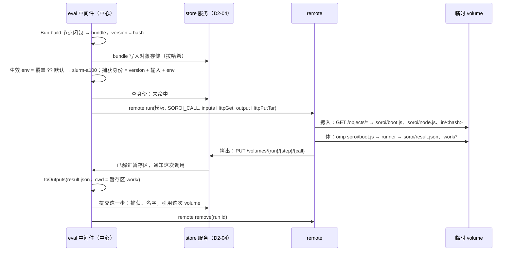
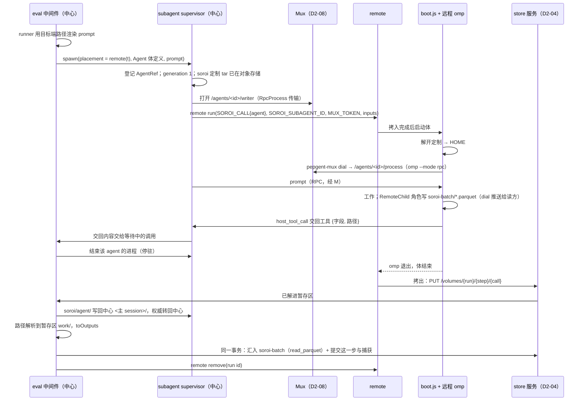

# D4 远程执行的闭合契约：远程 Program、远程 Agent、运行环境模板

起草：DrafterD4Remote（Claude 族）。议题 III（`argon/rulings-C.md:193-209`）。证据路径相对 `pepgent-pm/evidence/`；设计文档相对各仓库根。已与 D2（`decisions/D2-components.md`）、D3（多路复用器）、D5（插件）、D6（store）对齐，对齐点在各行注明。

## 1. 框架

用户把远程执行的难点说得很直接：“你看起来好像是构建命令，而实际上，你还得处理依赖，并把它还原成ts文件，在目标环境执行”（U `01a18e8a #8d913d2f`，`argon/rulings-C.md:194-196`），并追问“package.json怎么办”（U `#f4c96767`，`argon/rulings-C.md:197-198`）。远程 Agent 则“运行肯定是要对标主agent的，否则，omp的定制之类的不生效捕获无从谈起……只改连接方式变成远程连接，远程启动，是生是死全部遵照omp既有的生命周期……只需要补充，部署，服务发现”（U `01a18e1f #9c291fe2`，`argon/rulings-C.md:202-204`；`inv/s-subagent.md:35-36`）。文件进出走标准 OCI 行为：“自动生成的volume……运行时被覆盖……全自动的把文件拷回来”，连回走“独立的网络层中，有中心化的omp rpc多路复用器”（U `01a18e3a #09e1cc92`，`argon/rulings-C.md:199-201`，`inv/s-remote.md:62-64`）。

边界有四条：

- remote 是独立程序，不知道 soroi（U15 `inv/s-remote.md:164-166`；`pepgent-remote/design/remote.md:5`）。
- eval 只在中心主机运行，远程 agent 不能再开远程 agent（U `#5a37a640`、`#3dbd0473`，`argon/rulings-C.md:117-120`）。
- 只有正式运行进 store；远程 agent 本机落盘，结束后随拷贝回集中副本（U `#7ffcea0c`、`#8e0a7e8f`，`inv/s-remote.md:130-146`）。
- eval 里的调用要“非常简单”，模板提前构建（U `01a18e3a #c5030836`，`argon/rulings-C.md:216-218`）。

本文还遵守 leader 转述的两条新指令。U23：soroi 的最小功能集合“一定是一个完整的omp定制，并且能走通我说的所有流程，并且能作为pepgent的agent核心”。U24：“不要混淆soroi和omomp……soroi是独立的omp定制”。所以“对标主 agent 的定制”指 soroi 自己的 omp 定制（D2-25），不是本机 `~/.omp` 或 omomp 的插件、提示词；本文也不使用 fork 或分身的概念。

现状断点：`eval.md:76` 只写“文件即版本……原样发到另一台机器上运行”，`remote.md:75` 只把体当“模板镜像里的一条命令”，中间没有交付单元、依赖来源、入参解码和返回回收（`inv/s-remote.md:206,251`；`inv/s-eval.md:230` G05）。现有 `omp-soroi-eval` 已有可复用的主路径：每次调用起一个独立 Bun 进程，由 `runner.ts <request.json> <result.json>` 动态 import 节点文件并写回结果（`pepgent-omp-soroi-eval/src/runner.ts:1-42`）。但版本只哈希节点文件本身，运行环境固定为 `central`（`src/execute.ts:117-124`，`inv/r-eval.md:79,145`）。远程 Agent 的部署、服务发现，以及 transcript、工件、blob 放在哪里，都还是待定问题（`pepgent-soroi/design/subagent.md:52,152-156`）。单次调用覆盖 env 的语法与三语句规则冲突（`inv/s-eval.md:228` G03；`argon/rulings-C.md:216-221` E-1）。

本文把这三段接成一条主路径：

1. 中心把节点闭包打成一个 bundle，和 runner、输入文件一起，经 remote 的 HTTP GET 拷入临时 volume。
2. 体由同一个 boot 入口运行 Program，或者启动加载 soroi 定制的 omp。
3. 结果随整个 volume 的 tar 拷回 store 服务的暂存区，由中间件按正式运行或 dry run 分流。

remote 只看到模板名、环境变量和若干 URL，不认识 soroi。

## 2. 组件归属（与 D2 对齐）

| 部分 | 归属 |
| --- | --- |
| 打包节点闭包、runner/`boot.js`、选择执行位置、env 解析、调用 remote CLI、回收结果、远程角色写批次 | `omp-soroi-eval`（D2-02） |
| 远程启动 subagent 进程、开写方连接、generation 与 remote 作业的对应、transcript 拷入拷出 | `omp-soroi-subagent`（D2-03），其 `launchRemote(spec, template)` 即本文 D4-05、D4-08、D4-09、D4-11、D4-12 |
| `GET /objects/{hash}`（拷入来源）、`PUT /volumes/{run}/{step}/{call}`（拷出目标）、按调用的暂存区、批次汇入 | store 服务（D2-04，`Pepgent/store`；路径按 D6） |
| 临时 volume、拷入拷出、作业生命周期、模板目录 | `Pepgent/remote`（D2-09，本文不改它的接口） |
| `pepgent-mux dial`、写方与读方连接、运行中批次推送、运行中 volume 文件读取 | omp RPC Mux（D2-08，`Pepgent/omp-rpc-mux`；协议按 D3） |
| soroi 约定模板用的镜像 | `Pepgent/images`（D2-13）；本文只规定镜像要满足的约定（D4-08） |
| soroi omp 定制这个可安装的整体 | `Pepgent/soroi` 发行仓（D2-25） |

## 3. 决策表

分类：意图 / 技术 / 串联 / 实现。“补”列：缺 = 缺失部分，补 = 设计补充，— = 两者都不是。

| ID | what | where | how | 取舍 | 分类 | 补 | 依据 |
| --- | --- | --- | --- | --- | --- | --- | --- |
| D4-01 | 远程 Program 的交付单元是节点闭包的单文件 bundle，不在目标端安装依赖 | `omp-soroi-eval` 中间件；新模块 `bundle.ts` | 调用时用 `Bun.build({ entrypoints: [<project>/nodes/<fn>.ts], target: "bun", format: "esm" })` 打包：节点文件、它的相对 import、`node_modules` 里的 JS/TS 包合成一个 `node.js`。目标端由 Bun 直接执行。TS 在打包时转写，目标端执行的就是这份 TS 闭包 | 对比“随 volume 带源码和 package.json、在体里 `bun install`”：目标端不必访问 registry，没有安装耗时，拷入的只有一个文件。对比“镜像预装 node_modules”：镜像不必随每个节点函数的依赖重建，模板仍可提前构建。代价：带原生 addon 或运行时读取包内文件的依赖打不进 bundle，归镜像（D4-03）。D2-10 中“载荷带库的 package.json”的写法由本行取代 | 技术 | 缺 | U `#8d913d2f`、`#f4c96767`（`argon/rulings-C.md:194-198`）；A4 `inv/s-remote.md:206`；暂定项 `argon/rulings-C.md:209` |
| D4-02 | 节点函数版本 = 它的 bundle 的内容哈希 | `store.md`“身份”；`omp-soroi-eval` `execute.ts` 的 `fnVersion` | 对 bundle 字节取哈希作为版本，覆盖相对 import 和包依赖。bundle 按内容哈希放进对象存储，成为这个版本的执行物。捕获身份公式不变：版本 + 输入身份 + 运行环境。（D6 已同意） | 只哈希节点文件时，改 helper 或升级依赖不会改变版本，按身份复用就会拿回旧结果。代价：打包器输出一变，版本也变，复用失效一次。节点源码的展示和回看仍由节点库与 store 负责（D2-04 提交时保存节点文件字节） | 串联 | 补 | `store.md:30-31`；`eval.md:76`；现码 `src/execute.ts:119-121` 只哈希 `.ts` 文件；BS:128（`argon/bootstrap.md:128`：版本身份覆盖实际执行物） |
| D4-03 | `package.json` 属于节点项目，在中心主机安装；系统级依赖属于模板镜像 | 节点项目 `<project>/package.json` 与 lockfile；remote 模板镜像 | 节点项目现在约定为 `<project>/nodes/<name>.ts`（`inv/r-eval.md:68,85`）。项目拥有者在中心执行 `bun install`，打包按这份 `package.json` 解析依赖；远程端看不到 `package.json`。二进制工具、Python、CUDA、原生 addon、设备驱动属于运行环境，写进模板镜像 | 这回答了“package.json 怎么办”：它只在打包时用一次，作用范围就是节点项目。代价：节点依赖原生库时，还要有一个装了这个库的模板 | 技术 | 缺 | U `#f4c96767`；`layers.md:10`（环境包括镜像）；A4 `inv/s-remote.md:206` |
| D4-04 | 中心和远程走同一条执行路径，执行位置是 ADT | `omp-soroi-eval` `execute.ts` | `Site = { kind: "central" } \| { kind: "remote"; template }`，与 D5 的 `Placement` 是同一个类型。两种位置都运行 runner bundle 加节点 bundle；入参、`result.json`、回收方式完全相同。差别只在 central 在本机临时目录起进程，remote 经 remote 起作业 | 满足“远程运行的捕获与本机相同”：中心与远程用同一个版本、同一套回收代码。代价：中心调用也要先打包 | 串联 | 补 | `layers.md:20`；现码 `src/execute.ts:179-198` |
| D4-05 | 一次远程调用映射到 remote 的 `RunRequest`，remote 不认识 soroi | 中间件调用 `remote run`（CLI，stdin 传 JSON） | 字段映射：<br>• `template`：生效的模板名；<br>• `mount`：不覆盖，用 `remote templates` 返回的模板默认值；<br>• `inputs`：runner/boot bundle、节点 bundle、每个输入 File，都是 `HttpGet` 到 store 服务 `/objects/{hash}`；<br>• `env.SOROI_CALL`：本次调用请求的 JSON（D4-06）；<br>• `output`：`HttpPutTar` 到 store 服务 `/volumes/{run}/{step}/{call}`。<br>中间件以 CLI 调用 remote，类型由 `remote schema` 生成 | 只用 remote 已有的字段和两种已实现的传输方式，不给 remote 加接口。请求放在环境变量里，就不必为一次性的请求文件另设端点。代价：很大的字符串 atom 会撑大环境变量（记为占位） | 串联 | 缺 | `remote.md:39-50`；`inv/r-remote.md:116-117`；`templates/komodo/example/compose.yaml:27-36`（体加载 `.env`）；D2-04 |
| D4-06 | 位置参数的入参形态 | `SOROI_CALL` | 参数按位置排列。标量原样传。File 先从 `/objects/{hash}` 拷到 `<mount>/in/<hash>`，参数改写成 `{ kind: "file", path: "<mount>/in/<hash>" }`。节点函数照旧收到可读路径 | 节点函数不需要知道自己在哪运行。文件按内容哈希命名，同一个输入不会重复拷入 | 实现 | 缺 | `eval.md:74`；`src/node.ts:47-56`；`layers.md:12` |
| D4-07 | 扁平输出对象和 File 的回收 | runner；store 服务暂存区；中间件 | 1. runner 以 `<mount>/work` 为 cwd 运行，把扁平 `Output` 写进 `<mount>/soroi/result.json`；File 字段是相对 `work/` 的路径。<br>2. 拷出步骤把整个 volume 以 tar PUT 给 store 服务。store 服务解进按调用划分的暂存区（对象加清单），暂存区只做中转，不是权威。<br>3. 中间件从暂存区读 `result.json`，对它执行现有 `toOutputs`。<br>4. 正式运行：这一步提交时引用这次 volume，File 与批次随提交进入中心副本，提交后删除暂存区。dry run：结果交回 AI，暂存区不被任何提交引用，这次 eval 调用返回时删除。<br>5. 最后中间件调 `remote remove` | 把“拷回的工作目录归调用方”（`remote.md:36`）落到 store 服务的暂存区上，正式运行和 dry run 只差最后是否提交。拷回的整个 volume 就是“运行结束后可浏览的工作目录”。暂存区的生命周期与 D2-04 一致 | 串联 | 缺 | `remote.md:72-74`；`eval.md:151-153`；`layers.md:21,24`；现码 `src/execute.ts:200-235`；D2-04、D6 |
| D4-08 | soroi 约定模板：一个入口同时承载 Program 和 Agent | remote 模板（目录数据）；镜像定义在 `Pepgent/images` | 体的镜像提供 `omp`、`pepgent-mux` 两个程序和本环境的系统依赖。体的命令固定为 `BUN_BE_BUN=1 omp ${REMOTE_MOUNT}/soroi/boot.js`。`boot.js` 读 `SOROI_CALL`：<br>• `program`：跑 runner；<br>• `agent`：exec `pepgent-mux dial --batch-dir soroi-batch -- omp --mode rpc --session …`（D4-11） | 镜像只需要两个程序：omp 内嵌 Bun，中心 runner 现在就是这样起的（`src/execute.ts:184-187`）；`pepgent-mux` 是 D3 规定的拨入入口。命令是模板的数据，remote 不解析它。代价：模板作者要遵守这个约定 | 技术 | 补 | `remote.md:75,147`；`src/execute.ts:184-187`；D3 |
| D4-09 | 远程 Agent 的定制：每次启动随拷入带上中心安装的 soroi omp 定制 | `omp-soroi-subagent` 的 `launchRemote`；`boot.js` | D2-25 的 soroi 定制发行 tar（两个插件、设置覆盖、soroi 的 agent 定义、技能、规则）按内容寻址放在对象存储里，经 `/objects/{hash}` 拷入，不含凭据；中心主 agent 的运行容器也从同一份 tar 安装（D2-20）。`boot.js` 把它解到 `<mount>/soroi/home`，以 `HOME=<mount>/soroi/home` 启动 omp，让 omp 只从这里加载用户级定制。本机 `~/.omp` 和 omomp 的任何东西都不进入。omp 可执行文件来自镜像，两侧版本不作考虑 | 远程每一代加载的定制，与中心主 agent 加载的逐字节相同，发版后不必重建镜像。不采用的写法：把插件和设置烘焙进镜像，那样每次发版都要重建镜像，否则就会和中心不一致。D2-11 已采纳本行。不拷 omp 可执行文件，是因为中心可能是 macOS arm64，而远程是 Linux | 意图 + 技术 | 缺 | U `#9c291fe2`；U `01a18f4a #f488be08`（`inv/s-subagent.md:90-91`）；U24；`subagent.md:17,118-128`；`omp://settings.md:26`、`omp://config-usage.md:74`；D2-11、D2-20 |
| D4-10 | 长期凭据由模板部署的拥有方注入，不进定制 tar，也不进 `RunRequest.env` | 模板的部署声明 | 模型 provider 等密钥由模板所在的部署注入：Komodo Stack 引用 workload repo SOPS 写成的 km Variables；Slurm 用站点自己的密钥机制。`RunRequest.env` 只放调用数据，以及 D3 规定的启动参数（`SOROI_SUBAGENT_ID`、`SOROI_SUBAGENT_PARENT`、写方为这一次启动签发的 `MUX_TOKEN`） | 凭据由使用方的拥有者保存和注入。remote 的运行记录 `runs/<run>.json` 会保存原请求（`inv/r-remote.md:121`），所以长期秘密不能走 env；只在一次启动内有效的连接令牌可以 | 技术 | 补 | `subagent.md:128`；`omp://providers.md:65`；D3 |
| D4-11 | 远程 Agent 经多路复用器连回，RPC 协议原样不变 | `boot.js`；`omp-soroi-subagent` supervisor；D3 | 1. supervisor 在调用 `remote run` 之前打开 `/agents/<id>/writer?token=…`，把它作为 `RpcProcess` 的传输。<br>2. 体里的 `pepgent-mux dial` 向 `$REMOTE_MUX/agents/<SOROI_SUBAGENT_ID>/process?token=$MUX_TOKEN` 发起出站 WebSocket，再把 `omp --mode rpc` 的每一行 JSONL 作为一条消息转发。<br>3. prompt、IRC、host tool（含交回工具）、host URI 全部照旧。<br>4. 读方订阅 `/agents/<id>/reader`。<br>本机 subagent 也跑在 `dial` 下，本机和远程只有一种传输 | 本机和远程只差在进程在哪里启动、怎样连上（`subagent.md:16`），插件不另造协议。名字与帧格式以 D3 为准，已对齐 | 串联 | 缺 | U `#09e1cc92`；U `#9c291fe2`；`subagent.md:66-68`；`remote.md:26`；D3 |
| D4-12 | 生命周期嵌套：agent 身份 ⊃ generation ⊃ remote 作业 ⊃ volume ⊃ 拷入、体、拷出 | `omp-soroi-subagent`；remote | 最外层是 agent 身份和四个状态，由中心 `AgentRegistry` 持有，长期存在。一个 generation 是 omp 进程的一次存活，远程时正好对应一次 remote 作业：<br>• 开始：唤醒或复活时 `remote run`；<br>• 结束：停驻、kill 或结果作业取消时进程退出，体结束，拷出，汇入，`remote remove`。<br>作业生命周期的权威是 remote；run id 只在这个 generation 期间由 supervisor 持有；`.soroi.json` 记启动配方（`site`、模板名），不当状态读 | 两种生命周期各有各的权威，不合并（`inv/s-remote.md:186,264`）。停驻就结束作业，空闲时不占远程资源；唤醒早已死掉的 session 只是再开一个作业。与 D2-11 一致 | 串联 | 缺 | U `#678fe41a`；`subagent.md:18-19,30-35`；D2-11 |
| D4-13 | transcript、blob、工件的位置与权威转移 | `<mount>/soroi/agent/`；中心 `<主 session>/` | 1. generation 开始：中心把 `<id>.jsonl` 和它引用的 blob 打成 `agent.tar` 拷入。中心文件是来源，tar 是一次性副本。<br>2. 运行中：权威是 volume 里的 `soroi/agent/`，只有远程 omp 写。<br>3. 拷出汇入后：`soroi/agent/` 的内容写回中心 `<主 session>/<id>.jsonl` 与 blob 目录，权威转回中心；冷复活和 `history://` 照旧读中心文件。<br>运行中的读方经多路复用器看事件流，不读文件 | 回答 `subagent.md:154` 的待定问题：transcript 与 store 批次用同一种“运行中在远程、结束后回中心”的锚点，任何时刻只有一处算数 | 技术 | 缺 | U `#8e0a7e8f`；`subagent.md:19,93,110,154`；`store.md:68` |
| D4-14 | 远程 Agent 的交回与捕获完成 | 交回工具（host tool，中心执行）；中间件 | 1. 交回工具与本机完全相同：经 RPC 作为 host tool 在中心执行，收下 `{ 字段, 路径 }`，交给正在等待这次调用的 eval 执行。与本机一样，未提交的一步只存在于这次 eval 调用里。路径带执行位置（D5 的 `{ path, placement }`）。<br>2. 中间件让 supervisor 结束这个 agent 的进程。<br>3. 拷出到达后，中间件把路径解析到暂存区里的 `work/`，执行 `toOutputs`；捕获到此完成 | 交回通道只有一条，本机和远程相同（C-5，`argon/rulings-C.md:128-133`）。文件在拷出之前不在中心，所以捕获的结束锚点是拷出到达，而不是交回工具被调用 | 串联 | 缺 | U `#49e6867a`；`eval.md:86,94`；D5 |
| D4-15 | 远程 Agent 的本机批次与汇入时点 | `<mount>/soroi-batch/`；`omp-soroi-eval` 的 `RemoteChild` 角色；store 服务 | 远程 omp 里加载的 `omp-soroi-eval` 以远程角色运行，只写这次捕获的运行中数据：捕获开始、每轮与工具调用的进度、交回、登记的文件。数据按中心分区表的 schema 写成 Parquet 批次，每次提交一个文件，先写临时名再改名。`pepgent-mux dial --batch-dir` 监视这个目录，经多路复用器推送给读方（D3）。正式运行时，store 服务在提交含这次 Agent 调用的那一步的同一个事务里执行 `INSERT … SELECT * FROM read_parquet(…)`；dry run 不汇入 | 落实“本机落盘，结束后随拷贝回集中副本”。汇入与这一步的提交是同一次提交，不会出现先进中心副本、后被复用的半截值。表与列以 D6 为准，D6 已同意 | 技术 | 补 | U `#8e0a7e8f`、`#3dbd0473`；`store.md:54-70`；D3、D6 |
| D4-16 | 只有一层：远程 agent 不能再开远程 agent | 两个插件的角色判定 | 角色是 `Main \| LocalChild \| RemoteChild`，由启动方设置的 `SOROI_ROLE` 决定。开远程 agent 只有一条路：写 eval 的中心会话在 `soroi_eval` 里调用 env 为远程的 `Agent` 节点函数。写 eval 的中心会话指主 agent，以及经 `omp-soroi-subagent` 派出的中心 agent（D2-02），由启动配方里的 `writesEval` 标记（D5）。由此：<br>• Agent 体会话（本机或远程）以及它们派出的会话都没有 `soroi_eval`，调不了 `Agent` 节点，也就开不了远程 agent；<br>• `RemoteChild` 不注册 `soroi_task`，与 D5 的嵌套门一致；<br>• 容器里没有 remote 的目录和凭据。<br>远程 agent 自己可以用 omp 内置的进程内 task | 一层由结构保证：没有任何工具能从远程触发远程启动，不需要运行时计数或拦截；同一个结构也满足“eval 禁止递归嵌套”。主 agent 和经 `omp-soroi-subagent` 派出的中心 agent 照常能调用 `Agent` 节点 | 意图 + 技术 | — | U `#3dbd0473`、`#5a37a640`（`argon/rulings-C.md:117-120`）；`inv/r-eval.md:95`；D5 |
| D4-17 | 服务发现 = remote 的模板目录，不另建登记 | remote `templates` | 能启动 subagent 的地方，就是 remote 目录里遵守 D4-08 约定的模板。节点作者从 `remote templates` 里选模板名，写成函数默认值，或者在调用时覆盖。部署 = `Pepgent/images` 构建带 `omp` 和 `pepgent-mux` 的镜像并登记模板；定制随每次启动拷入（D4-09） | 目录只有 remote 一个权威（`inv/s-remote.md:263`），soroi 不维护第二份机器清单。与 D2-11 的发现规则一致 | 技术 | 缺 | U `#9c291fe2`（部署、服务发现）；`subagent.md:24,130-138`；D2-11 |
| D4-18 | 生效 env 的解析，以及它进入捕获身份 | 中间件 | `生效 env = 本次调用的覆盖 ?? 函数默认 env ?? central`。捕获身份用生效 env（现码一律用 `central`，见 `src/execute.ts:122`）。捕获记录的“运行环境”存模板名，另记 remote run id 作为来源 | 同一个函数在不同环境下的结果不会互相复用；产物能查到来自哪个运行环境（`layers.md:22`） | 技术 | 补 | `eval.md:79`；`store.md:16,31` |
| D4-19 | 单次调用覆盖 env 的语法：写在 eval 工具参数里，以调用的产出 atom 名定位 | `soroi_eval` 工具参数 | 新增可选参数 `env: Record<产出 atom 名, 模板名>`。键可以是这次调用产出的任意一个 atom 名；一次运行内名字唯一，所以能唯一定位一次调用。代码本身仍只有三种语句，不出现模板名字面量。<br>例：代码 `const { curve: curve_2200c, log: log_2200c } = anneal(film, temp_2200c)`，参数 `env: { curve_2200c: "slurm-a100" }` | 不往调用里塞对象或额外参数，不破坏“不定义 object、没有魔法值、调用参数只能是 atom 名”（`eval.md:136-137`），调用仍然简单。同一种定位方式也可用于 pins（E-2，由 D5 决定）。<br>不采用的写法：<br>• `fn.withEnv(t)(a, b)`：嵌套调用；<br>• 把模板当成 atom 参数：改变函数参数个数，而且模板不是数据输入（已告知 D5） | 技术 | 补 | U `#c5030836`、`#13abc2a1`、`#276d1776`（`argon/rulings-C.md:216-221`）；`inv/s-eval.md:228` |
| D4-20 | 运行级的 env 覆盖不另设机制 | — | 由 D4-19 在各步逐个调用表达。派生运行要改环境时，改动随派生运行记录（`intervention.md` 的派生运行） | assistant 的 004e04da 提过三层覆盖，用户只是附条件认可（`inv/s-remote.md:96-104`），裁决中也只标为暂定。运行级覆盖需要一份跨步、跨中心 agent 的运行状态，主路径不需要它。若 argon 认定这属于意图，可改成运行记录上的一个默认 env 字段 | 技术 | 补 | `argon/pivot-baseline.md:81` |
| D4-21 | dry run 里的远程调用真实执行，结果不进 store | 中间件 | dry run 照常发起远程作业，例如在 Slurm 上试跑算法；拷回后结果交给 AI，暂存区不被提交引用，批次不汇入，捕获不写。被 pin 住的调用不发起作业。远程 Agent 的 transcript 仍按 D4-13 回到中心 session 目录：它归 omp 管，不属于 store | 满足“在slum里试跑某种算法非常正常”与“dry run根本没有store” | 意图 | — | U `#68d36f55`、`#32b6f7fd`、`#7ffcea0c`（`inv/s-remote.md:116-128`） |
| D4-22 | 远程执行在 soroi 定制里如何打包、安装、被 Pepgent 调用（U23） | `omp-soroi-eval`、`omp-soroi-subagent`；`Pepgent/soroi` 发行仓（D2-25） | 打包：远程执行的 soroi 一侧全部在两个插件里。`omp-soroi-eval` 含打包、runner/`boot.js`、`Site` 执行、env 参数、remote 客户端、远程角色写批次；`omp-soroi-subagent` 含 `launchRemote`、多路复用写方、generation、transcript 拷入拷出。<br>安装：两个插件随 D2-25 的 soroi 定制作为一个整体装在中心主机；D4-09 拷到远程的正是这份已安装的整体，所以远程 Agent 与中心加载同一套定制。<br>调用：Pepgent 后端不直接为 soroi 调用 remote，而是经 Mux 驱动中心主 agent，远程执行发生在 `soroi_eval` 内部。Pepgent 只经 `Pepgent/images` 和 remote 的模板写入登记环境，读 remote 的 `templates`、`status`、`tail` 做展示。伴随进程（store 服务、Mux）由 D2-25 声明 | 远程执行不另成一个需要单独安装的组件；所有流程（逐步 eval、两阶段、远程捕获、subagent 生命周期）都在这一套定制里走通 | 串联 | 补 | U23；U24；D2-25 |

## 4. 接口草图（主路径）

### 4.1 中间件内部类型（`omp-soroi-eval`）

```ts
/** 与 D5 的 Placement 是同一个类型。 */
type Site =
	| { readonly kind: "central" }
	| { readonly kind: "remote"; readonly template: TemplateName };

/** 节点闭包：bundle 的对象哈希就是函数版本（D4-02）。 */
interface NodeBuild {
	readonly version: ContentHash; // = hash(bundle 字节)，也是对象存储里的键
}

/** 进入 SOROI_CALL 的调用请求（D4-05、D4-06、D4-09）。 */
type CallRequest =
	| {
			readonly kind: "program";
			readonly node: VolumeFile; // "soroi/node.js"
			readonly args: readonly SiteAtomic[];
	  }
	| {
			readonly kind: "agent";
			readonly session: VolumeFile; // "soroi/agent/<id>.jsonl"
			readonly customization: VolumeFile; // "soroi/customization.tar"：D2-25 的 soroi 定制
			readonly state: VolumeFile | null; // "soroi/agent.tar"；首次启动为 null
			readonly agentDef: string; // soroi 定制里的 Agent 体 agent 定义名
			readonly prompt: string; // 中心用目标端路径渲染好的提示词
			readonly capture: CaptureId; // 批次行要带的捕获身份
	  };
// agent 调用另有 D3 的启动参数：SOROI_SUBAGENT_ID、SOROI_SUBAGENT_PARENT、MUX_TOKEN；SOROI_ROLE=RemoteChild。

type SiteAtomic = number | string | boolean | { readonly kind: "file"; readonly path: string };

/** runner 写进 <mount>/soroi/result.json。 */
type ProgramResult =
	| { readonly ok: true; readonly output: Output } // File 字段是相对 work/ 的路径
	| { readonly ok: false; readonly error: string };

/** 一次远程调用在中心的进行状态，只存在于这次 eval 调用里（D4-14）。 */
type RemoteCall =
	| { readonly kind: "started"; readonly call: CallRef; readonly run: RemoteRunId }
	| { readonly kind: "returned"; readonly call: CallRef; readonly run: RemoteRunId; readonly payload: ReturnPayload } // 仅 Agent
	| { readonly kind: "copied"; readonly call: CallRef; readonly staging: StagingRef };
```

### 4.2 `soroi_eval` 参数（D4-19，叠加在 D5 的工具契约上）

```ts
interface SoroiEvalParams {
	readonly code: string;
	readonly mode: "dry_run" | "formal";
	readonly pins?: Record<string, unknown>; // 形状由 D5 定
	/** 单次调用覆盖 env：键是该调用的任一产出 atom 名，值是 remote 模板名。 */
	readonly env?: Record<AtomName, TemplateName>;
}
```

### 4.3 映射成 remote `RunRequest`（Program 调用示例）

```json
{
  "template": "slurm-a100",
  "env": {
    "SOROI_CALL": "{\"kind\":\"program\",\"node\":\"soroi/node.js\",\"args\":[2200,{\"kind\":\"file\",\"path\":\"/work/in/9f2c…\"}]}"
  },
  "inputs": [
    { "path": "soroi/boot.js", "source": { "kind": "http_get", "url": "http://<store>/objects/<boot-hash>" } },
    { "path": "soroi/node.js", "source": { "kind": "http_get", "url": "http://<store>/objects/<version>" } },
    { "path": "in/9f2c…",      "source": { "kind": "http_get", "url": "http://<store>/objects/9f2c…" } }
  ],
  "output": { "kind": "http_put_tar", "url": "http://<store>/volumes/<run>/<step>/<call>" }
}
```

Agent 调用的差别：`soroi/node.js` 换成 `soroi/customization.tar`；非首次启动再加 `soroi/agent.tar`；`env` 多出 D3 的三个启动参数和 `SOROI_ROLE`。输入 File 同样放在 `in/<hash>`。

### 4.4 volume 布局（`<mount>` = 模板默认挂载路径）

```text
<mount>/
  soroi/boot.js            runner + boot（omp-soroi-eval 产物，按哈希拷入）
  soroi/node.js            节点 bundle（Program）
  soroi/customization.tar  soroi omp 定制（Agent）
  soroi/home/              boot 把定制解到这里，作为远程 omp 的 HOME
  soroi/agent.tar          transcript + blob（Agent，唤醒时）
  soroi/agent/<id>.jsonl   远程 omp 的 transcript 与 blob（运行中的权威）
  soroi/result.json        Program 的结果
  soroi-batch/*.parquet    远程 Agent 的本机批次（dial --batch-dir 监视）
  in/<hash>                输入文件
  work/                    体的 cwd；Program 和 Agent 写出的文件
```

### 4.5 模板约定（Komodo 体，D4-08）

```yaml
body:
  image: <Pepgent/images 构建：omp、pepgent-mux 与本环境系统依赖>
  env_file: .env              # 带 SOROI_CALL、D3 启动参数与 REMOTE_*
  working_dir: ${REMOTE_MOUNT}
  environment: { BUN_BE_BUN: "1" }   # 长期凭据由部署方以 km Variables 注入，见 D4-10
  command: ["omp", "${REMOTE_MOUNT}/soroi/boot.js"]
```

### 4.6 store 服务端点（D2-04，路径按 D6）

| 方法 | 路径 | 内容 |
| --- | --- | --- |
| GET | `/objects/{hash}` | 对象存储里按内容寻址的字节：输入 File、节点 bundle、boot、soroi 定制 tar、agent 状态 tar |
| PUT | `/volumes/{run}/{step}/{call}` | 整个 volume 的 tar；解进该调用的暂存区（对象加清单，`soroi-batch/` 暂存），通知等待这次调用的中间件；只有正式提交引用它时才进入中心副本 |

### 4.7 多路复用器（D3）

| 一方 | 连接 |
| --- | --- |
| supervisor（写方） | 在 `remote run` 之前打开 `/agents/<id>/writer?token=…`，作为 `RpcProcess` 传输 |
| 体里的 `pepgent-mux dial` | 出站 WebSocket `$REMOTE_MUX/agents/<id>/process?token=$MUX_TOKEN`；一条消息就是一行 omp JSONL；`--batch-dir` 推送 `mux_batch` 帧 |
| 读方 | `/agents/<id>/reader`，只读白名单 |

## 5. 主路径时序

### 5.1 远程 Program（正式运行）



### 5.2 远程 Agent（正式运行）



唤醒同一个 agent 时，supervisor 以 generation + 1 再走一遍上图的前半段，多拷入一个 `soroi/agent.tar`（中心 transcript 与 blob 的一次性副本）。

## 6. 占位（先假定能工作）

| 占位 | 假定 |
| --- | --- |
| 打包的确定性 | 同一份源码和依赖，`Bun.build` 每次输出同样的字节 |
| 打包覆盖面 | 节点的 JS/TS 依赖都能打进 bundle；打不进的由模板镜像提供 |
| `SOROI_CALL` 大小 | 调用请求（含字符串 atom）放得进环境变量 |
| 暂存区通知 | store 服务收到某个调用的 volume tar 后，能通知中心正在等待这次调用的中间件 |
| HOME 迁移 | 以 `HOME=<mount>/soroi/home` 启动时，omp 的用户级定制全部从 soroi 定制加载；blob 目录随 `--session` 落在 `soroi/agent/` 下 |
| 远程角色插件 | `omp-soroi-eval` 在 `RemoteChild` 角色下能从会话事件写出 Parquet 批次 |
| 冷复活接入 | `omp-soroi-subagent` 自己的 reviver 按 `.soroi.json` 的 `site` 重开远程作业，不走内置的本地 cwd 检查 |
| 运行中产物进度 | 远程批次和 volume 里仍在写入的文件，经 Mux 可只读看到（D3） |

## 7. 通过后要改的设计文档

| 文档 | 节 | 改动 |
| --- | --- | --- |
| `pepgent-soroi/design/eval.md` | “节点函数”（:62-79） | “文件即版本”改为 bundle 版本（D4-01/02）；补 `package.json` 与系统依赖的归属（D4-03）；env 的默认、覆盖与解析（D4-18/19/20） |
| `pepgent-soroi/design/eval.md` | “中间件”（:89-96） | 补执行位置 `Site`、`RunRequest` 映射、入参与回收、正式与 dry run 分流（D4-04..07、D4-21） |
| `pepgent-soroi/design/eval.md` | “存储”（:164-168） | 补结构上的一层规则：只有写 eval 的中心会话有 `soroi_eval`，Agent 体会话没有（D4-16）；去掉 fork 分身的说法（U24，与 D2 一致） |
| `pepgent-soroi/design/eval.md` | “接口”（:170-176） | remote 一行写明以 CLI 调用，只用 `RunRequest` 现有字段 |
| `pepgent-soroi/design/store.md` | “身份”（:27-33） | 节点函数版本 = bundle 哈希；运行环境 = 生效模板名，另记 remote run id（D4-02/18） |
| `pepgent-soroi/design/store.md` | “远程 agent 运行中”（:54-70） | 补批次内容、`soroi-batch/` 位置、汇入与这一步的提交同一事务（D4-15） |
| `pepgent-soroi/design/subagent.md` | “要求”第 21、24 行；“实现”（:26-52）；“待定问题”（:152-156） | 第 21 行去掉分身；部署 = 镜像带 omp 与 `pepgent-mux`，每次拷入 soroi 定制（D4-08/09/10）；服务发现 = remote 模板目录（D4-17）；Mux 传输（D4-11）；generation 与 remote 作业的嵌套（D4-12）；transcript 与 blob 的位置与权威转移（D4-13）；删去已回答的三个待定问题 |
| `pepgent-soroi/design/layers.md` | “远程运行”“远程捕获” | 只核对要求的措辞与链接，要求本身不变 |
| `pepgent-remote/design/remote.md` | “一次运行”第 75 行 | 写明 soroi 约定模板只是模板数据（体命令运行 `boot.js`），remote 不需要了解它（D4-08）；接口不变 |
