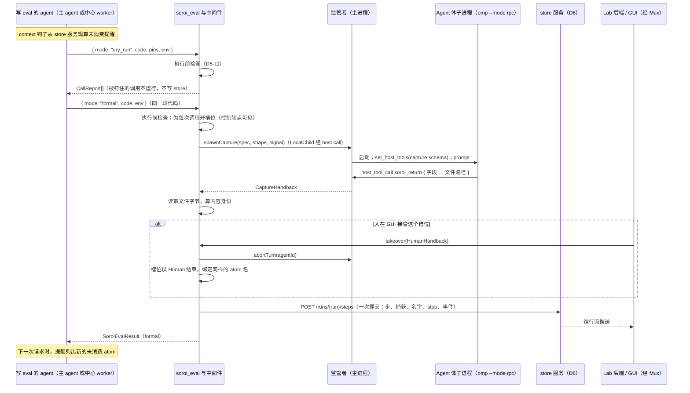

# D5 omp-soroi-eval ↔ omp-soroi-subagent 契约与 eval 半截项

起草：DrafterD5Plugins（Claude 族，task:high）。

范围：

- eval 的 `Agent` 节点改走 soroi 自己的 subagent；
- 唯一交回工具；
- `soroi_eval` 的 dry run / 正式运行签名，以及 pins；
- 单次调用换 env（采用 D4-19）；
- 执行前检查；
- 并发写步与批次（不用 fork）；
- 未消费提醒；
- `Human` 构造器路径（与 D2-06、D6 的介入衔接）；
- 两个插件仓库的分合；
- 这两个插件怎样进入 U23 要求的“完整 omp 定制”。

只写主路径；不确定的部分写成占位并假定能工作。

## 1. 问题框架

### 用户已定的方向

- **捕获是工具行为。** 用户原话：“agent的捕获，是纯粹的 自动以工具行为……自定义工具，直接接受subagent给的文件路径，就等于捕获运行时产物”（`argon/rulings-C.md:137-138`，U `01a18dd4 #49e6867a`）。
- **重写 subagent。** 因为“omp内置的subagent必须走yield还和我们的需求不太符合”，用户决定重写（`argon/rulings-C.md:139-140`，U `#c1ef8567`）。
- **eval 里的内置 subagent 只是占位。** 用户当时说“用内置subagent先当占位符占着”（`argon/rulings-C.md:141-142`，U `#4567dcfd`）。
- **嵌套只禁两件事。** 用户的两条禁令是“eval禁止递归嵌套，eval永远只有中心主机能运行”和“远程agent……不允许再接着开远程agent”（`argon/rulings-C.md:117-120`，U `#5a37a640`、`#3dbd0473`）。
- **交回工具是唯一结果通道。** C-5【定】：交回结果和文件路径，不走 `yield`，也不拿最后一条回复兜底（`argon/rulings-C.md:128-154`）。
- **soroi 里没有 fork。** U24（Main 逐字转达）：“不要混淆soroi和omomp，soroi并不是完全基于omomp的，他提出的fork在soroi根本不应该存在，soroi是独立的omp定制”。所以本表不以 fork 或分身作为任何机制，也不挂在 omomp 的工具上；`eval.md`、`subagent.md` 和 C-4 里的 fork 说法都要撤下（§6）。

### 两个插件的现状：各做了一半，契约没接上

eval 插件：

- `Agent` 体仍用内置 `runSubprocess`，每次调用临时注册一个带类型的 `soroi_return`（`inv/r-eval.md:92-95`）。
- `pins` 按节点函数名钉值，同一函数调用多次时分不开（`inv/r-eval.md:67`；`index.ts:23-27`）。
- 批次挂在 `task`/`fork_task` 的工具调用上，成员关系只存在进程内存里（`inv/r-eval.md:59,110`；`src/batch.ts:17-45`）。
- 没有 `human` 构造器（`inv/r-eval.md:147`）。

subagent 插件：

- `soroi_return` 只有 `result: string`，不收文件路径（`inv/s-subagent.md:106`）。
- 没调交回工具时，把 `lastAssistantText` 当结果发出（`inv/s-subagent.md:107`；`src/main/supervisor.ts:309-328`）。
- `soroi_task` 只允许 `MAIN_AGENT_ID` 调用，子进程一律不能再开（`src/main/index.ts:29-31`）。这是 ask 超时后实现者自定的范围，不是用户决定（`inv/s-subagent.md:175`）。

### 意图约束与技术项的分界

| 半截项 | 意图约束（【定】） | 具体语法与字段（【暂定】，交技术投票） |
| --- | --- | --- |
| E-1 单次调用换 env | `argon/rulings-C.md:216-220` | `:221` |
| E-2 dry run / 正式运行签名与 pins | `argon/rulings-C.md:222-230` | `:231` |
| E-5 并发与汇总 | 五个结果分得清、从一开始就不同名（`argon/rulings-C.md:248-250`） | 批次屏障与转交说明（`:251`） |
| `Human` | — | 交回形状与主动 `human(request)` 签名（`argon/rulings-C.md:280`） |

### 采用的相邻决策

| 决策 | 采用的内容 |
| --- | --- |
| D2-02、D2-03、D2-05 | 并发写步由主 agent 经 omp-soroi-subagent 派出的中心 agent 承担；两插件之间是进程内调用，契约由本表给出（`D2-components.md:32,39-42`） |
| D2-25 | 仓 B（omp-soroi，待建）承载合并后的插件源码、agent 定义、技能、规则、设置覆盖、installer 与发行；store 源码和镜像归仓 A（store，待建）；`Pepgent/soroi` 保留设计、工作台与统一 e2e，组装各仓构建产物，两个旧插件仓迁入同一包后归档 |
| D3-07/09/10/11/12/19（含 leader 裁决 D 与第 1、2 轮修订） | Mux 不启动进程。本机子 agent 由 subagent 模块自己启动 `omp-rpc-mux dial --generation g --token t -- omp --mode rpc …`，由 dial 持有 stdio 并连到 `/agents/{id}/process`；远程子 agent 照旧走 `remote run`，由 D4-08 的 boot.js 执行同一条 dial（带 `--root`、`--expose`），运行中的进度只经 `GET /agents/{id}/files` 拉取；根会话由 Lab 后端以写方身份打开 `/agents/{root}/writer` 后用同样的 dial 启动（D3-10）。监管者经 Mux 的写方 WS `/agents/{id}/writer` 驱动子进程。人的 IRC 走 D3-12 的写方契约 `HumanIrcOp = enqueue \| edit \| withdraw \| deliver`（D3 §4）：每个 agent 的写方持有发给它的待投递表，是“还没投递的人类消息”的唯一权威；soroi 子 agent 的写方是父进程里的 subagent 监管者，由它实现这份契约；根 agent 的写方是 Lab 后端（D7）。写方在 agent 空闲或步边界时执行 `deliver`，以 `from = human:<principal>` 经 `IrcBus.send` 投递，之后成为 transcript 里的不可变事实。Lab 后端按 D3-11 读 agent（在线时作 Mux 读方，停驻后读 transcript）。每个写 eval 的会话注册控制端点 `WS /endpoints/eval:<本会话 id>`，注册时带本代的 `MUX_GENERATION`、`MUX_TOKEN`；根会话的端点另答 `writers(runId)`（D3-19）（`D3-network-mux.md`） |
| D4-16 | 角色 `Main \| LocalChild \| RemoteChild`，由 `SOROI_ROLE` 决定 |
| D4-19 | 单次调用换 env 写在 `soroi_eval` 参数里，以产出 atom 名为键 |
| D6-04 | 一步一次提交 |
| D6-11 | 在途状态从 eval 插件经 Mux 注册的控制端点读取 |
| D6 回复 | store 里没有批次记录；步只记写它的 omp 会话 id |

U23 要求“完整 omp 定制”。D5-02 写 `packages/omp-soroi` 给这个整体贡献什么，以及 Pepgent 怎样调用它。

## 2. 决策表

分类：意图 / 技术 / 串联 / 实现。“补充”列标明该行是否属于“缺失部分或设计补充”（argon 可以否决的范围）。

| ID | what | where | how | 取舍 | 分类 | 补充 |
| --- | --- | --- | --- | --- | --- | --- |
| D5-01 | 两个插件合并成一个 omp-soroi 包 | 仓 B（omp-soroi，待建）：eval 代码在 `src/eval/`，subagent 代码在 `src/subagent/`，交回契约在 `src/contract.ts`。`Pepgent/omp-soroi-eval` 和 `Pepgent/omp-soroi-subagent` 的代码迁入后，两个旧仓在 GitHub 归档；发行 tar 内的安装布局仍为 `packages/omp-soroi` | 一个扩展入口，按 `SOROI_ROLE`（D4-16）选角色。eval 直接 import subagent 模块的 `Subagents` 接口（§3.1），不经事件总线 | **合并的好处：** 两边之间的契约很宽，包括角色、交回契约、写 eval 的资格（D5-06）、批次成员、`LocalChild` 里转发 spawn。合并后这些都是编译期类型，交回工具只有一处定义，`eval.md:3`“同一个插件还提供交回工具”仍然成立。插件、技能、规则与发行在仓 B，store 以仓 A 镜像组装，完整定制内容与安装方式不变。**代价：** 两个旧仓的代码要迁移，旧仓要归档。**落选方案：** D2 原稿让两个仓库各自独立，由发行仓把两者作为依赖打包。那样要多维护一个跨仓库的契约包，还要靠 `pi.events`（`loader.ts:557`）做运行时握手 | 技术 / 串联 | 设计补充 |
| D5-02 | omp-soroi 在“完整 omp 定制”中的贡献，以及 Pepgent 怎样调用（U23） | 仓 B（omp-soroi，待建）的 `package.json` 里的 `omp.extensions`；同仓 agent 定义、技能、规则与设置覆盖（D2-25） | **插件：** eval 模块提供 `soroi_eval`、未消费提醒、中间件和介入控制端点；subagent 模块提供监管者、`soroi_task`、`soroi_return` 和子进程桥接。**技能 `soroi-eval`：** 怎样写一步，dry run 与正式运行，pins 与 env，`stop`，派出中心 worker 并写批次目的。**规则：** 每个 atom 都要消费；dry run 通过后原样提交同一段代码，不合并、不改写。**agent 定义（D2-25 列出的三种角色）：** 写 eval 的主 agent，写 eval 的中心 worker，`Agent` 体。**调用路径：** Pepgent 的 Lab 后端以写方身份打开 `/agents/{root}/writer`，用 `omp-rpc-mux dial -- omp --mode rpc` 启动中心 omp 主会话（D2-15、D3-10、裁决 D），以 RPC 发 prompt、收事件；运行图和时间轴读 store 服务（D6）；在途调用读各写 eval 会话的控制端点（D5-14、D6-11）。**远程：** omp-agent 镜像不烘焙定制；boot 每次把与中心同一哈希的发行 tar 经 copy-in 拷入，安装到隔离 HOME（D2-11、D4-09）。**验收：** 在干净 HOME 里安装发行包后实测，extension、agent 定义、技能、规则、设置覆盖全部被 omp 发现，才算完整定制 | 仓 B 发行一份定制，中心和远程加载同一份字节，不会分叉；store 独立由仓 A 镜像发布，统一组装在 `Pepgent/soroi`；soroi 发版不需要重建镜像。omp 插件 manifest 只声明 extensions、tools、hooks、commands 和 settings（`plugins/types.ts:26-49`）；扩展包里的 agent 目录会被发现（`inv/o-placement.md:34-40`）。技能和规则怎样随安装生效，记为占位 P11，由上面的验收确认 | 串联 | 缺失部分 |
| D5-03 | `Agent` 节点改走 soroi subagent，替换 `runSubprocess` | `src/eval/agent-body.ts` 改为调用 `Subagents.spawnCapture`；删除 `AGENT_BODY_PREFIX` 前缀约定（`agent-body.ts:11-12`） | 中间件调用 `spawnCapture({ parentId: 写这一步的 agent, cwd, agent: AgentTemplate, assignment: prompt, placement }, shape, signal)`，返回 `Promise<CaptureHandback>`。写这一步的 agent 可以是主 agent，也可以是 soroi 派出的中心 worker。在 `Main` 里，这个调用直接进同进程的监管者；在 `LocalChild` 里，经 host call `{ op: "spawn_capture" }` 转到主进程的监管者，交回随 host call 的回复返回。捕获轮次不在父 agent 上登记异步作业，因为 `soroi_eval` 这次调用本身就在等它；取消走 `soroi_eval` 的 AbortSignal，中止子 agent 当前这一轮。子 agent 照常登记进 `AgentRegistry`，受内置生命周期管理。捕获记录只存子 agent 的 omp 会话 id，与 D6-03 的 `transcript: SessionId` 是同一个字段；transcript 的权威仍是 omp（D2-01，远程时按 D4-13 转移）。GUI 经 Lab 后端按 D3-11 读取：在线时作为 Mux 读方，停驻后读 transcript | 落实 C-5 的技术面：以 omp-soroi-subagent 替换 runSubprocess（`argon/rulings-C.md:135`），也落实 D2-05 的进程内 API。agent 的身份与状态仍只由主进程的 `AgentRegistry` 持有；store 不存会随 D4-13 失效的文件位置。代价：每次 `Agent` 调用都起一个 omp 进程，比进程内 subagent 重 | 实现 / 串联 | 否（已定意图的落地） |
| D5-04 | 唯一交回工具 `soroi_return` 的统一契约 | `packages/omp-soroi/src/contract.ts`；`#launch` 里的 `set_host_tools`；sidecar `<id>.soroi.json` | 工具名只有一个，schema 按委派种类生成，`ReturnContract = report \| capture`。<br>• `report`（`soroi_task` 的委派）：`{ result: string }`。<br>• `capture`：按节点的返回形状生成。单个输出是 `{ value }`，多个输出是扁平字段；`File` 字段收文件路径字符串。<br>交回值的类型是 `Returned`，文件写成 `{ kind: "file", path, placement }`。subagent 只收下路径；取回、算内容身份、送进 store 的对象由中间件做（`eval.md:94`）。契约是启动参数：spawn 时写进 sidecar，复活时按 sidecar 重新 `set_host_tools`，所以复活后 schema 不变 | 落实 C-5 要求的 typed 结果与 `File` 路径捕获（`argon/bootstrap.md:96`），以及 D2-05“按节点返回类型生成 schema”。契约在 agent 的一生里不变，属于启动配方，不另设状态源。代价：同一个 agent 不能在两种委派之间切换 schema（主路径不需要） | 技术 | 设计补充 |
| D5-05 | 删除“最后一条回复兜底”；保留 IRC 唤醒回执 | `supervisor.ts:309-328` 的 `#settleTurn` | 作业轮次和捕获轮次只在 `soroi_return` 被调用时交回。一轮结束而没有交回，就没有结果，不发 `lastAssistantText`。别的 agent 用 IRC 唤醒它的那一轮，结束时把输出回给唤醒者：这对标内置的唤醒监视器，属于 IRC 语义，不是结果通道，保留。同步改 README:21 和工具说明 `main/index.ts:9` | C-5【定】否决兜底（`argon/rulings-C.md:132-133`）。保留唤醒回执，是为了满足“生命周期和irc全方位对标omp内置subagent”（`inv/s-subagent.md:90-91`，U `#f488be08`） | 意图（落地为实现） | 否 |
| D5-06 | 嵌套边界：谁能写 eval，谁能派出 subagent | 两插件的角色判定（`SOROI_ROLE`，D4-16）；启动配方里的 `writesEval` | (1) **写 eval：** `soroi_eval` 和未消费提醒只在 `writesEval` 为真的会话里注册。`Main` 为真；`soroi_task` 派出的 `report` worker，在派出方为真时为真；`capture`（`Agent` 体）和它派出的一切都为假。`writesEval` 由监管者在 spawn 时计算，写进启动配方。<br>(2) **派出 soroi subagent：** `Main` 和 `LocalChild` 注册 `soroi_task`。去掉 `MAIN_AGENT_ID` 检查；`LocalChild` 里的调用经 host call `{ op: "spawn" }` 转到主进程的监管者，父 id 是这个子 agent。`RemoteChild` 不注册 `soroi_task`，只能用自己进程里的内置 task。<br>(3) **远程启动：** 只有一条路，即写 eval 的中心 agent 调用 env 为远程的 `Agent` 节点（D4-16） | 正好落在用户的两条禁令上（`argon/rulings-C.md:117-120`）：任何 `Agent` 体之下都没有 eval，所以 eval 不会嵌套；远程 agent 没有工具能再开 soroi subagent。同时撤销没有用户依据的一刀切（`inv/s-subagent.md:175`）。用结构保证，不做运行时计数 | 意图 + 技术 | 否 |
| D5-07 | 并发写步由 soroi 派出的中心 worker 承担，不用 fork | `soroi_task`；技能 `soroi-eval` | 两种并发：<br>• **一步之内：** 平铺写多条互不依赖的调用，引擎自然并发（`eval.md:136`，依据 U `#13abc2a1`）。<br>• **多个 agent 分头写步：** 主 agent 用 `soroi_task` 派出几个中心 worker（`LocalChild`，`report` 契约，`writesEval` 为真），每个 worker 在同一个运行里用 `soroi_eval` 写自己的一步。<br>这些 worker 写的步属于同一个运行：worker 的运行，是它所属根会话的运行。按 D6，步记下写它的会话 id | U24 要求 soroi 不含 fork。用户最早要“可以通过fork self开分身去处理”（`argon/rulings-C.md:121-122`），本意是让多个 agent 分头消费，这里换成 soroi 自己的机制，与 D2 的口径一致（`D2-components.md:32`）。代价：worker 不继承父 agent 的对话，父 agent 要在委派里写清这几路为什么开；这正是 D5-12 的“目的说明” | 技术 | 设计补充 |
| D5-08 | `soroi_eval` 工具签名：dry run 与正式运行 | `src/eval/index.ts` 的参数 schema | 改成判别联合：`{ mode: "dry_run", code, pins?, env? } \| { mode: "formal", code, env? }`。正式运行在类型上就没有 pins，不再需要运行时检查（`index.ts:49-51`）。正式运行就是把同一段代码再提交一次：重新检查、重新执行，store 里已有的捕获按身份复用；不记住、也不锁定上一次 dry run。工具说明和技能写明：dry run 通过后原样提交，不合并多步，不改写代码 | 意图约束：dry run 不写 store，正式运行没有替身，不锁定上一次 eval，不让模型最后合并重写（`argon/rulings-C.md:222-230`）。字段名属【暂定】技术项（`:231`）。代价：正式运行时，没钉住、也没命中复用的调用会再真实跑一遍；这是用户“dry run 是测试”的本意 | 技术 | 设计补充 |
| D5-09 | pins 按调用产出的 atom 名钉值 | `soroi_eval.pins`；检查器 | `pins: Record<AtomName, PinValue>`，键是调用语句绑定的输出 atom 名，`PinValue = number \| string \| boolean \| { file: path }`。一条调用的输出全部被钉住，这条调用就不运行；只钉一部分会被检查拒绝。同一函数调用两次，绑定的名字不同，可以分别钉不同的值。删除现行按函数名钉值的做法 | 名字在一次运行里唯一（`eval.md:37`），用名字当键不会歧义，也和“永远只有 atom”的心智一致；与 D4-19 的 env 覆盖用同一种键。同函数多次调用的区分是 s-eval G02 的缺口（`inv/s-eval.md:227`） | 技术 | 设计补充 |
| D5-10 | 单次调用换 env：采用 D4-19 | `soroi_eval.env`；检查器；中间件 | `env?: Record<AtomName, 模板名>`，键是这次调用产出的任意一个 atom 名。检查器把每个键归并到产出它的调用；同一条调用的几个键给了不同模板，报 `env_conflict`。生效的 env 依次取：这里的覆盖，节点函数的默认模板，`central`。生效的 env 算进捕获身份（现行身份已含 env，`execute.ts:122`）。步的代码仍只有三种语句，不出现模板名字面量。检查器核对键是本步某条调用的输出，模板名在 remote 的模板目录里（占位 P6） | 意图约束：调用要简单，模板提前构建，不写魔法值，不定义 object（`argon/rulings-C.md:216-220`）。env 是“在哪里跑”，不是参与数据流的值，所以放在工具参数里，不改调用的参数个数。**备选（本稿初版）：** 用 `const gpu: Env = "slurm-a100"` 定义环境 atom，作为末尾参数传入。它让 env 进入数据流、改变参数个数，因与 D4 冲突而撤回 | 技术 | 设计补充 |
| D5-11 | 执行前检查清单 | `src/eval/check.ts`（大部分已有，`inv/r-eval.md:69-72`）；`eval.md` 占位表第一行改写成正文 | 按顺序检查：<br>(1) 只有三种语句；根 atom 允许数字、字符串、布尔字面量与 `const <name> = file("<相对路径>")`。`file` 是内建根形式，先于普通调用识别，只作为单个标识符声明的初始化器，不解析节点库、不产生调用或捕获；路径基于根 omp 的 cwd，字节在 dry run 与正式运行都经本次 `EvalTransfer`（`design/eval.md`“一步的写法”）。<br>(2) 引用的 atom 都在本会话的可见集里，或在本步前文定义过。可见集与 D5-13 的提醒用同一个计算：atom 取自 store 服务里本运行已提交的状态，再按监管者给出的可见范围（`Subagents.visibility`：spawn 时的快照、自己的子树、已释放的批次）过滤；主 agent 的可见范围是整个运行中已释放的部分。检查器不直接读整个运行。<br>(3) 新名字在本运行和本步内都不重复。<br>(4) 被调函数能解析到节点文件（`<cwd>/nodes/<name>.ts`，库在 D2-12）。<br>(5) 按节点签名做 TS 类型检查。<br>(6) 返回类型只能是 `Atomic` 或一层扁平对象。<br>(7) 解构的字段集合等于返回类型的字段集合；标量返回值不能解构。<br>(8) pins 只钉调用输出，根 atom 或非调用输出返回 `pin_key{name}`；一条调用要钉就全钉；值的种类与字段相符。<br>(9) env 的键是本步某条调用的输出，同一条调用不冲突，模板存在。<br>(10) dry run 里的 `Human` 调用必须被钉住（理由见 D5-14） | 补上 s-eval G06 指出的“穷尽解构要核对字段集合”（`inv/s-eval.md:231`），以及 argon E-3 要求写明的检查职责（`argon/bootstrap.md:142`）。穷尽解构本身是【暂定】（`argon/rulings-C.md:240`），这里只是落实现行文档已有的规则。检查和提醒共用一个可见集，模型能引用的正是它被提醒看到的 | 技术 | 设计补充 |
| D5-12 | 批次：一次 `soroi_task` 派出的中心 worker 算一批，同批全部交回后一起释放 | `soroi_task` 的参数 `purpose`（派出多于一个 worker 时必填）；启动配方；监管者的作业结束锚点；`Subagents.batchOf(id)` | **批次：** 一次 `soroi_task` 调用就是一批，`batchId` 取这次工具调用的 id。一次派出多于一个 worker 时 `purpose` 必填。每个 worker 的启动配方里写 `batchId` 和 `purpose`；这是 spawn 时定下、之后不变的启动事实，权威是监管者，不进 store（按 D6）。<br>**成员完成：** 这个成员 `report` 契约的 `soroi_return` 被监管者接受。<br>**释放：** 同批全部成员都已完成。这是监管者持有的作业结束锚点，与发起者收到这批 `soroi_task` 结果是同一时刻；不从 store 的步推断。<br>**释放前：** 批次产出只对产出它的 worker 子树可见。<br>**释放后：** 这批输出连同 `purpose` 一起出现在发起者的提醒里。<br>**交给别的 agent 汇总：** 发起者在释放后再派一个 worker；它看得到派出之前已有的 atom，提醒里带着目的说明，不需要另设转交接口 | 【定】的部分是五个结果下游分得清、知道要干什么，并且从一开始就不同名（`argon/rulings-C.md:248-250`）；运行内名字唯一和提醒里的来源（D5-13）已满足这一点。worker 是逐步提交的，store 里“有一步”不等于这一路做完；做完的权威是 worker 的交回，所以释放取自监管者。多 worker 时 `purpose` 必填，下游才知道这批要干什么。同批屏障、目的说明、转交是【暂定】（`:251`），D2-02 也写了“批次由 soroi 自己的 subagent 派发来界定”。`purpose` 是 soroi 自有工具的参数，不依赖 omomp。**更省的备选：** 不设屏障，只靠唯一名字和来源；`eval.md:161-162` 要一并删除 | 技术 | 设计补充 |
| D5-13 | 未消费提醒的注入方式与内容 | 写 eval 的会话的 `context` 钩子（`index.ts:108-121`，沿用现行注入位置） | **怎样算：** 每次请求模型前，都从 store 服务现算本运行的未消费 atom，不缓存。<br>**每行写法：** `名字 = 预览 ← fn(参数) @env`。批次产出按批次分组，组头是 `purpose`。`Human` 产出标 `← human`；介入替换的标 `← human 替代 fn(参数)`。<br>**谁看得到什么：** 主 agent 看本运行里已释放的全部 atom；worker 看派出它之前已有的 atom、自己子树产出的 atom，以及已释放的批次 | 把占位“宿主能读取 store 里的未消费 atom 并注入系统提醒”（`eval.md:185`）落成具体钩子。worker 的可见范围是此前实现者的自选（`inv/s-eval.md:216`），这里按技术项提交投票，不当作用户意图 | 技术 | 设计补充 |
| D5-14 | `Human` 构造器的主动调用路径 | `src/eval/node.ts` 增加 `human`；中间件的调用槽位；每个写 eval 的会话经 Mux 注册的控制端点 `eval:<本会话 id>`（D2-06、D2-08、D3-19、D6-11） | `human<X, A>(request: (...xs: X) => string)`，`A` 和 `agent` 一样显式写出。<br>**端点：** 每个 `writesEval` 为真的会话注册自己的端点 `eval:<本会话 id>`，槽位的权威就是这个会话的 eval 模块。根会话的端点另外回答 `writers(runId)`：内容取自监管者里本根会话下 `writesEval` 为真的启动配方，是 Lab 后端找到全部端点的入口。<br>**流程：** 正式运行跑到 `Human` 调用时，写这一步的会话的中间件给这次调用开一个槽位，状态为“等人类交回”，带请求文本、输入 atom 和返回形状。Lab 后端先问 `eval:<根>` 拿到写方列表，再逐个读取槽位，GUI 显示请求；人提交 `HumanHandback`，形状与 `soroi_return` 的 capture 契约相同，送到持有该槽位的会话的端点，回到中间件。<br>这一步提交时，这次捕获写成 `body: "Human"`，身份取这次人类事件的哈希，不复用（D6 已同意）。<br>dry run 不写 store，也不开放人类交回，所以 dry run 里的 `Human` 调用必须钉住 | 接通 `eval.md:71` 已有的 `human` 构造器与 GUI 交回入口（argon I-2，`argon/bootstrap.md:169`；s-eval G10，`inv/s-eval.md:235`）。“与交回工具同形”是【暂定】（`argon/rulings-C.md:280`）。在途状态的权威是持有槽位的 eval 模块，不是 store（D6-11）；worker 写步是主路径（D5-07），所以端点按写 eval 的会话注册，不只按根会话 | 串联 | 缺失部分 |
| D5-15 | 被动介入：接管运行中的调用 | 中间件的调用槽位；持有槽位的会话的控制端点上的 `takeover`；`Subagents.abortTurn`；Program 运行器与 `remote abort`（D6-15） | 正式运行中，每次调用都是一个槽位，在写这一步的会话的控制端点上可见（D5-14，Lab 后端经 `writers(runId)` 找到它）。人在 GUI 里接管一个运行中的槽位时，`takeover` 送到持有该槽位的会话，由它的中间件执行：<br>(1) 先中止这次调用的体。`Agent` 中止子 agent 当前这一轮；`Program` 结束运行器进程；远程的调用用 `remote abort`。<br>(2) 再用人的 `HumanHandback` 结束这个槽位。<br>(3) 槽位绑定的 atom 名不变，所以同一步里的下游调用照常自动消费。<br>(4) 这一步一次提交（D6-04），带 `call_aborted` 和 `human_handback` 事件，这次捕获记成 `body: "Human"`，带上它替换的调用（函数、版本、输入）。<br>已经提交的步不在此列：改已提交的东西是派生运行，归 D6 | 用户原话：“将一个运行的程序取消，原本的atom要经过程序消费，现在经过一个特殊的程序，就叫他人类接入，所以产生了新的atom，然后自动触发函数消费”（`argon/rulings-C.md:278`）。槽位接管让“自动触发”在同一步内自然成立，不需要第二套调度；intervention.md 的“改值”三步（`intervention.md:11-15`）在 eval 一侧有了入口。运行器是持有槽位的会话的子进程，只有它能中止，所以接管必须送到这个会话 | 串联 | 缺失部分 |
| D5-16 | 人类介入产出新 atom 后通知 AI | 执行派生请求的 eval 插件；向会话投递带人类来源的 IRC（占位 P9） | **情形一：** 介入发生在 `soroi_eval` 调用进行中。这次工具结果把该调用标成 `human`，写这一步的 agent 当场就知道。<br>**情形二：** agent 已经空闲，例如 D6 的派生运行产出了新 atom。派生运行由 eval 插件自己向 store 提交（D6-16）；它拿到 store 的提交结论后，直接向拥有这次运行的主会话投递一条带人类来源的 IRC（principal 取自派生请求），唤醒新的一轮；提醒里这些 atom 带 `← human` 标记 | 用户原话：“写了以后通知ai改变了”（`argon/rulings-C.md:277`，【定】）。复用 IRC 唤醒，与“人工接管走 IRC，来源可辨”（`argon/rulings-C.md:171-173`）走同一条路。提交方本来就拿到提交结论，不再订阅 store 的运行流去得知自己写下的结果（D6-09 的读方只有 Lab 后端） | 串联 | 缺失部分 |
| D5-17 | `AgentTemplate` 就是 omp 的 agent 定义名 | `node.ts` 的 `agent(prompt, { template })`；`discoverAgents(cwd)` | `template` 是 omp agent 定义的名字，子进程按这个定义启动：模型、thinking、工具、系统提示（`supervisor.ts:155-172`）。定义随发行包（D2-25）或 Lab 库的 `.omp/agents`（D2-12）分发 | 用 omp 现成的定制机制，满足“对标主 agent”（`argon/rulings-C.md:202-204`），不另造模板格式。AgentTemplate 的字段结构原是【暂定】（`argon/rulings-C.md:246`） | 技术 | 设计补充 |
| D5-18 | `Agent` 体的文件输入与交回路径怎样解析 | 中间件；`Placement` | **中心放置：** `File` 输入给子 agent 的是中心可读的路径；交回路径相对子 agent 的 cwd 解析，中间件读出字节、算内容身份，随这一步提交进 store 服务。**远程放置：** 输入经 copy-in 出现在 volume 里；交回路径随 copy-out 回到 store 服务，再由中间件绑定（D4、D6-07，占位 P5） | 落实“交回工具只收下路径，文件可能在另一台机器上，取回、存储和管理都由中间件完成”（`eval.md:94`）。subagent 只管路径，不碰文件 | 串联 | 设计补充 |
| D5-19 | 在 eval.md 写明“eval 禁止递归嵌套”，并撤下 fork 说法 | `design/eval.md`“存储”“并发”“接口”及开头的流程图 | 加一句：eval 不能嵌套；只有中心主机上的主 agent，以及从主 agent 起经 `soroi_task` 逐级派出、`writesEval` 为真的 `report` worker（D5-06）能写 eval，`Agent` 体及其之下都没有 eval 工具。把 `:5`、`:161-162`、`:166` 以及 `:175` 接口表里的 fork 分身改成 D5-07 的说法 | s-eval G08 指出用户原话“eval禁止递归嵌套”在文档里没有单独写出（`inv/s-eval.md:233`，U `#5a37a640`）；U24 要求删去 fork | 意图 | 设计补充 |

## 3. 接口草图（主路径）

### 3.1 eval 与 subagent 之间

两者在同一个包里，这是包内的模块接口。

```ts
// packages/omp-soroi/src/contract.ts
type AgentId = string & { readonly __brand: "AgentId" }
type TemplateName = string & { readonly __brand: "TemplateName" } // remote 模板目录里的名字
type Role = "Main" | "LocalChild" | "RemoteChild"                  // SOROI_ROLE，D4-16

type Placement =
  | { readonly kind: "central" }
  | { readonly kind: "remote"; readonly template: TemplateName }

type FieldKind = "number" | "string" | "boolean" | "file"
type Shape =
  | { readonly kind: "single"; readonly type: FieldKind }                        // 交回 { value }
  | { readonly kind: "record"; readonly fields: Readonly<Record<string, FieldKind>> }

type ReturnContract =
  | { readonly kind: "report" }                          // soroi_task：{ result: string }
  | { readonly kind: "capture"; readonly shape: Shape }  // Agent 节点

type Returned =
  | { readonly kind: "number"; readonly value: number }
  | { readonly kind: "string"; readonly value: string }
  | { readonly kind: "boolean"; readonly value: boolean }
  | { readonly kind: "file"; readonly path: string; readonly placement: Placement }

interface CaptureHandback {
  readonly agentId: AgentId
  readonly session: string                              // 子 agent 的 omp 会话 id（= D6-03 的 transcript: SessionId）
  readonly fields: Readonly<Record<string, Returned>>   // 单个输出用字段名 "value"
}

interface SpawnSpec {
  readonly parentId: AgentId            // 写这一步的 agent：主 agent 或中心 worker
  readonly cwd: string
  readonly agent: string | undefined    // omp agent 定义名（AgentTemplate）
  readonly assignment: string
  readonly placement: Placement
}

interface Batch {
  readonly id: string
  readonly purpose: string
  readonly members: readonly AgentId[]
  readonly released: boolean   // 每个成员的 report 作业都已经 soroi_return 交回（监管者的作业结束锚点）
}

// 一个写 eval 的会话能看见哪些 atom（D5-11 的检查与 D5-13 的提醒共用）；atom 本身取自 store 服务
type Visibility =
  | { readonly kind: "main" }                                    // 本运行中已释放的全部 atom
  | { readonly kind: "worker"; readonly spawnedAt: Date; readonly subtree: readonly AgentId[]; readonly releasedBatches: readonly string[] }

interface Subagents {
  spawnCapture(spec: SpawnSpec, shape: Shape, signal: AbortSignal): Promise<CaptureHandback>
  abortTurn(id: AgentId): Promise<void>
  batchOf(id: AgentId): Batch | undefined        // 启动配方里的批次，加上释放状态
  visibility(session: string): Visibility        // 由启动配方和批次释放状态算出
  writers(rootSession: string): readonly string[] // 本根会话下 writesEval 为真的会话 id（含根会话）
}
// Main：直接调用监管者。LocalChild：经 soroi-host 的 host call（spawn_capture / abort_turn / batch_of / visibility）转到主进程。
```

启动配方（sidecar `<id>.soroi.json`）只在 spawn 时写，之后不变，不当状态读：

```ts
interface LaunchRecipe {
  readonly parentId: AgentId
  readonly cwd: string
  readonly launch: { agent?: string; model?: string; thinking?: string; tools?: string[]; systemPrompt?: string }
  readonly role: Role
  readonly placement: Placement
  readonly contract: ReturnContract
  readonly writesEval: boolean          // D5-06
  readonly batch: { readonly id: string; readonly purpose: string } | undefined // D5-12
}
```

监管者的轮次（替换现行的 `job | relay | none`）：

```ts
type Turn =
  | { readonly kind: "none" }
  | { readonly kind: "job"; readonly resolve: (text: string) => void }               // report
  | { readonly kind: "capture"; readonly resolve: (h: CaptureHandback) => void }      // capture
  | { readonly kind: "relay"; readonly to: AgentId; readonly replyTo: string }        // IRC 唤醒回执
  | { readonly kind: "human"; readonly principal: string }                           // 写方在空闲或步边界 deliver 一条人的 IRC 后开启的一轮（D3-12）：不发布结果，不对 human:* 做 ensureLive

// 人的 IRC：监管者为它的每个 soroi 子 agent 实现 D3 §4 的 HumanIrcWriter（HumanIrcOp = enqueue | edit | withdraw | deliver），
// 待投递表只在监管者里；类型定义在 D3，这里不另立一份。根 agent 的写方是 Lab 后端（D7）。
```

`soroi_task` 的参数：

```ts
type SoroiTaskParams = {
  readonly purpose?: string     // 这批计算的目的，一句话；tasks 多于一个时必填；随批次出现在提醒里
  readonly context?: string
  readonly tasks: readonly { readonly task: string; readonly name?: string; readonly agent?: string }[]
}
```

### 3.2 `soroi_return` 的 host tool schema（按契约生成）

```ts
function returnToolSchema(c: ReturnContract): JsonSchema {
  switch (c.kind) {
    case "report":  return obj({ result: str("The complete result, in Markdown.") })
    case "capture": return c.shape.kind === "single"
      ? obj({ value: field(c.shape.type) })
      : obj(mapValues(c.shape.fields, field))
    default: return assertNever(c)
  }
}
// field("file") = string：你写下的文件路径，相对你的 cwd 或绝对路径
```

子进程收到 `host_tool_call { toolName: "soroi_return", arguments }`，主侧按当前轮次处理：

- `capture`：解析成 `CaptureHandback` 并 `resolve`；
- `job`：发布结果；
- `relay`：把结果回给唤醒者。

### 3.3 `soroi_eval`

```ts
type AtomName = string
type PinValue = number | string | boolean | { readonly file: string }
type EnvOverride = Readonly<Record<AtomName, TemplateName>>   // D4-19

type SoroiEvalParams =
  | { readonly mode: "dry_run"; readonly code: string; readonly pins?: Readonly<Record<AtomName, PinValue>>; readonly env?: EnvOverride }
  | { readonly mode: "formal"; readonly code: string; readonly env?: EnvOverride }

type CallReport = {
  readonly call: string                                   // 源码里的这条调用
  readonly outcome: "ran" | "reused" | "pinned" | "human" | "failed"
  readonly env: TemplateName | "central"
  readonly outputs: Readonly<Record<AtomName, string>>    // 预览
  readonly agentId?: AgentId                              // Agent 体
}

type SoroiEvalResult =
  | { readonly mode: "dry_run"; readonly calls: readonly CallReport[] }
  | { readonly mode: "formal"; readonly runId: string; readonly runStarted: boolean; readonly runEnded: boolean; readonly calls: readonly CallReport[] }
```

示例：

```ts
// soroi_eval({ mode: "formal", env: { curve_2200c: "slurm-a100" }, code: `
const temp_2200c = 2200
const { curve: curve_2200c, log: log_2200c } = anneal(film, temp_2200c)
stop(log_2200c)
// ` })
```

### 3.4 检查错误（检查器返回结果，不抛异常）

```ts
type CheckError =
  | { kind: "statement_form"; at: number }
  | { kind: "unknown_atom"; name: AtomName }
  | { kind: "duplicate_name"; name: AtomName }
  | { kind: "unknown_node"; fn: string }
  | { kind: "type_error"; message: string }
  | { kind: "output_not_flat"; fn: string }
  | { kind: "destructure_mismatch"; fn: string; missing: string[]; extra: string[] }
  | { kind: "pin_key"; name: AtomName }  // pins 指向根 atom 或非调用输出
  | { kind: "partial_pin"; fn: string; unpinned: AtomName[] }
  | { kind: "pin_kind"; name: AtomName; expected: FieldKind }
  | { kind: "env_key"; name: AtomName }
  | { kind: "env_conflict"; fn: string; templates: string[] }
  | { kind: "unknown_template"; template: string }
  | { kind: "unpinned_human_in_dry_run"; fn: string }
type CheckResult = { ok: true; checked: Checked } | { ok: false; errors: readonly CheckError[] }
```

### 3.5 提醒

```text
<system-reminder source="soroi">
运行 R-… 里这些 atom 还没有被消费……
- 批次「比较五种退火算法在 2200°C 的曲线」（已全部正式运行）
  - curve_svm = file(…) ← svm(film, temp_2200c) @slurm-a100
  - curve_gp  = file(…) ← gp(film, temp_2200c) @central
- score_review = 0.82 ← human 替代 review(curve_svm)
</system-reminder>
```

### 3.6 `Human` 与控制端点

```ts
declare const human: <X extends readonly Atomic[], A extends Output>(request: (...xs: X) => string) => HumanFn<X, A>

type SlotId = string  // 写这一步的工具调用 id + 调用序号
type SlotState =
  | { readonly kind: "running"; readonly body: "Program" | "Agent"; readonly env: TemplateName | "central"; readonly agentId?: AgentId; readonly remoteRun?: string }
  | { readonly kind: "awaiting_human"; readonly request: string; readonly inputs: readonly AtomName[]; readonly shape: Shape }

interface HumanHandback { readonly slot: SlotId; readonly by: string; readonly fields: Readonly<Record<string, Returned>> }

// 每个 writesEval 为真的会话经 Mux 注册的控制端点 eval:<本会话 id>（D2-06、D2-08、D3-19、D6-11），由 Lab 后端调用
interface EvalControl {
  slots(runId: string): readonly { slot: SlotId; fn: string; state: SlotState }[]   // 本会话持有的在途槽位
  answer(h: HumanHandback): void        // 主动 human 调用的交回
  takeover(h: HumanHandback): void      // 被动接管：先中止体，再以人的交回结束槽位
}

// 只有根会话的端点 eval:<根会话 id> 另外回答：
interface RootEvalControl extends EvalControl {
  writers(runId: string): readonly string[]   // 本运行下所有写 eval 的会话 id，取自监管者的启动配方（Subagents.writers）
  derive(parent: string, at: Committed | { kind: "InFlight"; writerSession: string; slot: SlotId }, changes: readonly Change[]): void   // D6-16；由持有运行的根会话执行（D7-09）
  abort(run: string): void   // D6-05；由持有运行的根会话执行（D7-09）
}

type CaptureBody = "Program" | "Agent" | "Human"
type Replaced = { readonly fn: string; readonly version: string; readonly inputs: readonly string[] } // 仅被动接管时有
```

## 4. 主路径时序



## 5. 占位（假定能工作）

| 编号 | 占位 | 假定 | 归属 |
| --- | --- | --- | --- |
| P1 | 合并后的单个入口在主进程和每个子进程各加载一次 | 子进程经安装和 `-e` 两条路拿到同一个入口时，只生效一次 | `packages/omp-soroi` |
| P2 | `LocalChild` 的 host call 承载 spawn、capture 交回和可见范围 | 现有 `soroi-host` 机制能承载 `spawn`、`spawn_capture`、`abort_turn`、`batch_of`、`visibility` 这几种 host call，以及它们的长时回复 | `packages/omp-soroi` |
| P3 | 复活时按 sidecar 里的契约重新 `set_host_tools` | RPC 允许在启动时注册带任意 JSON schema 的 host tool | omp RPC（`subagent.md:74`） |
| P4 | 远程启动 subagent，并连回主侧 | `launchRemote(spec, template)` 返回一个和本机一样能驱动的 RPC 会话 | D4-05/08/09/11/12、D3 |
| P5 | 远程文件拷入拷出 | 交回路径随 copy-out 进 store，中间件能按 `{ path, placement }` 绑定 | D4、D6-07 |
| P6 | remote 的模板目录 | 检查器能按名字查到模板 | D4 |
| P7 | 每个写 eval 的会话的控制端点 `WS /endpoints/eval:<本会话 id>` 挂在 Mux 上 | Lab 后端经根会话端点的 `writers(runId)` 找到全部端点，能读到槽位，并把 `answer`、`takeover` 送回持有该槽位的写 eval 会话 | D2-08、D3-12、D3-19 |
| P9 | 唤醒空闲会话 | 插件能向空闲会话投递一条带人类来源的 IRC，开启新的一轮 | `packages/omp-soroi` + omp IRC |
| P10 | 代码以原始文本输入 | 沿用 `eval.md:186` 的占位 | 不变 |
| P11 | 发行包带技能、规则和默认设置 | 安装后这些随包生效（agent 目录已有依据，`inv/o-placement.md:34-40`） | D2-25 |

## 6. 这些行通过后要改的 design 文档

| 文档与位置 | 改动 | 依据行 |
| --- | --- | --- |
| `eval.md:3` | 插件由仓 B（omp-soroi，待建）提供；同一个插件提供 eval、交回工具、未消费提醒和 subagent | D5-01、D5-04 |
| `eval.md:5` 与流程图 | “或者 `fork` 出分身”改成“或者经 `soroi_task` 派出中心 worker” | D5-07、D5-19 |
| `eval.md`“节点函数”（`:66-79`） | `human` 显式写出 `A`；`A` 限定为 `Atomic` 或扁平对象；`template` 是 omp agent 定义名；“调用时可以换用另一个”指向 `soroi_eval.env` | D5-10、D5-14、D5-17 |
| `eval.md`“捕获的三种来源”（`:83-87`） | `Agent` 行：soroi subagent、capture 契约、文件交回为路径。`Human` 行：主动调用与槽位接管 | D5-03、D5-04、D5-14、D5-15 |
| `eval.md`“dry run 与正式运行”（`:149-156`） | 写出工具签名；pins 按输出 atom 名，全钉或不钉；env 覆盖；正式运行原样提交同一段代码；dry run 里的 `Human` 调用必须钉住 | D5-08、D5-09、D5-10、D5-11 |
| `eval.md`“并发”（`:158-162`） | 删去 fork；批次即一次 `soroi_task`，目的写在 `purpose`；转交就是释放后再派一个 worker | D5-07、D5-12 |
| `eval.md`“存储”（`:164-168`） | “主 agent 和它 `fork` 出的分身”改为“主 agent，以及从主 agent 起经 `soroi_task` 逐级派出、`writesEval` 为真的 `report` worker”；加“eval 不能嵌套，`Agent` 体及其之下都没有 eval 工具” | D5-06、D5-19 |
| `eval.md`“接口”与“占位”（`:170-186`） | subagent 行（`:175`）删去 fork 分身的说法，改为 `Subagents` 接口；store 行改为 store 服务；“执行前的检查”“未消费提醒的注入方式”两条占位改写成正文；新增 P7、P9 | D5-03、D5-11、D5-13、D5-19 |
| `subagent.md:20-21` | 交回工具按契约生成 schema；不发最后一条回复，IRC 唤醒回执保留；“中心主机上的主 agent 和它 fork 出的分身”改为“主 agent，以及从主 agent 起经 `soroi_task` 逐级派出、`writesEval` 为真的 `report` worker” | D5-04、D5-05、D5-06、D5-19 |
| `subagent.md:26-37`“实现” | 实现位置为仓 B（omp-soroi，待建）的 `src/subagent/`；本机子进程由插件以 `omp-rpc-mux dial … -- omp --mode rpc` 启动，监管者经 Mux 写方驱动（D3）；sidecar 含角色、放置、契约、`writesEval` 和批次；轮次增加 `capture` 和 `human`；`soroi_task` 增加 `purpose` | D5-01、D5-04、D5-06、D5-12 |
| `subagent.md:47-52`“未覆盖” | 删去“中心分身再开 soroi subagent 还没有做”；改写为角色闸门 | D5-06 |
| `soroi.md:13-14` | 宿主插件两行合为一行：`packages/omp-soroi` 提供 eval、交回工具、未消费提醒和 subagent | D5-01 |
| `intervention.md:11-17` | “改值”的中止与 `Human` 捕获，指向 eval 的槽位接管与控制端点；交回形状是 capture 契约 | D5-14、D5-15 |
| `argon/rulings-C.md` C-4（argon 改） | “中心 `fork` 分身”改为“写 eval 的中心 agent”（U24） | D5-06、D5-07 |

## 7. 反例回应（第 1 轮未采纳的修改）

| 来源 | 反例 | 回应 |
| --- | --- | --- |
| 导师 · D5-11 | 并发 worker 产出同名输出，要求 store 在提交时复核名字 | 不改。这是并发竞态的防护；设计阶段只写主路径，竞态与重试不进本表（`pepgent-soroi/.claude/rules/design-assumes-it-works.md`）。主路径上名字唯一由检查 (3) 保证 |
| 导师 · D5-18 | 交回 `/etc/passwd`，或经 symlink 读到凭据；要求限定输出根目录、canonicalize、限制大小 | 不改。这是安全加固，不属于主路径（同一条规则）。主路径是 agent 交回自己写下的文件 |
| 导师 · D5-16 | 会话停驻后插件不在，通知丢失；要求 Lab 后端订阅 store 再唤醒 | 不改，采用 task:high 的写法。D2-06 已定：对已停驻的会话发起派生时，Lab 后端作为写方先开新一代，等端点注册后再路由；所以执行派生、拿到提交结论的插件一定在线，可以直接投递 IRC |
