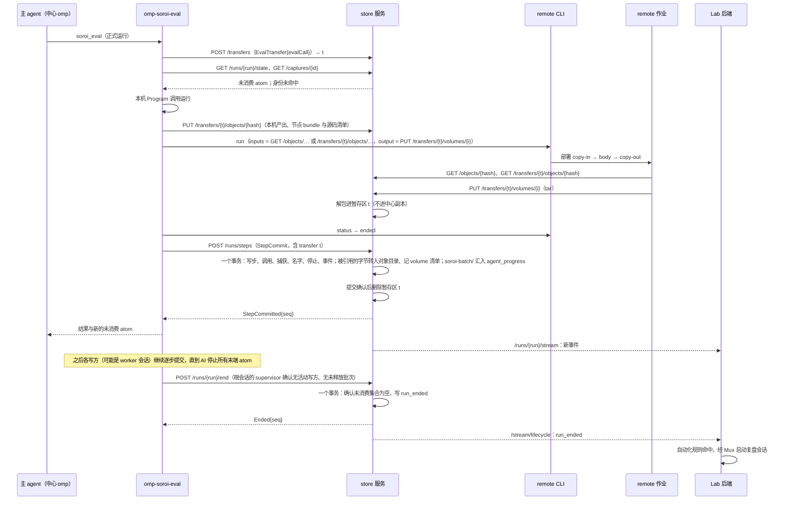
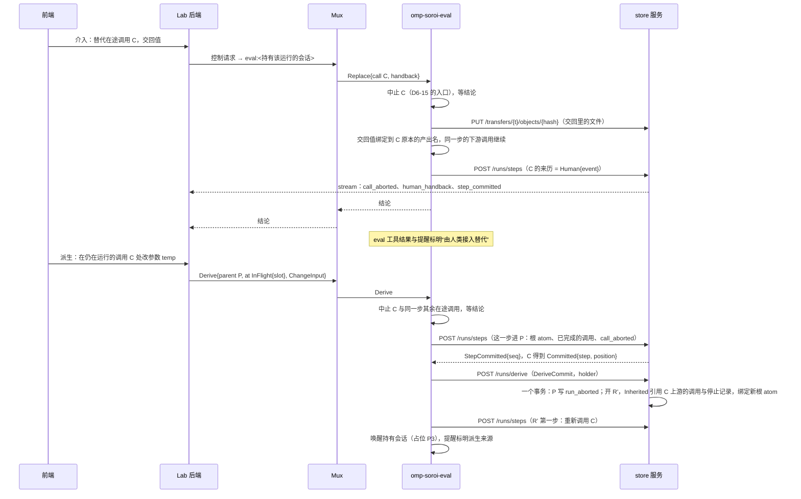

# D6 store 服务：写入、读取、订阅、介入记录与运行生命周期

依据缩写（行号均为当前工作树）：

| 缩写 | 文件 |
| --- | --- |
| PB | `pepgent-pm/evidence/argon/pivot-baseline.md` |
| RC | `pepgent-pm/evidence/argon/rulings-C.md` |
| BS | `pepgent-pm/evidence/argon/bootstrap.md` |
| inv/… | `pepgent-pm/evidence/inv/…` |
| D2 | `pepgent-pm/evidence/decisions/D2-components.md` |
| design/… | `pepgent-soroi/design/…` |
| U23、U24 | Main 逐字转述的用户新指令（待秘书登记进 LEDGER）。U23：“对于soroi的最小功能合集，一定是一个完整的omp定制，并且能走通我说的所有流程，并且能作为pepgent的agent核心，并且最后能在这个基础上知道pepgent和soroi之间缺失的点，线，面”。U24：“不要混淆soroi和omomp，soroi并不是完全基于omomp的，他提出的fork在soroi根本不应该存在，soroi是独立的omp定制” |

## 框架

store 是“能落盘的状态管理”，不是 session log，GUI 直接读它，不另设 DSL（PB:20，用户原话 `#64246eaf`）；历史时间轴“是个极为重要的功能”（RC:262）；DuckLake 是为远程 agent 准备的：运行中本机独立落盘，运行结束后随拷贝回集中副本，不让一堆集群写一个中央库（RC:95，`#8e0a7e8f`；RC:120，`#3dbd0473`）；dry run 从头到尾不进 store（RC:229-230，`#32b6f7fd`）；人类写值不是合并写入，而是取消原程序、改由“人类接入”消费并产出新 atom，并“通知ai改变了”（RC:277-278，`#ba5ad307`、`#d1baf561`）；人类修改正在运行的函数体并派生新闭包永远是正式运行（RC:279，`#a0d22b8a`）；“没有重放”（RC:263，`#9e2d37a1`、`#21495b13`）。

`design/store.md` 已把中心提交、远程汇入、提交后推送、全文派生表都派给一个叫“soroi 服务”的执行者，但没有写它是哪个进程、和 eval 插件怎么分工（inv/s-store.md:197-202；`design/store.md:65,68-69,85-86`）。argon 把它的进程归属、FTS 派生表、`Human` 身份都标为【暂定】交投票（PB:76-78；RC:191,259,266）。另有七处半截设计归本表：S-1 检索（RC:254-259）、S-2 运行生命周期与派生记录（RC:260-266；BS:153-158）、S-3 草稿与跨运行比较（RC:267-272；BS:159-162）、I-1 到 I-3 的记录侧（RC:274-286；BS:166-171）、节点库的持久化、列出、版本、影响校验（RC:241-246；inv/s-node-library.md:223-267）。

本表接受 D2 已定的归属，不重议：store 服务是 `Pepgent/soroi` 单仓的 `packages/store`（同仓有插件包 `packages/omp-soroi` 与 compose），随 soroi 定制同版本发布的中心常驻进程，是中心副本唯一写方（D2:40）；介入的入口在 Lab 后端，经 Mux 到持有该运行的 eval 插件，store 只记录结果（D2:42）；节点库的当前定义在每个 Lab 的 git 仓库里（D2:48）；Lab 后端是 GUI 的门面，自动化在 Lab 后端里订阅 store（D2:50,52）；store 服务作为 soroi omp 定制的伴随服务随发行仓的 compose 拉起（D2:61）。按 U24，本表不出现 `fork` 分身或并发批次的任何记录，不依赖 omomp 的机制。

leader 已就与 D2 草稿的分歧作出技术裁决：D6-08 不建 FTS 派生索引；D6-16 派生运行不按已存的步重新执行；节点函数版本为 `Bun.build` bundle 的内容哈希（argon 无冲突：argon/version-ruling.md）。D6-11 在途进度从 eval 插件读、不经 store，D2 已无异议。

## 决策表

| ID | what | where | how | 取舍 | 分类 | 缺失部分或设计补充? |
| --- | --- | --- | --- | --- | --- | --- |
| D6-01 | **store 服务进程与单写方** | `Pepgent/soroi` 单仓的 `packages/store`（随 soroi 定制同版本发布）；中心主机一个 Bun 常驻进程 `pepgent-store`，进程内用 `@duckdb/node-api` 打开 DuckLake（D2:40,56；argon/D2-rulings.md） | 服务是中心副本唯一的 DuckLake 连接持有者，也是唯一读方入口：eval 插件、Lab 后端、remote 的步骤容器都只经它的 HTTP 接口读写。eval 插件不再在 omp 进程内打开 DuckLake（现状 inv/r-eval.md:99-103）。**权威：** 中心副本（值、名字、步、调用、捕获、停止、运行、事件）和对象目录。**生命周期：** 进程由 Komodo Stack 起停，独立于任何 omp 会话；数据比进程活得久（`design/layers.md:30`） | **选定：** 单写方服务，其余皆客户端。**朴素方案：** 各 omp 进程各自打开同一个 DuckLake。中心主机上并存多个根会话，还有远程汇入和 GUI 读取，多写方要靠锁维持一致，违背“一项状态一个源头”。**实质不同的方案：** 由 Lab 后端进程内嵌 store。把引擎的值权威塞进业务应用，违背组件独立存在（RC:53） | 串联 | 是：PB:76 暂定 1；inv/s-store.md:197-202 |
| D6-02 | **落盘选型** | 中心主机文件系统：`$STORE_HOME/catalog.sqlite`（DuckLake 目录库）、`$STORE_HOME/data/`（Parquet）、`$STORE_HOME/objects/<sha256>`（文件原始字节） | DuckLake 规格不变（`design/store.md:41-52`），目录库用 SQLite：只有一个写方进程，SQLite 足够，已验证 Bun 可读写（`design/store.md:94`）。对象按内容哈希放本地目录，由 store 服务经 HTTP 提供给远程。小提交走 DuckLake 目录库内联（`design/store.md:95`），定期合并整理见占位 P7 | **选定：** 本地文件系统，不起 S3 服务。DuckDB、DuckLake 为 MIT，SQLite 为公有领域。**朴素方案：** 即选定方案。**实质不同的方案：** S3 兼容对象存储。MinIO 与 Garage 均为 AGPL-3.0，MinIO 社区版已停止发布二进制；SeaweedFS 为 Apache-2.0，协议友好，但只有一台中心主机、远程一律经 store 的 HTTP 取对象时，它只多一个要运维的服务。将来中心拆成多台主机时再换 SeaweedFS，DuckLake 的 `DATA_PATH` 和对象目录换成 S3 前缀即可 | 技术 | 否（store.md 已定方向，本行定具体件） |
| D6-03 | **记录模型修订：调用与捕获分开，按调用连起名字；远程进度单独一张表** | `Pepgent/soroi` 的 `packages/store` 的表；`design/store.md` 的“存什么” | 身份表（不分区）：`vals`（值）、`releases`（发行导入记录：版本、artifact 内容哈希、boot、runner、定制 tar 各自的哈希、导入时刻，D6-22）、`captures`（捕获：身份、节点函数名、版本、体、运行环境、按位置的输入值身份、产出字段→值身份、agent transcript session id）。运行表（按 `run_id` 分区）：`runs`（运行 id、持有它的根 omp session id、派生自哪次运行与改动列表）、`steps`（代码、写这一步的 omp session id、提交时间）、`calls`（步内位置、函数名、输入 atom 名、产出 atom 名、捕获身份、来历）、`names`、`stops`、`events`、`agent_progress`（运行、步、调用位置、批内序号、时刻、种类 `turn \| tool_call \| file_written`、transcript 条目 id；只引用 transcript 条目，不复制对话，理由同 D6-19；远程 `Agent` 的 `soroi-batch/` 原样使用这张表的 schema）。**分工：** 调用、捕获、名字、停止和 `events` 只由中心的一步提交写；远程批次只汇入 `agent_progress`，不往其他表写，所以“捕获开始”“交回”不会出现两份，`events` 的封闭类型集合（D6-20）也不必扩大。`calls.来历` 是 sum type，四个变体各有唯一标签：`Executed{capture, site: central \| remote{transfer}}`（本次运行）、`Adopted{capture}`（身份命中中心副本，采用已有记录）、`Human{capture, event}`（人类交回，`event.replaced` 记被替代的调用及其 transcript）、`Inherited{sourceRun, sourceStep, sourcePosition, capture}`（派生运行从父运行继承，只引用父运行的那个调用与捕获，不复制）。schema、提交、`graph`、事件、`compare` 对四个变体都穷尽处理。消费关系仍不单独存：一个 atom 被哪些 `calls` 的输入名引用，或有没有 `stops` 记录 | **选定：** 调用（运行内、带名字）与捕获（跨运行、带身份）分两层。这回答了“复用在当前运行里怎么记”（inv/s-store.md:225-230）和“捕获只存值身份、消费按名字定义”的断裂（inv/s-store.md:232-236），现有插件已有同名两层表（inv/r-eval.md:99）。远程批次“结束后随拷贝回集中副本”（RC:95，`#8e0a7e8f`），所以它要有一张明确的目标表。**朴素方案：** 捕获行直接带运行 id 和名字。同一个捕获被多个运行复用时要复制，身份不再唯一。远程进度写进 `events`：`graph` 与 `stream` 的穷尽处理失效。**实质不同的方案：** 加一张消费表。是可由 `calls` 推出的派生数据，不需要 | 技术 | 是：S-2（BS:153-158） |
| D6-04 | **写入粒度：一步一次提交** | eval 插件 → store：`POST /runs/steps` | 正式运行的一步，在它全部调用结束（含远程拷回、人类交回、被中止）后，由 eval 插件一次提交：步、调用、新捕获、新名字、停止、事件（每个调用的开始、结束时刻作为事件带原始时间写入）。远程 `Agent` 的批次在同一个事务里 `INSERT INTO agent_progress SELECT * FROM read_parquet(…)` 汇入（D6-03、D6-07）。dry run 不调用任何写接口 | **选定：** 一步一事务，与“一个 atom 被消费 = 所在的一步已正式运行”（`design/eval.md:102`）的原子性一致；D4、D5 起草者采用同一粒度。**实质不同的方案：** 每个调用开始、结束各提交一次，让 store 也承载在途状态。在途捕获的权威是 eval 插件（D2:38），提前写进 store 等于先改自己的记录再去对齐。在途状态的读法见 D6-11 | 串联 | 是：inv/s-store.md:265-269 |
| D6-05 | **运行的开始与结束锚点** | `runs` 与 `events`；开始由 store 的提交确认，结束由根会话的 eval 插件与 store 先后确认 | **开始：** 一个根 omp 会话没有未结束的运行时，它的第一次正式提交（或 D6-16 的派生请求）由 eval 插件带上 `open: { session }`，store 在同一事务里建运行、写 `run_started`；运行 id 由 store 生成，确认者是 store 的提交。**规则：** 一个根会话同一时刻至多一个未结束的运行；运行记录里的根 session id 就是持有它的会话，Lab 后端据此找到持有会话的 `eval:<session id>` 端点（每个写 eval 的会话各一个，根端点另答 `writers(runId)`，D3-19），把控制请求路由过去。**结束：** 同一运行里可以有多个中心会话并发写 eval（D3-19 的 writers），任何一个写方单独提交后未消费集合恰好为空，都不代表运行已结束。结束要两个权威各自确认：① 根会话的 eval 插件（持有该运行的 supervisor，在途调用的权威）确认这个运行已没有活动的正式 eval、也没有未释放的批次，于是调用 `POST /runs/{run}/end`，不管这个运行的最后一步由哪个会话提交（汇总转交给 worker 时，最后一步由 worker 会话提交）；② store 在这个请求的事务里用自己持有的未消费集合确认为空，为空才写 `run_ended` 并返回 `Ended{seq}`，否则什么也不写、返回 `NotEmpty{unconsumed}`。缺任何一方都不写。步提交本身从不写 `run_ended`。这仍与“所有末端的 atom 都停止了，流程就结束了”（`design/eval.md:120`）同义。**中止：** 派生请求或人类中止整个运行时，eval 插件先中止全部在途调用并得到结论，再请求 store 写 `run_aborted`。**嵌套：** 远程 volume 与批次 ⊂ 调用 ⊂ 步 ⊂ 运行；内层都在一步提交之前结束，所以运行的结束锚点之前没有未收尾的内层 | **选定：** 开始由执行方请求、store 确认；结束由两个状态各自的权威确认：在途状态归根会话的 eval 插件，已提交的未消费集合归 store，谁也不代替对方判断。**朴素方案：** store 单凭未消费集合为空就结束。并发写方中的一个先提交时，别的写方的在途调用还没提交，运行会被提前结束。**另一朴素方案：** 由 AI 或 GUI 显式宣布结束。结束条件已由两个权威持有的事实决定，再让第三方宣布只会多一个判断源。**被否的初稿：** 把结束标记 `mayEnd` 挂在根会话的步提交上。汇总转交给 worker 时，最后一步由 worker 会话提交，根会话不会再提交，标记永远等不到。**实质不同的方案：** 运行与 omp 会话等寿命。一个会话可以先后跑多次运行，派生运行也不必新开会话 | 串联 | 是：S-2（BS:157）；inv/s-gui-read.md:180 G3 |
| D6-06 | **运行事件对外可见** | store 服务 `GET /stream/lifecycle`（SSE）；消费方是 Lab 后端的自动化（D2:52） | 每次提交后，store 把本次提交写入的 `run_started`、`run_ended`、`run_aborted` 推给全局生命周期流；每条带运行 id、根 session、派生自哪次运行、序号、时间。订阅方带 `after=<全局游标>` 续读。store 不启动任何程序；自动化规则、审批与启动会话都在 Lab 后端 | **选定：** store 只发布事实，由订阅方决定动作，不长出调度器（PB:13；inv/s-gui-read.md:181 G4）。**朴素方案：** Lab 后端轮询运行列表。延迟与无效读取都更多，且仍读同一个源 | 串联 | 是：`design/layers.md:67-69` |
| D6-07 | **文件端点：传输暂存区、copy-in、copy-out 与提交时转入** | store 服务 HTTP；URL 由开暂存区的一方写进 remote 的 `RunRequest`，remote CLI 不调用 store（D2:45） | **暂存区是一个 ADT，两种都只用于传输**（与 D4-13 对齐）：① `EvalTransfer{evalCall}`：每次 eval 调用（dry run 与正式运行都一样）开始时，eval 中间件 `POST /transfers` 开一个，按调用的 `position` 分卷；② `AgentGenerationTransfer{agent, generation}`：不在 eval 调用里的远程 agent 唤醒（例如人经 IRC 唤醒一个远程 subagent），由 subagent 模块为这一代开一个，只有一卷。store 生成 transfer id，放在 `$STORE_HOME/staging/<transfer>/`；暂存区由 store 持有，不进中心副本，任何查询都看不到它（D2:40）。**所有尚未提交的字节都先进暂存区**，没有提交前的通用对象上传：本机调用产出的文件、节点 bundle 及其源码清单（D6-21）、人类交回的文件、拷入远程的 transcript 包，都由开暂存区的一方 `PUT /transfers/{t}/objects/{sha256}`。远程运行期间的全部文件进出都走 `/transfers/{t}/...`，D4 的 `RunRequest` 示例应同样使用这组路径。**copy-in：** 已在中心副本里的输入 `File` 用 `GET /objects/{sha256}`；暂存区里的字节用 `GET /transfers/{t}/objects/{sha256}`（remote 的 `HttpGet` 源，inv/r-remote.md:105,156）。节点 bundle 的版本是其内容哈希（leader 裁决，argon 无冲突：argon/version-ruling.md）。**copy-out：** `EvalTransfer` 里每个远程调用 `PUT /transfers/{t}/volumes/{position}`；`AgentGenerationTransfer` 用 `PUT /transfers/{t}/volume`；正文都是整个 volume 的 tar（inv/r-remote.md:106），store 解包进暂存区。读回用 `GET /transfers/{t}/volumes/{position}/files/{path}` 或 `GET /transfers/{t}/volume/files/{path}`。**结束锚点：** `EvalTransfer`：dry run 在 eval 调用返回时由中间件 `DELETE /transfers/{t}`；正式运行的一步提交引用该 transfer，store 在同一事务里把被引用的字节按内容哈希转入对象目录，为每个远程调用写清单对象与 `volumes` 行（调用 → 清单），把 `soroi-batch/` 的 Parquet 汇入 `agent_progress`（D6-03），提交确认后删除暂存区；权威在这次提交时从远程批次目录转到中心副本（`design/store.md:68`）。`AgentGenerationTransfer`：subagent 模块把 transcript 与 blob 写回中心 session 目录并确认后，显式 `DELETE /transfers/{t}`；这一代不产生 store 记录，transcript 归 omp（D4-13）。**浏览（提交之后）：** `GET /volumes/{run}/{step}/{position}` 返回清单，`GET /volumes/{run}/{step}/{position}/files/{path}` 返回文件，满足“结束后能浏览工作目录”（`design/layers.md:24`）；`position` 是调用在步内的位置，全文统一这一种写法 | **选定：** 暂存区的生命周期嵌在它服务的那个对象里：eval 调用，或一代远程 agent；开始由那个对象的拥有方请求，结束是 dry run 返回、正式提交确认，或 transcript 写回确认。dry run 的远程试跑（RC:225，`#68d36f55`“在slum里试跑某种算法非常正常”）因此有地方收发文件，又不进 store（RC:229）；对象目录只放已提交记录引用的字节。用 ADT 把两种拥有方和结束锚点分开，不让一种暂存区承担两种生命周期。**朴素方案：** 提交前就把字节 `PUT` 进对象目录。没提交的那一步会留下无人引用的对象；dry run 的字节会混进中心对象目录。**实质不同的方案：** remote 把 volume 拷到中心主机共享目录，再由 store 去扫。多一个共享目录和一份文件状态 | 串联 | 是：PB:76 暂定 1；D2:40 |
| D6-08 | **检索：不建派生索引** | store 服务 `GET /search?q=…` | 结构化字段直接 SQL。文本检索对 DuckLake 表的文本列做 `ILIKE '%q%'`：字符串标量值（`vals`）、atom 名、步的代码、节点函数名；结果按运行归组。文件只按名字、路径、媒体类型检索，不检索文件内容；这条边界写进 `design/store.md`，让读者知道目前“检索内容”（RC:256）覆盖到哪里。“一个值在哪些运行里出现过”是 `GET /values/{hash}/runs`（`design/layers.md:33`）。删除 `design/store.md:86` 的 FTS 派生表 | **选定：** 不存第二份文本。用户反对“数据本身还要再在数据库里存一遍反向索引”（RC:257，`#543f0ccd`），偏好列存（RC:258）；DuckDB `fts` 的默认 `ignore = '(\\.|[^a-z])+'` 会把中文全部剥掉（R：`curl https://duckdb.org/docs/2.0/core_extensions/full_text_search.html` 输出），实验室文本以中文为主，派生表检索不到。代价：没有相关度排序，全量扫描随数据增长；等有实测的性能需求，再加派生索引并写明来源、失效与刷新。**朴素方案：** 即选定方案。**实质不同的方案：** 保留 `fts` 派生表并在全部写入路径上更新（D2:40、PB:77 暂定 2）。见上，中文不可用 | 意图 + 技术 | 设计补充：S-1（RC:254-259） |
| D6-09 | **订阅推送** | store 服务 `GET /runs/{run}/stream?after={seq}`（SSE）；读方是 Lab 后端，浏览器只连 Lab 后端（D2:54） | 每次提交后，store 把该运行新增的事件连同它们引用的记录（调用、捕获、名字、停止）按序号推给订阅这个运行的读方；读方先 `GET /runs/{run}/graph` 取快照（带当前序号），再从该序号续订。远程 agent 运行中的进度不经 store，由读方经 Mux 订阅（D2:44；`design/store.md:85`） | **选定：** 提交即推送，序号即游标，和时间轴用同一个权威（事件表）。**朴素方案：** 读方轮询 `graph`。同一个源，只是延迟大。**实质不同的方案：** store 转发远程批次进度。store 会持有一份不归它的副本 | 技术 | 是：PB:76 暂定 1 |
| D6-10 | **运行图投影与回看；回溯的活动时间线** | store 服务 `GET /runs/{run}/graph?at={seq}`；`GET /runs/{run}/activity?until={time}` | **运行图：** 返回 `RunGraph`（见接口草图）：节点是根 atom 与调用，边是“产出名 → 消费它的调用的第几个输入”，状态取自已提交的事件，产物取自捕获的产出字段；未消费 atom 单列。`at=k` 只投影序号不超过 k 的已提交运行事实，表示“提交到第 k 次时 store 持有的运行状态”，不依赖 DuckLake 快照（`design/store.md:77,80`）。**活动时间线：** 另一个投影，按调用的原始开始、结束时刻（随步提交写入的事件字段，D6-04）列出每个调用的活动区间，`until=t` 截到时刻 t。它是提交之后重建的活动记录：一个 10:00 开始、14:00 才提交的调用，在时间线上显示 10:00 到 14:00 的区间，供时间轴的“现在”线回看（`design/layers.md:41`）；它不是 store 在 12:00 时持有的运行状态，那时 store 里还没有这个调用。两者都是按需计算的视图，不落盘、不是 DSL | **选定：** 运行图只表达 store 持有过的事实；按原始时刻回看的需求由一个明确标为“回溯重建”的时间线满足，两种语义不混在一个投影里，运行图里也不会出现提交前的调用。修正 `design/store.md:84` 把“事件给出体的种类、产物”混为一谈的表述（inv/s-gui-read.md:183 G6）。**朴素方案：** 让 GUI 自己拼表。每个读方各写一份拼装逻辑。**被否的初稿：** 运行图同时接受按时刻过滤。会把提交前的调用画成 store 当时就持有的状态 | 技术 | 设计补充：inv/s-gui-read.md:183-185 |
| D6-11 | **在途状态的读法** | 在途调用、待人类交回的 `Human` 调用：eval 插件经 Mux 注册的控制端点（D2:44,168）；已提交事实：store | Lab 后端画运行中的图 = store 的 `graph` 快照与 `stream`，叠加 eval 插件控制端点上的在途调用（开始时刻、体、环境、远程 run id、是否在等人类交回），再叠加 Mux 上远程批次进度。一步提交后，在途叠加层里的这几个调用由已提交记录取代 | **选定：** 在途状态只从它的权威（eval 插件，D2:38）读，store 只装已提交的事实。**实质不同的方案：** eval 插件把在途变化推给 store 再转发（D5 起草者最初的设想）。store 会持有在途状态的副本，late subscriber 还要 store 自己保存最新快照，这是第二份状态 | 串联 | 是：inv/s-gui-read.md:184 G7 |
| D6-12 | **草稿与实验索引** | 草稿画布（原型 R-022 流程编辑器）归 Lab 后端的业务库（D2:50）；store 不存草稿 | store 只负责“还没走完的运行”：已正式运行的步与未消费 atom（`design/store.md:84`）。原型里尚未开始的实验画布是 Lab 的业务对象：引用节点库函数名，供讨论和启动实验时作为 agent 的上下文，从不被执行，也不进 store。实验开始正式运行后，Lab 后端从生命周期流（D6-06）收到这次运行的 `run_started`（带根 session id），把 store 生成的 run id 存进业务库作为该实验的索引；同一个 session 先后跑的多个实验各自引用自己的 run id | **选定：** 草稿是业务计划，不是值，不进值的权威；dry run 也就不必为画草稿写 store（RC:269-270）。业务库只存 run id 这一索引，运行状态一律从 store 读（D2:50）。**朴素方案：** 只按 session id 关联。一个 session 可以先后跑多个运行（D6-05），区分不开。**实质不同的方案：** store 存未运行的捕获作为草稿节点。用户已否定（inv/s-gui-read.md:169） | 串联 | 设计补充：S-3（RC:272；inv/s-gui-read.md:178 G1） |
| D6-13 | **跨运行比较按调用对齐** | store 服务 `GET /compare?a={run}&b={run}[&map={rootA}:{rootB},…]` | 纯查询，自底向上对齐。**根：** 先用请求里显式给出的根映射；没有映射的根，按唯一的值身份对齐（两边各只有一个根 atom 持有同一个值身份时对齐）。**调用：** 一个调用的候选，是对面运行里节点函数名相同、并且每个输入位置上要么两边的 atom 已对齐、要么两边都是根 atom 的调用。候选唯一时自动配对（两边的根 atom 随之对齐，值不同时标 `Changed`）。候选不止一个时，只有值身份、继承来源（`Inherited` 指向的父运行调用）或显式映射能唯一消歧才配对；否则返回 `Ambiguous` 并列出两边的候选，即使两侧候选数量相等也一样。提交顺序（步序号、步内位置）不作为跨运行的身份，不用来配对。**产出：** 对齐调用的产出按字段名对齐，再递归到下游。每对标为 `SameCapture`（身份相同）、`Changed`（对齐但输入或产出不同）、`OnlyA`、`OnlyB`、`Ambiguous`，逐字段给出两边的值。根 atom 的名字不参与对齐 | **选定：** 按输入位置与值身份对齐，两次独立写出的运行（R-014 写 `temp_2200c`、R-018 写 `temp_2300c`）也能对上，覆盖改了参数后身份已变的调用（inv/s-gui-read.md:179 G2）；名字不是身份（`design/store.md:35`），提交顺序也不是。对不准的地方明说 `Ambiguous`，交给人用显式映射，不任意配对。出处是原型“和 R-014 对比”（`design/layers.md:34`）。派生运行用 `Inherited` 引用父运行的调用（D6-03），对齐直接成立。**朴素方案：** 只按捕获身份对齐。只能认出没变的调用。**被否的初稿：** 根 atom 按名字对齐；以及按（步序号, 步内位置）配对多个候选。前者名字带值语义，改了参数就对不上；后者把两次运行里偶然的书写顺序当成同一调用。**实质不同的方案：** 记录一个跨运行的“调用位置 id”。要为比较多存一份状态 | 技术 | 设计补充：S-3（RC:272） |
| D6-14 | **改值：中止在途捕获，由 `Human` 交回** | 入口 Lab 后端 → Mux → 持有运行的 eval 插件（D2:42）；记录进 store | 只针对在途调用。插件中止该调用（D6-15），得到结论后，用人类的交回（与交回工具同形：字段值 + 文件）作为这个调用的产出，绑定到原代码里该调用本来要绑定的那些名字，`calls.来历 = Human{event}`，`event.replaced` 指向被替代的调用。同一步里已写好的下游调用照常消费这些名字（“自动触发函数消费”，RC:278）；这一步提交时，eval 工具返回给 AI 的结果和之后的未消费提醒都标明 `名字 ← 人类接入（替代 anneal(film, temp_2200c)）`，AI 由此得知人改了值（“写了以后通知ai改变了”，RC:277）。已提交的调用不能改值，要改走 D6-16 | **选定：** 在途改值与派生运行按“调用是否已提交”划界，回答 I-2 的重叠（inv/s-intervention.md:154-158）。**朴素方案：** GUI 改 store 里的值。用户否定合并写入（RC:278）。**实质不同的方案：** 改值也派生新运行。会让每次改一个在途值都截断整个运行，用户的说法是“将一个运行的程序取消”而非整个运行 | 意图 + 串联 | 设计补充：I-1、I-2（RC:274-280） |
| D6-15 | **中止的执行路径** | eval 插件（在途调用的拥有方）；store 只记录结论 | 本机 `Program`：结束 runner 进程。远程 `Program`：`remote abort <run>`（inv/r-remote.md:102），再 `remote remove`。本机 `Agent`：取消结果作业，中止 subagent 当前这一轮，agent 仍可唤醒（`design/subagent.md:44` 已验证）。远程 `Agent` 按顺序停止，保住远程 transcript：经 Mux 中止当前轮 → 关闭这一代 agent 进程 → 等远程 omp 退出 → remote 作业照常 copy-out，把 transcript、blob 与批次送进暂存区（D6-07）→ 中心确认收到 → `remote remove`。**被中止的调用同样留下复盘线索：** 它的远程批次照样随这一步提交汇入 `agent_progress`；调用记录的 `Aborted` 结果和替代它的 `HumanEvent.replaced` 都带被中止 agent 的 transcript session id，复盘能查到它在被中止前做了什么。中止时刻与“被谁替代”在该步提交时作为事件写入 | **选定：** 请求拥有方并等结论（D2:42）；远程 `Agent` 的中止嵌在 remote 作业的生命周期里，先结束内层（agent 一代），再结束外层（作业），transcript 不丢（`design/subagent.md:19`）。被中止不等于没发生过，它做过的事仍是运行的一部分历史（RC:262“历史时间轴是个极为重要的功能”）。**朴素方案：** 远程 `Agent` 也直接 `remote abort`。copy-out 不再运行，远程 transcript 随 volume 删除而丢失。**另一朴素方案：** 被中止调用的批次丢弃。复盘时看不到被替代的 agent 做了什么。**实质不同的方案：** store 或 Lab 后端直接调 remote。跳过在途调用的拥有方，插件可能在被替代后才收到交回 | 串联 | 是：I-3（BS:170-171） |
| D6-16 | **派生运行：改参数或函数体** | 入口同 D6-14；派生请求由 eval 插件执行，store 在一次提交里建新运行 | 请求指向父运行 P 的一个调用 C，`at` 是 sum type：`Committed{step, position}`（C 已提交）或 `InFlight{slot}`（C 还在跑，`slot` 取自 eval 控制端点的在途调用，D6-11）。改动：`ChangeInput{位置, 新值}`（新值成为新根 atom）和/或 `ChangeVersion{函数名, 新版本}`（新函数体先由 Lab 后端在人确认后 commit 进库，D2:48）。**派生执行期间，持有会话算 P 的活动写方：** 从受理派生请求到 P 写下 `run_aborted`，supervisor 不发 P 的结束请求 `POST /runs/{run}/end`（D6-05），所以 P 不会先被写成 `run_ended`。**InFlight 先落成 Committed：** 插件按 D6-15 中止 C 以及同一步 S 中其余在途调用，再把 S 提交进 P：根 atom、已完成的调用、被中止调用的 `call_aborted`；这是新增记录，不改 P 已有的记录。此后 C 有了已提交的地址，走下面同一条路径。**Committed 路径：** 插件中止 P 剩下的在途调用，请求 store 写 P 的 `run_aborted`（P 未结束时），并在同一请求里开新运行 R'：R' 继承 P 中不在 C 下游的全部名字与停止记录（`calls.来历 = Inherited`，按身份复用，不运行；继承停止记录，这些 atom 才不会重新出现在未消费提醒里），新根 atom 绑定改过的输入。插件随即把“新的实例”作为 R' 的第一步正式运行：同一函数（或新版本）、替换后的输入、原来的产出名。之后 R' 的下游由 AI 按未消费提醒一步步写，提醒标明 `来自派生：R-016 在 N-05 改了 temp`；与父运行相同的调用按身份直接复用。R' 记 `derivedFrom = P`、改动列表；P 的已有记录不动。**持有会话：** P 的根会话没有其他未结束的运行时，由它持有 R'；否则由 Lab 后端经 Mux 新开一个根会话作为 R' 的持有者（D2-15），维持 D6-05“一个根会话同一时刻至多一个未结束的运行” | **选定：** 只自动运行被改的那一个调用（“新的实例，新的参数，旧的函数体”，RC:264），下游不按 P 已存的步重新执行，因为“没有重放”（RC:263）。在途的 C 先把它所在的一步落进 P，再派生，满足“人类修改**正在运行的**函数体”（RC:265，`#a0d22b8a`；原型“R-016 在 N-05 被截断重跑”，`design/layers.md:65`），同一步里已跑完的调用也不丢。派生期间 supervisor 不发结束请求，P 的结局只有一个：随派生写 `run_aborted`。**朴素方案：** 按 P 已存的步把受影响的部分全部重跑（`design/intervention.md:24` 的字面理解）。这就是对同一份脚本的重放。**实质不同的方案：** 只建 R'，连 C 也交给 AI 重写。人的改动就停在一个未消费的根 atom 上，“受影响的部分重新运行”一个都没有发生 | 意图 + 串联 | 设计补充：S-2、I-2（RC:260-266）；inv/s-intervention.md:166-170 |
| D6-17 | **主动 `human(request)` 节点** | 在途请求读自 eval 插件控制端点（D6-11）；交回经 Lab 后端 → Mux → 插件 | `human` 构造器的调用开始后进入“等待人类交回”；GUI 从在途叠加层看到它和 `request` 文本；人交回（与交回工具同形）后，调用结束，`calls.来历 = Human{event}`，`event.replaced` 为空，随这一步提交。与 D6-14 共用一个交回类型 | **选定：** 被动介入与主动请求是同一种 `Human` 调用，只差有没有被替代的调用。交回形状同交回工具为【暂定】（RC:280） | 技术 | 设计补充：I-2（BS:169） |
| D6-18 | **`Human` 捕获的身份** | `captures`；身份由 eval 插件在提交前算出 | 身份 = human-event 的哈希，只用插件提交前已有的字段：transfer id、调用位置、principal（交回的人）、交回内容、`replaced`（被替代的调用，含被中止 agent 的 transcript session id；主动请求时为空）。运行 id 与步序号由 store 在提交时填入，受理时刻由插件记下，三者都只作事实字段，不进身份。每次介入都是新身份，不会被复用（保留 `design/store.md:32` 的方向） | **选定：** 人的回答不是输入的函数，按输入算身份会让下次同样输入时错误复用一次人类回答；transfer id 每次 eval 调用都不同，所以同一次介入的身份稳定、不同介入的身份必然不同；身份只依赖提交前就确定的字段，插件不必等 store 返回才能算。该规则来自 assistant 的补充，用户未单独确认（RC:266；inv/s-store.md:252-257），交投票 | 技术 | 否（保留现文方向，改为投票确认） |
| D6-19 | **接管 agent 不经 store** | Lab 后端 → Mux → subagent 插件 → omp IRC（D2:42） | 人发出的 IRC 带人类来源，可排队（RC:173，`#7bfe3696`）；对话只在 omp transcript 里。store 不为一条 IRC 建 `Human` 捕获；那个 agent 之后经交回工具交回时，是一次普通的 `Agent` 捕获，捕获记录里的 transcript session id 可回看人的消息 | **选定：** IRC 不等于交回结果（inv/s-intervention.md:184-188）。**实质不同的方案：** 每条人类 IRC 记一个 store 事件。是 transcript 的第二份副本 | 串联 | 是：I-3（BS:171） |
| D6-20 | **事件类型收敛** | `events` | 保留：`run_started`、`run_ended`、`run_aborted`、`step_committed`、`call_started`、`call_ended`、`call_adopted`、`call_inherited`、`call_aborted`、`human_handback`、`atom_stopped`。删除 `design/store.md:19` 的“暂停、继续”：转向后程序由 AI 逐步写出，store 没有任何一方会产生“暂停”这个事实，也没有 (U) 原话支撑。原型的“暂停”按钮落到 D6-16 的中止整个运行或 D6-14 的介入 | **选定：** 每个事件类型都有确定的产生者。按 U24 只保留有 (U) 支撑的东西。该删除交投票，不默默收缩 | 技术 | 设计补充 |
| D6-21 | **节点库：持久化、列出、版本、影响校验的 store 侧** | 当前定义在 Lab 库 git 仓库（D2:48）；store 保存所有正式用过的版本并回答使用情况 | **持久化：** 一个节点版本第一次被正式运行时，eval 中间件把这几样一并放进暂存区，随那一步提交转入对象目录（D6-07）：执行用的 bundle、入口 TS 与源码清单（含 source map）、所在的 Git commit、构建 manifest、lockfile 的身份。所以任何历史调用都能取回当时执行的东西和原始源码（inv/s-node-library.md:251-257 G4）。Git 默认分支仍是当前定义的权威，store 只存被正式用过的版本。**版本：** 身份 = `Bun.build` bundle 的内容哈希（leader 裁决，argon 无冲突：argon/version-ruling.md）；GUI 的“v3”是该函数在库仓库里改动它的 commit 序号，只作显示（inv/s-node-library.md:261-267 G5）。**列出：** 参数、默认值、返回字段、体、运行环境由 Lab 后端从库仓库的 TS 导出（占位 P2），store 不存。**影响校验：** `GET /functions/{name}/usage` 按版本列出用到它的运行（含状态）与调用次数；Lab 后端再并上草稿里的引用（D6-12） | **选定：** 当前定义归 git，store 只管“哪个版本被正式用过、用在哪”这类值的事实；bundle 是转写后的执行物，单存 bundle 取不回原始源码，所以源码清单和 commit 一起存。**朴素方案：** store 也存当前定义和名字映射。会成为第二个当前定义源（D2:48） | 串联 | 是：E-4（RC:241-246；BS:143-144） |
| D6-22 | **在 soroi omp 定制中的打包、安装与被 Pepgent 调用（U23）** | `Pepgent/soroi` 单仓：`packages/omp-soroi`（插件包）、`packages/store`（store 服务）与仓根 compose（D2:61）；store 镜像由同一仓库构建，与插件同版本 | soroi 定制里的 eval 插件只认一个配置项 `SOROI_STORE_URL`；store 服务是定制声明的伴随服务。发行分两个 profile：**standalone**：从外部 release artifact 安装定制，compose 拉起 `pepgent-store` 与 Mux，脱离 Pepgent 走通本机的 eval（dry run、正式运行、复用）、subagent、store（时间轴、介入记录、运行事件、比较、检索）；**完整 e2e**：在 standalone 之上显式接入 remote、运行环境模板、OrbStack 上的 Slurm 与 Komodo、独立网络层，走通远程运行、远程捕获与拷入拷出。**导入 release artifact：** 部署时 init 在 store 就绪后调用 `PUT /releases/{version}`（正文是 artifact 字节，带声明的内容哈希）。这本身是一次 store 提交：store 校验哈希，在同一事务里把 artifact 内的 boot 程序、runner、定制 tar 各自按内容哈希放进对象目录，并写一条 `releases` 记录（版本、artifact 内容哈希、boot、runner、定制 tar 各自的哈希、导入时刻）；远程拷入时 D4-05 从 `/objects/{hash}` 取这些字节；所以对象目录仍只放已提交记录引用的字节（D6-07）。不要求空 store 自己生成 artifact。Pepgent 侧由 Lab 后端以同一个 URL 读取、订阅、比较、检索，部署时由 `Pepgent/deploy` 的 Stack 拉起同一个镜像（D2:59） | **选定：** omp 定制本身只含 omp 侧内容，store 以伴随服务进入同一个发行单元，满足“能走通我说的所有流程”（U23）又不把常驻服务塞进 omp 进程；远程流程依赖 store 与 Mux 之外的外部系统，所以单列一个显式接入它们的 profile。release 导入走普通提交，不另开一条绕过记录直接写对象目录的路。是否算进“完整的omp定制”交 argon（D2:184、D2-25） | 意图 + 串联 | 是：U23 |

## 接口草图（主路径）

```ts
// ---- 身份与值 ----
type Hash = string & { readonly _: 'Hash' }        // sha256，对确定性编码取（占位 P1）
type RunId = string & { readonly _: 'RunId' }      // store 生成的 ULID
type Seq = number & { readonly _: 'Seq' }          // 运行内递增序号
type SessionId = string                            // 根 omp session
type AtomName = string
type FnName = string                               // 库内函数名
type Version = Hash                                // 节点 bundle 的内容哈希（D4）

type Scalar =
  | { kind: 'string'; v: string } | { kind: 'number'; v: number }
  | { kind: 'boolean'; v: boolean } | { kind: 'null' }
type Value = { kind: 'scalar'; scalar: Scalar } | { kind: 'file'; content: Hash; media: string; name: string }
type Body = 'Program' | 'Agent' | 'Human'
type Env = { kind: 'central' } | { kind: 'remote'; template: string; remoteRun: string }

// ---- 写入：eval 插件 → store，一步一次（D6-03、D6-04、D6-05） ----
type Site = { kind: 'central' } | { kind: 'remote'; transfer: TransferId }  // 远程：同事务把暂存区里的批次汇入 agent_progress
type Replaced = {                                 // 被替代（被中止）的调用
  fn: FnName; version: Version; inputs: Hash[]
  transcript: SessionId | null                     // 被中止 agent 的 transcript，复盘用（D6-15）
}
type HumanEvent = {                                // D6-18：身份只取前五个字段，均为插件提交前已有
  transfer: TransferId; position: number; principal: string
  handback: Handback; replaced: Replaced | null    // 主动 human(request) 时为空
  accepted: string                                 // 受理时刻：事实字段，不进身份；run id、步序号由 store 提交时填，也不进身份
}
type CallOrigin =
  | { kind: 'Executed'; capture: CaptureRecord; site: Site }      // 本次运行产生的新捕获
  | { kind: 'Adopted'; capture: Hash }                            // 身份命中中心副本
  | { kind: 'Human'; capture: CaptureRecord; event: HumanEvent }  // 人类交回（替代或主动请求）
  | { kind: 'Inherited'; sourceRun: RunId; sourceStep: Seq; sourcePosition: number; capture: Hash } // 派生运行只引用父运行的调用
type CaptureRecord = {
  identity: Hash; fn: FnName; version: Version; body: Body; env: Env
  inputs: Hash[]                                   // 按位置的输入值身份
  outputs: { field: string; value: Value }[]
  transcript: SessionId | null                     // Agent 捕获引用 omp transcript
}
type CallCommit = {
  position: number; fn: FnName; inputNames: AtomName[]
  outputNames: { field: string; name: AtomName }[]
  outcome:
    | { kind: 'Done'; origin: CallOrigin }
    | { kind: 'Aborted'; at: string; transcript: SessionId | null }  // 被中止 agent 的 transcript；远程批次照样汇入 agent_progress
  startedAt: string; endedAt: string
}
type NodeVersionRecord = {                         // D6-21：版本第一次被正式运行时随步提交
  version: Version; bundle: Hash; entry: Hash; sources: Hash  // sources：源码清单对象（含 source map）
  commit: string; buildManifest: Hash; lockfile: Hash
}
type StepCommit = {
  run: { kind: 'open'; session: SessionId } | { kind: 'existing'; run: RunId }
  session: SessionId; code: string; transfer: TransferId     // 本步全部未提交字节所在的暂存区
  roots: { name: AtomName; value: Value }[]
  calls: CallCommit[]; stops: AtomName[]; versions: NodeVersionRecord[]
}
type StepCommitted = { run: RunId; seq: Seq }      // 步提交从不写 run_ended
// POST /runs/steps        body: StepCommit   → StepCommitted

// ---- 运行结束（D6-05）：根会话的 supervisor → store ----
type EndResult =
  | { kind: 'Ended'; seq: Seq }                    // 未消费集合为空，同一事务写了 run_ended
  | { kind: 'NotEmpty'; unconsumed: AtomName[] }   // 不写任何记录
// POST /runs/{run}/end    → EndResult   （supervisor 确认没有活动写方、没有未释放批次后才调用，不论最后一步由谁提交）

// ---- 派生（D6-16） ----
type Change =
  | { kind: 'ChangeInput'; position: number; value: Value; name: AtomName }
  | { kind: 'ChangeVersion'; fn: FnName; from: Version; to: Version }
type Committed = { kind: 'Committed'; step: Seq; position: number }
type Derive = {                                    // Lab 后端 → Mux → 控制端点 eval:<持有会话>（D3-19）
  parent: RunId
  at: Committed | { kind: 'InFlight'; slot: string }  // InFlight：插件先把在途的那一步落进 P，得到 Committed
  changes: Change[]
}
type DeriveCommit = { parent: RunId; at: Committed; changes: Change[]; holder: SessionId } // eval 插件 → store；holder 见 D6-05
type Derived = { run: RunId; seq: Seq; parentAborted: boolean }
// POST /runs/derive       body: DeriveCommit → Derived   （P 的 run_aborted、R' 的继承名字与停止记录、新根 atom 同一事务写入）
// POST /runs/{run}/abort  → { seq: Seq }

type Handback = { fields: { field: string; value: Value }[] } // 与交回工具同形（【暂定】RC:280）

// ---- 文件（D6-07）：未提交的字节一律在暂存区，提交时转入对象目录 ----
type TransferId = string & { readonly _: 'TransferId' } // store 生成并持有；不进中心副本
type TransferKind =                               // 两种都只是传输暂存区（D4-13）
  | { kind: 'EvalTransfer'; evalCall: string }     // eval 调用开始时开；按 position 分卷；dry run 返回或步提交确认后结束
  | { kind: 'AgentGenerationTransfer'; agent: string; generation: number } // 非 eval 场景的远程 agent 一代；一卷；transcript 写回确认后由 subagent 模块 DELETE
// GET    /objects/{sha256}                                  → bytes（中心副本里的对象）
// POST   /transfers               body: TransferKind        → { transfer: TransferId }
// PUT    /transfers/{t}/objects/{sha256}                    ← bytes（本机产出、节点 bundle 与源码、人类上传、transcript 包）
// GET    /transfers/{t}/objects/{sha256}                    → bytes（remote-step copy-in）
// PUT    /transfers/{t}/volumes/{position}                  ← application/x-tar（EvalTransfer 的 remote-step copy-out）
// GET    /transfers/{t}/volumes/{position}/files/{path}     → bytes（dry run 取回产出）
// PUT    /transfers/{t}/volume                              ← application/x-tar（AgentGenerationTransfer 的 copy-out）
// GET    /transfers/{t}/volume/files/{path}                 → bytes（subagent 模块取回 transcript 与 blob）
// DELETE /transfers/{t}                                     （EvalTransfer：dry run 返回时；AgentGenerationTransfer：transcript 写回确认后）
// GET    /volumes/{run}/{step}/{position}                   → { files: { path: string; content: Hash; size: number }[] }
// GET    /volumes/{run}/{step}/{position}/files/{path}      → bytes

// ---- 发行导入（D6-22）：一次 store 提交 ----
type ReleaseRecord = { version: string; content: Hash; boot: Hash; runner: Hash; customization: Hash; importedAt: string }
// PUT    /releases/{version}       ← artifact 字节，头部带声明的 sha256 → ReleaseRecord
//        （同一事务：校验哈希；boot、runner、定制 tar 各自按内容哈希放入对象目录；写 releases 记录列出它们的哈希。D4-05 从 /objects/{hash} 拷入）
// GET    /releases                                          → ReleaseRecord[]

// ---- 远程进度（D6-03）：soroi-batch/ 与这张表同 schema ----
type AgentProgress = {
  run: RunId; step: Seq; position: number; seq: number; at: string
  kind: 'turn' | 'tool_call' | 'file_written'; transcriptEntry: string   // 只引用 transcript 条目
}

// ---- 读取（D6-09、D6-10、D6-13、D6-08、D6-21） ----
type CallStatus =                                 // 只描述已提交的事实；没有“运行中”
  | { kind: 'Ended' } | { kind: 'Adopted' } | { kind: 'Human' } | { kind: 'Aborted' }
  | { kind: 'Inherited'; sourceRun: RunId; sourceStep: Seq; sourcePosition: number }
type GraphNode =
  | { kind: 'Root'; name: AtomName; value: Value }
  | { kind: 'Call'; step: Seq; position: number; fn: FnName; version: Version; body: Body; env: Env
      status: CallStatus; startedAt: string; endedAt: string
      outputs: { field: string; name: AtomName; value: Value }[]; transcript: SessionId | null }
type GraphEdge = { from: AtomName; to: { step: Seq; position: number; input: number } }
type RunGraph = {                                 // 提交到第 at 次时 store 持有的运行状态
  run: RunId; holder: SessionId; derivedFrom: { run: RunId; changes: Change[] } | null
  state: 'Open' | 'Ended' | 'Aborted'; at: Seq
  nodes: GraphNode[]; edges: GraphEdge[]; unconsumed: AtomName[]
}
type Activity = {                                 // 提交后按原始时刻重建的活动记录，不是当时的运行状态
  run: RunId; until: string
  intervals: { step: Seq; position: number; fn: FnName; body: Body; startedAt: string
               endedAt: string | null }[]        // endedAt 为空：到 until 时这个调用的原始活动尚未结束
}
// GET /runs?state=Open|Ended|Aborted               → { run: RunId; holder: SessionId; state; startedAt; endedAt }[]
// GET /runs/{run}/graph?at={seq}                   → RunGraph
// GET /runs/{run}/activity?until={time}            → Activity
// GET /runs/{run}/state                            → { unconsumed: { name; value; origin: string }[] }  （未消费提醒用）
// GET /runs/{run}/progress?step=&position=          → AgentProgress[]
// GET /captures/{identity}                         → CaptureRecord | 404   （复用查找）
// GET /compare?a={run}&b={run}[&map={rootA}:{rootB},…] → RunComparison
// GET /search?q={text}                             → { run: RunId; hits: { kind: 'value'|'name'|'code'|'fn'|'file'; text: string }[] }[]
// GET /values/{hash}/runs                          → { run: RunId; names: AtomName[] }[]
// GET /functions/{name}/usage                      → { version: Version; runs: { run: RunId; state; calls: number }[] }[]
// GET /versions/{version}                          → NodeVersionRecord
type Pair =
  | { kind: 'SameCapture'; a: GraphNode; b: GraphNode }
  | { kind: 'Changed'; a: GraphNode; b: GraphNode; fields: { field: string; a: Value; b: Value }[] }
  | { kind: 'OnlyA'; a: GraphNode } | { kind: 'OnlyB'; b: GraphNode }
  | { kind: 'Ambiguous'; fn: FnName; a: GraphNode[]; b: GraphNode[] }
type RunComparison = { a: RunId; b: RunId; pairs: Pair[] }

// ---- 推送（SSE） ----
type RunEvent =
  | { kind: 'run_started' | 'run_ended' | 'run_aborted'; seq: Seq; at: string }
  | { kind: 'step_committed'; seq: Seq; at: string; step: { session: SessionId; code: string } }
  | { kind: 'call_started' | 'call_ended' | 'call_adopted' | 'call_inherited' | 'call_aborted' | 'human_handback'
      seq: Seq; at: string; call: GraphNode }
  | { kind: 'atom_stopped'; seq: Seq; at: string; name: AtomName }
// GET /runs/{run}/stream?after={seq}   → SSE，data: RunEvent
// GET /stream/lifecycle?after={cursor} → SSE，data: { run: RunId; holder: SessionId; derivedFrom: RunId | null; event: 'run_started'|'run_ended'|'run_aborted'; at: string; cursor: string }
```

## 主路径时序

正式运行一步：一个本机 `Program` 调用、一个远程 `Agent` 调用，提交后推送并触发自动化。



在途改值与派生运行：



## 占位（先假定能工作）

| 占位 | 假定 |
| --- | --- |
| P1 确定性编码 | 有一种确定性编码可以对结构化值稳定取哈希（`design/store.md:106`） |
| P2 节点签名导出 | Lab 后端能从库仓库的 TS 节点文件导出参数、默认值、返回字段、体与环境 |
| P3 唤醒根会话 | eval 插件能向空闲的根会话注入一条消息，开始新的一轮（派生后通知 AI） |
| P4 网络地址 | 远程作业能经独立网络层访问 store 服务的 URL（D2:43） |
| P5 远程批次格式 | 远程 `Agent` 写的 `soroi-batch/` 位于 `REMOTE_MOUNT` 下，是与 `agent_progress` 同 schema 的 Parquet（D6-03；D4 的 boot 以 `omp-rpc-mux dial --expose soroi-batch` 暴露它）；运行中读方经 Mux 拉取这个目录的文件（D3-13） |
| P6 控制端点 | 每个写 eval 的会话经 Mux 各注册一个 `eval:<写 eval 的会话的 session id>` 端点，持有运行的根会话的端点另答 `writers(runId)`（D3-19）；Lab 后端按运行记录里的持有会话 id（D6-05）找到根端点，再 `POST /endpoints/{name}/requests` 送来在途叠加层查询、替代与派生请求，Mux 转回结论（D2:168） |
| P7 合并整理 | store 服务定期对 DuckLake 执行内联数据落盘、小文件合并、快照过期；时间轴不依赖快照 |
| P8 认证 | store 服务只接受中心主机内与网络层内的调用方；与 Lab 后端之间的认证留给后续决策表 |

## 通过后要改的设计文档

| 文档与章节 | 改动 |
| --- | --- |
| `design/store.md` 开头与“谁往里写” | “soroi 服务”改称 store 服务，写明它是 `Pepgent/soroi` 单仓 `packages/store` 中随 soroi 定制同版本发布的独立进程、中心副本唯一写方（D6-01）；eval 插件经它提交（D6-04） |
| `design/store.md`“存什么” | 拆出“调用”记录与 `来历` 四种变体（`Executed{site}`、`Adopted`、`Human`、`Inherited{source…}`）；新增 `agent_progress` 表与“远程批次只汇入它”的分工（被中止调用的批次也汇入）；新增 `releases` 表（D6-22）；运行记持有会话、派生自哪次运行与改动列表（含函数版本）；步记写它的 session id；新增节点版本记录（bundle、源码清单、commit、构建 manifest、lockfile）；事件类型按 D6-20 收敛（D6-03、D6-16、D6-20、D6-21） |
| `design/store.md`“身份” | 节点函数版本改为 `Bun.build` bundle 的内容哈希（leader 裁决，argon 无冲突：argon/version-ruling.md）；`Human` 身份一行保留，注明经投票确认（D6-18） |
| `design/store.md`“落盘” | 目录库定为 SQLite，对象目录为本地文件系统，写明不起 S3 服务的理由（D6-02） |
| `design/store.md`“远程 agent 运行中” | 传输暂存区是 ADT：`EvalTransfer`（每次 eval 调用一个，按调用位置分卷）与 `AgentGenerationTransfer`（非 eval 场景的远程 agent 一代），都由 store 持有、只作传输；所有未提交字节先进暂存区、提交时转入对象目录；copy-in/copy-out 的 URL、volume 清单、批次在步提交的同一事务里汇入 `agent_progress`（D6-07）；远程 `Agent` 的有序停止保住 transcript（D6-15） |
| `design/store.md` 新增“运行的生命周期” | 开始、结束（根会话的 supervisor 确认无活动写方与未释放批次后调用 `POST /runs/{run}/end`，store 在该请求的事务里确认未消费集合为空才写 `run_ended`）、中止锚点与嵌套关系（D6-05），生命周期事件流（D6-06） |
| `design/store.md`“读取、订阅与检索” | 运行图只按序号投影已提交事实，另设按原始时刻重建的活动时间线（D6-10）、订阅游标、在途叠加层的来源、比较对齐（显式根映射、值身份、输入位置、继承来源；候选不唯一即 `Ambiguous`，不按提交顺序配对）、检索改为 SQL 文本匹配并删去 FTS 派生表，写明只检索文本列、文件只按名字、路径、媒体类型检索（D6-08 至 D6-13） |
| `design/store.md`“验证结果” | 删去全文检索一行的结论依赖，改记 `fts` 默认 `ignore` 剥除中文的观察 |
| `design/intervention.md`“改值” | 写明只针对在途调用、中止路径、交回绑定原产出名、AI 如何得知，被中止调用的批次与 transcript 仍可复盘（D6-14、D6-15）；`Human` 身份只用提交前已有的字段（D6-18） |
| `design/intervention.md`“改函数体或参数” | 写明派生可指向已提交或在途的调用，在途时先把那一步落进父运行；派生期间 supervisor 不发结束请求，父运行随派生写 `run_aborted`；只重新调用被改的那一个调用，下游由 AI 继续，不重放；R' 的持有会话（D6-16） |
| `design/intervention.md`“接管 agent”与“写进 store 的东西” | IRC 接管不进 store，只经 transcript 引用关联（D6-19）；主动 `human` 节点与被动介入共用一种交回（D6-17） |
| `design/layers.md`“GUI 读取”“记录”“预定义函数库”“运行事件” | 草稿归 Lab 业务对象，实验以 run id 索引（D6-12）；比较的对齐方式链接到 store（D6-13）；节点库链接到 D2-12 与 store 的版本记录、使用查询（D6-21）；运行事件节补上指向 store 生命周期流的设计链接（D6-06） |
| `design/eval.md`“节点函数”“存储”“接口” | 版本定义随 D4；正式运行经 store 服务一次提交；store 接口表改列 HTTP 读写；删去任何 `fork` 批次记录的表述（U24） |
| `design/soroi.md`“组成” | store 服务注明为 soroi 定制的伴随服务、外部独立进程；standalone 与完整 e2e 两个 profile（D6-22） |

## 反例回应

第 1 轮投票中，下列反例指向重试、失败分支与安全加固。按 `pepgent-soroi/.claude/rules/design-assumes-it-works.md`，设计阶段只写主路径，这些留给实现阶段，本表不改：

| 行 | 反例 | 回应 |
| --- | --- | --- |
| D6-04 | 响应丢失后重试造成重复提交，要求带 `commitId` 的幂等提交 | 属重试分支。主路径上一步只提交一次 |
| D6-07 | 恶意 tar；暂存区到期清理 | 属安全加固与失败分支。主路径上暂存区在 dry run 返回或提交确认时结束 |
| D6-15 | 有序停止卡住时的超时强制中止 | 属失败分支。主路径按有序停止走完 |

## 最终三族计票与通过结果

三族最终票按 D1-12 计：Claude 族内部全部赞成，Argon 与导师各为独立席位；三族中至少两族赞成即通过。D6-01 至 D6-22 的最终表如下：

| ID | Claude 族 | Argon | 导师 | 结果 |
| --- | --- | --- | --- | --- |
| D6-01 | 赞成 | 赞成 | 赞成 | 通过 |
| D6-02 | 赞成 | 赞成 | 赞成 | 通过 |
| D6-03 | 赞成 | 赞成 | 赞成 | 通过 |
| D6-04 | 赞成 | 赞成 | 赞成 | 通过 |
| D6-05 | 赞成 | 赞成 | 赞成 | 通过 |
| D6-06 | 赞成 | 赞成 | 赞成 | 通过 |
| D6-07 | 赞成 | 赞成 | 赞成 | 通过 |
| D6-08 | 赞成 | 赞成 | 赞成 | 通过 |
| D6-09 | 赞成 | 赞成 | 赞成 | 通过 |
| D6-10 | 赞成 | 赞成 | 赞成 | 通过 |
| D6-11 | 赞成 | 赞成 | 赞成 | 通过 |
| D6-12 | 赞成 | 赞成 | 赞成 | 通过 |
| D6-13 | 赞成 | 赞成 | 赞成 | 通过 |
| D6-14 | 赞成 | 赞成 | 赞成 | 通过 |
| D6-15 | 赞成 | 赞成 | 赞成 | 通过 |
| D6-16 | 赞成 | 赞成 | 赞成 | 通过 |
| D6-17 | 赞成 | 赞成 | 赞成 | 通过 |
| D6-18 | 赞成 | 赞成 | 赞成 | 通过 |
| D6-19 | 赞成 | 赞成 | 赞成 | 通过 |
| D6-20 | 赞成 | 赞成 | 赞成 | 通过 |
| D6-21 | 赞成 | 赞成 | 赞成 | 通过 |
| D6-22 | 赞成 | 赞成 | 赞成 | 通过 |

汇总：Claude 族 22 赞成 / 0 反对；Argon 22 赞成 / 0 反对 / 0 否决；导师 22 赞成 / 0 反对。三族均赞成 D6-01 至 D6-22，22 行全部通过。

## 计票后的编辑性修订

最终计票完成后，仅对 D6-22 作不改语义的编辑性补充：release 导入时，boot、runner、定制 tar 各自按内容哈希放入对象目录，并在 `releases` 记录中分别列出对应哈希。该修订只是把已选定的 release 导入落盘记录写明，不改变 D6-22 的方案或最终票。
