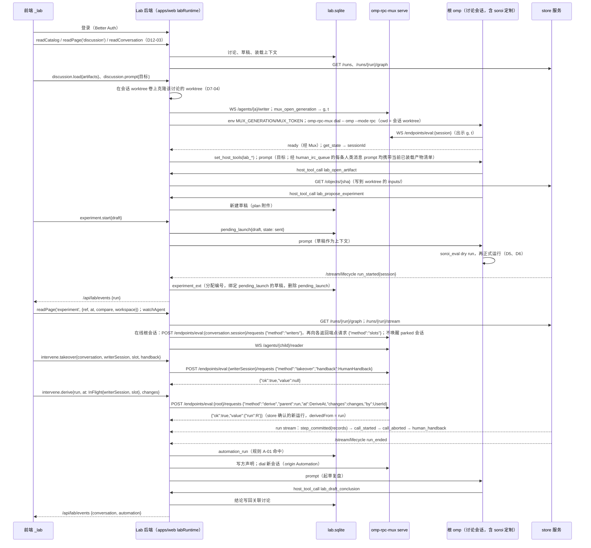

# D7 Pepgent Lab 业务后端：数据源、根会话驱动与前端接缝

起草：DrafterD7Lab（Claude 族）。评审输入：导师 D7Mentor，讨论者 D7Steady（稳健）、D7Divergent（发散）。他们的意见已在取舍列中处理，未采纳的写明了理由。本文与 `decisions/D2-components.md`（D2-12 至 D2-20）、`D3-network-mux.md`、`D5-plugins-eval.md`、`D6-store-service.md` 对齐。

依据缩写（行号均为当前工作树）：

| 缩写 | 文件 |
| --- | --- |
| PB | `pepgent-pm/evidence/argon/pivot-baseline.md` |
| RC | `pepgent-pm/evidence/argon/rulings-C.md` |
| FC | `pepgent-pm/evidence/argon/flow-catalog.md` |
| D2…D6 | `pepgent-pm/evidence/decisions/D2-components.md` … `D6-store-service.md` |
| inv/… | `pepgent-pm/evidence/inv/…` |
| LEDGER | `pepgent-soroi/LEDGER.md` |
| layers | `pepgent-soroi/design/layers.md` |
| web/… | `pepgent/apps/web/src/…`（`Pepgent/Pepgent` 业务仓） |
| rpc.md | `omp://rpc.md`（omp RPC 协议文档） |

## 框架

**要回答的问题。** `pepgent/apps/web` 的 `_lab` 前端现在只读一份同步、不可变的 fixture：`LabBridge.readSnapshot(): LabSnapshot` 直接返回常量 `LAB_SNAPSHOT`，源码注释写明“UI-only for now: … no server function, storage or timer”（web/client/services/lab.ts:4-13）。D7 决定替换它的后端：`LabSnapshot` 18 个顶层字段（web/client/contracts/lab-snapshot.ts:24-58）各自的权威源是什么，前端怎样读、怎样写；后端跑在哪里，Lab 自己的状态存在哪里；它怎样作为单写方经 Mux 启动并驱动装着 soroi 的根会话；讨论和自动化怎样使用 omp 会话与 soroi 的运行事件；集群页、容器页怎样落到 remote 模板上；认证与成员放在哪里；`LabBridge` 怎样从同步 fixture 换成异步、有类型的接口，同时不打断正在做 UI 的 agent。

**用户意图（逐字）。**

- 业务在 Pepgent，soroi 只是 omp 扩展组件：“对于soroi的的业务，在pepgent/pepgent目录，并且已有agent在制作纯前端，目前soroi的设计对于完整的pepgent是不够的，另外，soroi本身相当于只是omp的扩展组件，离真正的pepgent还很远”（LEDGER U1；AGENTS.md C1-1、C1-2；inv/s-pepgent.md:23-25）。
- soroi 要能作为 Pepgent 的 agent 核心：“对于soroi的最小功能合集，一定是一个完整的omp定制，并且能走通我说的所有流程，并且能作为pepgent的agent核心，并且最后能在这个基础上知道pepgent和soroi之间缺失的点，线，面”（LEDGER U23；AGENTS.md C1-3）。
- harness 核心是 omp，可以用成熟方案：“对于实现，我允许你使用成熟的开源且协议友好的现成方案，而不是所有东西都自造，但是对于核心的ai harness，不能偏离以omp为核心，不修改omp的宿主代码”（LEDGER U13；AGENTS.md C1-1）。
- 全流程，不收缩：“这是一个从设计，到补充，到开仓，到实现，到e2e测试的全流程任务，不要擅自收缩”（LEDGER U2；AGENTS.md C1-3）。
- 业务形态基本不变：“大体上来说，我认为虽说动了核心设计，但是app层的业务好像几乎不用动，只是因为反转以后，体验更好了”（PB:66 `#e3692177`）。
- 讨论一人一会话；旧 AI 不可用：用户在前端轮次里选了“裁掉：一人一会话”和“现有的ai应该完全用不了”（inv/s-pepgent.md:96-104）。
- GUI 能看见任意 agent：“rpc实际上本来就要额外做只读层面的多路复用”（PB:34 `#2dbf970b`）。
- GUI 可以写，写法是人类接入：“不，写方不一定只有ai，可以是人在gui写，写了以后通知ai改变了，但是值已经进去了”（FC:390 `#ba5ad307`），以及“人类写这种操作等于，将一个运行的程序取消……就叫他人类接入”（FC:391 `#d1baf561`）。

**已定的边界（不重议）。**

- Lab 后端在 `Pepgent/Pepgent` 的 `apps/web` 服务层，持有业务状态，是 GUI 的门面；实验只存运行 id，运行状态从 store 读（D2:51 D2-14）。讨论即中心 omp 主会话（D2:52 D2-15）。自动化在 Lab 后端，订阅 store 的变更流（D2:53 D2-16）。成员、项目、角色归 Lab 后端（D2:54 D2-17）。前端只经 `PepgentBridge` 调 Lab 后端，不直连 store 或 Mux（D2:55 D2-18）。
- 旧 Paseo、`_app`、`apps/hub` 保持不动，不复用为 Mux 或 soroi 后端（D2:56 D2-19；PB:54 说明旧 `apps/web/src/server` 与 `apps/hub` 只服务于用户判为不可用的旧 Paseo 会话）。
- 写方启动每个 omp 进程：`omp-rpc-mux dial -- omp --mode rpc`（leader 裁决；D3-08 已按此修订）。Mux 只路由。读方只能发只读命令；人类 IRC 的待投递表归各 agent 的写方，操作是 `enqueue / edit / withdraw / deliver`：根会话的写方是 Lab 后端，子 agent 的写方是 subagent 模块，Lab 经读方连接发 `mux_human_irc*` 帧（D3:60 D3-06、D3:66 D3-12）。每个写 eval 的会话各在 Mux 上注册控制端点 `eval:<该会话 session id>`，提供在途槽位、`answer`、`takeover` 和派生；根会话的端点另答 `writers()`，返回包含根会话自身的 `{session,endpoint}[]`，不按运行过滤（D3:73 D3-19；D5 §3.6；D6:42-45）。
- store 是值的权威，Lab 后端只经它的 HTTP 读取、订阅、比较、检索（D6:29 D6-01，D6:34 D6-06，D6:37-41）。草稿归 Lab 后端，不进 store（D6:40 D6-12）。一个根会话同一时刻至多一个未结束的运行；派生运行不新开会话（D6:33 D6-05）。
- 节点库的当前定义在每个 Lab 的 git 仓库里，Lab 后端在人确认后 commit，再把中心检出快进（D2:49 D2-12）。镜像构建走 `Pepgent/images` + Komodo Build + 镜像仓库（D2:50 D2-13）；remote 是模板目录和作业生命周期的唯一权威，新增模板写入（D2:46 D2-09）。

**现状里决定接缝形态的几处事实。**

| 事实 | 依据 |
| --- | --- |
| `createLabServices()` 在构造时同步调用 `bridge.lab.readSnapshot()` | web/renderer/platform/web/create-lab-services.ts:45-48 |
| `LabRuntime` 每页读一次 snapshot；所选 Lab、聚焦项目是页面生命周期状态 | web/renderer/application/lab-runtime.tsx:18-22；web/renderer/application/contracts/lab-session.tsx:1-12 |
| lab 服务是模块级单例，无参数构造 | web/renderer/bootstrap/renderer-services.ts:40-45 |
| `_lab` 布局路由有 `pendingComponent` 但没有 loader；桌面布局已用 loader 等待 `loadDesktopOnboardingSnapshot()` | web/app/routes/_lab.tsx:20-25；web/app/routes/_app.tsx:25-26 |
| 13 个 lab 页面的 controller 各读自己那一页的切片，加上 `labs`、`account`、`members`、`projects`、`experiments`、`aiModels` 这些目录切片 | `grep "snapshot\."` 于 web/renderer/features/lab-*/（R：本次检索输出） |
| id 是故事线的字面量联合：`LabId`、`MemberId`、`ProjectId` 等 | web/client/contracts/lab-common.ts:23-29；lab-experiments.ts:93,99,106,142,196；lab-workspace.ts:137 |
| view model 里写死了故事线 id | web/renderer/features/lab-clusters/model/clusters-view-model.ts:236；lab-containers/model/containers-view-model.ts:213,271；lab-experiment-detail/model/experiment-detail-view-model.ts:106；lab-flow-editor/model/flow-editor-view-model.ts:300；lab-connect-cluster/model/connect-cluster-view-model.ts:217-220；lab-node-library/model/node-library-view-model.ts:218-219 |
| 进程内的 `serverRuntime()` 会启动 Paseo daemon；`runOperation` 和请求中间件都先等它 | web/server/runtime-host.ts:1-12；web/server/operations/run.ts:25-27；web/app/start.ts:30-36；web/server/host.ts:28 |
| 现有请求中间件只做 loopback 本机访问令牌，“not user authentication” | web/server/transport/trust.ts:1-7 |
| omp RPC 有 `get_available_models`、`set_model`、`set_host_tools`/`host_tool_call`；`get_state` 返回 `sessionId`、`sessionFile` | rpc.md:156,167-171,497,782-821,1409-1421 |

## 决策表

| ID | what | where | how | 取舍 | 分类 | 缺失部分或设计补充? |
| --- | --- | --- | --- | --- | --- | --- |
| D7-01 | **Lab 后端的进程归属** | `Pepgent/Pepgent` 的 `apps/web`，与 TanStack Start 同在一个 Node 进程。新增四个隔离区：<br>• `src/server/lab/`：运行时、数据库、客户端、投影；<br>• `src/rpc/lab.ts`：server functions；<br>• `src/app/routes/api/lab/*`：SSE 与对象代理路由；<br>• `src/protocol/lab/`：线协议类型 | `server/lab/runtime.ts` 自带进程级 `labRuntime()` 和 `runLabOperation()`，结果仍是 `OperationResult`（inv/r-pepgent.md:289-293）。它不 import `server/paseo/**`、`hub-client`、`persistence/session-store`，也不调用 `serverRuntime()`。<br>两个生命周期拥有者都改为启动两个 runtime：生产是 `server/host.ts#runHost`，开发是 Vite 插件。<br>请求中间件 `app/start.ts` 按面分流：`/_lab` 文档、`lab.*` server function 和 `/api/lab/*` 走 Lab 认证（D7-03）与 `labRuntime()`；其余照旧走 `serverRuntime()` 与本机令牌。<br>**隔离的含义：** 代码与状态隔离，进程仍是一个 | **选定：** 同进程隔离区，沿用 server function、`OperationResult`、SSE 路由这套已有约定（D2-14 已选）。<br>**朴素方案：** 直接在现有 `operations/handlers.ts` 里加 lab handler。它们会经 `runOperation` 等待 Paseo 运行时（run.ts:25-27），等于复用旧 Paseo 后端，违背 D2-19。<br>**实质不同的方案：** 独立服务 `apps/lab-server`。文档仍由 apps/web 提供，多出一跳协议，认证要做两遍，收益只是进程隔离（D7Steady 指出同进程可行，但要写清“隔离”只到代码与状态） | 技术 | 是：中间件分流与双 runtime 启动 |
| D7-02 | **Lab 自有状态的持久化** | Lab 业务库卷 `lab.sqlite` | SQLite（公有领域）、better-sqlite3（MIT）、Drizzle ORM（Apache-2.0），labRuntime 启动迁移，web 唯一写方。只存 Lab 自有事实与外部主键的展示扩展。表为 Better Auth 表、lab_profile、member_profile、project、conversation（含私有 worktree）、draft、pending_launch、experiment_ext、discussion_binding、discussion_context、conversation_attachment、conclusion、artifact_meta、human_irc_queue、report、activity、milestone、automation_rule、automation_run、library_repo、library_staging、deploy_key，以及 `conversation_read{conversation,member,readAt}`（D12-12）与**生命周期游标记录（D30-02）：每个 Lab 实例一行，保存自动化最后处理的 store 生命周期事件 cursor；表名、列名由工程师定**。**D12-16 补列：** report.project_id/tags/sources/model；artifact_meta.created_at/sources（名称大小读快照）；conclusion.created_at；draft.updated_at；project.created_by；conversation.created_at；library_repo.description；library_staging.reason；automation_rule.created_by 与步骤 JSON；automation_run.ended_at。discussion_context.artifact_id 存 ArtifactRef，去掉指向 artifact_meta 的外键。**activity（D38-02 v2）：** 只记成员、结论确认与节点合入三族 Lab 自有事件，`kind` 为原命令名：`member.invite/role/quota/remove`、`conclusion.confirm`、`library.merge`、`library.apply`、`agentTemplate.saveVersion`；后三者均入节点合入族，不统一改名为 `library.merge`。`actor/project/text`、`home.activity` 全部行与 `settings.repoActivity` 三个合入值的读取、首页映射及失效规则见 D12“Lab 自有活动的读取与首页投影”；成员事件出线但不进首页。运行开始结束在读取时从 store 生命周期投影，不入 activity 表。运行状态、transcript、worktree 文件、模板与构建记录不存；自动化运行与消费游标是 Lab 自有记录，不是 store 运行状态副本 | 单写 SQLite 运维简单；Drizzle 兼 Better Auth 适配与业务迁移；better-sqlite3 从 Vite 服务端 bundle 外置、镜像按 ABI 安装。不另起 PostgreSQL；不从文件名或正文猜业务字段 | 技术 | 否 |
| D7-03 | **认证与成员** | 内嵌 Better Auth 与 organization 插件；`/api/auth/*`；`/sign-in` | organization/member/invitation 是 Lab、成员、角色、邀请唯一权威。角色 owner/researcher/student/guest，角色语句只由 Better Auth 判定：startWithoutApproval 授 owner/researcher；approval:[any,ownExperiments] 中 owner=any（含他人实验和自动化）、researcher=ownExperiments，student/guest 无审批；buildImages、manageMembers 仅 owner（D11-29A）。discussion:[create,prompt] 授 owner/researcher/student，不授 guest；prompt 另要求 conversation.owner 等于目标 Lab member.id，其他成员可读不可 prompt（D11-49）。editLibrary 授 owner/researcher/student、guest 只读（D10-12）；lab:write 与逐命令权限按 D12-10。Lab 表仅以 Better Auth 主键扩展 glyph/描述、头像色/缩写/主项目/GPU 配额。邮箱密码登录；`/sign-in` 与 `/api/auth/*` 公开，未登录 Lab 页面转登录，Lab 调用返回401；无公开注册或自助建 Lab，经邀请加入。部署一次性 seed 创建管理员和首 Lab，完成后 Web 才服务，Web 不做 seed（D11-30）。人类消息 principal 与 HumanHandback.by 取 session.user.id；讨论归属由 conversation 判断，不在 Lab 表重复判断角色。仅监听本机或内网，不暴露公网 | 嵌入成熟库，不另造成员权威；角色、讨论归属分属各自拥有方，布尔 approve 不足以表达研究员只批自己实验 | 技术 | 是：D11-29A、D11-49、D11-30 |
| D7-04 | **根会话模型：Lab 会话（conversation）** | 中心主机 Lab 容器（D2:57 D2-20）；Lab 表 `conversation`；会话 worktree 卷 | 只有一种根会话：装着完整 soroi 定制的 `omp --mode rpc`。它以 soroi 的 Main 角色运行（`SOROI_ROLE=Main`，D5-06 的 `writesEval` 为真）。用 `origin` 区分来源：<br>• `Discussion{name, project, archived}`：讨论页，一人一会话；<br>• `Panel{page, scope}`：各页右栏 AI；<br>• `Automation{rule, automationRun}`：自动化动作。<br>**会话 worktree（D2-12、D2-20）：** 卷根路径的部署配置接口见 D7-19（D21-01、D22-01）。每个 Lab 会话在第一次启动前，由 Lab 在会话 worktree 卷上从 Lab 库远端的当前默认分支克隆一份独立的 git clone，并在克隆的那个 commit 上建好该会话的私有分支 `conv/<conversation>` 并检出，路径记在 `conversation.worktree`，作为这个会话所有代的 cwd。会话里未合入的节点改动和讨论产物快照都以这份 worktree 为权威（D7-07、D7-11）。此后 worktree 的基线只在人执行 `library.sync` 时改变（D7-11）；启动、唤醒和别的会话合入节点都不碰它。会话删除时删除它。<br>**启动配方（每一代；Lab 是写方）：**<br>① 打开 `WS /agents/{id}/writer`；<br>② 发 `mux_open_generation`，拿到 generation `g` 与 token `t`；<br>③ 在本容器内执行 `omp-rpc-mux dial --agent {id} -- omp --mode rpc --session {file}`，cwd 是该会话的 worktree。**在继承的 Lab 容器环境之上设置** `MUX_GENERATION={g}`、`MUX_TOKEN={t}`、`SOROI_ROLE=Main`，以及取所属 Lab 配置的 `SOROI_STORE_URL`、`SOROI_MUX_URL`、`MUX_AUTH_TOKEN`（该 Lab Mux 的部署 bearer，soroi 监管者开子 agent 的 writer 使用）；**从传给 dial 的环境中删除受信 reader 凭据**（单 Lab 即删除 `MUX_TRUSTED_READER_TOKEN`）。D13-01 的 `SOROI_CENTRAL_IMAGE_DIGEST`、`SOROI_CENTRAL_CONFIG_DIGEST` 等其余既有启动输入照常沿继承链到达根 omp，不把这些设置项写成封闭环境清单（D32-01 v3）。dial 从 env 读 generation 与 token（D3 §4 命令行），omp 继承处理后的同一份 env，soroi 的 eval 模块注册 `eval:<session id>` 端点时出示它们（D3-19）；<br>④ 等 `ready`，读 `get_state` 记下 `sessionId`；<br>⑤ 发 `set_host_tools`（D7-05）；<br>⑥ 用户消息先进 Lab 的人类 IRC 待投递表（D7-09），会话空闲或到达步边界时以 `prompt` 投递；Automation 首条 prompt 同样按该队列语义投递，principal 按 D7-10 / D30-05 取会话 owner 对应的 `user.id`。<br>**停驻：** 一轮结束后关闭 stdin。**唤醒：** 下一条 prompt 时在同一个写方声明里开新的一代（D3-07），从 ① 之后的 ② 开始。<br>Lab 专属的行为约定放在 Lab 库项目级 `.omp/` 的规则与技能里，随 cwd 生效。<br>**soroi 怎样进入这条路径：** 容器里的 omp 已从 soroi 发行 tar 装好定制（D2-20、D2-25），所以 dial 拉起的 `omp --mode rpc` 加载的就是 omp-soroi 插件、soroi 的 agent 定义与设置；Lab 只给出 env 和 cwd，不替代也不改写 soroi。<br>**身份分层：** `origin` 是 Pepgent 的业务分类，不参与 Mux 寻址；Mux 地址是 agent id，控制端点名由 soroi 按 session id 注册（D3-19） | **选定：** 一种会话，来源用 ADT 表达；讨论即会话（D2-15），实验跑在讨论会话里（D7-06）；每个会话一份编写 worktree，与 D2-12、D2-15、D2-20 一致；启动时不同步 worktree，因为会话 worktree 本来就长期带着未提交的草稿，在它上面隐式合并默认分支，git 会拒绝，会话就起不来（LeadMentor 第 2 轮反例）。D7Divergent 指出：每个实验另开一个会话，正是 D2-15 否掉的“每个实验另起一个无人对话的 agent”（D2:52）。<br>**朴素方案：** 所有会话共用中心检出作 cwd。一个讨论里未确认的节点草稿会被另一个讨论正式运行时打包进去，中心检出也不再是默认分支的近处副本（D7-high 反例）。<br>**实质不同的方案：** Lab 后端自己写对话循环。偏离 omp 核心（U13） | 串联 | 是：PB:57-58 |
| D7-05 | **Pepgent 业务工具：RPC host tools** | `src/server/lab/tools.ts`；每代 ready 后 set_host_tools | 工具在 Lab 执行，经 host_tool_call/result 往返：lab_propose_experiment{title,plan} 只建草稿、挂 plan 附件，不启动；lab_draft_conclusion{text,evidence,pendingRun?} 建待确认结论；lab_open_artifact{artifact:ArtifactRef} 将 store 对象或讨论不可变快照拷进本会话 inputs 并返回路径；inputs 只是近处副本。lab_save_artifact{path,role,sources:ArtifactRef[]} 将字节保存为 worktree 内 `artifacts/<hash>/<文件名>` 不可变快照，记 id/conversation/hash/snapshot/source/role/sources/createdAt，返回讨论产物引用；同会话同字节复用 id，字节变则新快照新 id，不调用 store。lab_publish_report{title,body,figures,project,tags:string[],sources:ArtifactRef[]} 建报告，body 为 Markdown（`$$…$$`、`\tag{}`，图 ``），发布时从本会话 get_state 记模型。lab_propose_changes{target,rows,assignments:{item:discussion或experiment,project,reason}[]} 在右栏挂 changes。附件按 toolCallId 关联 transcript（完整形状见 D12-16） | 业务不进 soroi；保存即快照，原路径覆盖不改已保存内容；讨论产物在正式运行前不进 store 对象目录，不增加第二上传通道 | 串联 | 是 |
| D7-06 | **实验身份与状态** | draft/pending_launch/experiment_ext；store 运行 | 一实验一 store 运行；启动前为草稿。运行状态/时刻/根 session/derivedFrom 仅 store 持有，在途写方由在线根端点 `writers()` 与各写方端点的 `slots()` 给出；`writers()` 返回包含根会话自身的 `{session,endpoint}[]`，不按运行过滤。`experiment_ext` 以 RunId 为键仅存编号、名称、项目、来源草稿。草稿 origin.discussion 指向讨论；experiment.start 在原讨论建 pending_launch，每会话至多一条。有 startWithoutApproval 直接 sent 并 prompt 草稿全文，否则 awaiting_approval；approval:any 可批准，或 approval:ownExperiments 且审批 member.id 等于草稿所属讨论 conversation.owner（D11-29B），不另存创建者。**审批投递（D26-01）：** `experiment.approve` 在一次受理中把该会话的 pending 从 `awaiting_approval` 改为 `sent`，读取批准那一刻的当前 `draft.canvas`，以完整 `DraftCanvas` 的无损呈现、审批人的 `session.user.id` 为 principal，按既定 `human_irc_queue` 入队语义投递（含 D12-17 的 `conversation` 通知与投递），并为 pending 变化发 `catalog`；不增加版本或快照字段。agent 自行 eval。生命周期流见非派生 run_started 时：有 sent 意图则将其绑运行、写 ext、删除 pending；无 pending 时取讨论名称项目；Panel 取 scope，Automation 取规则名与范围，其中 `focused_project` 在每次命名时读取规则创建者当前 `member_profile.main_project_id` 作为 ext 项目，无主项目则项目为 `null`、按 Lab 范围处理（D30-01）；派生沿父名称项目、另分编号。**pending 的第二个结束锚点（D26-05）：** `awaiting_approval` 时，`draft.discard` 在一次受理中同时删除该 pending 与草稿，撤回尚未投递的启动意图，返回 `Done`、发 `catalog`，该讨论随后可再建 pending；不新增撤回或拒绝命令。save、discard 的完整状态矩阵见 D12-10“草稿与启动意图的生命周期”。读取时投影 draft、queued、running(Open)、needs_you（待人类槽位/审批）、ended(Ended)、stopped(Aborted)，不落运行状态副本。同讨论先后多实验、同刻至多一未结束 | pending 是意图而非运行状态；ownExperiments 与讨论 owner 使用同一成员身份，不增第二份创建者事实 | 串联 | 是：D11-29B |
| D7-07 | **讨论** | Lab 表 `conversation`（origin `Discussion`）、`discussion_binding`、`discussion_context`、`conversation_attachment`、`conclusion`、`artifact_meta`；omp transcript；会话 worktree；store | **消息：** 来自 omp 的 transcript，Lab 不存副本。会话在线时，Lab 作为读方连上 Mux，调用 `get_messages`，并订阅它的 stdout。已停驻时，读 `get_state.sessionFile` 指向的 jsonl，不唤醒（D3-11；占位 P2）。<br>**附件与引用：** `plan`、`conclusion` 附件和 `references` 取自 D7-05 的工具记录。<br>**实验关系：** `originated` 是这个讨论的会话里开出的运行（store 运行记录的根 session 等于本会话）；`bound` 是人手动绑定的运行（`discussion_binding`）。<br>**装载上下文：** 人选中的产物 id 记入 `discussion_context`；此后经 `human_irc_queue` 投递的每条人类消息 prompt 前，附上当前已装载产物的完整清单，清单为空时不附（含 `discussion.prompt`、steer 与 D26-01 的实验投递），agent 用 `lab_open_artifact` 读取。<br>**讨论产物的权威：** 每个讨论产物是产生它的会话 worktree 里的一份不可变快照 `artifacts/<hash>/<文件名>`。AI 保存时由 `lab_save_artifact` 生成（D7-05）；人上传时由 Lab 直接按内容哈希写成快照。`artifact_meta{id, conversation, hash, snapshot, source, role}` 指向这份快照；再次上传同名文件，或 AI 改了原路径，都会生成新的快照和新的 `ArtifactId`，已有的引用不变。附件、Datasets 页（经 `/api/lab/artifacts/{id}`）和别的会话的 `lab_open_artifact` 都读这份快照。Lab 库的 `.gitignore` 排除 `artifacts/`、`inputs/`，合入节点时不会带上它们（D7-11）。<br>**变成运行输入：** AI 在 `soroi_eval` 里把快照路径（或它在 `inputs/` 里的副本）作为根 `File` 输入；eval 中间件按 D6-07 把字节放进这次调用的暂存区，随那一步提交进入 store 的对象目录。之后它就是一个 store 产物，带运行来源 | **选定：** transcript 只有 omp 一个源（D6-19）；讨论产物在提交前只有 worktree 里的不可变快照一个源，提交后由 store 持有，与 D6-07 的“没有提交前的通用对象上传”一致。<br>**被否的第 1 轮写法：** `artifact_meta` 直接指向可变的 worktree 路径，覆盖后旧引用会读到新字节（LeadMentor 第 2 轮反例）。<br>**朴素方案：** Lab 存一份消息表。是 transcript 的第二份副本。<br>**实质不同的方案：** 讨论产物先 `PUT` 进 store 对象目录（初稿）。D6 没有这个端点，对象目录会出现没有提交引用的字节（D7-high 反例） | 串联 | 是：FC:494（F31 步骤 1） |
| D7-08 | **运行的读取与订阅（GUI 读方）** | `labRuntime` 里的 store 客户端和 Mux 读方；前端只连 Lab | **已提交的事实：** `GET /runs`、`/runs/{run}/graph?at=`、`/runs/{run}/stream`、`/compare`、`/search`、`/functions/{name}/usage`（D6 接口草图）。<br>**在途叠加层：** Lab 只读取自己持有在线一代的根会话：从 `conversation.session` 找到 `eval:<conversation.session>`，请求 `{"method":"writers"}`，得到包含根会话自身的 `{session,endpoint}[]`，再逐个向返回端点请求 `{"method":"slots"}`；两者都不按运行过滤。已停驻的会话没有在途的 `soroi_eval`，不唤醒。全部槽位按 D12-04 的完整挂载表放置：有 Open 运行挂运行项；无运行的 Discussion 有 pendingLaunch 挂该实验项，没有 pendingLaunch 挂讨论头；无运行的 Panel 或 Automation 挂会话头。每批在一个响应里只出现一次，不挂在会话头时头的 `slots` 为 `[]`。<br>**agent 实时流：** Lab 按 D18-05、D29-01 从调用者为成员的各 Lab 的 Mux 实例 `GET /agents` 找到该 agentId 的所属实例，以读方连该实例的 `/agents/{id}/reader`，经 `/api/lab/agents/{id}/stream` 用 SSE 转给浏览器（D3-11）；归属与授权详见 D12“读取范围与归属”。<br>**远程批次与产物：** `/agents/{id}/files…`（D3-13，按同一所属实例转发）。<br>**对象字节：** 浏览器经 `/api/lab/objects/{sha}` 取，Lab 代理 store 的 `GET /objects/{sha}`。<br>**变更推送：** `/api/lab/events` 是 SSE，通知与失效读取采用 D12-17 的 `LabChange` 联合及失效表。来源为 store 的运行流和生命周期流、Mux 的在线事件、Lab 自己的写入，**以及有订阅者时对在线根会话的定期槽位读取**（D29-03）：某 Lab 有浏览器订阅时，Lab 后端定期对该 Lab 自己持有在线一代的每个根会话读 `writers` → 各写方 `slots`，与上次槽位集合按 `writerSession`、`slot`、`state` 比较；有变化按当前挂载位置发 `run{run}`、`catalog` 或 `conversation{id}`（D29-04），没有订阅者就不读。有 Open 运行时同样适用，槽位打开、进入 `awaiting_human` 与结束由此发现，不等待 store 步提交。上次结果只用于比较，不作为任何读取的来源；目录与页面仍每次从端点读取。读取间隔为实现参数，先假定足够及时。浏览器收到通知后重读对应切片 | **选定：** Lab 是唯一门面（D2-18），各项状态各从自己的权威读；在途状态只从在线根会话及其写方端点读取。<br>**朴素方案：** 浏览器轮询整份 snapshot。延迟大，还要每次请求全部权威方。<br>**实质不同的方案：** 浏览器直连 store 和 Mux。打破 renderer 边界，认证要分散到三处（D2:55） | 串联 | 是：FC:497（F31 步骤 4） |
| D7-09 | **人类写入：三种介入与中止** | 命令经 `lab.command` 进入 Lab；Lab 转给拥有方 | **找端点：** 对仍有运行的会话，根端点由 store 运行记录的根 session 得到，端点为 `eval:<根 session id>`；根端点的 `writers()` 返回包含根会话自身的 `{session,endpoint}[]`，不按运行过滤。无运行时，取 `conversation.session` 作为根端点的 session；已停驻的会话没有在途 `soroi_eval`，读取时不唤醒。<br>**改值（在途调用）：** `intervene.takeover` 带 `conversation`、`writerSession`、`slot`、`handback`；Lab 按 `writerSession` 直接发到 `eval:<writerSession>` 的 `{"method":"takeover","handback":HumanHandback}`，由持有该槽位的会话执行（D6-14；D5-15）。该命令权限按 `conversation.owner` 判定。<br>**主动 `human()` 的交回：** `intervene.answer` 同样带 `conversation`、`writerSession`、`slot`、`handback`，Lab 直接发到 `eval:<writerSession>` 的 `{"method":"answer","handback":HumanHandback}`（D5-14），权限按 `conversation.owner` 判定。<br>**改参数或函数体（派生）：** Lab 的 `lab.command` 接收 `intervene.derive{run, at, changes}`，再映射为根端点的 `{"method":"derive","parent":RunId,"at":DeriveAt,"changes":Change[],"by":UserId}`；Lab 按 `conversation.owner` 授权后，从认证上下文取当前 `UserId` 填入 `by`，不以 `conversation.owner` 的 `MemberId` 代替；eval 拿到 store 成功提交后的结论后，以 `from = human:<by>` 投递 D5-16 情形二的 IRC；`at` 是 sum type：`Committed{step, position}`（调用已提交，坐标取自 `RunGraph`）或 `{kind:"InFlight",writerSession,slot}`（调用还在跑，坐标取自在途叠加层），与 D6-16 一致。改函数体时，人确认后先经 D7-11 的 `library.merge` 合入默认分支。新函数体就写在持有会话的 worktree 里时，插件直接从 cwd 打包出新版本；在别处写的（例如节点库页），人确认派生时同时确认对持有会话执行 `library.sync`（D7-11），插件随后打包出新版本。<br>**中止整个运行：** Lab 的 `lab.command` 接收 `run.abort{run}`，再映射为根端点 `{"method":"abort","run":RunId}`；由 eval 插件中止在途调用，再请 store 写 `run_aborted`（D6-05、D6-15）。<br>Lab 一律等拥有方给出结论，控制端点成功回复统一为 `{"ok":true,"value":V}`：`answer`、`takeover`、`abort` 为 `null`，`derive` 为 store 确认的新运行 `{run}`；store 的流随后推送结果，Lab 自己不写任何运行记录。**接管 agent（人类 IRC，D3-12）：** GUI 为每条消息生成 `msg` 键，可在投递前编辑或撤回。目标是 Lab 会话（根会话）时，Lab 就是写方，直接对自己的待投递表（Lab 表 `human_irc_queue`）执行 `enqueue / edit / withdraw`，会话空闲或到达步边界时 `deliver`：以 RPC `prompt` 投递，正文带 `human:<principal>` 来源，投递后成为 transcript 里不可变的事实。目标是 soroi 子 agent 时，Lab 在读方连接上发 `mux_human_irc`、`mux_human_irc_edit`、`mux_human_irc_withdraw`，待投递表在 subagent 模块里。principal 是当前用户。<br>原型的按钮映射：`intervene` 对应改值或派生；`truncate` 对应派生；`pause` 对应中止（D6-20 已删除“暂停”这个事实）；`logs` 对应读方流或 `remote tail` | **选定：** 请求在途状态的拥有方，等结论（D2-06）；answer/takeover 以 conversation owner 授权，直接送持有槽位的 writerSession；derive/abort 仍按运行由根会话处理。<br>**朴素方案：** Lab 直接写 store。跳过拥有方，用户也否定了合并写入（FC:391） | 意图 + 串联 | 是：PB:21 |
| D7-10 | **自动化** | labRuntime automation.ts；automation_rule/run；按 Lab 实例的生命周期游标记录 | 规则与线形状以 D12-09 为准：name/enabled/scope/trigger/when/conditions/then/creator，步骤为 {text,detail,actor}，actor=automatic、agent{template}、approval。trigger=event{run_started/run_ended/run_aborted} 或 schedule{cron}；instrument 不进第一版，列 D9。**范围（D30-01）：** `focused_project` 每次匹配或命名时读规则创建者当前 `member_profile.main_project_id`，事件匹配同 `project{p}`，会话开出的 ext 项目也取该项目；创建者无主项目时按 Lab 范围匹配全部运行、ext 项目为 null，不在规则另存副本。**事件游标（D30-02）：** `lab.sqlite` 每 Lab 实例保存自动化最后处理的 store 生命周期 cursor，以 `GET /stream/lifecycle?after=<落库游标>` 订阅；记录不存在时从 `"0"` 开始并建立。每条事件在同一个 SQLite 事务里按当前已启用规则匹配、写命中的 automation_run、推进 cursor，之后再为不需审批的运行开会话；重启从落库游标续读，停机事件随源流送达、不另补发。规则仅在 Lab 运行中创建，只处理它建立之后到达的事件；空库首次启动无规则，历史事件只推进游标。store cursor 接口与 LAB-06 followLifecycle 不变。**定时（D30-03 v2）：** croner 显式传 `timezone: "UTC"`，cron 一律按 UTC 解释，schedule.at 为同一时刻的 ISO 8601 UTC 串；不依赖容器本地时区，不新增字段、部署变量或配置接口。**会话与首条投递（D30-04/05）：** then 含 approval 时停 waiting，action 是规则步骤与触发事实填好的 prompt，批准后开装着完整定制的 Main Automation 根会话；owner 取批准者。手动运行 owner 取 manual.by；无审批的事件或定时运行 owner 取规则 creator。后续写、介入、派生、中止、experiment.update、会话内 conclusion.confirm 及 ownExperiments 口径均沿既有规则按该 owner 判定，权限表不变。首条 prompt（审批时为 waiting.action，其余为同样填好的文本）按既定 human_irc_queue 语义入队，principal 为该 owner 对应的 user.id，投递时机、human:<principal> 前缀与 conversation 通知均同人类消息，不另造通道。conditions 由 Main 判断，agent 步由它用模板派子 agent；结论或报告写回关联讨论。**结束与删除（D30-06/07）：** 首条 prompt 投递后，Lab 首次观察该会话 settle（session_settled 或 prompt_result.sessionSettled 为真），同次受理把 running 改为 ok、endedAt 记该时刻并发 automation；条件不满足时 Main 说明原因并结束首轮，同样为 ok。后续续写不改变这条运行；skipped 仍只由 dismiss 产生，failed 判定由工程师自定。不新增 host tool、状态或字段。规则删除语义见 D12-10：无运行才删除，有运行返回既有 revision_conflict，以 enabled:false 停用保留事实。运行记 event/schedule/manual 触发事实、endedAt，通过 conversation.automation_run_id 连会话。approval:any 可批任意；ownExperiments 只批事件触发且触发运行 owner 为本人 | store 只发布事实，Lab 持规则、消费游标与审批，不另造条件语言，不将普通模板作为失去 eval/host tools 的根会话。UTC cron 的当地时间由规则作者换算；ok 只代表首轮结束，不区分“做了事”与“条件不满足” | 技术 | 是：D12-09、D30-01..07 |
| D7-11 | **节点库与智能体模板读写** | Lab 库默认分支；中心检出缓存；会话私有 worktree；library_staging；store usage | 定义静态导出参数、默认值、返回、体、环境及 D12-15 的 group/estimateMinutes；产物契约列 D9。身份为 bundle 哈希，显示为 commit 序号；store usage 并草稿引用。会话基线为最近 clone/sync 的默认分支 commit（merge-base），私有 conv 分支在 clone 即建立；会话改动含私有提交与未提交工作区。未合入节点同时满足“工作区不同于当前默认分支”与“相对自身基线有改动”，标讨论和落后提交数；已合入不等 sync 即不再显示。人确认 library.merge 时，仅选路径从会话基线到工作区的 diff，在当前默认分支新建的干净集成检出用 git apply --3way，提交 push 后快进中心检出并删集成检出；保留别的会话已合入改动，未选草稿不进 commit，源 worktree/私有分支不改，冲突按 P13。library.apply 先把暂存源码写进 nodes 页 Panel worktree，再同一路 merge。sync 只由人显式触发：未提交草稿先提交到本 clone 的 conv 分支、不 push，再合并默认分支；同步后仍按上述条件列未合入路径，不自动同步其他会话。**智能体模板（D46-05）：** 每个模板是 Lab 库默认分支 `.omp/agents/` 顶层单个 `<id>.md` 文件，不递归；id=frontmatter `name`=文件名主干，harness='omp'、版本取容器 omp。description 取 frontmatter `description`；models 取 `model`，字符串按逗号切分并去首尾空白，YAML 列表原样取，无字段为 `[]`；files 仅为 `[{path: '.omp/agents/<id>.md', contents}]`，内容取默认分支中心检出；lastCommit 取默认分支最近改动该路径的提交，sequence 按本条提交序号；drafts 为各会话对该路径按本条判据未合入的改动。按 D12-10 用 agentTemplate.writeFile/removeFile 写设置页 agents Panel worktree，saveVersion{conversation,id} 等于对该 Panel 会话做 library.merge，`paths = ['.omp/agents/<id>.md']`；writeFile/removeFile 路径范围仍为 `.omp/agents/**`，合入路径含 nodes 与 `.omp/agents/**`，不是浏览器上传整套文件覆盖 | 当前定义归 git，草稿归会话；三方合并按选路径保留别人的合法修改；不隐式同步带草稿会话、不造定义副本 | 串联 | 是：D12-10、D12-15 |
| D7-12 | **集群页与接入向导落到 remote** | remote CLI（home 在 Lab 容器里，D2:57）；Lab 不另存集群表或作业表 | **集群：** 即 remote 目录里的一个后端端点：Komodo Core、slurmrestd 或 k8s context（inv/r-remote.md:114-115）。Lab 按后端把 `remote templates` 归组，模板的镜像、设备、挂载、资源取自 P3。<br>**作业（第一版只读，P5 的只读部分）：** 算力页的作业列表直接读 remote 的作业记录：remote 新增只读操作 `remote runs`，返回其 `runs/<run>.json` 记录的摘要（run id、模板、所属后端、最新生命周期事实），由 `Pepgent/remote` 实现。remote 是作业的唯一权威，Lab 不建作业表。每个作业的状态用 `remote status <run>`，输出尾部用 `remote tail <run>`。`remote tail` 返回的是一次快照，不是流；有浏览器订阅时，Lab 定期调用 `remote runs`、`remote status` 和 `remote tail`，把变化经 `/api/lab/events` 的 `compute` 频道与 `/api/lab/jobs/{run}/tail` 以 SSE 推给浏览器；没有订阅者就不调用（D7-18）。作业最新的生命周期事实是 `Removed` 时不开 tail 流。容器页的 `liveContainers` 就是用这个镜像的模板正在跑的作业，取自同一份列表。<br>**agent 容器：** 作业列表上再叠加 Mux 的在线列表（D3-15），标出哪些作业里有 agent 正连着。<br>**第一版不实现、列入 D9 差距报告的“面”（leader 立场；argon 裁定不违反 U2、U23，votes/D7-argon.md:49-69）：**<br>• 后端的健康、容量与节点（P4）；<br>• 作业的控制：`restart`、`destroy`、`new_sandbox`（P5 的控制部分）；<br>• 交互 shell 与预构建检查终端（P6）；<br>• 接入向导的执行方（P7）：主机与控制器安装归 `Pepgent/iac`，目录登记归 remote。<br>这些按钮在第一版不可用 | **选定：** 模板与作业只有 remote 一个源；作业列表与日志是 F17（状态、日志尾部）和 F31 第 4 步（算力页实时显示容器 stdout 尾部）必经的读取，所以只读部分进第一版；控制部分仍列入 D9（D8-mentor 对 D8-16 的反例；leader 裁决）。<br>**被否的第 1 轮写法：** P5 整体推迟。符合 D7 的 Lab 拿不到作业列表，F17 和 F31 第 4 步无法通过，等于擅自收缩流程（U2）。<br>**朴素方案：** Lab 自己记一份它见过的作业。是第二份作业登记。<br>**另一朴素方案：** Lab 直连 Komodo Core 读服务器状态。复制了 remote 的后端知识，还要另存一份凭据（D7Divergent）。<br>**实质不同的方案：** 在本表把 remote 扩成集群管理面。超出 D2-09 的“范围不变”（D2:46），也接近 D2 禁止的外部控制面（D2:27）；`remote runs` 只读自己已有的作业记录，不在此列 | 串联 | 是：inv/s-remote.md:253,263；FC:514；`remote runs` 归 Pepgent/remote |
| D7-13 | **容器（镜像）页落到 images 定义与 remote 模板** | `Pepgent/images` 根 `images.json` 与独立检出（D46-02/03 v2、P15）；remote 模板与作业；W-03 维护清单、W-09 导出、W-10 投影 | **检出与镜像定义（D46-02/03 v2）：** 部署注入 `PEPGENT_LAB_IMAGES_HOME` 与 `PEPGENT_LAB_IMAGES_REMOTE`（D7-19），Lab 后端是检出唯一写方，不存在时 clone，每次读取 containers 前快进远端默认分支。镜像定义的权威为 images 根 `images.json`，每个发布目标一项，现有 omp-agent、central、lab-web；Lab 不解析 Dockerfile，只读清单与检出，按 D12 P15 导出。name 是无 registry/tag/digest 的发布 repository 路径；path 是 Dockerfile 相对路径；base 是沿 FROM 链最近的已发布祖先，无则链顶外部引用原文，不是直接 FROM；central/lab-web 为 `pepgent/omp-agent`、omp-agent 为 `debian:stable-slim`。跨过内部 stage 装入内容仍按 base/sdk/python_package/internal_library/files/runtime_config 六类列入 dependencies，version 取 Dockerfile 引用或标签原文、浮动引用写 latest。name/path/base/dependencies 原样取清单；files 至少含 path 所指 Dockerfile，路径取清单、size 取检出文件字节数、contents 为 UTF-8 全文或二进制 null，target 不出线，wire 不变；其他缺源视图字段仍按 D12 不出线。<br>**“用这个镜像的模板”：** 对 `TemplateMetadata.image` 先去掉 `@` 及之后的 digest，再去掉最后一个 `/` 之后的 `:tag`，最后去掉首段 registry 主机（首段含 `.` 或 `:`，或等于 `localhost`）；结果与 `ImageDefinition.name` 相等即匹配。不同 tag 视作同一镜像，不按 `identity.image` digest 关联。<br>**绑定与资源：** 资源默认值与挂载取按 `TemplateInfo.name` 排序的第一个匹配模板；`resources.boundClusters` 为全部匹配模板的 `primaryCluster` 去重。其余资源字段是真实选中模板的值，不是 Lab 默认集群。<br>**`nodeBindingCount`（D40-01）：** `containers.definitions` 中默认环境属于匹配模板的节点函数个数；取 `NodeDefinition.defaultEnvironment`（节点构造 `env` 的源码原文），原文为字符串字面量时取其值与 `TemplateInfo.name` 比较；null 与非字面量表达式不计入。`NodeDefinition.template` 是 Agent 的 omp agent 定义，不用于本项；wire 与 W-09 导出不变。<br>**`liveContainers`：** `jobs` 中 `run.template` 属于匹配模板的作业，同源于 `remote runs` 与 `remote status`（D7-12）。<br>第一版不提供构建、tag/digest 读取、模板写入、预构建检查与终端，按 D8-16、D12-08/10 列入 D9；不为关联镜像增加 registry API 读取或 images 对 remote 目录的依赖 | **选定：** 定义、资源、作业各取拥有方；repository 关联不依赖部署 registry 主机。**代价：** 同 repository 的不同 tag 合并展示，多模板共用镜像时只显示一个模板的资源默认值。**落选：** images 导出关联模板反转依赖；按镜像 digest 关联超出第一版读取范围；按 Agent 的 `template` 计节点不符合默认环境事实 | 串联 | 是：D38-03 与 D40-01 的确定关联及计数规则 |
| D7-14 | **设置页其余部分** | Better Auth；project/library_repo/deploy_key；Lab库git | 项目merge把讨论/实验归属改目标项目、archive改状态；library_repo记远端/分支/密钥引用，检出提供状态、同步与领先提交。Lab生成持有私钥，界面只示公钥，rotate重新生成。成员审批范围来自D7-03的approval:any/ownExperiments，不用布尔approve；智能体模板按D7-11与D12-10；experiments/discussions是D7-06/07投影；建议由lab_propose_changes的assignments提供；GPU用量无来源为null、列D9 | 业务事实与凭据各归拥有方，不让用户粘私钥，不造使用量 | 技术 | 是：P9 |
| D7-15 | **AI 模型目录与选择** | omp（每个 Lab 会话自己的那一代） | 模型目录按会话取：右栏或讨论打开模型选择时，Lab 在**这个会话自己的那一代**上发 RPC `get_available_models`（rpc.md:169-171）；会话已停驻时，按 D7-04 先开新的一代。当前模型取自同一代的 `get_state`。切换模型用 `set_model{provider, modelId}`（rpc.md:167），也发给同一代。`readCatalog` 不再带全 Lab 的 `aiModels`。provider 的凭据由 `Pepgent/deploy` 注入 Lab 容器 | **选定：** 模型目录的权威是 omp，查询与切换对同一个进程，结果确定（LeadMentor 反例：从任一在线会话读取不确定）。<br>**朴素方案：** Lab 写死一份模型清单。<br>**实质不同的方案：** 一个专用的目录会话。多一个常驻进程，目录与真正切换模型的进程仍可能不同 | 技术 | 否 |
| D7-16 | **前端接缝，阶段 A：只改时机，不改数据** | `client/services/lab.ts`、`renderer/platform/web/create-lab-services.ts`、`renderer/bootstrap/renderer-services.ts`、`app/routes/_lab.tsx`、`renderer/bootstrap/lab-entry.tsx` | `LabBridge.readSnapshot()` 改为返回 `Promise<LabSnapshot>`，暂时仍解析为 fixture。<br>`renderer-services.ts` 新增 `loadLabServices(): Promise<LabServices>`，每页一次。`_lab` 路由的 `loader` 等它，做法与桌面布局 `_app.tsx:25-26` 相同；`LabEntry` 读 loader 的数据。<br>`createLabServices(bridge, snapshot)` 改为接收已读好的 snapshot。<br>`LabServices`、`LabSession`、`LabRuntime` 和 13 个 feature controller 都不变。<br>这是一次性的兼容步骤：`LabSnapshot` 这个 18 字段的聚合不是后端契约，阶段 B 的按页读取和命令联合才是切换目标 | **选定：** 能在 UI agent 改间距的同时落地，feature 代码零改动（D7Steady：只有把 id 放宽和剧情数据化移出本阶段，才能这么说）。<br>**朴素方案：** 一步到位接真实数据。要同时改 13 个 controller 和 6 处剧情字面量，与正在进行的 UI 工作冲突 | 实现 | 否 |
| D7-17 | **前端接缝，阶段 B：线上传权威方的数据，在客户端投影成现有的视图类型** | 线协议 `src/protocol/lab/`；投影 `src/client/services/lab/project-*.ts`；server functions `src/rpc/lab.ts`；W-09/W-10 按 D16-09 与 D20-01..03 的互斥路径域落地，由 AreaMgrPepgent 对接，不联系 U59 无关前端会话 | **线协议：** 只放权威方自己的形状：store 的 `RunGraph`、`RunEvent`（D6），Mux 的 `Presence`（D3），remote 的 `TemplateInfo`，Lab 的行。服务端不拼文案、不算布局。<br>**投影：** 客户端的纯函数把线数据投影成现有的 `*Fixture` 视图类型（`client/contracts/lab-*.ts` 保持原位，不搬家）。坐标、泳道、计数这些布局数学由投影计算。文案来自 renderer 的 copy 目录。用户内容是语言中性的 `string`（`LabString` 已允许）。<br>**读取：** 每个页面路由的 `loader` 调用 `readPage`，壳层调用 `readCatalog`。<br>**订阅与写入：** `subscribe` 订阅 `/api/lab/events`，收到后让对应 loader 失效；`send(command)` 发出 `LabCommand` 联合；`watchAgent` 订阅 agent 流。<br>**页面改动：** 各页本地 reducer 的动作改为命令；UI 数据绑定、最少 props/条件渲染由 W-10 按 D20-02 完成，不改 CSS、主题、类名、布局、视觉层级、组件结构与无关文案。U59 已合入的合法结构与语义保留；其改过的 controller/model 文件仍可按 D20-01 从最新 main 接续修改数据来源、类型、演示字面量与空值处理。<br>**同批要改的“点”：**<br>• id 字面量联合放宽为 `string` 品牌类型；<br>• 6 处 view model 的剧情字面量改成数据事实，如“仪器网关”这种后端种类、“判据节点”这种节点角色、由运行状态决定的流程模式；<br>• `AgentTemplate.harness`（lab-compute.ts:196）去掉 `claude | codex | pi | opencode` 四枚举，收窄为字面量 `'omp'`；`id` 就是 omp agent 定义名（D7-11）；<br>• 删掉固定回复 `AiConversationFixture.reply`。<br>运行时不再引用 `LAB_SNAPSHOT` | **选定：** 线上是权威方的原样数据，投影放在客户端。全量 snapshot 要服务端编造文案和布局，每次载入还要遍历每个运行的图（D7Divergent）。<br>**朴素方案：** 服务端拼好整份 `LabSnapshot`。<br>**实质不同的方案：** 重写前端契约，让页面直接消费线类型。要重写 13 页的 view model，收益只在命名 | 实现 + 串联 | 是：inv/s-pepgent.md:197 |
| D7-18 | **Lab 后端对外接口** | rpc/lab.ts；api/lab/*；api/auth/* | 公开线契约完整定义见 `D12-lab-wire.md`（D12-01..17、类型、命令结果权限、HTTP、事件失效表）。六个 POST server functions 经 runLabOperation：catalog.read{lab}、page.read{lab,page,params}、command{command}、conversation.read{conversation}、conversation.models{conversation}、conversation.markRead{conversation}。settings 参数精确空对象，一次返回四标签。SSE 为 events、agents/{id}/stream、jobs/{run}/tail；compute 订阅期间定期读 remote runs/status，tail 订阅期间定期取快照，Removed 不开 tail。上传为 POST `/api/lab/conversations/{conversation}/artifacts?name=&role=` 原始字节，返 ArtifactMetaWire；对象/讨论产物 GET、Mux files 列目录/文件、store volume 文件代理按 D12-13。认证交 Better Auth，输入按 Zod 边界解析，OperationResult 外层、LabBridge 成功值与 OperationFailure 按 D12-02。命令联合只含真实执行方；P4、P5控制、P6、P7、构建与模板写入不进第一版，列 D9，不造数 | 一个目录、一个页面、一个命令联合；会话独立读取，字节不走 JSON 命令；不保留省略的第二套 wire 草图 | 技术 | 否 |
| D7-19 | **部署形态与配置** | 中心主机的 Lab 容器（D2:57 D2-20），以 Komodo Stack 部署，定义在 `Pepgent/deploy`（D2-23）；Lab 服务只监听本机或内网 | 镜像基于 omp-agent（omp 与 `omp-rpc-mux`），再加 Node 和 apps/web 的构建产物；启动时从 soroi 发行 tar 安装定制（D2-25）。<br>**多 Lab 实例隔离（D18-05）：** Lab 后端是唯一的多租户层，Better Auth organization 承载多个 Lab 及成员、角色、邀请。每新增一个 Lab，部署独立的 store、Mux、Komodo、remote home，以及该 Lab 的中心 omp 会话卷与 worktree 卷；soroi 各组件不带 Lab 字段。Lab 后端按 `labId` 选择该 Lab 实例的 store URL、Mux URL 与 remote home，不以进程级单一 `SOROI_STORE_URL`、`SOROI_MUX_URL` 作为所有 Lab 的入口。根会话每代 dial 和 omp 继承的这两个环境变量，取所属 Lab 的配置。新增 Lab 的部署单元边界与供给方式仍是 D18-05 的占位细节，先假定能工作，不另定义配置形状。<br>**卷（按 D2-20 分开，各有自己的写方）：**<br>• Lab 业务库卷：`lab.sqlite` 与 Lab 生成的部署密钥，写方是 Lab 后端；<br>• omp session 卷：中心 omp 的会话文件，写方是 omp 的 `SessionManager`；<br>• 中心检出缓存卷：Lab 库默认分支的近处副本，写方是 Lab 后端，只做快进，可重建；`library.merge` 用的干净集成检出也放在这个卷上，每次合入时基于当前默认分支新建，push 成功后删除（D7-11）；<br>• 会话 worktree 卷：每个 Lab 会话一份独立 clone（D7-04），写方是该会话的 omp 和人，Lab 创建与删除；<br>• images 检出卷：`Pepgent/images` 远端默认分支的独立可重建检出，Lab 后端是唯一写方；不存在时 clone，每次读 containers 前快进远端默认分支，再读 P15，不在本地自造镜像定义（D46-02/03）；<br>• remote home 卷：remote 的配置、凭据与作业记录，按上述 Lab 实例隔离。<br>**凭据：** Lab 库部署密钥由 Lab 生成并持有（D7-14）；私有 `Pepgent/images` 的只读 deploy key 私钥存放在部署 owner 目录，沿 `LAB_ADMIN_CONFIG_FILE` 先例按路径只读 bind 进 lab-web 供 git 使用，不经 Komodo Variable 或 Stack environment，不让用户粘贴、不进镜像（D47-01 v2；D48-01 v2 的 org deploy key 开关前提不改变此路径）。`BETTER_AUTH_SECRET`、各 Lab Mux 的写方与读方凭据、Komodo API 密钥、模型 provider 密钥由 `Pepgent/deploy` 按既定路径注入。**受信 reader（D32-01 v3）：** deploy 为每个 Lab 的 Mux 实例生成一个与该 Lab 部署 bearer 不同的受信 reader 凭据，同一来源注入该 Mux serve（`--trusted-reader-token-file` 或 `MUX_TRUSTED_READER_TOKEN`，形式由 deploy 定）及 `lab-web` 中该 Lab 的实例配置。各 Lab 的受信 reader 凭据与该 Lab 的 Mux URL 同属按 `labId` 选择的实例配置，只交 Lab 后端，不进 dial/omp 的环境。中心 Stack 单 Lab 部署用 `lab-web` 环境变量 `MUX_TRUSTED_READER_TOKEN` 注入，此名不是所有 Lab 共用的进程级唯一凭据；多 Lab 形状沿 D18-05 占位，不另定义。Lab 仅在自己到所属 Lab Mux 的 `/agents/{id}/reader` 受信连接上使用该凭据，发子 agent 的 `mux_human_irc`、`mux_human_irc_edit`、`mux_human_irc_withdraw`，principal 取当前用户（D3-12、D7-09）。启动 dial 时按 D7-04③在继承环境上设置所属 Lab 的既有启动项，并删除受信 reader 凭据，D13-01 中心身份等其余输入照常继承。**同容器同用户不是沙箱**：只是不经子进程环境传递，仍可通过进程检查或 Lab 初始环境取得凭据，不把过滤 env 名称称作 OS/进程隔离；D3-12 区分持受信凭据的 Lab 后端连接与只持部署 bearer 或代 token 的连接，其文字不变。<br>**配置：** 各 Lab 的 store URL、Mux URL、受信 reader 凭据、remote home 及上述各卷挂载路径按 `labId` 选择。其中 `PEPGENT_LAB_WORKTREE_HOME` 是部署交给 Lab 后端的会话 worktree 卷容器内挂载根路径；中心 Stack 注入 `PEPGENT_LAB_WORKTREE_HOME=/work`，对应既有 `session-worktrees:/work`，Lab 在该根下按 D7-04 创建和删除会话 clone（D21-01）。`PEPGENT_LAB_LIBRARY_HOME` 是部署交给 Lab 后端的中心检出缓存卷容器内挂载根路径；中心 Stack 注入 `PEPGENT_LAB_LIBRARY_HOME=/var/lib/pepgent/library`，对应既有 `library-cache` 挂载，Lab 按 D7-11 在该根下维护库检出与临时集成检出（D22-01）。这两个配置接口不新建卷、不增加第二个路径来源，也不改变各卷的权威、写方和生命周期。**images 配置（D46-02、D47-01 v2）：** compose 字面值注入 `PEPGENT_LAB_IMAGES_HOME=/var/lib/pepgent/images`（既有 `images-checkout` 卷容器内挂载点）与 `PEPGENT_LAB_IMAGES_REMOTE=pepgent-images:Pepgent/images.git`；这两项是非机密路径/远端配置，不承载私钥。W-04 在 Lab 服务 environment 和卷表 images-checkout 行登记变量名；W-09 在 `runtime.ts` 解析，未注入时缺省值按该文件现有惯例由 W-09 决定 | **选定：** Lab 持有多 Lab 路由，各 soroi 实例保持单租户；根会话与写方同在一个容器，Lab 才能直接在本机执行 dial（D2-20）；卷按写方分开，与 D2-20 的持久载体一一对应。受信凭据边界沿 D13-05“同容器不是沙箱”，不为此分 OS 用户或拆容器。<br>**初稿的缺口：** 卷只有“Lab 库检出、`$PEPGENT_LAB_HOME`、remote home”，缺会话 worktree 与 images 检出及其写入凭据（D7-high、LeadMentor 反例） | 实现 | 是 |
| D7-20 | **soroi 与 Pepgent 依赖方向（U23）** | 两仓边界 | soroi 不认识 Pepgent。运行调用仍只有 store HTTP/SSE、Mux 写方/读方/控制端点、RPC host tools、Lab 库项目级定制四条线。Lab 按 D12-01 消费 store 权威 contract/schema 解析 HTTP，不导入服务实现或插件执行器。仓 A 建前按 D16-15 以 `git+https://github.com/Pepgent/soroi.git#store-contract` 引用 CI 派生契约包，不钉版本，沿用 `pepgent-store/contract`；源码归 soroi packages/store，派生分支不成为第二源头、不手改。按 D28-02，契约决策或切片派发时同步开 Pepgent 跟进 issue；soroi 合入并推进分支后由消费方 Lab 席位 `npm update pepgent-store`、提交 lockfile、检查与完成必要 Lab 代码改动。建仓 A 后改由 A 产出契约包并停用派生分支。拿掉 Pepgent，定制+store+Mux 仍走全部流程；D9 对照 18 字段盘点 | 契约消费不等于服务内嵌，依赖单向、schema 不复制，刷新由消费方负责 | 意图 | 否 |
| D7-21 | **不复用旧 Paseo 后端** | apps/web | Lab 区不 import `server/paseo/**`、`hub-client`、`session-store`、`serverRuntime()`；`apps/hub` 不承担任何 Lab 职责。旧 `_app` 面保持不动 | D2-19；用户原话“先不动”“现有的ai应该完全用不了”（inv/s-pepgent.md:104） | 意图 | 否 |

## LabSnapshot 18 个字段的权威源与读写方式

“读”列写阶段 B 的来源，阶段 A 时全部仍是 fixture。“写”列是 `LabCommand` 的变体，由 Lab 转给权威方。

| 字段 | 权威源 | 前端怎样读 | 前端怎样写 | 缺口 |
| --- | --- | --- | --- | --- |
| `labs` | Lab：Better Auth organization，加 lab_profile | readCatalog；activity 投影运行中实验数 | `lab.update`；Lab 创建仅部署 seed，不开放 lab.create（D12-10） | — |
| `account` | Lab：Better Auth 的当前会话用户，加该 Lab 的 member 行 | `readCatalog` | 退出登录走 Better Auth 的 `signOut` | 缺登录页 |
| `members` | Lab：Better Auth 的 member，加 `member_profile` | `readCatalog` | 见 `settings` | — |
| `projects` | Lab：`project` 表 | `readCatalog`；`itemCount` 由投影算出 | 见 `settings` | — |
| `experiments` | 外部加 Lab：store 的运行（状态、时刻、根 session、`derivedFrom`、调用），`experiment_ext`、`pending_launch` 与草稿；在线根会话经 `writers()` 得到各写方 `{session,endpoint}`，再由各端点 `slots()` 得到在途槽位（`needs_you`）。挂载按 D12-04：有 Open 运行挂该运行项；无运行的 Discussion 有 pendingLaunch 挂该实验项，无 pendingLaunch 挂讨论头；无运行的 Panel 与 Automation 挂会话头。每批只出现一次，不挂在会话头时头的 `slots` 为 `[]` | `readCatalog`；`progress`、`where`、`now`、`updated` 都由 `RunGraph` 投影算出 | 启动草稿用 `experiment.start{draft}`，批准用 `experiment.approve{draft}`，改名或改项目用 `experiment.update` | 逐步写出的运行事先不知道总节点数，所以 `progress.total` 没有来源 |
| `aiModels` | 该 Lab 会话本代 omp 的模型目录与状态 | `lab.conversation.models`，停驻时先开代，不进目录（D12-03） | panel.model 调该代 set_model | — |
| `home` | Lab report/activity/milestone；remote模板作业、讨论activity、Panel | readPage('home')（D12-08） | milestone.create/complete、panel.prompt；报告仅 lab_publish_report 写，GUI只读（D12-10） | quote/dialogs/prompts 是 renderer 文案 |
| `experimentsPage` | 外部加 Lab：泳道的实际时段取自 store 调用的起止时刻，按模板绑定的设备归组；计划时段取自草稿估时；冲突由投影算出 | `readPage('experiments')` | `panel.prompt`；聚焦项目仍是页面状态 | 模板的设备字段（P3）；仪器排期仲裁是缺失的“面” |
| `experimentFlows` | store 图/回看、目录中的运行与槽位、Mux presence/files | `readPage('experiment', D12-05 的 ref/at/compare/workspace)`；订阅 run | intervene.*、run.abort、human.irc | 派生导航按 graph.derivedFrom |
| `flowEditor` | Lab：`draft`；`palette` 是节点库导出，加上由泳道投影算出的可用性 | `readPage('flowEditor', {draft})` | `draft.save`、`experiment.start` | 校验仍由页面推导 |
| `nodeLibrary` | 外部加 Lab：库默认分支（中心检出）、各会话相对当前默认分支未合入的节点改动（含私有分支 `conv/<conversation>` 上的草稿 commit；按 D7-11 计算），以及各会话落后默认分支的 commit 数、store 的使用情况、`library_staging`、remote 模板的挂载、镜像与集群 | `readPage('nodes')` | `library.stage`、`library.apply`、`library.merge{conversation, paths}`、`library.sync{conversation}`（D7-11） | P1 定义导出 |
| `automation` | Lab automation_rule/run（D12-09）与对应完整 Automation 会话头（D31-01） | readPage('automation') 返回 rules、runs、conversations、panels；`conversations` 为 runs 中非 null 会话对应的 Automation 头，每会话一项、对本 Lab 全体成员可见，槽位按 D12-04 挂载。订阅 automation；收到 conversation{id} 时，`conversations` 含该会话的自动化页重读（D12-17） | automation.rule.create/update/delete、run、approve、dismiss（D12-10）；会话写与首步槽位交回仍按既有会话 owner 权限 | instrument 列 D9 |
| `datasets` | store File/volume/来源；讨论快照与 artifact_meta、discussion_context | readPage('datasets')；字节 GET 按 D12-13 | discussion.load{artifacts:ArtifactRef[]}；原始字节 POST `/api/lab/conversations/{conversation}/artifacts?name=&role=`；下载只读 | 实验产物契约列 D9 |
| `discussions` | conversation/附件/结论/绑定/上下文，消息仅 omp transcript | 页面只带 activity/selected，正文 `lab.conversation.read`；models 独立读；markRead 记本人位置（D12-03/08/12） | discussion.*、conclusion.confirm | 停驻按 P2 不唤醒读消息 |
| `clusters` | 外部：remote 的后端与模板（P3）、作业记录（`remote runs`）与每个作业的 `remote status`，Mux 的在线列表 | `readPage('clusters')`；日志尾部经 SSE `/api/lab/jobs/{run}/tail`（`remote tail`） | 第一版无命令 | P4、P5 的控制部分、P6 不在第一版，列入 D9（D7-12） |
| `connectCluster` | 外部：现有集群来自 remote；向导文案移到 renderer 的 copy | `readPage('connectCluster')`，只读 | 第一版无命令 | P7 不在第一版，列入 D9（D7-12） |
| `containers` | images 定义、remote 模板/作业 | readPage('containers')（D12-08） | 第一版无 image.build/template.bind，按 D12-10 列 D9 | 构建、标签、预检查/终端不在第一版 |
| `settings` | Better Auth 成员/角色/邀请/授权；project、library_repo、库 `.omp/agents`；成员状态按 D46-04 取 Lab 进程内连接与调用观察，不取 Better Auth session：online 为该成员在本 Lab 至少一个 events 订阅；lastActiveAt 为本进程启动后最近接纳其本 Lab 已认证 lab.* 或 /api/lab/* 调用的时刻，无则 null；不落库、不加表列迁移、不改 wire | `readPage('settings', {})`，精确空参数，一次四标签（D12-05） | member.*、project.*、repo.*、agentTemplate.writeFile/removeFile/saveVersion（D12-10） | GPU 用量无源为 null；harness='omp' |

## 接口草图（主路径）

```ts
// ---- 前端接缝 ----
// 阶段 A（D7-16）
export interface LabBridge {
  readSnapshot(): Promise<LabSnapshot>                          // 暂时仍解析为 fixture
}
// 阶段 B 的 LabBridge、目录、13 页参数与 wire、命令与逐 kind 结果、权限、流帧：
// 完整形状在 D12-lab-wire.md 的“类型定义”“命令与结果”“HTTP 路由”“事件”，不在此另写一份。
// readCatalog / readPage / readConversation / readModels / markRead / send<C> /
// uploadArtifact / subscribe / watchAgent / watchJobTail 均采用 D12 的确切签名。
// settings 读取无参；上传原始字节走 D12-13 HTTP，不是 artifact.upload JSON 命令。
// 客户端纯函数消费 D12 wire，投影为原有视图类型；布局与文案不进服务端 wire。

// ---- Lab 自有记录（Drizzle schema 的领域形状） ----
type ConversationOrigin =
  | { kind: 'Discussion'; name: string; project: ProjectId; archived: boolean }
  | { kind: 'Panel'; page: LabPage; scope: string }
  | { kind: 'Automation'; rule: AutomationRuleId; automationRun: AutomationRunId }
type ConversationRow = { id: ConversationId; lab: LabId; owner: MemberId; origin: ConversationOrigin
                         agent: AgentId; session: SessionId; worktree: string; createdAt: string } // worktree 仅内部，不出线
type DraftRow = { id: DraftId; lab: LabId; project: ProjectId; origin: { discussion: ConversationId; retroRun: RunId | null }
                  canvas: DraftCanvas; savedVersion: number; updatedAt: string } // 绑定只在 experiment_ext.draft
type PendingLaunchRow = { conversation: ConversationId; draft: DraftId; at: string
                          state: 'awaiting_approval' | 'sent' }                  // 每个会话至多一条
type ArtifactMetaRow = { id: ArtifactId; conversation: ConversationId; hash: Hash; snapshot: string
                        source: string | null; role: ArtifactRole; sources: ArtifactRef[]; createdAt: string }
type ConversationReadRow = { conversation: ConversationId; member: MemberId; readAt: string } // 仅本人位置，guest 也可写
type DiscussionContextRow = { conversation: ConversationId; artifact: ArtifactRef } // 无 artifact_meta 外键
// report.project_id/tags/sources/model、conclusion.created_at、project.created_by、
// library_repo.description、library_staging.reason、automation_rule.created_by/步骤 JSON 按 D12-16 落库。
type AutomationRunRow = { id: AutomationRunId; rule: AutomationRuleId; trigger: Trigger; endedAt: string | null
                          state: { kind: 'waiting'; action: string } | { kind: 'running'; conversation: ConversationId }
                               | { kind: 'ok' | 'failed' | 'skipped' } }

// ---- 根会话（D7-04）：Lab 是写方，自己执行 dial ----
interface LabSessions {
  open(origin: ConversationOrigin, owner: MemberId): Promise<ConversationRow>   // 从默认分支克隆 worktree → 写方声明 → 开一代 → dial → ready → get_state → set_host_tools
  prompt(c: ConversationId, text: string): Promise<void>                       // 按 human_irc_queue 语义入队；停驻时开代，空闲或步边界投递（D7-04、D30-05）
}
// dial 命令行：
// 在继承的 Lab 容器环境上设置 MUX_GENERATION={g}、MUX_TOKEN={t}、SOROI_ROLE=Main、
// 以及 conversation.lab 对应的 SOROI_STORE_URL、SOROI_MUX_URL、MUX_AUTH_TOKEN；删除受信 reader 凭据（D32-01 v3）。
//   omp-rpc-mux dial --agent {agent} -- omp --mode rpc --session {file}
// cwd = 该会话的编写 worktree；D13-01 的中心身份及其余既有启动输入照常继承，不将上列设置项视为封闭环境清单。

// ---- Pepgent 业务工具（D7-05），用 set_host_tools 注册 ----
type LabHostTool =
  | { name: 'lab_propose_experiment'; input: { title: string; plan: { text: string; node: string }[] } }
  | { name: 'lab_draft_conclusion'; input: { text: string; evidence: string; pendingRun?: RunId } }
  | { name: 'lab_open_artifact'; input: { artifact: ArtifactRef } }
  | { name: 'lab_save_artifact'; input: { path: string; role: ArtifactRole; sources: ArtifactRef[] } }
  | { name: 'lab_publish_report'; input: { title: string; body: string; figures: ArtifactRef[]; project: ProjectId | null; tags: string[]; sources: ArtifactRef[] } }
  | { name: 'lab_propose_changes'; input: { target: string; rows: ChangeLine[]; assignments: { item: { kind: 'discussion'; conversation: ConversationId } | { kind: 'experiment'; run: RunId }; project: ProjectId; reason: string }[] } }
```

## 主路径时序（F31：从讨论装载产物，启动实验，介入，自动化写回）



## 占位（设计阶段先假定能工作）

| 占位 | 假定 |
| --- | --- |
| P1 节点定义导出 | 静态导出参数、默认值、返回字段、体、默认环境与 group/estimateMinutes，按 D10-11(c)、D12-15；产物契约 role/判据不进第一版，原样列入 D9 |
| P2 停驻会话的 transcript | Lab 能不唤醒地读出停驻会话的消息，例如按 omp 的会话文件格式读 `get_state.sessionFile` 指向的 jsonl（D3-11） |
| P3 模板元数据 | remote 的 `templates` 能返回模板的后端端点、镜像、设备、挂载和资源默认值，模板写入能写这些字段（D2-09 的“GUI 展示所需字段”） |
| P4 后端健康与容量 | **第一版不实现**，列入 D9 缺失的“面”（leader 立场；argon：votes/D7-argon.md:67-69）。归属：remote 或 iac，留到 D9 之后的决策 |
| P5 作业列表与控制 | **只读部分进第一版：** remote 新增只读操作 `remote runs`，列出它自己的作业记录摘要（由 `Pepgent/remote` 实现，第一版假定可用）；Lab 用它加 `remote status`、`remote tail` 显示作业列表、状态与日志尾部，容器页 `liveContainers` 同源（D7-12）。**控制部分**（`restart`、`destroy`、`new_sandbox`）第一版不实现，列入 D9 |
| P6 交互 shell | **第一版不实现**，列入 D9；集群页 `shell`、容器页预构建检查与终端不可用 |
| P7 接入向导的执行方 | **第一版不实现**，列入 D9；主机与控制器安装归 `Pepgent/iac`，目录登记归 remote（argon：votes/D7-argon.md:69） |
| P8 仪器事件 | 存在一种仪器事件源，自动化可以订阅 |
| P9 资源计量 | 能按成员统计 GPU 小时用量 |
| P11 邀请邮件 | Better Auth 的邀请能经 SMTP 送达 |
| P12 host tools 跨代保持 | 每一代 `ready` 后重新发一次 `set_host_tools`，工具集就与上一代相同 |
| P13 git 合并 | `library.merge` 把会话 diff 三方合并到集成检出上（`git apply --3way`）后 push，以及 `library.sync` 把默认分支合并进会话私有分支，主路径上都不产生冲突 |

## 已裁决的条目（第 1 轮）

- **D6-12 的读法：** argon 裁定讨论即会话、实验跑在讨论会话里，用户从未要求无人对话的实验会话（votes/D7-argon.md:15-30）。已写入 D7-04、D7-06。
- **旧 `_app` 面：** 保持不动，不加 Lab 登录；Lab 服务只监听本机或内网（argon：votes/D7-argon.md:34-45；leader 立场）。已写入 D7-03、D7-19、D7-21。
- **P4–P7：** 第一版不实现，列入 D9 差距报告；argon 裁定不违反 U2、U23（votes/D7-argon.md:49-69）。已写入 D7-12、D7-18 与占位表。第 4 轮例外：P5 的只读部分（作业列表、状态、日志尾部）因 F17 与 F31 第 4 步必需，提前到第一版（D8-mentor 对 D8-16 的反例；leader 裁决），控制部分仍在 D9。
- **`AgentTemplate.harness`：** 去掉多 harness 枚举（argon：votes/D7-argon.md:73-87；leader 立场）。`id` 就是 omp agent 定义名，`harness` 收窄为字面量 `'omp'`，避免出现一份要与 `id` 保持一致的拷贝（D7-high 第 1 点）。已写入 D7-11、D7-17。
- **Mux 的命名：** 以 D2、D3 的 `omp-rpc-mux` 为准，D4 的写法已报治理统一。

第 1 轮各反例的逐条回应见 `decisions/D7-r1-responses.md`。

## 通过后要改的文档

文档写方按 D20-03：`apps/web/README.md`、`docs/conventions/01-repo-layout-and-layering.md`、`docs/conventions/03-typescript-react-style.md` 在 W-09 在席时归 W-09，W-09 按 D16-10 退役后归 W-10；`apps/web/src/renderer/README.md` 始终归 W-10。W-10 将每次 WEB PR 的精确文档段落原文写入 PR 正文及[文档承载 issue](https://github.com/Pepgent/Pepgent/issues/51)，W-09 在席时由 AreaMgrPepgent 送达并由 W-09 合入，退役后 W-10 直接修改。全部差量合入前承载保持 open，最终只由一个 PR 关闭；不以文档归档作为工程开工锁。

| 文档 | 位置 | 改成什么 |
| --- | --- | --- |
| `pepgent/apps/web/README.md` | 开头与“Runtime boundaries”表 | 进程内有两个 runtime：旧 Paseo 的 `serverRuntime` 与 Lab 的 `labRuntime`。表中加 `server/lab`、`rpc/lab.ts`、`protocol/lab`、`/api/lab/*`、`/api/auth/*` 几行。“Run”一节写明按 Lab 配置 store URL、Mux URL、remote home（D18-05、D7-19），以及 `BETTER_AUTH_SECRET` 与 D7-19 各卷的挂载路径 |
| `pepgent/AGENTS.md` | 拓扑那一句（:1-3） | `apps/web` 同时承载 Lab 业务后端（D7）；Lab 后端以写方身份驱动装有 soroi 定制的 omp |
| `pepgent/README.md` | 布局与运行（:3-35） | 同上，并写明 Lab 运行依赖 store、Mux、Lab 库远端与会话 worktree |
| `pepgent/docs/conventions/01-repo-layout-and-layering.md` | 运行区（:9-13） | `server/lab` 与 `protocol/lab` 的分层规则：Lab 区不 import Paseo 区；客户端投影放在 `client/services/lab/` |
| `pepgent/docs/conventions/03-typescript-react-style.md` | Lab 数据读取与组件接缝说明 | 按已合入 WEB 切片同步异步读取、投影、订阅与命令说明；owner 与差量交接按 D20-03 和本节文档承载 |
| `pepgent/apps/web/src/renderer/README.md` | `_lab` 一节（:31-48） | lab 服务改为 `_lab` loader 异步构造（阶段 A）；阶段 B 改为按页 loader、订阅与命令 |
| `client/services/lab.ts`、`renderer/application/contracts/lab-session.tsx`、`client/contracts/lab-common.ts`、`client/contracts/lab-snapshot.ts` 的头注释 | 文件头 | 把“UI-only / fixture / never mutated”改为对应阶段的事实；路径域由 W-10 按 D20-01 接续，不交给 U59 无关前端会话 |
| `pepgent/NOTICE` 与第三方声明 | — | 加入 better-sqlite3、drizzle-orm、better-auth、croner |
| `pepgent-pm/evidence/decisions/D2-components.md` | D2-14、D2-15、D2-16、D2-17、D2-18 | D2-14 的“业务库引擎留待后续”改为指向 D7-02；D2-15 的会话启动指向 D7-04；D2-16 的事件协议指向 D7-10；D2-17 的“认证留待后续”改为指向 D7-03；D2-18 补上两阶段接缝（D7-16、D7-17） |
| `pepgent-pm/evidence/decisions/D3-network-mux.md` | D3-12 | 写明根会话的待投递表由 Lab 持久化在 `human_irc_queue`（D7-09）。D3-10 已补上 Lab 写方注册 host tools，无需再改 |
| `pepgent-pm/evidence/decisions/D5-plugins-eval.md` | §3.6 `RootEvalControl`（:309-311） | 根端点补上 `derive(parent, at, changes)`（`at` 为 `Committed \| InFlight{writerSession, slot}`，D6-16）与 `abort(run)`（D6-05），由持有运行的根会话执行（D7-09） |
| `pepgent-pm/evidence/decisions/D6-store-service.md` | D6-12 | 写明“实验启动后记下的根 session”就是发起它的讨论会话（D7-06），Lab 以 `RunId` 为键存展示扩展 |
| `pepgent-soroi/design/layers.md` | “GUI 读取”（:36-43）、“预定义函数库”（:45-52）、“运行事件”（:67-69） | GUI 写入经 Lab 后端转给拥有方；草稿归 Lab；自动化订阅 store 生命周期流，链接 D7-10 |
| `pepgent-soroi/design/intervention.md` | 三种介入的入口 | 入口统一写为 Lab 后端的 `lab.command`，链接 D7-09 |
| `pepgent-remote/design/remote.md` | 模板目录与外部操作（:39-50、:77-88） | 写明 GUI 是 remote 的直接客户端之一；加入 P3 的模板元数据字段（D2-09），以及只读操作 `remote runs`（列出作业记录摘要，D7-12）；作业控制不在第一版 |
| `pepgent/AI4S-prototype/CLAUDE.md` | 数据故事线（:75-83） | 写明原型的 id 与文案是演示数据；真实后端的 id 是不透明字符串（D7-17） |
