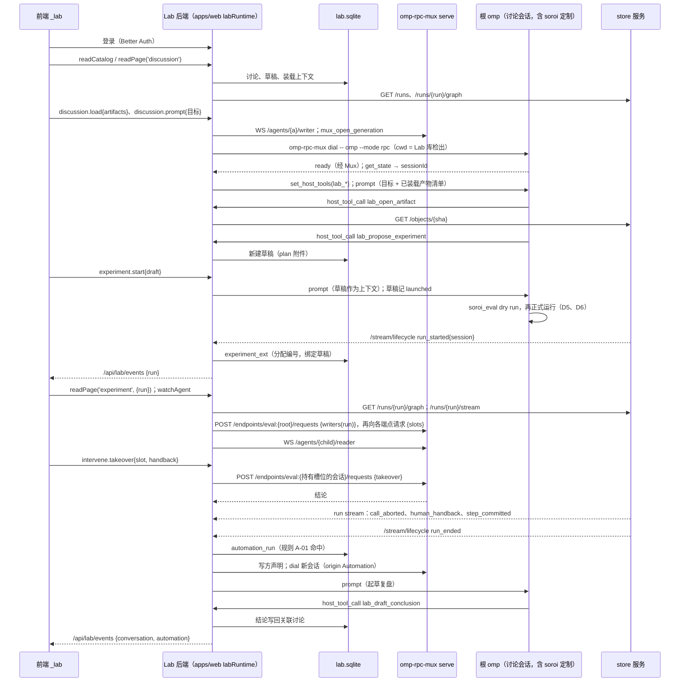

# D7 Pepgent Lab 业务后端：数据源、根会话驱动与前端接缝

起草：DrafterD7Lab（Claude 族）。评审输入：导师 D7Mentor，讨论者 D7Steady（稳健）、D7Divergent（发散）。他们的意见已在取舍列中处理，未采纳的写明了理由。本文与 `decisions/D2-components.md`（D2-12 至 D2-20）、`D3-network-mux.md`、`D5-plugins-eval.md`、`D6-store-service.md` 对齐。

依据缩写（行号均为当前工作树）：

| 缩写 | 文件 |
| --- | --- |
| PB | `pepgent-pm/evidence/argon/pivot-baseline.md` |
| RC | `pepgent-pm/evidence/argon/rulings-C.md` |
| FC | `pepgent-pm/evidence/argon/flow-catalog.md` |
| D2…D6 | `pepgent-pm/evidence/decisions/D2-components.md` … `D6-store-service.md` |
| inv/… | `pepgent-pm/evidence/inv/…` |
| LEDGER | `pepgent-soroi/LEDGER.md` |
| layers | `pepgent-soroi/design/layers.md` |
| web/… | `pepgent/apps/web/src/…`（`Pepgent/Pepgent` 业务仓） |
| rpc.md | `omp://rpc.md`（omp RPC 协议文档） |

## 框架

**要回答的问题。** `pepgent/apps/web` 的 `_lab` 前端现在只读一份同步、不可变的 fixture：`LabBridge.readSnapshot(): LabSnapshot` 直接返回常量 `LAB_SNAPSHOT`，源码注释写明“UI-only for now: … no server function, storage or timer”（web/client/services/lab.ts:4-13）。D7 决定替换它的后端：`LabSnapshot` 18 个顶层字段（web/client/contracts/lab-snapshot.ts:24-58）各自的权威源是什么，前端怎样读、怎样写；后端跑在哪里，Lab 自己的状态存在哪里；它怎样作为单写方经 Mux 启动并驱动装着 soroi 的根会话；讨论和自动化怎样使用 omp 会话与 soroi 的运行事件；集群页、容器页怎样落到 remote 模板上；认证与成员放在哪里；`LabBridge` 怎样从同步 fixture 换成异步、有类型的接口，同时不打断正在做 UI 的 agent。

**用户意图（逐字）。**

- 业务在 Pepgent，soroi 只是 omp 扩展组件：“对于soroi的的业务，在pepgent/pepgent目录，并且已有agent在制作纯前端，目前soroi的设计对于完整的pepgent是不够的，另外，soroi本身相当于只是omp的扩展组件，离真正的pepgent还很远”（LEDGER:11-15 U1；inv/s-pepgent.md:23-25）。
- soroi 要能作为 Pepgent 的 agent 核心：“对于soroi的最小功能合集，一定是一个完整的omp定制，并且能走通我说的所有流程，并且能作为pepgent的agent核心，并且最后能在这个基础上知道pepgent和soroi之间缺失的点，线，面”（LEDGER:126-128 U23）。
- harness 核心是 omp，可以用成熟方案：“对于实现，我允许你使用成熟的开源且协议友好的现成方案，而不是所有东西都自造，但是对于核心的ai harness，不能偏离以omp为核心，不修改omp的宿主代码”（LEDGER:61-63 U13）。
- 全流程，不收缩：“这是一个从设计，到补充，到开仓，到实现，到e2e测试的全流程任务，不要擅自收缩”（LEDGER:17-19 U2）。
- 业务形态基本不变：“大体上来说，我认为虽说动了核心设计，但是app层的业务好像几乎不用动，只是因为反转以后，体验更好了”（PB:66 `#e3692177`）。
- 讨论一人一会话；旧 AI 不可用：用户在前端轮次里选了“裁掉：一人一会话”和“现有的ai应该完全用不了”（inv/s-pepgent.md:96-104）。
- GUI 能看见任意 agent：“rpc实际上本来就要额外做只读层面的多路复用”（PB:34 `#2dbf970b`）。
- GUI 可以写，写法是人类接入：“不，写方不一定只有ai，可以是人在gui写，写了以后通知ai改变了，但是值已经进去了”（FC:390 `#ba5ad307`），以及“人类写这种操作等于，将一个运行的程序取消……就叫他人类接入”（FC:391 `#d1baf561`）。

**已定的边界（不重议）。**

- Lab 后端在 `Pepgent/Pepgent` 的 `apps/web` 服务层，持有业务状态，是 GUI 的门面；实验只存运行 id，运行状态从 store 读（D2:51 D2-14）。讨论即中心 omp 主会话（D2:52 D2-15）。自动化在 Lab 后端，订阅 store 的变更流（D2:53 D2-16）。成员、项目、角色归 Lab 后端（D2:54 D2-17）。前端只经 `PepgentBridge` 调 Lab 后端，不直连 store 或 Mux（D2:55 D2-18）。
- 旧 Paseo、`_app`、`apps/hub` 保持不动，不复用为 Mux 或 soroi 后端（D2:56 D2-19；PB:54 说明旧 `apps/web/src/server` 与 `apps/hub` 只服务于用户判为不可用的旧 Paseo 会话）。
- 写方启动每个 omp 进程：`omp-rpc-mux dial -- omp --mode rpc`（leader 裁决；D3-08 已按此修订）。Mux 只路由。读方只能发只读命令；人类 IRC 的待投递表归各 agent 的写方，操作是 `enqueue / edit / withdraw / deliver`：根会话的写方是 Lab 后端，子 agent 的写方是 subagent 模块，Lab 经读方连接发 `mux_human_irc*` 帧（D3:60 D3-06、D3:66 D3-12）。每个写 eval 的会话各在 Mux 上注册控制端点 `eval:<该会话 session id>`，提供在途槽位、`answer`、`takeover` 和派生；根会话的端点另答 `writers(runId)`（D3:73 D3-19；D5 §3.6；D6:42-45）。
- store 是值的权威，Lab 后端只经它的 HTTP 读取、订阅、比较、检索（D6:29 D6-01，D6:34 D6-06，D6:37-41）。草稿归 Lab 后端，不进 store（D6:40 D6-12）。一个根会话同一时刻至多一个未结束的运行；派生运行不新开会话（D6:33 D6-05）。
- 节点库的当前定义在每个 Lab 的 git 仓库里，Lab 后端在人确认后 commit，再把中心检出快进（D2:49 D2-12）。镜像构建走 `Pepgent/images` + Komodo Build + 镜像仓库（D2:50 D2-13）；remote 是模板目录和作业生命周期的唯一权威，新增模板写入（D2:46 D2-09）。

**现状里决定接缝形态的几处事实。**

| 事实 | 依据 |
| --- | --- |
| `createLabServices()` 在构造时同步调用 `bridge.lab.readSnapshot()` | web/renderer/platform/web/create-lab-services.ts:45-48 |
| `LabRuntime` 每页读一次 snapshot；所选 Lab、聚焦项目是页面生命周期状态 | web/renderer/application/lab-runtime.tsx:18-22；web/renderer/application/contracts/lab-session.tsx:1-12 |
| lab 服务是模块级单例，无参数构造 | web/renderer/bootstrap/renderer-services.ts:40-45 |
| `_lab` 布局路由有 `pendingComponent` 但没有 loader；桌面布局已用 loader 等待 `loadDesktopOnboardingSnapshot()` | web/app/routes/_lab.tsx:20-25；web/app/routes/_app.tsx:25-26 |
| 13 个 lab 页面的 controller 各读自己那一页的切片，加上 `labs`、`account`、`members`、`projects`、`experiments`、`aiModels` 这些目录切片 | `grep "snapshot\."` 于 web/renderer/features/lab-*/（R：本次检索输出） |
| id 是故事线的字面量联合：`LabId`、`MemberId`、`ProjectId` 等 | web/client/contracts/lab-common.ts:23-29；lab-experiments.ts:93,99,106,142,196；lab-workspace.ts:137 |
| view model 里写死了故事线 id | web/renderer/features/lab-clusters/model/clusters-view-model.ts:236；lab-containers/model/containers-view-model.ts:213,271；lab-experiment-detail/model/experiment-detail-view-model.ts:106；lab-flow-editor/model/flow-editor-view-model.ts:300；lab-connect-cluster/model/connect-cluster-view-model.ts:217-220；lab-node-library/model/node-library-view-model.ts:218-219 |
| 进程内的 `serverRuntime()` 会启动 Paseo daemon；`runOperation` 和请求中间件都先等它 | web/server/runtime-host.ts:1-12；web/server/operations/run.ts:25-27；web/app/start.ts:30-36；web/server/host.ts:28 |
| 现有请求中间件只做 loopback 本机访问令牌，“not user authentication” | web/server/transport/trust.ts:1-7 |
| omp RPC 有 `get_available_models`、`set_model`、`set_host_tools`/`host_tool_call`；`get_state` 返回 `sessionId`、`sessionFile` | rpc.md:156,167-171,497,782-821,1409-1421 |

## 决策表

| ID | what | where | how | 取舍 | 分类 | 缺失部分或设计补充? |
| --- | --- | --- | --- | --- | --- | --- |
| D7-01 | **Lab 后端的进程归属** | `Pepgent/Pepgent` 的 `apps/web`，与 TanStack Start 同在一个 Node 进程。新增四个隔离区：<br>• `src/server/lab/`：运行时、数据库、客户端、投影；<br>• `src/rpc/lab.ts`：server functions；<br>• `src/app/routes/api/lab/*`：SSE 与对象代理路由；<br>• `src/protocol/lab/`：线协议类型 | `server/lab/runtime.ts` 自带进程级 `labRuntime()` 和 `runLabOperation()`，结果仍是 `OperationResult`（inv/r-pepgent.md:289-293）。它不 import `server/paseo/**`、`hub-client`、`persistence/session-store`，也不调用 `serverRuntime()`。<br>两个生命周期拥有者都改为启动两个 runtime：生产是 `server/host.ts#runHost`，开发是 Vite 插件。<br>请求中间件 `app/start.ts` 按面分流：`/_lab` 文档、`lab.*` server function 和 `/api/lab/*` 走 Lab 认证（D7-03）与 `labRuntime()`；其余照旧走 `serverRuntime()` 与本机令牌。<br>**隔离的含义：** 代码与状态隔离，进程仍是一个 | **选定：** 同进程隔离区，沿用 server function、`OperationResult`、SSE 路由这套已有约定（D2-14 已选）。<br>**朴素方案：** 直接在现有 `operations/handlers.ts` 里加 lab handler。它们会经 `runOperation` 等待 Paseo 运行时（run.ts:25-27），等于复用旧 Paseo 后端，违背 D2-19。<br>**实质不同的方案：** 独立服务 `apps/lab-server`。文档仍由 apps/web 提供，多出一跳协议，认证要做两遍，收益只是进程隔离（D7Steady 指出同进程可行，但要写清“隔离”只到代码与状态） | 技术 | 是：中间件分流与双 runtime 启动 |
| D7-02 | **Lab 自有状态的持久化** | 中心主机 Lab 容器里的一个卷：`$PEPGENT_LAB_HOME/lab.sqlite` | SQLite（公有领域），驱动 `better-sqlite3`（MIT），schema 和迁移用 Drizzle ORM（Apache-2.0）。迁移由 `labRuntime()` 启动时执行。web 进程是唯一写方。<br>**只存两类事实：** 一是 Lab 是权威的事实，如草稿、讨论元数据、自动化规则；二是以外部主键为键的扩展，如以 store `RunId` 为键的实验编号与名称。<br>**表：** Better Auth 的表（D7-03）、`lab_profile`、`member_profile`、`project`、`conversation`（D7-04）、`draft`、`experiment_ext`（D7-06）、`discussion_binding`、`discussion_context`、`conversation_attachment`、`conclusion`、`artifact_meta`、`human_irc_queue`（根会话的人类 IRC 待投递表，D3-12）、`report`、`activity`、`milestone`、`automation_rule`、`automation_run`、`library_repo`、`library_staging`。<br>运行状态、transcript、模板、构建记录一概不存 | **选定：** SQLite。只有一个写方进程，store 服务的目录库也是 SQLite（D6:30），运维与备份最简单。Drizzle 同时承担 Better Auth 的适配器（`drizzleAdapter`）和业务 schema，只有一套迁移。`better-sqlite3` 是 native addon，要从 Vite 的服务端 bundle 外置，镜像里按目标 ABI 安装。<br>**朴素方案：** Node 内置 `node:sqlite`。[推断] 它在 Node 22 上仍是“活跃开发”稳定级，Better Auth 和 Drizzle 对 `better-sqlite3` 的支持更成熟；等它稳定后换驱动，不影响 schema。<br>**实质不同的方案：** PostgreSQL（PostgreSQL License）。多一个有状态服务，单写方用不上它的并发能力 | 技术 | 否 |
| D7-03 | **认证与成员** | apps/web 内嵌 Better Auth（MIT）及其 organization 插件；路由 `src/app/routes/api/auth/$.ts`；Lab 新增登录页 `/sign-in`（UI 负责人的工作） | **映射：** organization 即 Lab；member 带 role；invitation 即邀请。这三张表是 labs、成员、角色、邀请的**唯一**权威（D2-17）。<br>角色 `owner \| researcher \| student \| guest`（lab-compute.ts 中的 `MemberRole`）用 Better Auth 的 access control 定义。三项权限 `startWithoutApproval`、`buildImages`、`manageMembers` 是 access control 的语句，只由 Better Auth 判定，Lab 表不重复判定。<br>Lab 表只以 Better Auth 主键做扩展：<br>• `lab_profile`：glyph、描述；<br>• `member_profile`：头像色、缩写、描述、主项目、GPU 小时配额。<br>**登录：** 主路径用邮箱加密码。<br>**中间件：** Lab 面要求有效的 Better Auth 会话。当前用户 id 作为 principal 交给 Mux（D3-12 的 `X-Principal`），并作为 `HumanHandback.by`（D5 §3.6） | **选定：** 嵌入式的成熟库。成员、角色、邀请、权限的模型正好对上设置页（lab-compute.ts:213-228），不需要另建一套。<br>**朴素方案：** 继续用 loopback 令牌。它“not user authentication”（trust.ts:1-7），不满足多成员。<br>**实质不同的方案：** 外部 IdP 走 OIDC（如 Keycloak，Apache-2.0）。realm 与 client 要靠 IaC 声明；旧业务仓的 Keycloak 设计已被作废，不能直接恢复（inv/s-pepgent.md:83,195）。需要 SSO 时，再用 Better Auth 的 OAuth 插件接入，成员权威不变 | 技术 | 是：D2-17 占位转为定案；登录页 |
| D7-04 | **根会话模型：Lab 会话（conversation）** | 中心主机 Lab 容器（D2:57 D2-20）；Lab 表 `conversation` | 只有一种根会话：装着完整 soroi 定制的 `omp --mode rpc`。它以 soroi 的 Main 角色运行（`SOROI_ROLE=Main`，D5-06 的 `writesEval` 为真）。用 `origin` 区分来源：<br>• `Discussion{name, project, archived}`：讨论页，一人一会话；<br>• `Panel{page, scope}`：各页右栏 AI；<br>• `Automation{rule, automationRun}`：自动化动作。<br>**启动配方（Lab 是写方）：**<br>① 打开 `WS /agents/{id}/writer`；<br>② 发 `mux_open_generation`，拿到 generation 与 token；<br>③ 在本容器内执行 `omp-rpc-mux dial --agent {id} --generation {g} --token {t} -- omp --mode rpc --session {file}`，cwd 是 Lab 库检出（D2-12），env 是 `SOROI_ROLE`、`SOROI_STORE_URL`、`SOROI_MUX_URL`；<br>④ 等 `ready`，读 `get_state` 记下 `sessionId`；<br>⑤ 发 `set_host_tools`（D7-05）；<br>⑥ 用户消息先进 Lab 的人类 IRC 待投递表（D7-09），会话空闲或到达步边界时以 `prompt` 投递。<br>**停驻：** 一轮结束后关闭 stdin。**唤醒：** 下一条 prompt 时在同一个写方声明里开新的一代（D3-07）。<br>Lab 专属的行为约定放在 Lab 库项目级 `.omp/` 的规则与技能里，随 cwd 生效。<br>**soroi 怎样进入这条路径：** 容器里的 omp 已从 soroi 发行 tar 装好定制（D2-20、D2-25），所以 dial 拉起的 `omp --mode rpc` 加载的就是 omp-soroi 插件、soroi 的 agent 定义与设置；Lab 只给出 env 和 cwd，不替代也不改写 soroi。<br>**身份分层：** `origin` 是 Pepgent 的业务分类，不参与 Mux 寻址；Mux 地址是 agent id，控制端点名由 soroi 按 session id 注册（D3-19） | **选定：** 一种会话，来源用 ADT 表达；讨论即会话（D2-15），实验跑在讨论会话里（D7-06）。D7Divergent 指出：每个实验另开一个会话，正是 D2-15 否掉的“每个实验另起一个无人对话的 agent”（D2:52）。<br>**朴素方案：** 讨论、实验、右栏、自动化四种会话各一套启动逻辑。机制重复，实验会话也违背 D2-15。<br>**实质不同的方案：** Lab 后端自己写对话循环。偏离 omp 核心（U13） | 串联 | 是：PB:57-58 |
| D7-05 | **Pepgent 业务工具：写方注册的 RPC host tools** | `src/server/lab/tools.ts`；每一代 `ready` 后由 Lab 写方发 `set_host_tools`（rpc.md:782-821） | 工具在 Lab 后端执行，经 `host_tool_call`/`host_tool_result` 往返（rpc.md:1409-1421）：<br>• `lab_propose_experiment{title, plan}`：只建一条草稿（D6-12），在消息上挂 `plan` 附件，不启动会话或运行；<br>• `lab_draft_conclusion{text, evidence, pendingRun?}`：建一条待确认结论；<br>• `lab_open_artifact{artifactId}`：经 store 的 `GET /objects/{sha}` 取字节，写到会话目录，返回路径；<br>• `lab_save_artifact{path, role}`：读文件，`PUT /objects/{sha}` 存进 store，再登记 `artifact_meta`；<br>• `lab_publish_report{…}`：建一条首页报告；<br>• `lab_propose_changes{target, rows}`：在右栏消息里挂 `changes` 块。<br>附件按 `toolCallId` 关联到 transcript 里的那条消息 | **选定：** host tool。Pepgent 的业务不进 soroi，soroi 不认识 Pepgent（U23）；写方本来就持有 `host_tool_result`（D3-06）。<br>**朴素方案：** 让 agent 在回复里写约定格式的文本，Lab 再去解析。不确定，也不可校验。<br>**实质不同的方案：** 在 Lab 库里放一个 omp 扩展，经 HTTP 带令牌回调 Lab。多一条认证，扩展还要知道 Lab 的地址 | 串联 | 是 |
| D7-06 | **实验的身份与状态** | Lab 表 `draft`、`experiment_ext`；store 的运行 | **身份：** 一次实验就是一次 store 运行（1:1）。启动前的实验是一份草稿。<br>**`experiment_ext`（以 `RunId` 为键）只存 Lab 的展示事实：** 编号 `R-0xx`、名称、项目、来源草稿。Lab 在生命周期流（D6-06）上首次见到 `run_started` 时分配编号；名称和项目默认取自来源草稿，没有草稿时取自讨论。会话与讨论的对应已在 `conversation` 表里，不另存。<br>**启动草稿：** 草稿的 `origin.discussionId` 指向一个讨论。“启动”把草稿全文作为上下文，以 prompt 发给该讨论的会话，并在草稿上记 `launched{conversation, at}`。随后由 agent 自己调用 `soroi_eval`。该会话的下一次 `run_started` 绑定这份草稿。<br>**状态（读取时投影，不存）：**<br>• `draft`：未启动的草稿；<br>• `queued`：已启动、还没有运行；<br>• `running`：运行 `Open`；<br>• `needs_you`：`Open`，且 eval 控制端点上有 `awaiting_human` 槽位或待批的自动化；<br>• `ended`：运行 `Ended`；<br>• `stopped`：运行 `Aborted`。<br>派生运行（D6-16）是一条新的实验行，`derivedFrom` 取自 store 的 `RunGraph`。同一讨论可以先后跑多个实验，同一时刻至多一个在跑（D6-05） | **选定：** 运行状态只有 store 一个源；Lab 只给运行加展示用的业务属性，这些属性的权威是 Lab。D7Steady 指出：“由事件流推导出新的业务对象”会让事件流变成意图源。所以这里事件流只触发 Lab 分配自己的编号，不新建任何业务对象；草稿则由显式命令创建并启动。<br>**朴素方案：** Lab 复制一份运行状态。是第二份状态。<br>**实质不同的方案：** 每个实验一个专属会话（D6-12 字面上的“它启动的根 session”）。与 D2-15 冲突，见 D7-04；本行把 D6-12 读作“讨论会话” | 串联 | 是：S-3（RC:272）；交 argon 确认 D6-12 的读法 |
| D7-07 | **讨论** | Lab 表 `conversation`（origin `Discussion`）、`discussion_binding`、`discussion_context`、`conversation_attachment`、`conclusion`、`artifact_meta`；omp transcript；store | **消息：** 来自 omp 的 transcript，Lab 不存副本。会话在线时，Lab 作为读方连上 Mux，调用 `get_messages`，并订阅它的 stdout。已停驻时，读 `get_state.sessionFile` 指向的 jsonl，不唤醒（D3-11；占位 P2）。<br>**附件与引用：** `plan`、`conclusion` 附件和 `references` 取自 D7-05 的工具记录。<br>**实验关系：** `originated` 是这个讨论的会话里开出的运行；`bound` 是人手动绑定的运行（`discussion_binding`）。<br>**装载上下文：** 人选中的产物 id 记入 `discussion_context`；下一条 prompt 前附上这些产物的清单，agent 用 `lab_open_artifact` 读取。<br>**讨论来源的产物：** 字节进 store 的对象目录（D6:35 D6-07 允许“人类上传”），这样它能直接作为之后某次运行的根输入；名称、角色、所属讨论记在 `artifact_meta` | **选定：** transcript 只有 omp 一个源（D6-19）。<br>**朴素方案：** Lab 存一份消息表。是 transcript 的第二份副本。<br>**实质不同的方案：** 讨论产物另放 Lab 自己的 blob 目录。字节存两遍，作为运行输入时还要再拷一次 | 串联 | 是：FC:494（F31 步骤 1） |
| D7-08 | **运行的读取与订阅（GUI 读方）** | `labRuntime` 里的 store 客户端和 Mux 读方；前端只连 Lab | **已提交的事实：** `GET /runs`、`/runs/{run}/graph?at=`、`/runs/{run}/stream`、`/compare`、`/search`、`/functions/{name}/usage`（D6 接口草图）。<br>**在途叠加层：** 先向根会话的端点 `eval:<根 session id>` 请求 `writers(runId)`，得到这次运行里每个写 eval 的会话（根会话与它派出的中心 worker）的端点，再逐个请求 `slots`（D3-19；D6-11；D5 §3.6）。<br>**agent 实时流：** Lab 以读方连 `/agents/{id}/reader`，经 `/api/lab/agents/{id}/stream` 用 SSE 转给浏览器（D3-11）。<br>**远程批次与产物：** `/agents/{id}/files…`（D3-13）。<br>**对象字节：** 浏览器经 `/api/lab/objects/{sha}` 取，Lab 代理 store 的 `GET /objects/{sha}`。<br>**变更推送：** `/api/lab/events` 是 SSE，频道包括 `catalog`、`run:{RunId}`、`conversation:{id}`、`automation`。Lab 把 store 的运行流和生命周期流、Mux 的在线事件以及自己的写入转成“哪个切片变了”的通知；浏览器收到后重读对应切片 | **选定：** Lab 是唯一门面（D2-18），各项状态各从自己的权威读。<br>**朴素方案：** 浏览器轮询整份 snapshot。延迟大，还要每次请求全部权威方。<br>**实质不同的方案：** 浏览器直连 store 和 Mux。打破 renderer 边界，认证要分散到三处（D2:55） | 串联 | 是：FC:497（F31 步骤 4） |
| D7-09 | **人类写入：三种介入与中止** | 命令经 `lab.command` 进入 Lab；Lab 转给拥有方 | **改值（在途调用）：** 发 `takeover{slot, handback}` 到持有该槽位的会话的端点（由 `writers(runId)` 得到）（D6-14；D5-15）。<br>**主动 `human()` 的交回：** 发 `answer`（D5-14）。<br>**改参数或函数体：** 改函数体时，先把新函数体 commit 进 Lab 库（D7-11），再向控制端点发 `derive{parent, at, changes}`（D6-16）。<br>**接管 agent（人类 IRC，D3-12）：** GUI 为每条消息生成 `msg` 键，可在投递前编辑或撤回。目标是 Lab 会话（根会话）时，Lab 就是写方，直接对自己的待投递表（Lab 表 `human_irc_queue`）执行 `enqueue / edit / withdraw`，会话空闲或到达步边界时 `deliver`：以 RPC `prompt` 投递，正文带 `human:<principal>` 来源，投递后成为 transcript 里不可变的事实。目标是 soroi 子 agent 时，Lab 在读方连接上发 `mux_human_irc`、`mux_human_irc_edit`、`mux_human_irc_withdraw`，待投递表在 subagent 模块里。principal 是当前用户。<br>**中止整个运行：** 发 `abort{run}` 到控制端点，由 eval 插件中止在途调用，再请 store 写 `run_aborted`（D6-05、D6-15）。<br>Lab 一律等拥有方给出结论，store 的流随后推送结果；Lab 自己不写任何运行记录。<br>原型的按钮映射：`intervene` 对应改值或派生；`truncate` 对应派生；`pause` 对应中止（D6-20 已删除“暂停”这个事实）；`logs` 对应读方流或 `remote tail` | **选定：** 请求在途状态的拥有方，等结论（D2-06）。<br>**朴素方案：** Lab 直接写 store。跳过拥有方，用户也否定了合并写入（FC:391） | 意图 + 串联 | 是：PB:21 |
| D7-10 | **自动化** | `labRuntime` 内的 `automation.ts`；Lab 表 `automation_rule`、`automation_run` | **规则：** 结构是 `when / conditions / then`（lab-workspace.ts:24-39），作用范围是全 Lab、聚焦项目或单个项目。<br>**触发：**<br>• `event`：订阅 store 的 `/stream/lifecycle?after=`，游标存在 Lab（D6-06）；<br>• `schedule`：用进程内调度库 `croner`（MIT）；<br>• `instrument`：占位 P8。<br>**动作：** 开一个 origin 为 `Automation{rule, run}` 的 Lab 会话（D7-04），prompt 由规则模板加触发事件填充。例如运行结束后起草复盘，用 `lab_draft_conclusion` 或 `lab_publish_report` 写回关联讨论（layers:69；FC:476-482）。<br>**审批门禁：** 规则要求批准时，`automation_run` 停在 `waiting`；有 `startWithoutApproval` 权限的成员批准后，才开会话。<br>**手动运行：** 用同一条路径 | **选定：** Lab 进程内引擎。store 只发布事实，不长出调度器（D6:34）。<br>**朴素方案：** 外部 cron。拿不到运行事件。<br>**实质不同的方案：** n8n（Sustainable Use License，不是 OSI 协议），或 Temporal（MIT），对当前规模过重（D2-16） | 技术 | 是：FC:479 的事件协议定为 store 生命周期 SSE |
| D7-11 | **节点库与智能体模板的读写** | Lab 库 git 检出（D2-12）；Lab 表 `library_staging`；store `/functions/{name}/usage` | **定义：** 从 `nodes/*.ts` 导出参数、默认值、返回字段、体与默认环境（D6 的占位 P2）。<br>**版本：** 身份是 bundle 哈希，显示用 commit 序号（D6-21）。<br>**使用与影响：** store 按版本给出使用情况；Lab 再并上草稿里的引用。<br>**编辑：** 暂存改动（原型的 `stagedChanges`）先存在 `library_staging`；人确认后，Lab 写文件、commit、push，再把中心检出快进（D2-12）。<br>**智能体模板：** 就是 Lab 库 `.omp/agents/` 下的 omp agent 定义（D5-17）。`entries` 是该模板的文件，`save_version` 即一次 commit，`models` 取自定义的 frontmatter | **选定：** 当前定义只认 git（D2-12）。<br>**朴素方案：** Lab 存一份定义表。是第二个当前定义源 | 串联 | 是：F28/F29（FC:448-466）；`AgentTemplate.harness` 见 D7-16 |
| D7-12 | **集群页与接入向导落到 remote** | remote CLI（home 在 Lab 容器里，D2:57）；Lab 不另存集群表 | **集群：** 即 remote 目录里的一个后端端点：Komodo Core、slurmrestd 或 k8s context（inv/r-remote.md:114-115）。Lab 按后端把 `remote templates` 归组。<br>**作业与容器：** 来自 remote 的作业，即 `status`、`tail`、`abort`、`remove`。agent 容器另外叠加 Mux 的在线列表（D3-15）。<br>**原型按钮：** `restart`/`destroy` 映射到 `abort`/`remove`；`new_sandbox` 是以 box 模板 `run` 一个作业。<br>**由占位承担、归属交投票的能力：**<br>• 后端的健康、容量与节点（P4）；<br>• 作业列表（P5）；<br>• 交互 shell（P6）；<br>• 接入向导的执行方（P7）。<br>**建议：** 读取类能力归 remote，它是唯一持有后端凭据和三后端抽象的组件；主机与控制器的安装归 `Pepgent/iac`（D2-07、D2-21） | **选定：** 模板与作业只有 remote 一个源，缺的能力写成占位，不在 Lab 里另造。<br>**朴素方案：** Lab 直连 Komodo Core 读服务器状态。复制了 remote 的后端知识，还要另存一份凭据（D7Divergent）。<br>**实质不同的方案：** 在本表把 remote 扩成集群管理面。超出 D2-09 的“范围不变”（D2:46），也接近 D2 禁止的外部控制面（D2:27） | 串联 | 是：inv/s-remote.md:253,263；FC:514 |
| D7-13 | **容器（镜像）页落到 images 仓库、Komodo Build 与 remote 模板** | `Pepgent/images`（git）；Komodo Core API；镜像仓库 Distribution（Apache-2.0）的 v2 API；remote 模板写入（D2-09） | **镜像定义：** 来自 images 仓库的构建文件，从中读出依赖、文件、层。<br>**构建：** 构建记录归 Komodo；`build_push` 先把定义 commit 到 images 仓库，再经 Core 的 `RunBuild` 触发（D2-13）。<br>**tag、digest、大小：** 读镜像仓库的 v2 API。<br>**绑定与资源：** 资源默认值（cpu、memory、gpu、绑定集群、优先级）是模板字段，经 remote 模板写入（D2-09；字段见占位 P3）。<br>**`nodeBindingCount`：** 默认环境是用这个镜像的模板的节点函数个数（D7-11）。<br>**`liveContainers`：** 用这个镜像的模板正在跑的作业（P5）。<br>**终端与预构建检查：** 占位 P6 | **选定：** 各取各的权威（D2-13）。<br>**朴素方案：** Lab 存一份镜像表。是第二源。<br>**实质不同的方案：** BuildKit 服务，需要另运维一套构建器（D2-13） | 串联 | 是：PB:57-58 |
| D7-14 | **设置页的其余部分** | Better Auth（D7-03）；Lab 表 `project`、`library_repo`；Lab 库 git | **项目：** Lab 表，Lab 是权威。`merge` 把讨论与实验的项目属性改到目标项目，`archive` 改项目状态。<br>**代码库：** `library_repo` 记录远端 URL、分支和部署密钥的引用；状态、最近同步、领先的提交从检出读。部署密钥由 Lab 生成并存在 Lab 卷里，界面只展示公钥（`rotate` 即重新生成）。<br>**`experiments`、`discussions` 两节：** 是 D7-06、D7-07 的投影。<br>**`unassigned.suggestions`：** 由右栏会话经 `lab_propose_changes` 给出。<br>**`gpuHours.used`：** 占位 P9 | **选定：** 业务事实归 Lab，凭据由使用方（Lab）持有。<br>**朴素方案：** 部署密钥由人粘贴，违反凭据规则 | 技术 | 是：P9 资源计量 |
| D7-15 | **AI 模型目录与选择** | omp | `aiModels` 取自 RPC 的 `get_available_models`（rpc.md:169-171），由 Lab 作为写方，在任一在线的 Lab 会话上请求（占位 P10）。右栏切换模型用 `set_model{provider, modelId}`（rpc.md:167）。provider 的凭据由 `Pepgent/deploy` 注入 Lab 容器 | **选定：** 模型目录的权威是 omp。<br>**朴素方案：** Lab 写死一份模型清单 | 技术 | 否 |
| D7-16 | **前端接缝，阶段 A：只改时机，不改数据** | `client/services/lab.ts`、`renderer/platform/web/create-lab-services.ts`、`renderer/bootstrap/renderer-services.ts`、`app/routes/_lab.tsx`、`renderer/bootstrap/lab-entry.tsx` | `LabBridge.readSnapshot()` 改为返回 `Promise<LabSnapshot>`，暂时仍解析为 fixture。<br>`renderer-services.ts` 新增 `loadLabServices(): Promise<LabServices>`，每页一次。`_lab` 路由的 `loader` 等它，做法与桌面布局 `_app.tsx:25-26` 相同；`LabEntry` 读 loader 的数据。<br>`createLabServices(bridge, snapshot)` 改为接收已读好的 snapshot。<br>`LabServices`、`LabSession`、`LabRuntime` 和 13 个 feature controller 都不变。<br>这是一次性的兼容步骤：`LabSnapshot` 这个 18 字段的聚合不是后端契约，阶段 B 的按页读取和命令联合才是切换目标 | **选定：** 能在 UI agent 改间距的同时落地，feature 代码零改动（D7Steady：只有把 id 放宽和剧情数据化移出本阶段，才能这么说）。<br>**朴素方案：** 一步到位接真实数据。要同时改 13 个 controller 和 6 处剧情字面量，与正在进行的 UI 工作冲突 | 实现 | 否 |
| D7-17 | **前端接缝，阶段 B：线上传权威方的数据，在客户端投影成现有的视图类型** | 线协议 `src/protocol/lab/`；投影 `src/client/services/lab/project-*.ts`；server functions `src/rpc/lab.ts`；与 UI 负责人经 Main 协调后一次落地 | **线协议：** 只放权威方自己的形状：store 的 `RunGraph`、`RunEvent`（D6），Mux 的 `Presence`（D3），remote 的 `TemplateInfo`，Lab 的行。服务端不拼文案、不算布局。<br>**投影：** 客户端的纯函数把线数据投影成现有的 `*Fixture` 视图类型（`client/contracts/lab-*.ts` 保持原位，不搬家）。坐标、泳道、计数这些布局数学由投影计算。文案来自 renderer 的 copy 目录。用户内容是语言中性的 `string`（`LabString` 已允许）。<br>**读取：** 每个页面路由的 `loader` 调用 `readPage`，壳层调用 `readCatalog`。<br>**订阅与写入：** `subscribe` 订阅 `/api/lab/events`，收到后让对应 loader 失效；`send(command)` 发出 `LabCommand` 联合；`watchAgent` 订阅 agent 流。<br>**页面改动：** 各页本地 reducer 的动作改为命令。<br>**同批要改的“点”：**<br>• id 字面量联合放宽为 `string` 品牌类型；<br>• 6 处 view model 的剧情字面量改成数据事实，如“仪器网关”这种后端种类、“判据节点”这种节点角色、由运行状态决定的流程模式；<br>• `AgentTemplate.harness`（lab-compute.ts:196）改为 omp agent 定义名；<br>• 删掉固定回复 `AiConversationFixture.reply`。<br>运行时不再引用 `LAB_SNAPSHOT` | **选定：** 线上是权威方的原样数据，投影放在客户端。全量 snapshot 要服务端编造文案和布局，每次载入还要遍历每个运行的图（D7Divergent）。<br>**朴素方案：** 服务端拼好整份 `LabSnapshot`。<br>**实质不同的方案：** 重写前端契约，让页面直接消费线类型。要重写 13 页的 view model，收益只在命名 | 实现 + 串联 | 是：inv/s-pepgent.md:197 |
| D7-18 | **Lab 后端的对外接口** | `src/rpc/lab.ts`、`src/app/routes/api/lab/*`、`src/app/routes/api/auth/$.ts` | **server functions（POST，经 `runLabOperation`）：**<br>• `lab.catalog.read{lab}`；<br>• `lab.page.read{lab, page}`；<br>• `lab.command{command}`。<br>**SSE：**<br>• `GET /api/lab/events?lab=`；<br>• `GET /api/lab/agents/{id}/stream`。<br>**字节：** `GET /api/lab/objects/{sha}`。<br>**认证：** `/api/auth/*` 交给 Better Auth。<br>输入用 Zod 校验，沿用现有约定（inv/r-pepgent.md:289） | **选定：** 一个读目录、一个读页面、一个命令联合，类型由 TS 穷尽检查。<br>**朴素方案：** 每个页面动作一个 server function。要几十个声明，契约分散在各处 | 技术 | 否 |
| D7-19 | **部署形态与配置** | 中心主机的 Lab 容器（D2:57 D2-20），以 Komodo Stack 部署，定义在 `Pepgent/deploy`（D2-23） | 镜像基于 omp-agent（omp 与 `omp-rpc-mux`），再加 Node 和 apps/web 的构建产物；启动时从 soroi 发行 tar 安装定制（D2-25）。<br>**卷：** Lab 库检出、`$PEPGENT_LAB_HOME`（`lab.sqlite`、会话目录、部署密钥）、remote home。<br>**环境变量：** `SOROI_STORE_URL`、`SOROI_MUX_URL`、`PEPGENT_LAB_HOME`、`BETTER_AUTH_SECRET`；Mux 的写方与读方凭据、Komodo API 密钥、模型 provider 密钥由 `Pepgent/deploy` 按既定路径注入 | **选定：** 根会话与写方同在一个容器，Lab 才能直接在本机执行 dial（D2-20） | 实现 | 是 |
| D7-20 | **soroi 与 Pepgent 的依赖方向（U23）** | 两仓边界 | soroi 不认识 Pepgent，Pepgent 只经四条线调用 soroi：<br>• store 的 HTTP；<br>• Mux 的写方、读方与控制端点；<br>• RPC host tools；<br>• Lab 库项目级 `.omp/` 的规则、技能和 agent 定义。<br>拿掉 Pepgent，soroi 定制加上 store 与 Mux 仍能走通全部流程（D2-25）。D9 的“点、线、面”差距报告以本表第 3 节的 18 字段为对照表 | 满足 U23 的“作为 pepgent 的 agent 核心”，同时不让 soroi 反向依赖业务 | 意图 | 否 |
| D7-21 | **不复用旧 Paseo 后端** | apps/web | Lab 区不 import `server/paseo/**`、`hub-client`、`session-store`、`serverRuntime()`；`apps/hub` 不承担任何 Lab 职责。旧 `_app` 面保持不动 | D2-19；用户原话“先不动”“现有的ai应该完全用不了”（inv/s-pepgent.md:104） | 意图 | 否 |

## LabSnapshot 18 个字段的权威源与读写方式

“读”列写阶段 B 的来源，阶段 A 时全部仍是 fixture。“写”列是 `LabCommand` 的变体，由 Lab 转给权威方。

| 字段 | 权威源 | 前端怎样读 | 前端怎样写 | 缺口 |
| --- | --- | --- | --- | --- |
| `labs` | Lab：Better Auth 的 organization，加 `lab_profile` | `readCatalog`；`activity` 由投影算出，即运行中实验的个数 | `lab.create`、`lab.update` | `LabId` 字面量要放宽 |
| `account` | Lab：Better Auth 的当前会话用户，加该 Lab 的 member 行 | `readCatalog` | 退出登录走 Better Auth 的 `signOut` | 缺登录页 |
| `members` | Lab：Better Auth 的 member，加 `member_profile` | `readCatalog` | 见 `settings` | — |
| `projects` | Lab：`project` 表 | `readCatalog`；`itemCount` 由投影算出 | 见 `settings` | — |
| `experiments` | 外部加 Lab：store 的运行（状态、时刻、调用），`experiment_ext` 与草稿，eval 控制端点的槽位（`needs_you`） | `readCatalog`；`progress`、`where`、`now`、`updated` 都由 `RunGraph` 投影算出 | 启动草稿用 `experiment.start{draft}`，改名或改项目用 `experiment.update` | 逐步写出的运行事先不知道总节点数，所以 `progress.total` 没有来源 |
| `aiModels` | 外部：omp 的 `get_available_models` | `readCatalog` | 用 `panel.model{conversation, model}` 调 `set_model` | P10 |
| `home` | Lab 加外部：`report`、`activity`、`milestone`；集群行同 `clusters`；讨论行同 `discussions`；`ai` 是 Panel 会话 | `readPage('home')` | `report.*`、`milestone.*`、`panel.prompt` | `quote`、`dialogs`、`prompts` 移到 renderer 的 copy |
| `experimentsPage` | 外部加 Lab：泳道的实际时段取自 store 调用的起止时刻，按模板绑定的设备归组；计划时段取自草稿估时；冲突由投影算出 | `readPage('experiments')` | `panel.prompt`；聚焦项目仍是页面状态 | 模板的设备字段（P3）；仪器排期仲裁是缺失的“面” |
| `experimentFlows` | `draft` 模式来自 Lab 草稿；`running`/`ended` 模式来自 store 的 `RunGraph` 与 `at=seq` 回看、在途槽位，以及 Mux 的读方流与 files | `readPage('experiment', {run})`；订阅 `run:{RunId}` | `intervene.takeover`、`intervene.answer`、`intervene.derive`、`run.abort`、`human.irc` | 实验详情页缺“派生自”的导航 |
| `flowEditor` | Lab：`draft`；`palette` 是节点库导出，加上由泳道投影算出的可用性 | `readPage('flowEditor', {draft})` | `draft.save`、`experiment.start` | 校验仍由页面推导 |
| `nodeLibrary` | 外部加 Lab：库 git、store 的使用情况、`library_staging`、remote 模板的挂载、镜像与集群 | `readPage('nodes')` | `library.stage`、`library.apply`（commit 并快进） | P1 定义导出 |
| `automation` | Lab：`automation_rule`、`automation_run` | `readPage('automation')`；订阅 `automation` | `automation.rule.upsert`、`automation.run`、`automation.approve`、`automation.dismiss` | P8 仪器触发 |
| `datasets` | 外部加 Lab：store 捕获里的 `File` 产出、volume 清单、来源（函数、模板、remote run），`artifact_meta`，`discussion_context` | `readPage('datasets')`；字节经 `/api/lab/objects/{sha}`，预览由客户端生成 | `discussion.load{artifacts}`；`export`、`download` 是只读 | `role`、`verdict`、`contract` 要靠节点定义上的产物契约（P1） |
| `discussions` | Lab 加 omp：`conversation`（Discussion）、附件、结论、绑定、装载上下文；消息来自 transcript | `readPage('discussion', {id})`；`watchAgent` | `discussion.create`、`discussion.prompt`、`discussion.rename/move/archive`、`conclusion.confirm`、`discussion.bind{run}` | P2 停驻会话的 transcript 读取 |
| `clusters` | 外部：remote 的模板与作业，Mux 的在线列表 | `readPage('clusters')` | `sandbox.create`、`job.abort`、`job.remove` | P4、P5、P6 |
| `connectCluster` | 外部：现有集群来自 remote；向导文案移到 renderer 的 copy | `readPage('connectCluster')` | `cluster.connect{path, form}`，交给 P7 的执行方 | P7 |
| `containers` | 外部：images 仓库、Komodo Build、镜像仓库、remote 模板 | `readPage('containers')` | `image.build{image, tag}`、`template.bind{template, image, resources}` | P3、P5、P6 |
| `settings` | Lab 加外部：Better Auth（成员、角色、邀请、权限）、`project`、`library_repo`、Lab 库 `.omp/agents`、各种投影 | `readPage('settings', {tab})` | `member.invite/role/quota/remove`、`project.create/rename/merge/archive`、`repo.connect/sync/rotate/disconnect`、`agentTemplate.add/addFile/removeFile/addModel/saveVersion/duplicate/delete` | P9；`harness` 字段 |

## 接口草图（主路径）

```ts
// ---- 前端接缝 ----
// 阶段 A（D7-16）
export interface LabBridge {
  readSnapshot(): Promise<LabSnapshot>                          // 暂时仍解析为 fixture
}
// 阶段 B（D7-17）
export interface LabBridge {
  readCatalog(lab: LabId | null): Promise<LabCatalogWire>
  readPage<P extends LabPage>(lab: LabId, page: P, params: LabPageParams[P]): Promise<LabPageWire[P]>
  subscribe(lab: LabId, onChange: (change: LabChange) => void): () => void   // SSE /api/lab/events
  send(command: LabCommand): Promise<LabCommandResult>          // OperationResult；失败时抛 OperationFailure（client/api/call.ts）
  watchAgent(agent: AgentId, onFrame: (line: OmpLine) => void): () => void   // SSE /api/lab/agents/{id}/stream
}
// 客户端投影：纯函数，线数据 → 现有视图类型
declare function projectExperimentFlow(w: LabPageWire['experiment'], copy: LabCopy): ExperimentFlowFixture
declare function projectCatalog(w: LabCatalogWire): Pick<LabSnapshot, 'labs' | 'account' | 'members' | 'projects' | 'experiments' | 'aiModels'>

type LabPage = 'home' | 'experiments' | 'experiment' | 'flowEditor' | 'nodes' | 'automation' | 'datasets'
  | 'discussions' | 'discussion' | 'clusters' | 'connectCluster' | 'containers' | 'settings'
type LabChange =
  | { kind: 'catalog' } | { kind: 'run'; run: RunId } | { kind: 'conversation'; id: ConversationId }
  | { kind: 'automation' } | { kind: 'library' } | { kind: 'compute' }

// ---- 线协议（src/protocol/lab/）：权威方自己的形状 ----
type ExperimentWire = {
  ext: { run: RunId; number: string; name: string; project: ProjectId; draft: DraftId | null } | null
  run: { run: RunId; session: SessionId; state: 'Open' | 'Ended' | 'Aborted'; startedAt: string; endedAt: string | null } | null
  draft: DraftRow | null                                        // 草稿，或已启动、尚无运行
  slots: { slot: SlotId; fn: string; state: SlotState }[]       // eval 控制端点（D5 §3.6）
}
type LabPageWire = {
  experiment: { experiment: ExperimentWire; graph: RunGraph | null; presence: Presence[] }  // RunGraph 见 D6，Presence 见 D3
  discussion: { conversation: ConversationRow; messages: OmpMessage[]; attachments: AttachmentRow[]
                conclusions: ConclusionRow[]; context: ArtifactId[]; runs: ExperimentWire[] }
  clusters: { templates: TemplateInfo[]; jobs: RemoteJob[]; presence: Presence[] }        // remote / Mux
  // …其余页面同理
}

// ---- 命令（src/protocol/lab/command.ts），服务端用穷尽的 switch 处理 ----
type LabCommand =
  | { kind: 'discussion.create'; lab: LabId; project: ProjectId; name: string }
  | { kind: 'discussion.prompt'; conversation: ConversationId; msg: string; text: string }  // = 对该会话 human.irc enqueue（D7-09）
  | { kind: 'discussion.load'; conversation: ConversationId; artifacts: ArtifactId[] }
  | { kind: 'discussion.bind'; conversation: ConversationId; run: RunId }
  | { kind: 'conclusion.confirm'; conclusion: ConclusionId }
  | { kind: 'panel.prompt'; panel: { page: LabPage; scope: string }; text: string }
  | { kind: 'panel.model'; conversation: ConversationId; provider: string; modelId: string }
  | { kind: 'human.irc'; to: AgentId; op: HumanIrcGuiOp }                        // D3-12；deliver 由写方在空闲或步边界执行
  | { kind: 'draft.save'; draft: DraftId; canvas: DraftCanvas }
  | { kind: 'experiment.start'; draft: DraftId }
  | { kind: 'intervene.takeover'; run: RunId; slot: SlotId; handback: Handback }  // D6-14 / D5-15
  | { kind: 'intervene.answer'; run: RunId; slot: SlotId; handback: Handback }    // D5-14
  | { kind: 'intervene.derive'; run: RunId; at: { step: Seq; position: number }; changes: Change[] } // D6-16
  | { kind: 'run.abort'; run: RunId }
  | { kind: 'library.stage'; fn: string; changes: DefinitionChange[] }
  | { kind: 'library.apply'; fns: string[] }
  | { kind: 'automation.rule.upsert'; rule: AutomationRuleInput }
  | { kind: 'automation.run' | 'automation.approve' | 'automation.dismiss'; id: string }
  | { kind: 'image.build'; image: string; tag: string }
  | { kind: 'template.bind'; template: string; image: string; resources: TemplateResources }
  | { kind: 'sandbox.create'; template: string } | { kind: 'job.abort' | 'job.remove'; job: string }
  | { kind: 'cluster.connect'; form: ConnectForm }                               // P7
  | { kind: 'member.invite'; email: string; role: MemberRole } | { kind: 'member.role'; member: MemberId; role: MemberRole }
  | { kind: 'project.create' | 'project.rename' | 'project.merge' | 'project.archive'; /* … */ }
  | { kind: 'repo.connect' | 'repo.sync' | 'repo.rotate' | 'repo.disconnect'; /* … */ }
  | { kind: 'agentTemplate.saveVersion'; name: string; files: { path: string; contents: string }[] }
type HumanIrcGuiOp =                                                              // D3 §4 HumanIrcOp 中 GUI 能发起的三种
  | { op: 'enqueue'; msg: string; body: string } | { op: 'edit'; msg: string; body: string } | { op: 'withdraw'; msg: string }

// ---- Lab 自有记录（Drizzle schema 的领域形状） ----
type ConversationOrigin =
  | { kind: 'Discussion'; name: string; project: ProjectId; archived: boolean }
  | { kind: 'Panel'; page: LabPage; scope: string }
  | { kind: 'Automation'; rule: AutomationRuleId; automationRun: AutomationRunId }
type ConversationRow = { id: ConversationId; lab: LabId; owner: MemberId; origin: ConversationOrigin
                         agent: AgentId; session: SessionId }       // agent = Mux 地址，session = omp sessionId
type DraftRow = { id: DraftId; lab: LabId; project: ProjectId; origin: { discussion: ConversationId; retroRun: RunId | null }
                  canvas: DraftCanvas; savedVersion: number
                  launched: { conversation: ConversationId; at: string } | null }
type AutomationRunRow = { id: AutomationRunId; rule: AutomationRuleId; trigger: Trigger
                          state: { kind: 'waiting'; action: string } | { kind: 'running'; conversation: ConversationId }
                               | { kind: 'ok' | 'failed' | 'skipped' } }

// ---- 根会话（D7-04）：Lab 是写方，自己执行 dial ----
interface LabSessions {
  open(origin: ConversationOrigin, owner: MemberId): Promise<ConversationRow>   // 写方声明 → 开一代 → dial → ready → get_state → set_host_tools
  prompt(c: ConversationId, text: string): Promise<void>                       // 已停驻时先开新的一代
}
// dial 命令行：
// omp-rpc-mux dial --agent {agent} --generation {g} --token {t} -- omp --mode rpc --session {file}
//   cwd = Lab 库检出；env = SOROI_ROLE=Main, SOROI_STORE_URL, SOROI_MUX_URL

// ---- Pepgent 业务工具（D7-05），用 set_host_tools 注册 ----
type LabHostTool =
  | { name: 'lab_propose_experiment'; input: { title: string; plan: { text: string; node: string }[] } }
  | { name: 'lab_draft_conclusion'; input: { text: string; evidence: string; pendingRun?: RunId } }
  | { name: 'lab_open_artifact'; input: { artifact: ArtifactId } }               // → { path }
  | { name: 'lab_save_artifact'; input: { path: string; role: ArtifactRole } }    // → { artifact }
  | { name: 'lab_publish_report'; input: { title: string; body: string; figures: string[] } }
  | { name: 'lab_propose_changes'; input: { target: string; rows: ChangeLine[] } }
```

## 主路径时序（F31：从讨论装载产物，启动实验，介入，自动化写回）



## 占位（设计阶段先假定能工作）

| 占位 | 假定 |
| --- | --- |
| P1 节点定义导出 | Lab 后端能从库里的 TS 节点文件导出参数、默认值、返回字段、体、默认环境，以及产物契约（`role`、判据）。与 D6 的 P2 是同一个占位，本表多加了产物契约 |
| P2 停驻会话的 transcript | Lab 能不唤醒地读出停驻会话的消息，例如按 omp 的会话文件格式读 `get_state.sessionFile` 指向的 jsonl（D3-11） |
| P3 模板元数据 | remote 的 `templates` 能返回模板的后端端点、镜像、设备、挂载和资源默认值，模板写入能写这些字段（D2-09 的“GUI 展示所需字段”） |
| P4 后端健康与容量 | 有一个接口能给出每个后端的健康、节点、CPU/GPU/内存容量和握手时间（建议归 remote） |
| P5 作业列表 | 能列出某个后端上 remote 的作业及其模板（建议归 remote） |
| P6 交互 shell | 能对运行中的容器开交互终端，用于集群页的 `shell` 和容器页的预构建检查 |
| P7 接入向导的执行方 | 有一方能按向导装好控制器或登记节点，并把新后端登记进 remote 的目录；凭据由该执行方持有（建议：主机安装归 iac，目录登记归 remote） |
| P8 仪器事件 | 存在一种仪器事件源，自动化可以订阅 |
| P9 资源计量 | 能按成员统计 GPU 小时用量 |
| P10 模型目录 | Lab 随时都能拿到可用模型目录（`get_available_models` 需要一个在线会话） |
| P11 邀请邮件 | Better Auth 的邀请能经 SMTP 送达 |
| P12 host tools 跨代保持 | 每一代 `ready` 后重新发一次 `set_host_tools`，工具集就与上一代相同 |

## 交 argon 与投票时需要注意的条目

- **D7-04、D7-06 与 D6-12 的读法（意图 + 串联）：** 本表按 D2-15 采用“讨论即会话，实验跑在讨论会话里”，把 D6-12 的“它启动的根 session id”读作“发起实验的讨论会话”。代价是同一讨论同一时刻只能有一个在跑的实验（D6-05），并行实验需要分开讨论。请 argon 确认用户没有要求“无人对话的实验会话”。
- **旧 `_app` 面上网（意图）：** Lab 部署在中心主机、监听网络地址后，旧面的 loopback 信任模型不再成立：能载入文档的客户端就能拿到令牌（trust.ts:1-7）。用户对旧功能的意思是“先不动”。建议在中间件里让旧面也要求 Lab 登录，这不改变旧功能本身；需要 argon 裁定这算不算“动”。
- **D7-12 的能力归属（串联）：** P4 至 P7 归 remote 还是 iac 要投票。本表不擅自扩大 remote 的范围（D2-09“范围不变”）。
- **`AgentTemplate.harness`（意图）：** 原型给了 `claude | codex | pi | opencode` 四种 harness（lab-compute.ts:196），与 U13“不能偏离以omp为核心”冲突。本表把它改为 omp agent 定义名，需要 argon 确认。
- **Mux 的命名：** Mux 的拥有方 D3 写 `omp-rpc-mux`（仓库 `Pepgent/omp-rpc-mux`），leader 裁决原文与 D4 写 `pepgent-mux`。本表跟随 D3 写 `omp-rpc-mux`；D3 起草者已把 D4 的写法报给治理统一。

## 通过后要改的文档

| 文档 | 位置 | 改成什么 |
| --- | --- | --- |
| `pepgent/apps/web/README.md` | 开头与“Runtime boundaries”表 | 进程内有两个 runtime：旧 Paseo 的 `serverRuntime` 与 Lab 的 `labRuntime`。表中加 `server/lab`、`rpc/lab.ts`、`protocol/lab`、`/api/lab/*`、`/api/auth/*` 几行。“Run”一节补上 `PEPGENT_LAB_HOME`、`SOROI_STORE_URL`、`SOROI_MUX_URL`、`BETTER_AUTH_SECRET` |
| `pepgent/AGENTS.md` | 拓扑那一句（:1-3） | `apps/web` 同时承载 Lab 业务后端（D7）；Lab 后端以写方身份驱动装有 soroi 定制的 omp |
| `pepgent/README.md` | 布局与运行（:3-35） | 同上，并写明 Lab 运行依赖 store、Mux 与 Lab 库检出 |
| `pepgent/docs/conventions/01-repo-layout-and-layering.md` | 运行区（:9-13） | `server/lab` 与 `protocol/lab` 的分层规则：Lab 区不 import Paseo 区；客户端投影放在 `client/services/lab/` |
| `pepgent/apps/web/src/renderer/README.md` | `_lab` 一节（:31-48） | lab 服务改为 `_lab` loader 异步构造（阶段 A）；阶段 B 改为按页 loader、订阅与命令 |
| `client/services/lab.ts`、`renderer/application/contracts/lab-session.tsx`、`client/contracts/lab-common.ts`、`client/contracts/lab-snapshot.ts` 的头注释 | 文件头 | 把“UI-only / fixture / never mutated”改为对应阶段的事实。阶段 A 由 Lab 后端接缝负责人改，阶段 B 由 UI 负责人改 |
| `pepgent/NOTICE` 与第三方声明 | — | 加入 better-sqlite3、drizzle-orm、better-auth、croner |
| `pepgent-pm/evidence/decisions/D2-components.md` | D2-14、D2-15、D2-16、D2-17、D2-18 | D2-14 的“业务库引擎留待后续”改为指向 D7-02；D2-15 的会话启动指向 D7-04；D2-16 的事件协议指向 D7-10；D2-17 的“认证留待后续”改为指向 D7-03；D2-18 补上两阶段接缝（D7-16、D7-17） |
| `pepgent-pm/evidence/decisions/D3-network-mux.md` | D3-12 | 写明根会话的待投递表由 Lab 持久化在 `human_irc_queue`（D7-09）。D3-10 已补上 Lab 写方注册 host tools，无需再改 |
| `pepgent-pm/evidence/decisions/D6-store-service.md` | D6-12 | 写明“实验启动后记下的根 session”就是发起它的讨论会话（D7-06），Lab 以 `RunId` 为键存展示扩展 |
| `pepgent-soroi/design/layers.md` | “GUI 读取”（:36-43）、“预定义函数库”（:45-52）、“运行事件”（:67-69） | GUI 写入经 Lab 后端转给拥有方；草稿归 Lab；自动化订阅 store 生命周期流，链接 D7-10 |
| `pepgent-soroi/design/intervention.md` | 三种介入的入口 | 入口统一写为 Lab 后端的 `lab.command`，链接 D7-09 |
| `pepgent-remote/design/remote.md` | 模板目录与外部操作（:39-50、:77-88） | 写明 GUI 是 remote 的直接客户端之一；P3、P5 若归 remote，加入模板元数据字段与作业列表操作 |
| `pepgent/AI4S-prototype/CLAUDE.md` | 数据故事线（:75-83） | 写明原型的 id 与文案是演示数据；真实后端的 id 是不透明字符串（D7-17） |
