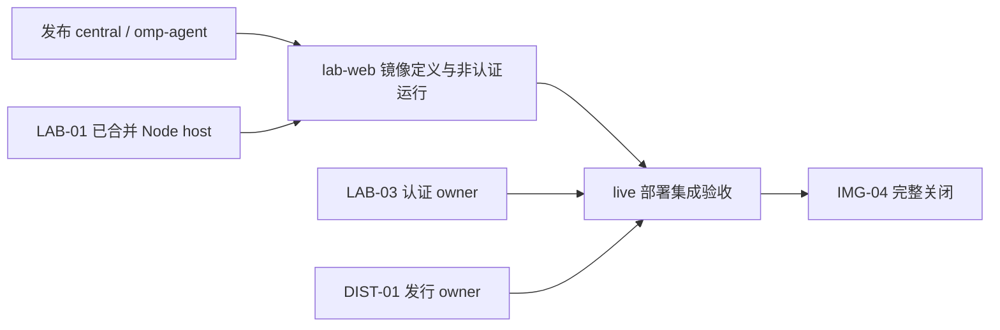

# Pepgent/images — D15-10③ 执行回执

依据：[PM#23](https://github.com/Pepgent/PM/issues/23)、local://exec/d15/CONTRACT.md、images.md、双核PREREVIEW裁决1/3/6/7/9及治理分身本次指令。

计划/决定性问题：main经整体merge revert PR恢复41753eb的树，原branch及既有worktree恢复d40585f；#3/#6恢复准确旧正文、#6旧标题与OPEN；#9/#10关闭not planned并评论；deploy8移回images6。决定性观察是实际命令回执、内容diff为空、GitHub正文逐字读回和真实图边。工程runtime、Project手工字段、PM父边和其他仓文件不在写入范围。无task工具，不派或联系任何agent；直接执行已审定契约，不另作设计。

## 每个写操作前的LEDGER逐项核对

当前源：/Users/mouriya/Ext/code/pepgent/pepgent-soroi/LEDGER.md。每次写前重新读取，列全部20个C编号及R1–R21。

### A01 写前核对：开始执行已批准D15-10③

时间：2026-11-01T11:02:08.858384+00:00；已现读LEDGER。

|条款|逐项检查结果|
|---|---|
|C1-1|已核对：仅落实D15，不提取产品设计或改omp宿主。|
|C1-2|已核对：只写images；跨仓仅获准deploy8图边，不碰Pepgent根。|
|C1-3|已核对：不缩范围、不写跑测试；内容对比只证恢复。|
|C1-4|已核对：不碰环境生产或SOPS。|
|C2-1|已核对：按双核裁决执行，不自行解释。|
|C2-2|已核对：不转嫁取证，不联系agent。|
|C2-3|已核对：不重投票或替代双核。|
|C2-4|已核对：保护直接授权与合法遗产。|
|C3-1|已核对：单仓不再派子任务。|
|C3-2|已核对：落实治理分身授权，不代行领导决策。|
|C3-3|已核对：不替代高阶审查或独立④核验。|
|C3-4|已核对：不恢复tern；临时revert分支通过PR回main，既有树保留。|
|C3-5|已核对：不改skill、agent或harness。|
|C4-1|已核对：证据写指定报告，issue/PR只作获准操作。|
|C4-2|已核对：中文、不联系agent、不起PTY omp。|
|C4-3|已核对：状态读源头，报告只作副本，不写LEDGER。|
|C5-1|已核对：仅读获准session及W，不读01a193fd。|
|C5-2|已核对：本操作前现读LEDGER并逐项核对。|
|C5-3|已核对：main整体revert、d40585f原branch保全；未知不删。|
|C5-4|已核对：仅治理回退，工程冻结。|
|R1|已核对：不从git历史提取设计。|
|R2|已核对：不改设计，不使用暂停决策派工程。|
|R3|已核对：不建迁仓、不改边界。|
|R4|已核对：双核授权产物不动。|
|R5|已核对：仅执行PM23与预审，无新表决。|
|R6|已核对：本仓执行，不代秘书台账。|
|R7|已核对：不改角色监督机制。|
|R8|已核对：不启tern、不改模型扩展。|
|R9|已核对：main不强推，非main仅lease恢复既有ref。|
|R10|已核对：不读禁读会话，U57档案不动。|
|R11|已核对：U80整理与治理段不动。|
|R12|已核对：不操作隔离环境或凭据。|
|R13|已核对：仅撤已判会话产物，保全d40585f。|
|R14|已核对：不写soroi业务。|
|R15|已核对：不写Pepgent业务或无关前端。|
|R16|已核对：不运行e2e，不加门禁。|
|R17|已核对：不扩D9分析。|
|R18|已核对：工程仍冻结。|
|R19|已核对：依据已通过PM23与双核，不改旧票。|
|R20|已核对：仅获准本仓动作交R，冻结项不动。|
|R21|已核对：不宣称恢复派工，独立核验另行执行。|

### A02 写前核对：创建/tmp正文载荷目录

时间：2026-11-01T11:02:16.441223+00:00；已现读LEDGER。

|条款|逐项检查结果|
|---|---|
|C1-1|已核对：仅落实D15，不提取产品设计或改omp宿主。|
|C1-2|已核对：只写images；跨仓仅获准deploy8图边，不碰Pepgent根。|
|C1-3|已核对：不缩范围、不写跑测试；内容对比只证恢复。|
|C1-4|已核对：不碰环境生产或SOPS。|
|C2-1|已核对：按双核裁决执行，不自行解释。|
|C2-2|已核对：不转嫁取证，不联系agent。|
|C2-3|已核对：不重投票或替代双核。|
|C2-4|已核对：保护直接授权与合法遗产。|
|C3-1|已核对：单仓不再派子任务。|
|C3-2|已核对：落实治理分身授权，不代行领导决策。|
|C3-3|已核对：不替代高阶审查或独立④核验。|
|C3-4|已核对：不恢复tern；临时revert分支通过PR回main，既有树保留。|
|C3-5|已核对：不改skill、agent或harness。|
|C4-1|已核对：证据写指定报告，issue/PR只作获准操作。|
|C4-2|已核对：中文、不联系agent、不起PTY omp。|
|C4-3|已核对：状态读源头，报告只作副本，不写LEDGER。|
|C5-1|已核对：仅读获准session及W，不读01a193fd。|
|C5-2|已核对：本操作前现读LEDGER并逐项核对。|
|C5-3|已核对：main整体revert、d40585f原branch保全；未知不删。|
|C5-4|已核对：仅治理回退，工程冻结。|
|R1|已核对：不从git历史提取设计。|
|R2|已核对：不改设计，不使用暂停决策派工程。|
|R3|已核对：不建迁仓、不改边界。|
|R4|已核对：双核授权产物不动。|
|R5|已核对：仅执行PM23与预审，无新表决。|
|R6|已核对：本仓执行，不代秘书台账。|
|R7|已核对：不改角色监督机制。|
|R8|已核对：不启tern、不改模型扩展。|
|R9|已核对：main不强推，非main仅lease恢复既有ref。|
|R10|已核对：不读禁读会话，U57档案不动。|
|R11|已核对：U80整理与治理段不动。|
|R12|已核对：不操作隔离环境或凭据。|
|R13|已核对：仅撤已判会话产物，保全d40585f。|
|R14|已核对：不写soroi业务。|
|R15|已核对：不写Pepgent业务或无关前端。|
|R16|已核对：不运行e2e，不加门禁。|
|R17|已核对：不扩D9分析。|
|R18|已核对：工程仍冻结。|
|R19|已核对：依据已通过PM23与双核，不改旧票。|
|R20|已核对：仅获准本仓动作交R，冻结项不动。|
|R21|已核对：不宣称恢复派工，独立核验另行执行。|

#### (R) 创建/tmp载荷目录

```sh
mktemp -d /tmp/d15-images-exec.XXXXXX
```

工具原始回执：

```text
{'text': '/tmp/d15-images-exec.IIFo14\n', 'details': {'wallTimeNoticeEmitted': False, 'timeoutSeconds': 30, 'wallTimeMs': 4.388291999697685}}
```

### A03 写前核对：准备images3会话前完整Body

时间：2026-11-01T11:02:25.431697+00:00；已现读LEDGER。

|条款|逐项检查结果|
|---|---|
|C1-1|已核对：仅落实D15，不提取产品设计或改omp宿主。|
|C1-2|已核对：只写images；跨仓仅获准deploy8图边，不碰Pepgent根。|
|C1-3|已核对：不缩范围、不写跑测试；内容对比只证恢复。|
|C1-4|已核对：不碰环境生产或SOPS。|
|C2-1|已核对：按双核裁决执行，不自行解释。|
|C2-2|已核对：不转嫁取证，不联系agent。|
|C2-3|已核对：不重投票或替代双核。|
|C2-4|已核对：保护直接授权与合法遗产。|
|C3-1|已核对：单仓不再派子任务。|
|C3-2|已核对：落实治理分身授权，不代行领导决策。|
|C3-3|已核对：不替代高阶审查或独立④核验。|
|C3-4|已核对：不恢复tern；临时revert分支通过PR回main，既有树保留。|
|C3-5|已核对：不改skill、agent或harness。|
|C4-1|已核对：证据写指定报告，issue/PR只作获准操作。|
|C4-2|已核对：中文、不联系agent、不起PTY omp。|
|C4-3|已核对：状态读源头，报告只作副本，不写LEDGER。|
|C5-1|已核对：仅读获准session及W，不读01a193fd。|
|C5-2|已核对：本操作前现读LEDGER并逐项核对。|
|C5-3|已核对：main整体revert、d40585f原branch保全；未知不删。|
|C5-4|已核对：仅治理回退，工程冻结。|
|R1|已核对：不从git历史提取设计。|
|R2|已核对：不改设计，不使用暂停决策派工程。|
|R3|已核对：不建迁仓、不改边界。|
|R4|已核对：双核授权产物不动。|
|R5|已核对：仅执行PM23与预审，无新表决。|
|R6|已核对：本仓执行，不代秘书台账。|
|R7|已核对：不改角色监督机制。|
|R8|已核对：不启tern、不改模型扩展。|
|R9|已核对：main不强推，非main仅lease恢复既有ref。|
|R10|已核对：不读禁读会话，U57档案不动。|
|R11|已核对：U80整理与治理段不动。|
|R12|已核对：不操作隔离环境或凭据。|
|R13|已核对：仅撤已判会话产物，保全d40585f。|
|R14|已核对：不写soroi业务。|
|R15|已核对：不写Pepgent业务或无关前端。|
|R16|已核对：不运行e2e，不加门禁。|
|R17|已核对：不扩D9分析。|
|R18|已核对：工程仍冻结。|
|R19|已核对：依据已通过PM23与双核，不改旧票。|
|R20|已核对：仅获准本仓动作交R，冻结项不动。|
|R21|已核对：不宣称恢复派工，独立核验另行执行。|

(R) `Path('/tmp/d15-images-exec.IIFo14/issue3-body.md').write_text(content)`，写入5374字节；准确载荷：

```markdown
## 必须先读

- 决策树根：[D8 MVP 验收定义与实现计划](https://github.com/Pepgent/PM/issues/8)。
- [D8 §4.2 切片表](https://github.com/Pepgent/PM/blob/main/evidence/decisions/D8-mvp-scope.md#L219-L391)；[本切片原始行](https://github.com/Pepgent/PM/blob/main/evidence/decisions/D8-mvp-scope.md#L246)：范围、依赖、验收与档位。
- [D8 §4.1 波次与并行顺序](https://github.com/Pepgent/PM/blob/main/evidence/decisions/D8-mvp-scope.md#L182-L202)：排期与集成顺序。
- [D2-20](https://github.com/Pepgent/PM/blob/main/evidence/decisions/D2-components.md#L57)：本切片继承的组件归属与行为契约。
- [D7-19](https://github.com/Pepgent/PM/blob/main/evidence/decisions/D7-lab-backend.md#L79)：本切片继承的组件归属与行为契约。
- [D2-11](https://github.com/Pepgent/PM/blob/main/evidence/decisions/D2-components.md#L48)：本切片继承的组件归属与行为契约。
- [D2-13](https://github.com/Pepgent/PM/blob/main/evidence/decisions/D2-components.md#L50)：本切片继承的组件归属与行为契约。

## 目标 / what

lab-web 镜像：IMG-01 加 remote CLI、Node、apps/web 构建产物（D7:79）；容器启动时用 installer 安装发行 tar，做法与 central 相同（D2:57 D2-20）

## 责任与范围

- 所属仓库：`Pepgent/images`。
- 切片 ID：`IMG-04`。
- 解锁：S2。
- 档位 / tier：`low`。
- 波次 / wave：`VS2`。
- 按已通过的 D2–D8 实施；不在本 issue 重议跨仓库设计，不扩大或缩小该行范围。

## 交付边界与编排

本 issue 保留 IMG-04 的完整 D8 验收，作为收口根，不由基础镜像 PR 提前关闭。部署生命周期沿 D7-19：发行安装命令成功后才启动 Node，发行定制与认证实现仍由各自仓库维护。

本轮按 leader 裁决先交付构建与非认证运行路径；认证及安装后工具清单由具名 live 集成 child 收口。两个 child 串行：先发布镜像，再以 LAB-03 和 DIST-01 的真实产物验证部署。两者都消费同一 Node 启动与 HOME 契约，不另建安装器或认证源头。

- [镜像定义 child](https://github.com/Pepgent/images/issues/5) 维护 images 的构建/运行包装，消费 Pepgent 已提交的 production build 和发布的 central 镜像。
- [live 集成 child](https://github.com/Pepgent/images/issues/6) 消费已发布 lab-web、[LAB-03](https://github.com/Pepgent/Pepgent/issues/12) 与真实 Soroi 发行，负责 `/api/auth/*`、浏览器会话和安装后 `soroi_eval`/`soroi_task`。
- 源码仅从 origin/main 的干净 checkout 导出已提交文件，构建上下文不包含 `.git`、本机 node_modules/dist 或未跟踪 `.env`。镜像不烘焙用户定制、目录或凭据；部署方在同一 HOME 上先执行 installer 再 exec Node。



物理共面：镜像定义 child 改 Dockerfile/README；live child 只有在真实部署入口确需修正镜像包装时才改同一文件，必须基于已合并镜像 child 串行提交，不并行重复构建定义。

完整关闭要求：原验收中的二进制由镜像 child 证明；认证路径、安装后工具清单与真实浏览器/持久化结果由 live child 证明，任何一项缺失都保持本根 open。

## 验收 / acceptance

容器启动后，`/api/auth/*` 有响应；`omp`、`omp-rpc-mux`、`remote` 都可执行；按 A0 第 ① 项的办法检查，lab-web 里 `omp` 的工具清单含 `soroi_eval`、`soroi_task`

验收执行与记录遵循 [D8-11 / D8-12](https://github.com/Pepgent/PM/blob/main/evidence/decisions/D8-mvp-scope.md#L82-L83) 及 [§3 验收矩阵](https://github.com/Pepgent/PM/blob/main/evidence/decisions/D8-mvp-scope.md#L102-L151)。完整相关 runtime 路径与权威方下游结果必须留证；只写定义、类型检查、构建或容器存活不代表完成。不得将 hash 验证作为证据；原行涉及哈希的身份/内容契约保持不变，须用真实运行行为与下游结果证明验收。

## 依赖关系

- Depends on: [IMG-01](https://github.com/Pepgent/images/issues/1)（前置切片须已有 runtime 验收证据，才能开工）。
- Depends on: [LAB-01](https://github.com/Pepgent/Pepgent/issues/8)（前置切片须已有 runtime 验收证据，才能开工）。
- Depends on: [LAB-03](https://github.com/Pepgent/Pepgent/issues/12)（认证 owner 提供真实会话与 `/api/auth/*`）。
- Depends on: [DIST-01](https://github.com/Pepgent/soroi/issues/199)（前置切片须已有 runtime 验收证据，才能开工）。

## 执行与异步状态

本根只记录范围裁决、依赖和完整关闭结论；实现与 runtime 证据放对应 child 的 PR，非代码集成结论放 live child。每个代码 PR 只关闭一个 child；基础镜像合并不关闭本根。

## Coordinator 启动

[](http://127.0.0.1:47591/tern/Pepgent/images/issues/3?cwd=%2FUsers%2Fmouriya%2FExt%2Fcode%2Fpepgent%2Fpepgent-images)

```

### A04 写前核对：准备images6会话前完整Body

时间：2026-11-01T11:02:25.446106+00:00；已现读LEDGER。

|条款|逐项检查结果|
|---|---|
|C1-1|已核对：仅落实D15，不提取产品设计或改omp宿主。|
|C1-2|已核对：只写images；跨仓仅获准deploy8图边，不碰Pepgent根。|
|C1-3|已核对：不缩范围、不写跑测试；内容对比只证恢复。|
|C1-4|已核对：不碰环境生产或SOPS。|
|C2-1|已核对：按双核裁决执行，不自行解释。|
|C2-2|已核对：不转嫁取证，不联系agent。|
|C2-3|已核对：不重投票或替代双核。|
|C2-4|已核对：保护直接授权与合法遗产。|
|C3-1|已核对：单仓不再派子任务。|
|C3-2|已核对：落实治理分身授权，不代行领导决策。|
|C3-3|已核对：不替代高阶审查或独立④核验。|
|C3-4|已核对：不恢复tern；临时revert分支通过PR回main，既有树保留。|
|C3-5|已核对：不改skill、agent或harness。|
|C4-1|已核对：证据写指定报告，issue/PR只作获准操作。|
|C4-2|已核对：中文、不联系agent、不起PTY omp。|
|C4-3|已核对：状态读源头，报告只作副本，不写LEDGER。|
|C5-1|已核对：仅读获准session及W，不读01a193fd。|
|C5-2|已核对：本操作前现读LEDGER并逐项核对。|
|C5-3|已核对：main整体revert、d40585f原branch保全；未知不删。|
|C5-4|已核对：仅治理回退，工程冻结。|
|R1|已核对：不从git历史提取设计。|
|R2|已核对：不改设计，不使用暂停决策派工程。|
|R3|已核对：不建迁仓、不改边界。|
|R4|已核对：双核授权产物不动。|
|R5|已核对：仅执行PM23与预审，无新表决。|
|R6|已核对：本仓执行，不代秘书台账。|
|R7|已核对：不改角色监督机制。|
|R8|已核对：不启tern、不改模型扩展。|
|R9|已核对：main不强推，非main仅lease恢复既有ref。|
|R10|已核对：不读禁读会话，U57档案不动。|
|R11|已核对：U80整理与治理段不动。|
|R12|已核对：不操作隔离环境或凭据。|
|R13|已核对：仅撤已判会话产物，保全d40585f。|
|R14|已核对：不写soroi业务。|
|R15|已核对：不写Pepgent业务或无关前端。|
|R16|已核对：不运行e2e，不加门禁。|
|R17|已核对：不扩D9分析。|
|R18|已核对：工程仍冻结。|
|R19|已核对：依据已通过PM23与双核，不改旧票。|
|R20|已核对：仅获准本仓动作交R，冻结项不动。|
|R21|已核对：不宣称恢复派工，独立核验另行执行。|

(R) `Path('/tmp/d15-images-exec.IIFo14/issue6-body.md').write_text(content)`，写入4651字节；准确载荷：

```markdown
## 必须先读

- Parent：[IMG-04 完整交付](https://github.com/Pepgent/images/issues/3)，完整验收不由基础镜像合并代替。
- [D7-03、D7-19](https://github.com/Pepgent/PM/blob/main/evidence/decisions/D7-lab-backend.md#L63)：认证 owner 与部署安装顺序。
- [D8-03、IMG-04](https://github.com/Pepgent/PM/blob/main/evidence/decisions/D8-mvp-scope.md#L74)：安装后扩展工具探针与完整容器验收。

## 目标与使用场景

以真实 lab-web 部署命令安装 Soroi 发行、启动 Node，由真实用户登录 Lab，并确认该容器的 omp 已加载 soroi_eval、soroi_task。此 live issue 承接 leader 明确延后的认证路径和原 IMG-04 的发行安装工具清单，不把“程序存在”误算为完整交付。

## 上下文与问题

基础镜像由 https://github.com/Pepgent/images/issues/5 交付；[LAB-03](https://github.com/Pepgent/Pepgent/issues/12) 已由 https://github.com/Pepgent/Pepgent/pull/38 合并到 source main 16fe1f2，交付真实 Better Auth、/api/auth/* 和 public seed CLI。应用 seed bin 读取 apps/web/resources/lab/migrations，现有镜像尚未保留该目录；对应包装修复归本 child，认证输入与先 seed 后 serving 的部署生命周期归 https://github.com/Pepgent/deploy/issues/8 。真实 Soroi 发行仍由 [DIST-01](https://github.com/Pepgent/soroi/issues/199) 与 https://github.com/Pepgent/soroi/issues/230 维护；DIST owner 已提供通过 C4 的真实 CI tar 与 settings launcher，安装后工具探针仍须按实际 owner 入口验证，不能用 settings=[] 的旧基线或已知失败的 A0 recipe 冒充通过。禁止新增假认证、假发行物或本地工具注册实现。

## 责任与必要决策

本 child 是部署集成验收的消费者，不在 images 复制认证、安装器或工具注册逻辑。

继承根裁决：源码仅从 origin/main 的干净 checkout 导出已提交文件，构建上下文不包含 `.git`、本机 node_modules/dist 或未跟踪 `.env`。镜像不烘焙用户定制、目录或凭据；部署方在同一 HOME 上先执行 installer 再 exec Node。

发行 owner 已确认外层 tar 解到只读 /release 后执行 `bun /release/install.ts --home /home/agent`；返回 command 指向 HOME/.local/bin/soroi，实际用安装所得设置覆盖启动 upstream omp。部署 owner 提供同一 HOME、模型网关client token、认证seed与secret，不让操作员粘凭据。

## 预期结果

1. LAB-03 合并后的真实 Web 产物重建进 lab-web，部署启动先完成 installer 再 exec Node；不带个人定制。
2. 真实认证端点返回 Better Auth 的会话结果；邮箱密码登录后刷新仍保留会话，无会话访问 Lab 被拒绝。
3. 同一个运行容器的 omp 通过发行设置启动，实际工具清单包含 soroi_eval、soroi_task；保留可归档工具响应/transcript，而非文件名grep。

## 验收标准

| # | Dimension | Check | Command / path | Env | Expect |
|---|---|---|---|---|---|
| 1 | integration | 结果1：部署顺序 | 从真实部署入口运行 `bun /release/install.ts --home /home/agent` 成功后 `exec node bin/pepgent-web.mjs`，保留installer JSON和Node日志 | lab-web容器，真实发行与部署注入 | 安装成功再监听；无静态凭据入镜像 |
| 2 | integration | 结果2：认证与持久会话 | 浏览器走真实登录页、邮箱密码登录、进入Lab、刷新；请求 `/api/auth/get-session`；另用无会话窗口访问Lab | LAB-03后的真实部署与seed账户 | 已登录会话JSON有效；刷新仍登录；无会话拒绝；附截图/响应/DB观察 |
| 3 | integration | 结果3：发行工具注册 | 在同一容器PTY启动installer返回的 soroi command，按D8-03扩展探针枚举并执行工具，记录实际工具清单 | 相同HOME、网关凭据由部署注入 | soroi_eval、soroi_task均在真实清单并可调用；不以hash/文件存在替代 |

## 继承验证义务与边界

From: https://github.com/Pepgent/images/issues/3 的 `/api/auth/*`、安装后工具清单和真实浏览器义务。Owner：images IMG-04 集成执行者，由 leader 在LAB-03与DIST-01落地后继续指派；此义务不可再次延期。应用业务缺陷回到实际owner，镜像包装缺陷在本child对应PR修正。

## 依赖关系

Depends on: https://github.com/Pepgent/images/issues/5（已发布可运行镜像）；https://github.com/Pepgent/Pepgent/issues/12（真实认证与会话）；https://github.com/Pepgent/soroi/issues/199 和 https://github.com/Pepgent/soroi/issues/230（真实发行及installer）。本issue保持live，依赖未满足不关闭parent。

```

### A05 写前核对：准备重开issue的双核指定说明

时间：2026-11-01T11:02:25.453590+00:00；已现读LEDGER。

|条款|逐项检查结果|
|---|---|
|C1-1|已核对：仅落实D15，不提取产品设计或改omp宿主。|
|C1-2|已核对：只写images；跨仓仅获准deploy8图边，不碰Pepgent根。|
|C1-3|已核对：不缩范围、不写跑测试；内容对比只证恢复。|
|C1-4|已核对：不碰环境生产或SOPS。|
|C2-1|已核对：按双核裁决执行，不自行解释。|
|C2-2|已核对：不转嫁取证，不联系agent。|
|C2-3|已核对：不重投票或替代双核。|
|C2-4|已核对：保护直接授权与合法遗产。|
|C3-1|已核对：单仓不再派子任务。|
|C3-2|已核对：落实治理分身授权，不代行领导决策。|
|C3-3|已核对：不替代高阶审查或独立④核验。|
|C3-4|已核对：不恢复tern；临时revert分支通过PR回main，既有树保留。|
|C3-5|已核对：不改skill、agent或harness。|
|C4-1|已核对：证据写指定报告，issue/PR只作获准操作。|
|C4-2|已核对：中文、不联系agent、不起PTY omp。|
|C4-3|已核对：状态读源头，报告只作副本，不写LEDGER。|
|C5-1|已核对：仅读获准session及W，不读01a193fd。|
|C5-2|已核对：本操作前现读LEDGER并逐项核对。|
|C5-3|已核对：main整体revert、d40585f原branch保全；未知不删。|
|C5-4|已核对：仅治理回退，工程冻结。|
|R1|已核对：不从git历史提取设计。|
|R2|已核对：不改设计，不使用暂停决策派工程。|
|R3|已核对：不建迁仓、不改边界。|
|R4|已核对：双核授权产物不动。|
|R5|已核对：仅执行PM23与预审，无新表决。|
|R6|已核对：本仓执行，不代秘书台账。|
|R7|已核对：不改角色监督机制。|
|R8|已核对：不启tern、不改模型扩展。|
|R9|已核对：main不强推，非main仅lease恢复既有ref。|
|R10|已核对：不读禁读会话，U57档案不动。|
|R11|已核对：U80整理与治理段不动。|
|R12|已核对：不操作隔离环境或凭据。|
|R13|已核对：仅撤已判会话产物，保全d40585f。|
|R14|已核对：不写soroi业务。|
|R15|已核对：不写Pepgent业务或无关前端。|
|R16|已核对：不运行e2e，不加门禁。|
|R17|已核对：不扩D9分析。|
|R18|已核对：工程仍冻结。|
|R19|已核对：依据已通过PM23与双核，不改旧票。|
|R20|已核对：仅获准本仓动作交R，冻结项不动。|
|R21|已核对：不宣称恢复派工，独立核验另行执行。|

(R) `Path('/tmp/d15-images-exec.IIFo14/reopen-comment.md').write_text(content)`，写入278字节；准确载荷：

```markdown
依 [Pepgent/PM#23](https://github.com/Pepgent/PM/issues/23)（D15），会话 `01a195a6` 期间在本 issue 下的私自裁决、合并与关闭动作已作废并回退，现恢复为会话前 OPEN 状态；既有评论作为不可变历史记录保留，不作执行依据。

```

### A06 写前核对：准备新建issue作废关闭说明

时间：2026-11-01T11:02:25.460283+00:00；已现读LEDGER。

|条款|逐项检查结果|
|---|---|
|C1-1|已核对：仅落实D15，不提取产品设计或改omp宿主。|
|C1-2|已核对：只写images；跨仓仅获准deploy8图边，不碰Pepgent根。|
|C1-3|已核对：不缩范围、不写跑测试；内容对比只证恢复。|
|C1-4|已核对：不碰环境生产或SOPS。|
|C2-1|已核对：按双核裁决执行，不自行解释。|
|C2-2|已核对：不转嫁取证，不联系agent。|
|C2-3|已核对：不重投票或替代双核。|
|C2-4|已核对：保护直接授权与合法遗产。|
|C3-1|已核对：单仓不再派子任务。|
|C3-2|已核对：落实治理分身授权，不代行领导决策。|
|C3-3|已核对：不替代高阶审查或独立④核验。|
|C3-4|已核对：不恢复tern；临时revert分支通过PR回main，既有树保留。|
|C3-5|已核对：不改skill、agent或harness。|
|C4-1|已核对：证据写指定报告，issue/PR只作获准操作。|
|C4-2|已核对：中文、不联系agent、不起PTY omp。|
|C4-3|已核对：状态读源头，报告只作副本，不写LEDGER。|
|C5-1|已核对：仅读获准session及W，不读01a193fd。|
|C5-2|已核对：本操作前现读LEDGER并逐项核对。|
|C5-3|已核对：main整体revert、d40585f原branch保全；未知不删。|
|C5-4|已核对：仅治理回退，工程冻结。|
|R1|已核对：不从git历史提取设计。|
|R2|已核对：不改设计，不使用暂停决策派工程。|
|R3|已核对：不建迁仓、不改边界。|
|R4|已核对：双核授权产物不动。|
|R5|已核对：仅执行PM23与预审，无新表决。|
|R6|已核对：本仓执行，不代秘书台账。|
|R7|已核对：不改角色监督机制。|
|R8|已核对：不启tern、不改模型扩展。|
|R9|已核对：main不强推，非main仅lease恢复既有ref。|
|R10|已核对：不读禁读会话，U57档案不动。|
|R11|已核对：U80整理与治理段不动。|
|R12|已核对：不操作隔离环境或凭据。|
|R13|已核对：仅撤已判会话产物，保全d40585f。|
|R14|已核对：不写soroi业务。|
|R15|已核对：不写Pepgent业务或无关前端。|
|R16|已核对：不运行e2e，不加门禁。|
|R17|已核对：不扩D9分析。|
|R18|已核对：工程仍冻结。|
|R19|已核对：依据已通过PM23与双核，不改旧票。|
|R20|已核对：仅获准本仓动作交R，冻结项不动。|
|R21|已核对：不宣称恢复派工，独立核验另行执行。|

(R) `Path('/tmp/d15-images-exec.IIFo14/not-planned-comment.md').write_text(content)`，写入289字节；准确载荷：

```markdown
依 [Pepgent/PM#23](https://github.com/Pepgent/PM/issues/23)（D15），本 issue 属于会话 `01a195a6` 中无效决定产生的新建执行对象，现以 not planned 作废关闭。既有正文与评论作为不可变记录保留；不得用本 issue 作为恢复工程派工依据。

```

### A07 写前核对：将既有linked worktree/branch恢复到d40585f，不移除树

时间：2026-11-01T11:02:45.992868+00:00；已现读LEDGER。

|条款|逐项检查结果|
|---|---|
|C1-1|已核对：仅落实D15，不提取产品设计或改omp宿主。|
|C1-2|已核对：只写images；跨仓仅获准deploy8图边，不碰Pepgent根。|
|C1-3|已核对：不缩范围、不写跑测试；内容对比只证恢复。|
|C1-4|已核对：不碰环境生产或SOPS。|
|C2-1|已核对：按双核裁决执行，不自行解释。|
|C2-2|已核对：不转嫁取证，不联系agent。|
|C2-3|已核对：不重投票或替代双核。|
|C2-4|已核对：保护直接授权与合法遗产。|
|C3-1|已核对：单仓不再派子任务。|
|C3-2|已核对：落实治理分身授权，不代行领导决策。|
|C3-3|已核对：不替代高阶审查或独立④核验。|
|C3-4|已核对：不恢复tern；临时revert分支通过PR回main，既有树保留。|
|C3-5|已核对：不改skill、agent或harness。|
|C4-1|已核对：证据写指定报告，issue/PR只作获准操作。|
|C4-2|已核对：中文、不联系agent、不起PTY omp。|
|C4-3|已核对：状态读源头，报告只作副本，不写LEDGER。|
|C5-1|已核对：仅读获准session及W，不读01a193fd。|
|C5-2|已核对：本操作前现读LEDGER并逐项核对。|
|C5-3|已核对：main整体revert、d40585f原branch保全；未知不删。|
|C5-4|已核对：仅治理回退，工程冻结。|
|R1|已核对：不从git历史提取设计。|
|R2|已核对：不改设计，不使用暂停决策派工程。|
|R3|已核对：不建迁仓、不改边界。|
|R4|已核对：双核授权产物不动。|
|R5|已核对：仅执行PM23与预审，无新表决。|
|R6|已核对：本仓执行，不代秘书台账。|
|R7|已核对：不改角色监督机制。|
|R8|已核对：不启tern、不改模型扩展。|
|R9|已核对：main不强推，非main仅lease恢复既有ref。|
|R10|已核对：不读禁读会话，U57档案不动。|
|R11|已核对：U80整理与治理段不动。|
|R12|已核对：不操作隔离环境或凭据。|
|R13|已核对：仅撤已判会话产物，保全d40585f。|
|R14|已核对：不写soroi业务。|
|R15|已核对：不写Pepgent业务或无关前端。|
|R16|已核对：不运行e2e，不加门禁。|
|R17|已核对：不扩D9分析。|
|R18|已核对：工程仍冻结。|
|R19|已核对：依据已通过PM23与双核，不改旧票。|
|R20|已核对：仅获准本仓动作交R，冻结项不动。|
|R21|已核对：不宣称恢复派工，独立核验另行执行。|

#### (R) 恢复既有本地branch

```sh
git -C /Users/mouriya/ext/worktrees/issue-6-lab-web-live-75a9ab7 reset --hard d40585f37f437184f26cc8bf5d97c6f6c687f14a
```

工具原始回执：

```text
{'text': 'HEAD is now at d40585f fix: include Lab seed migrations in the production image\n', 'details': {'wallTimeNoticeEmitted': False, 'timeoutSeconds': 30, 'wallTimeMs': 61.866209000349045}}
```

### A08 写前核对：仅对既有非main远端branch使用精确lease恢复

时间：2026-11-01T11:02:46.072695+00:00；已现读LEDGER。

|条款|逐项检查结果|
|---|---|
|C1-1|已核对：仅落实D15，不提取产品设计或改omp宿主。|
|C1-2|已核对：只写images；跨仓仅获准deploy8图边，不碰Pepgent根。|
|C1-3|已核对：不缩范围、不写跑测试；内容对比只证恢复。|
|C1-4|已核对：不碰环境生产或SOPS。|
|C2-1|已核对：按双核裁决执行，不自行解释。|
|C2-2|已核对：不转嫁取证，不联系agent。|
|C2-3|已核对：不重投票或替代双核。|
|C2-4|已核对：保护直接授权与合法遗产。|
|C3-1|已核对：单仓不再派子任务。|
|C3-2|已核对：落实治理分身授权，不代行领导决策。|
|C3-3|已核对：不替代高阶审查或独立④核验。|
|C3-4|已核对：不恢复tern；临时revert分支通过PR回main，既有树保留。|
|C3-5|已核对：不改skill、agent或harness。|
|C4-1|已核对：证据写指定报告，issue/PR只作获准操作。|
|C4-2|已核对：中文、不联系agent、不起PTY omp。|
|C4-3|已核对：状态读源头，报告只作副本，不写LEDGER。|
|C5-1|已核对：仅读获准session及W，不读01a193fd。|
|C5-2|已核对：本操作前现读LEDGER并逐项核对。|
|C5-3|已核对：main整体revert、d40585f原branch保全；未知不删。|
|C5-4|已核对：仅治理回退，工程冻结。|
|R1|已核对：不从git历史提取设计。|
|R2|已核对：不改设计，不使用暂停决策派工程。|
|R3|已核对：不建迁仓、不改边界。|
|R4|已核对：双核授权产物不动。|
|R5|已核对：仅执行PM23与预审，无新表决。|
|R6|已核对：本仓执行，不代秘书台账。|
|R7|已核对：不改角色监督机制。|
|R8|已核对：不启tern、不改模型扩展。|
|R9|已核对：main不强推，非main仅lease恢复既有ref。|
|R10|已核对：不读禁读会话，U57档案不动。|
|R11|已核对：U80整理与治理段不动。|
|R12|已核对：不操作隔离环境或凭据。|
|R13|已核对：仅撤已判会话产物，保全d40585f。|
|R14|已核对：不写soroi业务。|
|R15|已核对：不写Pepgent业务或无关前端。|
|R16|已核对：不运行e2e，不加门禁。|
|R17|已核对：不扩D9分析。|
|R18|已核对：工程仍冻结。|
|R19|已核对：依据已通过PM23与双核，不改旧票。|
|R20|已核对：仅获准本仓动作交R，冻结项不动。|
|R21|已核对：不宣称恢复派工，独立核验另行执行。|

#### (R) 精确lease恢复既有远端branch

```sh
git push --force-with-lease=refs/heads/issue-6-lab-web-live:64114c63df3ec27884bfec1bc505af77b7724496 origin d40585f37f437184f26cc8bf5d97c6f6c687f14a:refs/heads/issue-6-lab-web-live
```

工具原始回执：

```text
{'text': 'To https://github.com/Pepgent/images.git\n + 64114c6...d40585f d40585f37f437184f26cc8bf5d97c6f6c687f14a -> issue-6-lab-web-live (forced update)\n\n\nWall time: 1.53 seconds', 'details': {'wallTimeNoticeEmitted': True, 'timeoutSeconds': 30, 'wallTimeMs': 1534.2415000014007}}
```

### A09 写前核对：创建获准revert PR分支，main历史不改写

时间：2026-11-01T11:02:58.210408+00:00；已现读LEDGER。

|条款|逐项检查结果|
|---|---|
|C1-1|已核对：仅落实D15，不提取产品设计或改omp宿主。|
|C1-2|已核对：只写images；跨仓仅获准deploy8图边，不碰Pepgent根。|
|C1-3|已核对：不缩范围、不写跑测试；内容对比只证恢复。|
|C1-4|已核对：不碰环境生产或SOPS。|
|C2-1|已核对：按双核裁决执行，不自行解释。|
|C2-2|已核对：不转嫁取证，不联系agent。|
|C2-3|已核对：不重投票或替代双核。|
|C2-4|已核对：保护直接授权与合法遗产。|
|C3-1|已核对：单仓不再派子任务。|
|C3-2|已核对：落实治理分身授权，不代行领导决策。|
|C3-3|已核对：不替代高阶审查或独立④核验。|
|C3-4|已核对：不恢复tern；临时revert分支通过PR回main，既有树保留。|
|C3-5|已核对：不改skill、agent或harness。|
|C4-1|已核对：证据写指定报告，issue/PR只作获准操作。|
|C4-2|已核对：中文、不联系agent、不起PTY omp。|
|C4-3|已核对：状态读源头，报告只作副本，不写LEDGER。|
|C5-1|已核对：仅读获准session及W，不读01a193fd。|
|C5-2|已核对：本操作前现读LEDGER并逐项核对。|
|C5-3|已核对：main整体revert、d40585f原branch保全；未知不删。|
|C5-4|已核对：仅治理回退，工程冻结。|
|R1|已核对：不从git历史提取设计。|
|R2|已核对：不改设计，不使用暂停决策派工程。|
|R3|已核对：不建迁仓、不改边界。|
|R4|已核对：双核授权产物不动。|
|R5|已核对：仅执行PM23与预审，无新表决。|
|R6|已核对：本仓执行，不代秘书台账。|
|R7|已核对：不改角色监督机制。|
|R8|已核对：不启tern、不改模型扩展。|
|R9|已核对：main不强推，非main仅lease恢复既有ref。|
|R10|已核对：不读禁读会话，U57档案不动。|
|R11|已核对：U80整理与治理段不动。|
|R12|已核对：不操作隔离环境或凭据。|
|R13|已核对：仅撤已判会话产物，保全d40585f。|
|R14|已核对：不写soroi业务。|
|R15|已核对：不写Pepgent业务或无关前端。|
|R16|已核对：不运行e2e，不加门禁。|
|R17|已核对：不扩D9分析。|
|R18|已核对：工程仍冻结。|
|R19|已核对：依据已通过PM23与双核，不改旧票。|
|R20|已核对：仅获准本仓动作交R，冻结项不动。|
|R21|已核对：不宣称恢复派工，独立核验另行执行。|

#### (R) 创建revert分支

```sh
git switch -c revert/d15-images-pr8 main
```

工具原始回执：

```text
{'text': "Switched to a new branch 'revert/d15-images-pr8'\n", 'details': {'wallTimeNoticeEmitted': False, 'timeoutSeconds': 30, 'wallTimeMs': 92.43366700038314}}
```

### A10 写前核对：按裁决3整体revert merge207f11a（唯一逆序项1）

时间：2026-11-01T11:02:58.323151+00:00；已现读LEDGER。

|条款|逐项检查结果|
|---|---|
|C1-1|已核对：仅落实D15，不提取产品设计或改omp宿主。|
|C1-2|已核对：只写images；跨仓仅获准deploy8图边，不碰Pepgent根。|
|C1-3|已核对：不缩范围、不写跑测试；内容对比只证恢复。|
|C1-4|已核对：不碰环境生产或SOPS。|
|C2-1|已核对：按双核裁决执行，不自行解释。|
|C2-2|已核对：不转嫁取证，不联系agent。|
|C2-3|已核对：不重投票或替代双核。|
|C2-4|已核对：保护直接授权与合法遗产。|
|C3-1|已核对：单仓不再派子任务。|
|C3-2|已核对：落实治理分身授权，不代行领导决策。|
|C3-3|已核对：不替代高阶审查或独立④核验。|
|C3-4|已核对：不恢复tern；临时revert分支通过PR回main，既有树保留。|
|C3-5|已核对：不改skill、agent或harness。|
|C4-1|已核对：证据写指定报告，issue/PR只作获准操作。|
|C4-2|已核对：中文、不联系agent、不起PTY omp。|
|C4-3|已核对：状态读源头，报告只作副本，不写LEDGER。|
|C5-1|已核对：仅读获准session及W，不读01a193fd。|
|C5-2|已核对：本操作前现读LEDGER并逐项核对。|
|C5-3|已核对：main整体revert、d40585f原branch保全；未知不删。|
|C5-4|已核对：仅治理回退，工程冻结。|
|R1|已核对：不从git历史提取设计。|
|R2|已核对：不改设计，不使用暂停决策派工程。|
|R3|已核对：不建迁仓、不改边界。|
|R4|已核对：双核授权产物不动。|
|R5|已核对：仅执行PM23与预审，无新表决。|
|R6|已核对：本仓执行，不代秘书台账。|
|R7|已核对：不改角色监督机制。|
|R8|已核对：不启tern、不改模型扩展。|
|R9|已核对：main不强推，非main仅lease恢复既有ref。|
|R10|已核对：不读禁读会话，U57档案不动。|
|R11|已核对：U80整理与治理段不动。|
|R12|已核对：不操作隔离环境或凭据。|
|R13|已核对：仅撤已判会话产物，保全d40585f。|
|R14|已核对：不写soroi业务。|
|R15|已核对：不写Pepgent业务或无关前端。|
|R16|已核对：不运行e2e，不加门禁。|
|R17|已核对：不扩D9分析。|
|R18|已核对：工程仍冻结。|
|R19|已核对：依据已通过PM23与双核，不改旧票。|
|R20|已核对：仅获准本仓动作交R，冻结项不动。|
|R21|已核对：不宣称恢复派工，独立核验另行执行。|

#### (R) 整体merge revert

```sh
git revert --no-edit -m 1 207f11ad8ad8a6c5b662f7f99419c1fc323a0c07
```

工具原始回执：

```text
{'text': '[revert/d15-images-pr8 205a177] Revert "Merge pull request #8 from Pepgent/issue-6-lab-web-live"\n Date: Sun Nov 1 20:02:58 2026 +0900\n 2 files changed, 8 insertions(+), 16 deletions(-)\n', 'details': {'wallTimeNoticeEmitted': False, 'timeoutSeconds': 30, 'wallTimeMs': 81.90220800042152}}
```

#### (R) 合入前tree内容与基线对比

```sh
git diff --exit-code 41753ebccd41dd398eb8232dc736a8a3af33483d HEAD -- && git show --stat --format=fuller HEAD
```

工具原始回执：

```text
{'text': 'commit 205a177c03aeae523bcfc3dfdd69722843c754d7\nAuthor:     RiriAgent <39219425+RiriAgent@users.noreply.github.com>\nAuthorDate: Sun Nov 1 20:02:58 2026 +0900\nCommit:     RiriAgent <39219425+RiriAgent@users.noreply.github.com>\nCommitDate: Sun Nov 1 20:02:58 2026 +0900\n\n    Revert "Merge pull request #8 from Pepgent/issue-6-lab-web-live"\n    \n    This reverts commit 207f11ad8ad8a6c5b662f7f99419c1fc323a0c07, reversing\n    changes made to 41753ebccd41dd398eb8232dc736a8a3af33483d.\n\n Dockerfile |  4 +---\n README.md  | 20 +++++++-------------\n 2 files changed, 8 insertions(+), 16 deletions(-)\n', 'details': {'wallTimeNoticeEmitted': False, 'timeoutSeconds': 30, 'wallTimeMs': 90.91862500086427}}
```

### A11 写前核对：发布revert branch供PR合入，不强推main

时间：2026-11-01T11:02:58.541474+00:00；已现读LEDGER。

|条款|逐项检查结果|
|---|---|
|C1-1|已核对：仅落实D15，不提取产品设计或改omp宿主。|
|C1-2|已核对：只写images；跨仓仅获准deploy8图边，不碰Pepgent根。|
|C1-3|已核对：不缩范围、不写跑测试；内容对比只证恢复。|
|C1-4|已核对：不碰环境生产或SOPS。|
|C2-1|已核对：按双核裁决执行，不自行解释。|
|C2-2|已核对：不转嫁取证，不联系agent。|
|C2-3|已核对：不重投票或替代双核。|
|C2-4|已核对：保护直接授权与合法遗产。|
|C3-1|已核对：单仓不再派子任务。|
|C3-2|已核对：落实治理分身授权，不代行领导决策。|
|C3-3|已核对：不替代高阶审查或独立④核验。|
|C3-4|已核对：不恢复tern；临时revert分支通过PR回main，既有树保留。|
|C3-5|已核对：不改skill、agent或harness。|
|C4-1|已核对：证据写指定报告，issue/PR只作获准操作。|
|C4-2|已核对：中文、不联系agent、不起PTY omp。|
|C4-3|已核对：状态读源头，报告只作副本，不写LEDGER。|
|C5-1|已核对：仅读获准session及W，不读01a193fd。|
|C5-2|已核对：本操作前现读LEDGER并逐项核对。|
|C5-3|已核对：main整体revert、d40585f原branch保全；未知不删。|
|C5-4|已核对：仅治理回退，工程冻结。|
|R1|已核对：不从git历史提取设计。|
|R2|已核对：不改设计，不使用暂停决策派工程。|
|R3|已核对：不建迁仓、不改边界。|
|R4|已核对：双核授权产物不动。|
|R5|已核对：仅执行PM23与预审，无新表决。|
|R6|已核对：本仓执行，不代秘书台账。|
|R7|已核对：不改角色监督机制。|
|R8|已核对：不启tern、不改模型扩展。|
|R9|已核对：main不强推，非main仅lease恢复既有ref。|
|R10|已核对：不读禁读会话，U57档案不动。|
|R11|已核对：U80整理与治理段不动。|
|R12|已核对：不操作隔离环境或凭据。|
|R13|已核对：仅撤已判会话产物，保全d40585f。|
|R14|已核对：不写soroi业务。|
|R15|已核对：不写Pepgent业务或无关前端。|
|R16|已核对：不运行e2e，不加门禁。|
|R17|已核对：不扩D9分析。|
|R18|已核对：工程仍冻结。|
|R19|已核对：依据已通过PM23与双核，不改旧票。|
|R20|已核对：仅获准本仓动作交R，冻结项不动。|
|R21|已核对：不宣称恢复派工，独立核验另行执行。|

#### (R) 发布revert branch

```sh
git push -u origin revert/d15-images-pr8
```

工具原始回执：

```text
{'text': "remote: \nremote: Create a pull request for 'revert/d15-images-pr8' on GitHub by visiting:        \nremote:      https://github.com/Pepgent/images/pull/new/revert/d15-images-pr8        \nremote: \nTo https://github.com/Pepgent/images.git\n * [new branch]      revert/d15-images-pr8 -> revert/d15-images-pr8\nbranch 'revert/d15-images-pr8' set up to track 'origin/revert/d15-images-pr8'.\n\n\nWall time: 1.61 seconds", 'details': {'wallTimeNoticeEmitted': True, 'timeoutSeconds': 30, 'wallTimeMs': 1606.8633340001106}}
```

### A12 写前核对：准备无closing keyword的revert PR正文

时间：2026-11-01T11:03:25.066904+00:00；已现读LEDGER。

|条款|逐项检查结果|
|---|---|
|C1-1|已核对：仅落实D15，不提取产品设计或改omp宿主。|
|C1-2|已核对：只写images；跨仓仅获准deploy8图边，不碰Pepgent根。|
|C1-3|已核对：不缩范围、不写跑测试；内容对比只证恢复。|
|C1-4|已核对：不碰环境生产或SOPS。|
|C2-1|已核对：按双核裁决执行，不自行解释。|
|C2-2|已核对：不转嫁取证，不联系agent。|
|C2-3|已核对：不重投票或替代双核。|
|C2-4|已核对：保护直接授权与合法遗产。|
|C3-1|已核对：单仓不再派子任务。|
|C3-2|已核对：落实治理分身授权，不代行领导决策。|
|C3-3|已核对：不替代高阶审查或独立④核验。|
|C3-4|已核对：不恢复tern；临时revert分支通过PR回main，既有树保留。|
|C3-5|已核对：不改skill、agent或harness。|
|C4-1|已核对：证据写指定报告，issue/PR只作获准操作。|
|C4-2|已核对：中文、不联系agent、不起PTY omp。|
|C4-3|已核对：状态读源头，报告只作副本，不写LEDGER。|
|C5-1|已核对：仅读获准session及W，不读01a193fd。|
|C5-2|已核对：本操作前现读LEDGER并逐项核对。|
|C5-3|已核对：main整体revert、d40585f原branch保全；未知不删。|
|C5-4|已核对：仅治理回退，工程冻结。|
|R1|已核对：不从git历史提取设计。|
|R2|已核对：不改设计，不使用暂停决策派工程。|
|R3|已核对：不建迁仓、不改边界。|
|R4|已核对：双核授权产物不动。|
|R5|已核对：仅执行PM23与预审，无新表决。|
|R6|已核对：本仓执行，不代秘书台账。|
|R7|已核对：不改角色监督机制。|
|R8|已核对：不启tern、不改模型扩展。|
|R9|已核对：main不强推，非main仅lease恢复既有ref。|
|R10|已核对：不读禁读会话，U57档案不动。|
|R11|已核对：U80整理与治理段不动。|
|R12|已核对：不操作隔离环境或凭据。|
|R13|已核对：仅撤已判会话产物，保全d40585f。|
|R14|已核对：不写soroi业务。|
|R15|已核对：不写Pepgent业务或无关前端。|
|R16|已核对：不运行e2e，不加门禁。|
|R17|已核对：不扩D9分析。|
|R18|已核对：工程仍冻结。|
|R19|已核对：依据已通过PM23与双核，不改旧票。|
|R20|已核对：仅获准本仓动作交R，冻结项不动。|
|R21|已核对：不宣称恢复派工，独立核验另行执行。|

(R) `Path('/tmp/d15-images-exec.IIFo14/revert-pr-body.md').write_text(content)`，写入2743字节；准确载荷：

```markdown
关联治理决议：[Pepgent/PM#23](https://github.com/Pepgent/PM/issues/23)（D15；本 PR 不使用 closing keyword，不关闭任何 issue）。

## 摘要

按 D15-03、D15-04 与常驻 Argon 双核预审裁决 3，整体撤销 [PR8](https://github.com/Pepgent/images/pull/8) 的会话内合并，使 main 的文件内容回到会话前基线 41753eb。main 通过此 revert PR 前进，不重写历史。

## 实现说明

对 merge 207f11ad8ad8a6c5b662f7f99419c1fc323a0c07 执行 `git revert --no-edit -m 1`，产生 205a177c03aeae523bcfc3dfdd69722843c754d7，撤回 Dockerfile migrations 复制与对应 README 合并差异。双核明确要求整体 merge revert，而非只撤 README 的 64114c6。

会话前遗产 d40585f 不删除：既有 `issue-6-lab-web-live` 本地分支、既有 worktree 和远端分支已恢复到 d40585f37f437184f26cc8bf5d97c6f6c687f14a；远端仅对这个既有非 main 分支使用精确 force-with-lease。原 PR8 正文及评论保持不可变。

## 变更预演（Layer 1）

本地 revert 真实命令输出：

```text
[revert/d15-images-pr8 205a177] Revert "Merge pull request #8 from Pepgent/issue-6-lab-web-live"
2 files changed, 8 insertions(+), 16 deletions(-)
```

本步骤为治理回退，未部署任何镜像或环境。

## 落地核对（Layer 2）

```sh
git diff --exit-code 41753ebccd41dd398eb8232dc736a8a3af33483d HEAD --
```

退出 0、无 diff。该观察证明 revert 提交的全部受控文件内容与会话前 main 基线相同；不是 hash 功能验证。

```text
HEAD is now at d40585f fix: include Lab seed migrations in the production image
+ 64114c6...d40585f ... -> issue-6-lab-web-live (forced update)
```

遗产已回到其会话前原分支位置，既有 worktree 未移除。

## 启动 / 运行时顺序（Layer 3）

不适用：本 PR 仅执行已通过的治理回退，不启动、部署或重启服务；工程冻结继续。

## 端到端业务行为（Layer 4）

本次真实入口是 Git/GitHub 的治理回退路径，不是镜像业务验收。已实际生成并推送 revert 提交，文件内容与指定会话前基线完全一致；合入后的 main 内容、issue 原文/开关与真实父子边将按 D15-10③派工在执行回执中逐项读回，并由不同执行者完成第④步独立核验。

没有运行或宣称通过镜像、浏览器、Slurm、Komodo 或全组件 e2e。恢复会话前 issue 不表示其业务验收通过。

## 分析

本 PR 仅撤销 D15 已判定的会话合并，不新增修复或设计。原 branch 保全与 main 整体撤回分别执行，防止把遗产从 main 移走误当成遗产丢失。Project 自动字段及来源不明的 worktree 保持不动；PM 父边由指定 PM 执行者处理。

```

### A13 写前核对：创建正常非draft revert PR，不关闭任何issue

时间：2026-11-01T11:03:25.081565+00:00；已现读LEDGER。

|条款|逐项检查结果|
|---|---|
|C1-1|已核对：仅落实D15，不提取产品设计或改omp宿主。|
|C1-2|已核对：只写images；跨仓仅获准deploy8图边，不碰Pepgent根。|
|C1-3|已核对：不缩范围、不写跑测试；内容对比只证恢复。|
|C1-4|已核对：不碰环境生产或SOPS。|
|C2-1|已核对：按双核裁决执行，不自行解释。|
|C2-2|已核对：不转嫁取证，不联系agent。|
|C2-3|已核对：不重投票或替代双核。|
|C2-4|已核对：保护直接授权与合法遗产。|
|C3-1|已核对：单仓不再派子任务。|
|C3-2|已核对：落实治理分身授权，不代行领导决策。|
|C3-3|已核对：不替代高阶审查或独立④核验。|
|C3-4|已核对：不恢复tern；临时revert分支通过PR回main，既有树保留。|
|C3-5|已核对：不改skill、agent或harness。|
|C4-1|已核对：证据写指定报告，issue/PR只作获准操作。|
|C4-2|已核对：中文、不联系agent、不起PTY omp。|
|C4-3|已核对：状态读源头，报告只作副本，不写LEDGER。|
|C5-1|已核对：仅读获准session及W，不读01a193fd。|
|C5-2|已核对：本操作前现读LEDGER并逐项核对。|
|C5-3|已核对：main整体revert、d40585f原branch保全；未知不删。|
|C5-4|已核对：仅治理回退，工程冻结。|
|R1|已核对：不从git历史提取设计。|
|R2|已核对：不改设计，不使用暂停决策派工程。|
|R3|已核对：不建迁仓、不改边界。|
|R4|已核对：双核授权产物不动。|
|R5|已核对：仅执行PM23与预审，无新表决。|
|R6|已核对：本仓执行，不代秘书台账。|
|R7|已核对：不改角色监督机制。|
|R8|已核对：不启tern、不改模型扩展。|
|R9|已核对：main不强推，非main仅lease恢复既有ref。|
|R10|已核对：不读禁读会话，U57档案不动。|
|R11|已核对：U80整理与治理段不动。|
|R12|已核对：不操作隔离环境或凭据。|
|R13|已核对：仅撤已判会话产物，保全d40585f。|
|R14|已核对：不写soroi业务。|
|R15|已核对：不写Pepgent业务或无关前端。|
|R16|已核对：不运行e2e，不加门禁。|
|R17|已核对：不扩D9分析。|
|R18|已核对：工程仍冻结。|
|R19|已核对：依据已通过PM23与双核，不改旧票。|
|R20|已核对：仅获准本仓动作交R，冻结项不动。|
|R21|已核对：不宣称恢复派工，独立核验另行执行。|

#### (R) 创建revert PR

```sh
gh pr create --repo Pepgent/images --base main --head revert/d15-images-pr8 --title "按 D15 撤销会话内 PR8 合并并恢复 main 基线" --body-file /tmp/d15-images-exec.IIFo14/revert-pr-body.md
```

工具原始回执：

```text
{'text': 'https://github.com/Pepgent/images/pull/11\n\n\nWall time: 2.34 seconds', 'details': {'wallTimeNoticeEmitted': True, 'timeoutSeconds': 30, 'wallTimeMs': 2335.4872910007834}}
```

#### (R) PR11合入前当前对象

```sh
gh pr view 11 --repo Pepgent/images --json url,state,isDraft,baseRefName,headRefName,headRefOid,mergeable,mergeStateStatus,closingIssuesReferences,statusCheckRollup
```

工具原始回执：

```text
{'text': '{"baseRefName":"main","closingIssuesReferences":[],"headRefName":"revert/d15-images-pr8","headRefOid":"205a177c03aeae523bcfc3dfdd69722843c754d7","isDraft":false,"mergeStateStatus":"CLEAN","mergeable":"MERGEABLE","state":"OPEN","statusCheckRollup":[],"url":"https://github.com/Pepgent/images/pull/11"}\n', 'details': {'wallTimeNoticeEmitted': False, 'timeoutSeconds': 30, 'wallTimeMs': 667.4949999973178}}
```

### A14 写前核对：按双核授权合入revert PR11，精确匹配已核head

时间：2026-11-01T11:03:37.197866+00:00；已现读LEDGER。

|条款|逐项检查结果|
|---|---|
|C1-1|已核对：仅落实D15，不提取产品设计或改omp宿主。|
|C1-2|已核对：只写images；跨仓仅获准deploy8图边，不碰Pepgent根。|
|C1-3|已核对：不缩范围、不写跑测试；内容对比只证恢复。|
|C1-4|已核对：不碰环境生产或SOPS。|
|C2-1|已核对：按双核裁决执行，不自行解释。|
|C2-2|已核对：不转嫁取证，不联系agent。|
|C2-3|已核对：不重投票或替代双核。|
|C2-4|已核对：保护直接授权与合法遗产。|
|C3-1|已核对：单仓不再派子任务。|
|C3-2|已核对：落实治理分身授权，不代行领导决策。|
|C3-3|已核对：不替代高阶审查或独立④核验。|
|C3-4|已核对：不恢复tern；临时revert分支通过PR回main，既有树保留。|
|C3-5|已核对：不改skill、agent或harness。|
|C4-1|已核对：证据写指定报告，issue/PR只作获准操作。|
|C4-2|已核对：中文、不联系agent、不起PTY omp。|
|C4-3|已核对：状态读源头，报告只作副本，不写LEDGER。|
|C5-1|已核对：仅读获准session及W，不读01a193fd。|
|C5-2|已核对：本操作前现读LEDGER并逐项核对。|
|C5-3|已核对：main整体revert、d40585f原branch保全；未知不删。|
|C5-4|已核对：仅治理回退，工程冻结。|
|R1|已核对：不从git历史提取设计。|
|R2|已核对：不改设计，不使用暂停决策派工程。|
|R3|已核对：不建迁仓、不改边界。|
|R4|已核对：双核授权产物不动。|
|R5|已核对：仅执行PM23与预审，无新表决。|
|R6|已核对：本仓执行，不代秘书台账。|
|R7|已核对：不改角色监督机制。|
|R8|已核对：不启tern、不改模型扩展。|
|R9|已核对：main不强推，非main仅lease恢复既有ref。|
|R10|已核对：不读禁读会话，U57档案不动。|
|R11|已核对：U80整理与治理段不动。|
|R12|已核对：不操作隔离环境或凭据。|
|R13|已核对：仅撤已判会话产物，保全d40585f。|
|R14|已核对：不写soroi业务。|
|R15|已核对：不写Pepgent业务或无关前端。|
|R16|已核对：不运行e2e，不加门禁。|
|R17|已核对：不扩D9分析。|
|R18|已核对：工程仍冻结。|
|R19|已核对：依据已通过PM23与双核，不改旧票。|
|R20|已核对：仅获准本仓动作交R，冻结项不动。|
|R21|已核对：不宣称恢复派工，独立核验另行执行。|

#### (R) 合入revert PR11

```sh
gh pr merge 11 --repo Pepgent/images --merge --match-head-commit 205a177c03aeae523bcfc3dfdd69722843c754d7
```

工具原始回执：

```text
{'text': '(no output)\n\nWall time: 4.06 seconds', 'details': {'wallTimeNoticeEmitted': True, 'timeoutSeconds': 30, 'wallTimeMs': 4061.5277079977095}}
```

### A15 写前核对：切回main，结束时必须停main

时间：2026-11-01T11:03:41.275201+00:00；已现读LEDGER。

|条款|逐项检查结果|
|---|---|
|C1-1|已核对：仅落实D15，不提取产品设计或改omp宿主。|
|C1-2|已核对：只写images；跨仓仅获准deploy8图边，不碰Pepgent根。|
|C1-3|已核对：不缩范围、不写跑测试；内容对比只证恢复。|
|C1-4|已核对：不碰环境生产或SOPS。|
|C2-1|已核对：按双核裁决执行，不自行解释。|
|C2-2|已核对：不转嫁取证，不联系agent。|
|C2-3|已核对：不重投票或替代双核。|
|C2-4|已核对：保护直接授权与合法遗产。|
|C3-1|已核对：单仓不再派子任务。|
|C3-2|已核对：落实治理分身授权，不代行领导决策。|
|C3-3|已核对：不替代高阶审查或独立④核验。|
|C3-4|已核对：不恢复tern；临时revert分支通过PR回main，既有树保留。|
|C3-5|已核对：不改skill、agent或harness。|
|C4-1|已核对：证据写指定报告，issue/PR只作获准操作。|
|C4-2|已核对：中文、不联系agent、不起PTY omp。|
|C4-3|已核对：状态读源头，报告只作副本，不写LEDGER。|
|C5-1|已核对：仅读获准session及W，不读01a193fd。|
|C5-2|已核对：本操作前现读LEDGER并逐项核对。|
|C5-3|已核对：main整体revert、d40585f原branch保全；未知不删。|
|C5-4|已核对：仅治理回退，工程冻结。|
|R1|已核对：不从git历史提取设计。|
|R2|已核对：不改设计，不使用暂停决策派工程。|
|R3|已核对：不建迁仓、不改边界。|
|R4|已核对：双核授权产物不动。|
|R5|已核对：仅执行PM23与预审，无新表决。|
|R6|已核对：本仓执行，不代秘书台账。|
|R7|已核对：不改角色监督机制。|
|R8|已核对：不启tern、不改模型扩展。|
|R9|已核对：main不强推，非main仅lease恢复既有ref。|
|R10|已核对：不读禁读会话，U57档案不动。|
|R11|已核对：U80整理与治理段不动。|
|R12|已核对：不操作隔离环境或凭据。|
|R13|已核对：仅撤已判会话产物，保全d40585f。|
|R14|已核对：不写soroi业务。|
|R15|已核对：不写Pepgent业务或无关前端。|
|R16|已核对：不运行e2e，不加门禁。|
|R17|已核对：不扩D9分析。|
|R18|已核对：工程仍冻结。|
|R19|已核对：依据已通过PM23与双核，不改旧票。|
|R20|已核对：仅获准本仓动作交R，冻结项不动。|
|R21|已核对：不宣称恢复派工，独立核验另行执行。|

#### (R) 根checkout切回main

```sh
git switch main
```

工具原始回执：

```text
{'text': "Switched to branch 'main'\nYour branch is up to date with 'origin/main'.\n", 'details': {'wallTimeNoticeEmitted': False, 'timeoutSeconds': 30, 'wallTimeMs': 77.14487500116229}}
```

### A16 写前核对：仅fast-forward取回已合入远端main

时间：2026-11-01T11:03:41.365384+00:00；已现读LEDGER。

|条款|逐项检查结果|
|---|---|
|C1-1|已核对：仅落实D15，不提取产品设计或改omp宿主。|
|C1-2|已核对：只写images；跨仓仅获准deploy8图边，不碰Pepgent根。|
|C1-3|已核对：不缩范围、不写跑测试；内容对比只证恢复。|
|C1-4|已核对：不碰环境生产或SOPS。|
|C2-1|已核对：按双核裁决执行，不自行解释。|
|C2-2|已核对：不转嫁取证，不联系agent。|
|C2-3|已核对：不重投票或替代双核。|
|C2-4|已核对：保护直接授权与合法遗产。|
|C3-1|已核对：单仓不再派子任务。|
|C3-2|已核对：落实治理分身授权，不代行领导决策。|
|C3-3|已核对：不替代高阶审查或独立④核验。|
|C3-4|已核对：不恢复tern；临时revert分支通过PR回main，既有树保留。|
|C3-5|已核对：不改skill、agent或harness。|
|C4-1|已核对：证据写指定报告，issue/PR只作获准操作。|
|C4-2|已核对：中文、不联系agent、不起PTY omp。|
|C4-3|已核对：状态读源头，报告只作副本，不写LEDGER。|
|C5-1|已核对：仅读获准session及W，不读01a193fd。|
|C5-2|已核对：本操作前现读LEDGER并逐项核对。|
|C5-3|已核对：main整体revert、d40585f原branch保全；未知不删。|
|C5-4|已核对：仅治理回退，工程冻结。|
|R1|已核对：不从git历史提取设计。|
|R2|已核对：不改设计，不使用暂停决策派工程。|
|R3|已核对：不建迁仓、不改边界。|
|R4|已核对：双核授权产物不动。|
|R5|已核对：仅执行PM23与预审，无新表决。|
|R6|已核对：本仓执行，不代秘书台账。|
|R7|已核对：不改角色监督机制。|
|R8|已核对：不启tern、不改模型扩展。|
|R9|已核对：main不强推，非main仅lease恢复既有ref。|
|R10|已核对：不读禁读会话，U57档案不动。|
|R11|已核对：U80整理与治理段不动。|
|R12|已核对：不操作隔离环境或凭据。|
|R13|已核对：仅撤已判会话产物，保全d40585f。|
|R14|已核对：不写soroi业务。|
|R15|已核对：不写Pepgent业务或无关前端。|
|R16|已核对：不运行e2e，不加门禁。|
|R17|已核对：不扩D9分析。|
|R18|已核对：工程仍冻结。|
|R19|已核对：依据已通过PM23与双核，不改旧票。|
|R20|已核对：仅获准本仓动作交R，冻结项不动。|
|R21|已核对：不宣称恢复派工，独立核验另行执行。|

#### (R) main fast-forward

```sh
git pull --ff-only origin main
```

工具原始回执：

```text
{'text': 'From https://github.com/Pepgent/images\n * branch            main       -> FETCH_HEAD\n   207f11a..f66e655  main       -> origin/main\nUpdating 207f11a..f66e655\nFast-forward\n Dockerfile |  4 +---\n README.md  | 20 +++++++-------------\n 2 files changed, 8 insertions(+), 16 deletions(-)\n\n\nWall time: 1.06 seconds', 'details': {'wallTimeNoticeEmitted': True, 'timeoutSeconds': 30, 'wallTimeMs': 1056.877999998629}}
```

### A17 写前核对：恢复images3会话前完整正文；保持OPEN

时间：2026-11-01T11:04:03.999082+00:00；已现读LEDGER。

|条款|逐项检查结果|
|---|---|
|C1-1|已核对：仅落实D15，不提取产品设计或改omp宿主。|
|C1-2|已核对：只写images；跨仓仅获准deploy8图边，不碰Pepgent根。|
|C1-3|已核对：不缩范围、不写跑测试；内容对比只证恢复。|
|C1-4|已核对：不碰环境生产或SOPS。|
|C2-1|已核对：按双核裁决执行，不自行解释。|
|C2-2|已核对：不转嫁取证，不联系agent。|
|C2-3|已核对：不重投票或替代双核。|
|C2-4|已核对：保护直接授权与合法遗产。|
|C3-1|已核对：单仓不再派子任务。|
|C3-2|已核对：落实治理分身授权，不代行领导决策。|
|C3-3|已核对：不替代高阶审查或独立④核验。|
|C3-4|已核对：不恢复tern；临时revert分支通过PR回main，既有树保留。|
|C3-5|已核对：不改skill、agent或harness。|
|C4-1|已核对：证据写指定报告，issue/PR只作获准操作。|
|C4-2|已核对：中文、不联系agent、不起PTY omp。|
|C4-3|已核对：状态读源头，报告只作副本，不写LEDGER。|
|C5-1|已核对：仅读获准session及W，不读01a193fd。|
|C5-2|已核对：本操作前现读LEDGER并逐项核对。|
|C5-3|已核对：main整体revert、d40585f原branch保全；未知不删。|
|C5-4|已核对：仅治理回退，工程冻结。|
|R1|已核对：不从git历史提取设计。|
|R2|已核对：不改设计，不使用暂停决策派工程。|
|R3|已核对：不建迁仓、不改边界。|
|R4|已核对：双核授权产物不动。|
|R5|已核对：仅执行PM23与预审，无新表决。|
|R6|已核对：本仓执行，不代秘书台账。|
|R7|已核对：不改角色监督机制。|
|R8|已核对：不启tern、不改模型扩展。|
|R9|已核对：main不强推，非main仅lease恢复既有ref。|
|R10|已核对：不读禁读会话，U57档案不动。|
|R11|已核对：U80整理与治理段不动。|
|R12|已核对：不操作隔离环境或凭据。|
|R13|已核对：仅撤已判会话产物，保全d40585f。|
|R14|已核对：不写soroi业务。|
|R15|已核对：不写Pepgent业务或无关前端。|
|R16|已核对：不运行e2e，不加门禁。|
|R17|已核对：不扩D9分析。|
|R18|已核对：工程仍冻结。|
|R19|已核对：依据已通过PM23与双核，不改旧票。|
|R20|已核对：仅获准本仓动作交R，冻结项不动。|
|R21|已核对：不宣称恢复派工，独立核验另行执行。|

#### (R) 恢复images3正文

```sh
gh issue edit 3 --repo Pepgent/images --body-file /tmp/d15-images-exec.IIFo14/issue3-body.md
```

工具原始回执：

```text
{'text': 'https://github.com/Pepgent/images/issues/3\n\n\nWall time: 1.42 seconds', 'details': {'wallTimeNoticeEmitted': True, 'timeoutSeconds': 30, 'wallTimeMs': 1419.6330420002341}}
```

### A18 写前核对：恢复images6会话前标题和完整正文

时间：2026-11-01T11:04:05.444270+00:00；已现读LEDGER。

|条款|逐项检查结果|
|---|---|
|C1-1|已核对：仅落实D15，不提取产品设计或改omp宿主。|
|C1-2|已核对：只写images；跨仓仅获准deploy8图边，不碰Pepgent根。|
|C1-3|已核对：不缩范围、不写跑测试；内容对比只证恢复。|
|C1-4|已核对：不碰环境生产或SOPS。|
|C2-1|已核对：按双核裁决执行，不自行解释。|
|C2-2|已核对：不转嫁取证，不联系agent。|
|C2-3|已核对：不重投票或替代双核。|
|C2-4|已核对：保护直接授权与合法遗产。|
|C3-1|已核对：单仓不再派子任务。|
|C3-2|已核对：落实治理分身授权，不代行领导决策。|
|C3-3|已核对：不替代高阶审查或独立④核验。|
|C3-4|已核对：不恢复tern；临时revert分支通过PR回main，既有树保留。|
|C3-5|已核对：不改skill、agent或harness。|
|C4-1|已核对：证据写指定报告，issue/PR只作获准操作。|
|C4-2|已核对：中文、不联系agent、不起PTY omp。|
|C4-3|已核对：状态读源头，报告只作副本，不写LEDGER。|
|C5-1|已核对：仅读获准session及W，不读01a193fd。|
|C5-2|已核对：本操作前现读LEDGER并逐项核对。|
|C5-3|已核对：main整体revert、d40585f原branch保全；未知不删。|
|C5-4|已核对：仅治理回退，工程冻结。|
|R1|已核对：不从git历史提取设计。|
|R2|已核对：不改设计，不使用暂停决策派工程。|
|R3|已核对：不建迁仓、不改边界。|
|R4|已核对：双核授权产物不动。|
|R5|已核对：仅执行PM23与预审，无新表决。|
|R6|已核对：本仓执行，不代秘书台账。|
|R7|已核对：不改角色监督机制。|
|R8|已核对：不启tern、不改模型扩展。|
|R9|已核对：main不强推，非main仅lease恢复既有ref。|
|R10|已核对：不读禁读会话，U57档案不动。|
|R11|已核对：U80整理与治理段不动。|
|R12|已核对：不操作隔离环境或凭据。|
|R13|已核对：仅撤已判会话产物，保全d40585f。|
|R14|已核对：不写soroi业务。|
|R15|已核对：不写Pepgent业务或无关前端。|
|R16|已核对：不运行e2e，不加门禁。|
|R17|已核对：不扩D9分析。|
|R18|已核对：工程仍冻结。|
|R19|已核对：依据已通过PM23与双核，不改旧票。|
|R20|已核对：仅获准本仓动作交R，冻结项不动。|
|R21|已核对：不宣称恢复派工，独立核验另行执行。|

#### (R) 恢复images6标题与正文

```sh
gh issue edit 6 --repo Pepgent/images --title "验证 lab-web 的真实认证与运行时 Soroi 安装集成" --body-file /tmp/d15-images-exec.IIFo14/issue6-body.md
```

工具原始回执：

```text
{'text': 'https://github.com/Pepgent/images/issues/6\n\n\nWall time: 1.99 seconds', 'details': {'wallTimeNoticeEmitted': True, 'timeoutSeconds': 30, 'wallTimeMs': 1994.606791999191}}
```

### A19 写前核对：重开会话前images6；不改既发评论

时间：2026-11-01T11:04:07.461565+00:00；已现读LEDGER。

|条款|逐项检查结果|
|---|---|
|C1-1|已核对：仅落实D15，不提取产品设计或改omp宿主。|
|C1-2|已核对：只写images；跨仓仅获准deploy8图边，不碰Pepgent根。|
|C1-3|已核对：不缩范围、不写跑测试；内容对比只证恢复。|
|C1-4|已核对：不碰环境生产或SOPS。|
|C2-1|已核对：按双核裁决执行，不自行解释。|
|C2-2|已核对：不转嫁取证，不联系agent。|
|C2-3|已核对：不重投票或替代双核。|
|C2-4|已核对：保护直接授权与合法遗产。|
|C3-1|已核对：单仓不再派子任务。|
|C3-2|已核对：落实治理分身授权，不代行领导决策。|
|C3-3|已核对：不替代高阶审查或独立④核验。|
|C3-4|已核对：不恢复tern；临时revert分支通过PR回main，既有树保留。|
|C3-5|已核对：不改skill、agent或harness。|
|C4-1|已核对：证据写指定报告，issue/PR只作获准操作。|
|C4-2|已核对：中文、不联系agent、不起PTY omp。|
|C4-3|已核对：状态读源头，报告只作副本，不写LEDGER。|
|C5-1|已核对：仅读获准session及W，不读01a193fd。|
|C5-2|已核对：本操作前现读LEDGER并逐项核对。|
|C5-3|已核对：main整体revert、d40585f原branch保全；未知不删。|
|C5-4|已核对：仅治理回退，工程冻结。|
|R1|已核对：不从git历史提取设计。|
|R2|已核对：不改设计，不使用暂停决策派工程。|
|R3|已核对：不建迁仓、不改边界。|
|R4|已核对：双核授权产物不动。|
|R5|已核对：仅执行PM23与预审，无新表决。|
|R6|已核对：本仓执行，不代秘书台账。|
|R7|已核对：不改角色监督机制。|
|R8|已核对：不启tern、不改模型扩展。|
|R9|已核对：main不强推，非main仅lease恢复既有ref。|
|R10|已核对：不读禁读会话，U57档案不动。|
|R11|已核对：U80整理与治理段不动。|
|R12|已核对：不操作隔离环境或凭据。|
|R13|已核对：仅撤已判会话产物，保全d40585f。|
|R14|已核对：不写soroi业务。|
|R15|已核对：不写Pepgent业务或无关前端。|
|R16|已核对：不运行e2e，不加门禁。|
|R17|已核对：不扩D9分析。|
|R18|已核对：工程仍冻结。|
|R19|已核对：依据已通过PM23与双核，不改旧票。|
|R20|已核对：仅获准本仓动作交R，冻结项不动。|
|R21|已核对：不宣称恢复派工，独立核验另行执行。|

#### (R) 重开images6

```sh
gh issue reopen 6 --repo Pepgent/images
```

工具原始回执：

```text
{'text': '✓ Reopened issue Pepgent/images#6 (验证 lab-web 的真实认证与运行时 Soroi 安装集成)\n\n\nWall time: 1.70 seconds', 'details': {'wallTimeNoticeEmitted': True, 'timeoutSeconds': 30, 'wallTimeMs': 1698.9289590008557}}
```

### A20 写前核对：按双核裁决6追加images6作废说明

时间：2026-11-01T11:04:09.183792+00:00；已现读LEDGER。

|条款|逐项检查结果|
|---|---|
|C1-1|已核对：仅落实D15，不提取产品设计或改omp宿主。|
|C1-2|已核对：只写images；跨仓仅获准deploy8图边，不碰Pepgent根。|
|C1-3|已核对：不缩范围、不写跑测试；内容对比只证恢复。|
|C1-4|已核对：不碰环境生产或SOPS。|
|C2-1|已核对：按双核裁决执行，不自行解释。|
|C2-2|已核对：不转嫁取证，不联系agent。|
|C2-3|已核对：不重投票或替代双核。|
|C2-4|已核对：保护直接授权与合法遗产。|
|C3-1|已核对：单仓不再派子任务。|
|C3-2|已核对：落实治理分身授权，不代行领导决策。|
|C3-3|已核对：不替代高阶审查或独立④核验。|
|C3-4|已核对：不恢复tern；临时revert分支通过PR回main，既有树保留。|
|C3-5|已核对：不改skill、agent或harness。|
|C4-1|已核对：证据写指定报告，issue/PR只作获准操作。|
|C4-2|已核对：中文、不联系agent、不起PTY omp。|
|C4-3|已核对：状态读源头，报告只作副本，不写LEDGER。|
|C5-1|已核对：仅读获准session及W，不读01a193fd。|
|C5-2|已核对：本操作前现读LEDGER并逐项核对。|
|C5-3|已核对：main整体revert、d40585f原branch保全；未知不删。|
|C5-4|已核对：仅治理回退，工程冻结。|
|R1|已核对：不从git历史提取设计。|
|R2|已核对：不改设计，不使用暂停决策派工程。|
|R3|已核对：不建迁仓、不改边界。|
|R4|已核对：双核授权产物不动。|
|R5|已核对：仅执行PM23与预审，无新表决。|
|R6|已核对：本仓执行，不代秘书台账。|
|R7|已核对：不改角色监督机制。|
|R8|已核对：不启tern、不改模型扩展。|
|R9|已核对：main不强推，非main仅lease恢复既有ref。|
|R10|已核对：不读禁读会话，U57档案不动。|
|R11|已核对：U80整理与治理段不动。|
|R12|已核对：不操作隔离环境或凭据。|
|R13|已核对：仅撤已判会话产物，保全d40585f。|
|R14|已核对：不写soroi业务。|
|R15|已核对：不写Pepgent业务或无关前端。|
|R16|已核对：不运行e2e，不加门禁。|
|R17|已核对：不扩D9分析。|
|R18|已核对：工程仍冻结。|
|R19|已核对：依据已通过PM23与双核，不改旧票。|
|R20|已核对：仅获准本仓动作交R，冻结项不动。|
|R21|已核对：不宣称恢复派工，独立核验另行执行。|

#### (R) 追加images6作废说明

```sh
gh issue comment 6 --repo Pepgent/images --body-file /tmp/d15-images-exec.IIFo14/reopen-comment.md
```

工具原始回执：

```text
{'text': 'https://github.com/Pepgent/images/issues/6#issuecomment-6557076362\n\n\nWall time: 1.19 seconds', 'details': {'wallTimeNoticeEmitted': True, 'timeoutSeconds': 30, 'wallTimeMs': 1185.4664999991655}}
```

### A21 写前核对：按D15将会话新建images9关闭为not planned

时间：2026-11-01T11:04:19.496082+00:00；已现读LEDGER。

|条款|逐项检查结果|
|---|---|
|C1-1|已核对：仅落实D15，不提取产品设计或改omp宿主。|
|C1-2|已核对：只写images；跨仓仅获准deploy8图边，不碰Pepgent根。|
|C1-3|已核对：不缩范围、不写跑测试；内容对比只证恢复。|
|C1-4|已核对：不碰环境生产或SOPS。|
|C2-1|已核对：按双核裁决执行，不自行解释。|
|C2-2|已核对：不转嫁取证，不联系agent。|
|C2-3|已核对：不重投票或替代双核。|
|C2-4|已核对：保护直接授权与合法遗产。|
|C3-1|已核对：单仓不再派子任务。|
|C3-2|已核对：落实治理分身授权，不代行领导决策。|
|C3-3|已核对：不替代高阶审查或独立④核验。|
|C3-4|已核对：不恢复tern；临时revert分支通过PR回main，既有树保留。|
|C3-5|已核对：不改skill、agent或harness。|
|C4-1|已核对：证据写指定报告，issue/PR只作获准操作。|
|C4-2|已核对：中文、不联系agent、不起PTY omp。|
|C4-3|已核对：状态读源头，报告只作副本，不写LEDGER。|
|C5-1|已核对：仅读获准session及W，不读01a193fd。|
|C5-2|已核对：本操作前现读LEDGER并逐项核对。|
|C5-3|已核对：main整体revert、d40585f原branch保全；未知不删。|
|C5-4|已核对：仅治理回退，工程冻结。|
|R1|已核对：不从git历史提取设计。|
|R2|已核对：不改设计，不使用暂停决策派工程。|
|R3|已核对：不建迁仓、不改边界。|
|R4|已核对：双核授权产物不动。|
|R5|已核对：仅执行PM23与预审，无新表决。|
|R6|已核对：本仓执行，不代秘书台账。|
|R7|已核对：不改角色监督机制。|
|R8|已核对：不启tern、不改模型扩展。|
|R9|已核对：main不强推，非main仅lease恢复既有ref。|
|R10|已核对：不读禁读会话，U57档案不动。|
|R11|已核对：U80整理与治理段不动。|
|R12|已核对：不操作隔离环境或凭据。|
|R13|已核对：仅撤已判会话产物，保全d40585f。|
|R14|已核对：不写soroi业务。|
|R15|已核对：不写Pepgent业务或无关前端。|
|R16|已核对：不运行e2e，不加门禁。|
|R17|已核对：不扩D9分析。|
|R18|已核对：工程仍冻结。|
|R19|已核对：依据已通过PM23与双核，不改旧票。|
|R20|已核对：仅获准本仓动作交R，冻结项不动。|
|R21|已核对：不宣称恢复派工，独立核验另行执行。|

#### (R) 关闭images9 not planned

```sh
gh issue close 9 --repo Pepgent/images --reason "not planned"
```

工具原始回执：

```text
{'text': '✓ Closed issue Pepgent/images#9 (IMG-05 范围补齐：central 镜像加入 e2e/ 依赖与 standin 入口)\n\n\nWall time: 1.57 seconds', 'details': {'wallTimeNoticeEmitted': True, 'timeoutSeconds': 30, 'wallTimeMs': 1566.588167000562}}
```

### A22 写前核对：为images9追加PM23作废说明，不编辑旧记录

时间：2026-11-01T11:04:21.090508+00:00；已现读LEDGER。

|条款|逐项检查结果|
|---|---|
|C1-1|已核对：仅落实D15，不提取产品设计或改omp宿主。|
|C1-2|已核对：只写images；跨仓仅获准deploy8图边，不碰Pepgent根。|
|C1-3|已核对：不缩范围、不写跑测试；内容对比只证恢复。|
|C1-4|已核对：不碰环境生产或SOPS。|
|C2-1|已核对：按双核裁决执行，不自行解释。|
|C2-2|已核对：不转嫁取证，不联系agent。|
|C2-3|已核对：不重投票或替代双核。|
|C2-4|已核对：保护直接授权与合法遗产。|
|C3-1|已核对：单仓不再派子任务。|
|C3-2|已核对：落实治理分身授权，不代行领导决策。|
|C3-3|已核对：不替代高阶审查或独立④核验。|
|C3-4|已核对：不恢复tern；临时revert分支通过PR回main，既有树保留。|
|C3-5|已核对：不改skill、agent或harness。|
|C4-1|已核对：证据写指定报告，issue/PR只作获准操作。|
|C4-2|已核对：中文、不联系agent、不起PTY omp。|
|C4-3|已核对：状态读源头，报告只作副本，不写LEDGER。|
|C5-1|已核对：仅读获准session及W，不读01a193fd。|
|C5-2|已核对：本操作前现读LEDGER并逐项核对。|
|C5-3|已核对：main整体revert、d40585f原branch保全；未知不删。|
|C5-4|已核对：仅治理回退，工程冻结。|
|R1|已核对：不从git历史提取设计。|
|R2|已核对：不改设计，不使用暂停决策派工程。|
|R3|已核对：不建迁仓、不改边界。|
|R4|已核对：双核授权产物不动。|
|R5|已核对：仅执行PM23与预审，无新表决。|
|R6|已核对：本仓执行，不代秘书台账。|
|R7|已核对：不改角色监督机制。|
|R8|已核对：不启tern、不改模型扩展。|
|R9|已核对：main不强推，非main仅lease恢复既有ref。|
|R10|已核对：不读禁读会话，U57档案不动。|
|R11|已核对：U80整理与治理段不动。|
|R12|已核对：不操作隔离环境或凭据。|
|R13|已核对：仅撤已判会话产物，保全d40585f。|
|R14|已核对：不写soroi业务。|
|R15|已核对：不写Pepgent业务或无关前端。|
|R16|已核对：不运行e2e，不加门禁。|
|R17|已核对：不扩D9分析。|
|R18|已核对：工程仍冻结。|
|R19|已核对：依据已通过PM23与双核，不改旧票。|
|R20|已核对：仅获准本仓动作交R，冻结项不动。|
|R21|已核对：不宣称恢复派工，独立核验另行执行。|

#### (R) 追加images9说明

```sh
gh issue comment 9 --repo Pepgent/images --body-file /tmp/d15-images-exec.IIFo14/not-planned-comment.md
```

工具原始回执：

```text
{'text': 'https://github.com/Pepgent/images/issues/9#issuecomment-6557078332\n\n\nWall time: 1.33 seconds', 'details': {'wallTimeNoticeEmitted': True, 'timeoutSeconds': 30, 'wallTimeMs': 1328.3133749999106}}
```

### A23 写前核对：按D15将会话新建images10关闭为not planned

时间：2026-11-01T11:04:22.443819+00:00；已现读LEDGER。

|条款|逐项检查结果|
|---|---|
|C1-1|已核对：仅落实D15，不提取产品设计或改omp宿主。|
|C1-2|已核对：只写images；跨仓仅获准deploy8图边，不碰Pepgent根。|
|C1-3|已核对：不缩范围、不写跑测试；内容对比只证恢复。|
|C1-4|已核对：不碰环境生产或SOPS。|
|C2-1|已核对：按双核裁决执行，不自行解释。|
|C2-2|已核对：不转嫁取证，不联系agent。|
|C2-3|已核对：不重投票或替代双核。|
|C2-4|已核对：保护直接授权与合法遗产。|
|C3-1|已核对：单仓不再派子任务。|
|C3-2|已核对：落实治理分身授权，不代行领导决策。|
|C3-3|已核对：不替代高阶审查或独立④核验。|
|C3-4|已核对：不恢复tern；临时revert分支通过PR回main，既有树保留。|
|C3-5|已核对：不改skill、agent或harness。|
|C4-1|已核对：证据写指定报告，issue/PR只作获准操作。|
|C4-2|已核对：中文、不联系agent、不起PTY omp。|
|C4-3|已核对：状态读源头，报告只作副本，不写LEDGER。|
|C5-1|已核对：仅读获准session及W，不读01a193fd。|
|C5-2|已核对：本操作前现读LEDGER并逐项核对。|
|C5-3|已核对：main整体revert、d40585f原branch保全；未知不删。|
|C5-4|已核对：仅治理回退，工程冻结。|
|R1|已核对：不从git历史提取设计。|
|R2|已核对：不改设计，不使用暂停决策派工程。|
|R3|已核对：不建迁仓、不改边界。|
|R4|已核对：双核授权产物不动。|
|R5|已核对：仅执行PM23与预审，无新表决。|
|R6|已核对：本仓执行，不代秘书台账。|
|R7|已核对：不改角色监督机制。|
|R8|已核对：不启tern、不改模型扩展。|
|R9|已核对：main不强推，非main仅lease恢复既有ref。|
|R10|已核对：不读禁读会话，U57档案不动。|
|R11|已核对：U80整理与治理段不动。|
|R12|已核对：不操作隔离环境或凭据。|
|R13|已核对：仅撤已判会话产物，保全d40585f。|
|R14|已核对：不写soroi业务。|
|R15|已核对：不写Pepgent业务或无关前端。|
|R16|已核对：不运行e2e，不加门禁。|
|R17|已核对：不扩D9分析。|
|R18|已核对：工程仍冻结。|
|R19|已核对：依据已通过PM23与双核，不改旧票。|
|R20|已核对：仅获准本仓动作交R，冻结项不动。|
|R21|已核对：不宣称恢复派工，独立核验另行执行。|

#### (R) 关闭images10 not planned

```sh
gh issue close 10 --repo Pepgent/images --reason "not planned"
```

工具原始回执：

```text
{'text': '✓ Closed issue Pepgent/images#10 (IMG-03 以 registry OCI 引用验证 Apptainer，不再交付 SIF 路径)\n\n\nWall time: 1.94 seconds', 'details': {'wallTimeNoticeEmitted': True, 'timeoutSeconds': 30, 'wallTimeMs': 1940.7422919981182}}
```

### A24 写前核对：为images10追加PM23作废说明

时间：2026-11-01T11:04:24.407854+00:00；已现读LEDGER。

|条款|逐项检查结果|
|---|---|
|C1-1|已核对：仅落实D15，不提取产品设计或改omp宿主。|
|C1-2|已核对：只写images；跨仓仅获准deploy8图边，不碰Pepgent根。|
|C1-3|已核对：不缩范围、不写跑测试；内容对比只证恢复。|
|C1-4|已核对：不碰环境生产或SOPS。|
|C2-1|已核对：按双核裁决执行，不自行解释。|
|C2-2|已核对：不转嫁取证，不联系agent。|
|C2-3|已核对：不重投票或替代双核。|
|C2-4|已核对：保护直接授权与合法遗产。|
|C3-1|已核对：单仓不再派子任务。|
|C3-2|已核对：落实治理分身授权，不代行领导决策。|
|C3-3|已核对：不替代高阶审查或独立④核验。|
|C3-4|已核对：不恢复tern；临时revert分支通过PR回main，既有树保留。|
|C3-5|已核对：不改skill、agent或harness。|
|C4-1|已核对：证据写指定报告，issue/PR只作获准操作。|
|C4-2|已核对：中文、不联系agent、不起PTY omp。|
|C4-3|已核对：状态读源头，报告只作副本，不写LEDGER。|
|C5-1|已核对：仅读获准session及W，不读01a193fd。|
|C5-2|已核对：本操作前现读LEDGER并逐项核对。|
|C5-3|已核对：main整体revert、d40585f原branch保全；未知不删。|
|C5-4|已核对：仅治理回退，工程冻结。|
|R1|已核对：不从git历史提取设计。|
|R2|已核对：不改设计，不使用暂停决策派工程。|
|R3|已核对：不建迁仓、不改边界。|
|R4|已核对：双核授权产物不动。|
|R5|已核对：仅执行PM23与预审，无新表决。|
|R6|已核对：本仓执行，不代秘书台账。|
|R7|已核对：不改角色监督机制。|
|R8|已核对：不启tern、不改模型扩展。|
|R9|已核对：main不强推，非main仅lease恢复既有ref。|
|R10|已核对：不读禁读会话，U57档案不动。|
|R11|已核对：U80整理与治理段不动。|
|R12|已核对：不操作隔离环境或凭据。|
|R13|已核对：仅撤已判会话产物，保全d40585f。|
|R14|已核对：不写soroi业务。|
|R15|已核对：不写Pepgent业务或无关前端。|
|R16|已核对：不运行e2e，不加门禁。|
|R17|已核对：不扩D9分析。|
|R18|已核对：工程仍冻结。|
|R19|已核对：依据已通过PM23与双核，不改旧票。|
|R20|已核对：仅获准本仓动作交R，冻结项不动。|
|R21|已核对：不宣称恢复派工，独立核验另行执行。|

#### (R) 追加images10说明

```sh
gh issue comment 10 --repo Pepgent/images --body-file /tmp/d15-images-exec.IIFo14/not-planned-comment.md
```

工具原始回执：

```text
{'text': 'https://github.com/Pepgent/images/issues/10#issuecomment-6557078866\n\n\nWall time: 1.15 seconds', 'details': {'wallTimeNoticeEmitted': True, 'timeoutSeconds': 30, 'wallTimeMs': 1150.5254999995232}}
```

#### (R) 移挂前读取实际child身份

```sh
gh api repos/Pepgent/images/issues/3/sub_issues --jq ".[]|{id,number,url:.html_url}" && gh api repos/Pepgent/images/issues/6/sub_issues --jq ".[]|{id,number,url:.html_url}"
```

工具原始回执：

```text
{'text': '{"id":6141759023,"number":5,"url":"https://github.com/Pepgent/images/issues/5"}\n{"id":6141759169,"number":6,"url":"https://github.com/Pepgent/images/issues/6"}\n{"id":6143502988,"number":8,"url":"https://github.com/Pepgent/deploy/issues/8"}\n', 'details': {'wallTimeNoticeEmitted': False, 'timeoutSeconds': 30, 'wallTimeMs': 982.4890000000596}}
```

### A25 写前核对：唯一指定执行方：从images3移除deploy8真实边

时间：2026-11-01T11:04:33.964730+00:00；已现读LEDGER。

|条款|逐项检查结果|
|---|---|
|C1-1|已核对：仅落实D15，不提取产品设计或改omp宿主。|
|C1-2|已核对：只写images；跨仓仅获准deploy8图边，不碰Pepgent根。|
|C1-3|已核对：不缩范围、不写跑测试；内容对比只证恢复。|
|C1-4|已核对：不碰环境生产或SOPS。|
|C2-1|已核对：按双核裁决执行，不自行解释。|
|C2-2|已核对：不转嫁取证，不联系agent。|
|C2-3|已核对：不重投票或替代双核。|
|C2-4|已核对：保护直接授权与合法遗产。|
|C3-1|已核对：单仓不再派子任务。|
|C3-2|已核对：落实治理分身授权，不代行领导决策。|
|C3-3|已核对：不替代高阶审查或独立④核验。|
|C3-4|已核对：不恢复tern；临时revert分支通过PR回main，既有树保留。|
|C3-5|已核对：不改skill、agent或harness。|
|C4-1|已核对：证据写指定报告，issue/PR只作获准操作。|
|C4-2|已核对：中文、不联系agent、不起PTY omp。|
|C4-3|已核对：状态读源头，报告只作副本，不写LEDGER。|
|C5-1|已核对：仅读获准session及W，不读01a193fd。|
|C5-2|已核对：本操作前现读LEDGER并逐项核对。|
|C5-3|已核对：main整体revert、d40585f原branch保全；未知不删。|
|C5-4|已核对：仅治理回退，工程冻结。|
|R1|已核对：不从git历史提取设计。|
|R2|已核对：不改设计，不使用暂停决策派工程。|
|R3|已核对：不建迁仓、不改边界。|
|R4|已核对：双核授权产物不动。|
|R5|已核对：仅执行PM23与预审，无新表决。|
|R6|已核对：本仓执行，不代秘书台账。|
|R7|已核对：不改角色监督机制。|
|R8|已核对：不启tern、不改模型扩展。|
|R9|已核对：main不强推，非main仅lease恢复既有ref。|
|R10|已核对：不读禁读会话，U57档案不动。|
|R11|已核对：U80整理与治理段不动。|
|R12|已核对：不操作隔离环境或凭据。|
|R13|已核对：仅撤已判会话产物，保全d40585f。|
|R14|已核对：不写soroi业务。|
|R15|已核对：不写Pepgent业务或无关前端。|
|R16|已核对：不运行e2e，不加门禁。|
|R17|已核对：不扩D9分析。|
|R18|已核对：工程仍冻结。|
|R19|已核对：依据已通过PM23与双核，不改旧票。|
|R20|已核对：仅获准本仓动作交R，冻结项不动。|
|R21|已核对：不宣称恢复派工，独立核验另行执行。|

#### (R) 移除images3到deploy8边

```sh
gh api --method DELETE repos/Pepgent/images/issues/3/sub_issue -F sub_issue_id=6143502988 --jq ".number"
```

工具原始回执：

```text
{'text': '3\n', 'details': {'wallTimeNoticeEmitted': False, 'timeoutSeconds': 30, 'wallTimeMs': 857.8103750012815}}
```

### A26 写前核对：唯一指定执行方：恢复images6到deploy8真实边

时间：2026-11-01T11:04:34.841420+00:00；已现读LEDGER。

|条款|逐项检查结果|
|---|---|
|C1-1|已核对：仅落实D15，不提取产品设计或改omp宿主。|
|C1-2|已核对：只写images；跨仓仅获准deploy8图边，不碰Pepgent根。|
|C1-3|已核对：不缩范围、不写跑测试；内容对比只证恢复。|
|C1-4|已核对：不碰环境生产或SOPS。|
|C2-1|已核对：按双核裁决执行，不自行解释。|
|C2-2|已核对：不转嫁取证，不联系agent。|
|C2-3|已核对：不重投票或替代双核。|
|C2-4|已核对：保护直接授权与合法遗产。|
|C3-1|已核对：单仓不再派子任务。|
|C3-2|已核对：落实治理分身授权，不代行领导决策。|
|C3-3|已核对：不替代高阶审查或独立④核验。|
|C3-4|已核对：不恢复tern；临时revert分支通过PR回main，既有树保留。|
|C3-5|已核对：不改skill、agent或harness。|
|C4-1|已核对：证据写指定报告，issue/PR只作获准操作。|
|C4-2|已核对：中文、不联系agent、不起PTY omp。|
|C4-3|已核对：状态读源头，报告只作副本，不写LEDGER。|
|C5-1|已核对：仅读获准session及W，不读01a193fd。|
|C5-2|已核对：本操作前现读LEDGER并逐项核对。|
|C5-3|已核对：main整体revert、d40585f原branch保全；未知不删。|
|C5-4|已核对：仅治理回退，工程冻结。|
|R1|已核对：不从git历史提取设计。|
|R2|已核对：不改设计，不使用暂停决策派工程。|
|R3|已核对：不建迁仓、不改边界。|
|R4|已核对：双核授权产物不动。|
|R5|已核对：仅执行PM23与预审，无新表决。|
|R6|已核对：本仓执行，不代秘书台账。|
|R7|已核对：不改角色监督机制。|
|R8|已核对：不启tern、不改模型扩展。|
|R9|已核对：main不强推，非main仅lease恢复既有ref。|
|R10|已核对：不读禁读会话，U57档案不动。|
|R11|已核对：U80整理与治理段不动。|
|R12|已核对：不操作隔离环境或凭据。|
|R13|已核对：仅撤已判会话产物，保全d40585f。|
|R14|已核对：不写soroi业务。|
|R15|已核对：不写Pepgent业务或无关前端。|
|R16|已核对：不运行e2e，不加门禁。|
|R17|已核对：不扩D9分析。|
|R18|已核对：工程仍冻结。|
|R19|已核对：依据已通过PM23与双核，不改旧票。|
|R20|已核对：仅获准本仓动作交R，冻结项不动。|
|R21|已核对：不宣称恢复派工，独立核验另行执行。|

#### (R) 恢复images6到deploy8边

```sh
gh api --method POST repos/Pepgent/images/issues/6/sub_issues -F sub_issue_id=6143502988 --jq ".number"
```

工具原始回执：

```text
{'text': '6\n', 'details': {'wallTimeNoticeEmitted': False, 'timeoutSeconds': 30, 'wallTimeMs': 936.6610420010984}}
```

#### (R) 指定终态对比：main基线与原branch遗产

```sh
git diff --exit-code 41753ebccd41dd398eb8232dc736a8a3af33483d main -- && git diff --exit-code d40585f37f437184f26cc8bf5d97c6f6c687f14a issue-6-lab-web-live -- && git rev-parse --abbrev-ref HEAD && git rev-parse main issue-6-lab-web-live && git --no-optional-locks status --short --branch && git -C /Users/mouriya/ext/worktrees/issue-6-lab-web-live-75a9ab7 --no-optional-locks status --short --branch && git ls-remote --heads origin && git worktree list --porcelain && gh pr view 11 --repo Pepgent/images --json url,state,isDraft,mergedAt,mergeCommit,closingIssuesReferences
```

工具原始回执：

```text
{'text': 'main\nf66e65562cc9392e376f35ee73a0fac643ffc8cf\nd40585f37f437184f26cc8bf5d97c6f6c687f14a\n## main...origin/main\n## issue-6-lab-web-live...origin/issue-6-lab-web-live\nb210a7edf73f2450130298f6614927850ec2d8c1\trefs/heads/issue-1-agent-central\n3a7d516069b175363c5f0afea9a34b15561daa27\trefs/heads/issue-5-lab-web-image\nd40585f37f437184f26cc8bf5d97c6f6c687f14a\trefs/heads/issue-6-lab-web-live\nf66e65562cc9392e376f35ee73a0fac643ffc8cf\trefs/heads/main\n205a177c03aeae523bcfc3dfdd69722843c754d7\trefs/heads/revert/d15-images-pr8\nworktree /Users/mouriya/Ext/code/pepgent/pepgent-images\nHEAD f66e65562cc9392e376f35ee73a0fac643ffc8cf\nbranch refs/heads/main\n\nworktree /Users/mouriya/ext/worktrees/issue-6-lab-web-live-75a9ab7\nHEAD d40585f37f437184f26cc8bf5d97c6f6c687f14a\nbranch refs/heads/issue-6-lab-web-live\n\n{"closingIssuesReferences":[],"isDraft":false,"mergeCommit":{"oid":"f66e65562cc9392e376f35ee73a0fac643ffc8cf"},"mergedAt":"2026-11-01T11:03:39Z","state":"MERGED","url":"https://github.com/Pepgent/images/pull/11"}\n\n\nWall time: 1.50 seconds', 'details': {'wallTimeNoticeEmitted': True, 'timeoutSeconds': 30, 'wallTimeMs': 1503.7840409986675}}
```

#### (R) 读回images3当前完整对象

```sh
gh api repos/Pepgent/images/issues/3
```

工具原始回执：

```text
{'text': '{"url":"https://api.github.com/repos/Pepgent/images/issues/3","repository_url":"https://api.github.com/repos/Pepgent/images","labels_url":"https://api.github.com/repos/Pepgent/images/issues/3/labels{/name}","comments_url":"https://api.github.com/repos/Pepgent/images/issues/3/comments","events_url":"https://api.github.com/repos/Pepgent/images/issues/3/events","html_url":"https://github.com/Pepgent/images/issues/3","id":6141595868,"node_id":"I_kwDOVelF-88AAAABbhFQ3A","number":3,"title":"IMG-04 lab-web 镜像","user":{"login":"RiriAgent","id":39219425,"node_id":"MDQ6VXNlcjM5MjE5NDI1","avatar_url":"https://avatars.githubusercontent.com/u/39219425?v=4","gravatar_id":"","url":"https://api.github.com/users/RiriAgent","html_url":"https://github.com/RiriAgent","fo…\n\n[Some lines truncated to 768 bytes. Use artifact://1440:raw:1-1 to read line 1 whole]', 'details': {'wallTimeNoticeEmitted': False, 'timeoutSeconds': 30, 'wallTimeMs': 360.66508300229907, 'meta': {'limits': {'columnTruncated': {'maxColumn': 768, 'unit': 'bytes', 'artifactId': '1440', 'lines': {'first': 1, 'last': 1}}}}}}
```

#### (R) 读回images6当前完整对象

```sh
gh api repos/Pepgent/images/issues/6
```

工具原始回执：

```text
{'text': '{"url":"https://api.github.com/repos/Pepgent/images/issues/6","repository_url":"https://api.github.com/repos/Pepgent/images","labels_url":"https://api.github.com/repos/Pepgent/images/issues/6/labels{/name}","comments_url":"https://api.github.com/repos/Pepgent/images/issues/6/comments","events_url":"https://api.github.com/repos/Pepgent/images/issues/6/events","html_url":"https://github.com/Pepgent/images/issues/6","id":6141759169,"node_id":"I_kwDOVelF-88AAAABbhPOwQ","number":6,"title":"验证 lab-web 的真实认证与运行时 Soroi 安装集成","user":{"login":"RiriAgent","id":39219425,"node_id":"MDQ6VXNlcjM5MjE5NDI1","avatar_url":"https://avatars.githubusercontent.com/u/39219425?v=4","gravatar_id":"","url":"https://api.github.com/users/RiriAgent","html…\n\n[Some lines truncated to 768 bytes. Use artifact://1441:raw:1-1 to read line 1 whole]', 'details': {'wallTimeNoticeEmitted': False, 'timeoutSeconds': 30, 'wallTimeMs': 388.7695409990847, 'meta': {'limits': {'columnTruncated': {'maxColumn': 768, 'unit': 'bytes', 'artifactId': '1441', 'lines': {'first': 1, 'last': 1}}}}}}
```

## 指定正文逐字对比结果

源S3内层11–77行与S2内层11–53行提取完整Body，末尾换行保存；当前GitHub API回执发生列截断，已读取原回执artifact://1440与1441的完整raw文本，未重发API来补显示。Python `json.loads`与字符串逐字对比结果：

```text
images3: body_exact=True; state=open
images6: body_exact=True; title_exact=True; state=open
```

完整恢复后Body已与前述载荷相同，源entry与载荷均在本报告记录；差异对比不是功能hash校验。

#### (R) 指定终态：新issue not_planned和真实父子边

```sh
gh api repos/Pepgent/images/issues/9 --jq "{number,state,state_reason}" && gh api repos/Pepgent/images/issues/10 --jq "{number,state,state_reason}" && gh api repos/Pepgent/images/issues/3/sub_issues --jq ".[]|{id,number,url:.html_url}" && gh api repos/Pepgent/images/issues/6/sub_issues --jq ".[]|{id,number,url:.html_url}"
```

工具原始回执：

```text
{'text': '{"number":9,"state":"closed","state_reason":"not_planned"}\n{"number":10,"state":"closed","state_reason":"not_planned"}\n{"id":6141759023,"number":5,"url":"https://github.com/Pepgent/images/issues/5"}\n{"id":6141759169,"number":6,"url":"https://github.com/Pepgent/images/issues/6"}\n{"id":6143502988,"number":8,"url":"https://github.com/Pepgent/deploy/issues/8"}\n\n\nWall time: 2.15 seconds', 'details': {'wallTimeNoticeEmitted': True, 'timeoutSeconds': 30, 'wallTimeMs': 2153.941916000098}}
```

#### (R) 读回三条本次新增说明评论

```sh
gh api repos/Pepgent/images/issues/comments/6557076362 --jq "{id,html_url,body}" && gh api repos/Pepgent/images/issues/comments/6557078332 --jq "{id,html_url,body}" && gh api repos/Pepgent/images/issues/comments/6557078866 --jq "{id,html_url,body}"
```

工具原始回执：

```text
{'text': '{"body":"依 [Pepgent/PM#23](https://github.com/Pepgent/PM/issues/23)（D15），会话 `01a195a6` 期间在本 issue 下的私自裁决、合并与关闭动作已作废并回退，现恢复为会话前 OPEN 状态；既有评论作为不可变历史记录保留，不作执行依据。\\n","html_url":"https://github.com/Pepgent/images/issues/6#issuecomment-6557076362","id":6557076362}\n{"body":"依 [Pepgent/PM#23](https://github.com/Pepgent/PM/issues/23)（D15），本 issue 属于会话 `01a195a6` 中无效决定产生的新建执行对象，现以 not planned 作废关闭。既有正文与评论作为不可变记录保留；不得用本 issue 作为恢复工程派工依据。\\n","html_url":"https://github.com/Pepgent/images/issues/9#issuecomment-6557078332","id":6557078332}\n{"body":"依 [Pepgent/PM#23](https://github.com/Pepgent/PM/issues/23)（D15），本 issue 属于会话 `01a195a6` 中无效决定产生的新建执行对象，现以 not planned 作废关闭。既有正文与评论作为不可变记录保留；不得用本 issue 作为恢复工程派工依据。\\n","html_url":"https://github.com/Pepgent/images/issues/10#issuecomment-6557078866","id":6557078866}\n\n\nWall time: 1.33 seconds', 'details': {'wallTimeNoticeEmitted': True, 'timeoutSeconds': 30, 'wallTimeMs': 1333.9685419984162}}
```

### A27 写前核对：准备revert PR最终执行证据评论

时间：2026-11-01T11:06:44.729770+00:00；已现读LEDGER。

|条款|逐项检查结果|
|---|---|
|C1-1|已核对：仅落实D15，不提取产品设计或改omp宿主。|
|C1-2|已核对：只写images；跨仓仅获准deploy8图边，不碰Pepgent根。|
|C1-3|已核对：不缩范围、不写跑测试；内容对比只证恢复。|
|C1-4|已核对：不碰环境生产或SOPS。|
|C2-1|已核对：按双核裁决执行，不自行解释。|
|C2-2|已核对：不转嫁取证，不联系agent。|
|C2-3|已核对：不重投票或替代双核。|
|C2-4|已核对：保护直接授权与合法遗产。|
|C3-1|已核对：单仓不再派子任务。|
|C3-2|已核对：落实治理分身授权，不代行领导决策。|
|C3-3|已核对：不替代高阶审查或独立④核验。|
|C3-4|已核对：不恢复tern；临时revert分支通过PR回main，既有树保留。|
|C3-5|已核对：不改skill、agent或harness。|
|C4-1|已核对：证据写指定报告，issue/PR只作获准操作。|
|C4-2|已核对：中文、不联系agent、不起PTY omp。|
|C4-3|已核对：状态读源头，报告只作副本，不写LEDGER。|
|C5-1|已核对：仅读获准session及W，不读01a193fd。|
|C5-2|已核对：本操作前现读LEDGER并逐项核对。|
|C5-3|已核对：main整体revert、d40585f原branch保全；未知不删。|
|C5-4|已核对：仅治理回退，工程冻结。|
|R1|已核对：不从git历史提取设计。|
|R2|已核对：不改设计，不使用暂停决策派工程。|
|R3|已核对：不建迁仓、不改边界。|
|R4|已核对：双核授权产物不动。|
|R5|已核对：仅执行PM23与预审，无新表决。|
|R6|已核对：本仓执行，不代秘书台账。|
|R7|已核对：不改角色监督机制。|
|R8|已核对：不启tern、不改模型扩展。|
|R9|已核对：main不强推，非main仅lease恢复既有ref。|
|R10|已核对：不读禁读会话，U57档案不动。|
|R11|已核对：U80整理与治理段不动。|
|R12|已核对：不操作隔离环境或凭据。|
|R13|已核对：仅撤已判会话产物，保全d40585f。|
|R14|已核对：不写soroi业务。|
|R15|已核对：不写Pepgent业务或无关前端。|
|R16|已核对：不运行e2e，不加门禁。|
|R17|已核对：不扩D9分析。|
|R18|已核对：工程仍冻结。|
|R19|已核对：依据已通过PM23与双核，不改旧票。|
|R20|已核对：仅获准本仓动作交R，冻结项不动。|
|R21|已核对：不宣称恢复派工，独立核验另行执行。|

(R) `Path('/tmp/d15-images-exec.IIFo14/revert-final-evidence.md').write_text(content)`，写入1984字节；准确载荷：

```markdown
## D15 回退执行结果（追加证据，不回写已合并 PR）

关联：[Pepgent/PM#23](https://github.com/Pepgent/PM/issues/23)。本 PR 已于 2026-11-01T11:03:39Z 合并，merge=f66e65562cc9392e376f35ee73a0fac643ffc8cf，未关闭任何 issue（closingIssuesReferences=[]）。

### Git 实际终态

```sh
git diff --exit-code 41753ebccd41dd398eb8232dc736a8a3af33483d main --
git diff --exit-code d40585f37f437184f26cc8bf5d97c6f6c687f14a issue-6-lab-web-live --
```

两项退出0、无diff：main文件内容与会话前基线一致，既有分支与遗产内容一致。远端main=f66e655、issue-6-lab-web-live=d40585f；根checkout停main，两棵原有worktree均无dirty文件行。main仅通过revert PR前进，未重写历史；d40585f保留在会话前原分支及既有worktree。

### GitHub 实际终态

- [images#3](https://github.com/Pepgent/images/issues/3)：OPEN；当前body与会话改写前原文逐字相等。
- [images#6](https://github.com/Pepgent/images/issues/6)：OPEN；旧标题与body均逐字相等；[作废说明](https://github.com/Pepgent/images/issues/6#issuecomment-6557076362)已追加。
- [images#9](https://github.com/Pepgent/images/issues/9)、[images#10](https://github.com/Pepgent/images/issues/10)：REST读回state=closed、state_reason=not_planned；[9说明](https://github.com/Pepgent/images/issues/9#issuecomment-6557078332)、[10说明](https://github.com/Pepgent/images/issues/10#issuecomment-6557078866)均已追加。
- 真实sub-issue API读回：images#3 children仅images#5/#6；images#6 child为[deploy#8](https://github.com/Pepgent/deploy/issues/8)，id=6143502988。跨仓边按双核指定仅由images端移挂。

### 边界

未手动修改Project自动字段，未删除既有worktree/旧保留分支，未改旧PR/评论。PM父边由PM执行者负责。以上是执行者按第③步要求的终态读回，不冒称第④步独立核验、镜像业务runtime或整体R20/R21完成；工程继续冻结。

```

### A28 写前核对：追加PR11实际终态证据；不编辑已合并body

时间：2026-11-01T11:06:44.740665+00:00；已现读LEDGER。

|条款|逐项检查结果|
|---|---|
|C1-1|已核对：仅落实D15，不提取产品设计或改omp宿主。|
|C1-2|已核对：只写images；跨仓仅获准deploy8图边，不碰Pepgent根。|
|C1-3|已核对：不缩范围、不写跑测试；内容对比只证恢复。|
|C1-4|已核对：不碰环境生产或SOPS。|
|C2-1|已核对：按双核裁决执行，不自行解释。|
|C2-2|已核对：不转嫁取证，不联系agent。|
|C2-3|已核对：不重投票或替代双核。|
|C2-4|已核对：保护直接授权与合法遗产。|
|C3-1|已核对：单仓不再派子任务。|
|C3-2|已核对：落实治理分身授权，不代行领导决策。|
|C3-3|已核对：不替代高阶审查或独立④核验。|
|C3-4|已核对：不恢复tern；临时revert分支通过PR回main，既有树保留。|
|C3-5|已核对：不改skill、agent或harness。|
|C4-1|已核对：证据写指定报告，issue/PR只作获准操作。|
|C4-2|已核对：中文、不联系agent、不起PTY omp。|
|C4-3|已核对：状态读源头，报告只作副本，不写LEDGER。|
|C5-1|已核对：仅读获准session及W，不读01a193fd。|
|C5-2|已核对：本操作前现读LEDGER并逐项核对。|
|C5-3|已核对：main整体revert、d40585f原branch保全；未知不删。|
|C5-4|已核对：仅治理回退，工程冻结。|
|R1|已核对：不从git历史提取设计。|
|R2|已核对：不改设计，不使用暂停决策派工程。|
|R3|已核对：不建迁仓、不改边界。|
|R4|已核对：双核授权产物不动。|
|R5|已核对：仅执行PM23与预审，无新表决。|
|R6|已核对：本仓执行，不代秘书台账。|
|R7|已核对：不改角色监督机制。|
|R8|已核对：不启tern、不改模型扩展。|
|R9|已核对：main不强推，非main仅lease恢复既有ref。|
|R10|已核对：不读禁读会话，U57档案不动。|
|R11|已核对：U80整理与治理段不动。|
|R12|已核对：不操作隔离环境或凭据。|
|R13|已核对：仅撤已判会话产物，保全d40585f。|
|R14|已核对：不写soroi业务。|
|R15|已核对：不写Pepgent业务或无关前端。|
|R16|已核对：不运行e2e，不加门禁。|
|R17|已核对：不扩D9分析。|
|R18|已核对：工程仍冻结。|
|R19|已核对：依据已通过PM23与双核，不改旧票。|
|R20|已核对：仅获准本仓动作交R，冻结项不动。|
|R21|已核对：不宣称恢复派工，独立核验另行执行。|

#### (R) 追加PR11终态证据

```sh
gh pr comment 11 --repo Pepgent/images --body-file /tmp/d15-images-exec.IIFo14/revert-final-evidence.md
```

工具原始回执：

```text
{'text': 'https://github.com/Pepgent/images/pull/11#issuecomment-6557101885\n\n\nWall time: 1.28 seconds', 'details': {'wallTimeNoticeEmitted': True, 'timeoutSeconds': 30, 'wallTimeMs': 1279.9539999999106}}
```

## 本仓执行结论与差集逐项收口

|盘点ID|实际结果|
|---|---|
|D01|双核裁决3解冻；整体 `git revert -m 1 207f11a` 生成205a177，经 [PR11](https://github.com/Pepgent/images/pull/11) 正常合入，main=f66e655；与41753eb完整文件内容diff为空。|
|D02、D03|随整体merge revert撤回；D03由裁决1采纳W归因解冻。main恢复基线；d40585f的原内容保留在原branch，不把遗产删除。|
|D04|本地branch及原worktree恢复d40585f；远端精确lease由64114c6恢复d40585f，非main专门授权；未强推main。|
|D05、D06|images6旧标题、完整body已恢复；API读回与S2原文逐字相同。|
|D07|images6重开OPEN，追加6557076362作废说明，不改既发评论。|
|D08|images3旧body恢复，与S3原文逐字相同，OPEN保持。|
|D09、D10|DELETE images3/sub_issue，POST images6/sub_issues，child6143502988；读回#3仅#5/#6，#6含deploy8。|
|D11、D12|images9/10已closed not_planned，分别追加6557078332/6557078866说明。|
|D13、D14|按裁决9归PM执行者；本仓未调用PM边写API，不冒称替PM完成。|
|D15、D16、D17|维持冻结；没有手动写Project字段，issue开关可能触发外部自动化，不将其当本执行者手动修改。|
|D18、D19|维持冻结/保留原worktree；仅branch内容按裁决3恢复，未移除目录。|

**原8个冻结ID中D01/D03/D04按双核解冻并已执行；5个冻结项（D15–D19）保持不动。** 本仓获准动作均已落实；跨仓PM父边明确由PM执行者负责，不计本仓未完成动作。

### 证据解释

指定恢复结果已通过真实Git/GitHub入口执行并读回：main经PR前进而非reset/force，原branch保全，准确issue原文与状态、父子边恢复。树diff/字符串逐字比较证明内容恢复，不把SHA相同作为功能证据。未运行build/test/lint/镜像/浏览器/Slurm/Komodo；此处不声称业务runtime通过。第④步独立核验由不同执行者进行，第⑤步秘书与R21双核复核不在本步。

### 实际偏差/工具限制

- 两次动态执行helper被工具delete-guard在执行前拒绝；一次helper定义语法错误未运行。已改为逐条字面量工具命令，没有通过shell执行变量命令或绕过删除守卫。
- 完整issue对象回执发生768字节列截断，JSON解析首次失败；随后读取同一回执artifact://1440/1441完整raw输出，无重跑API补显示。恢复正文逐字对比均True。
- 未联系任何agent/会话、未派subagent，未读git log/reflog、GitHub编辑历史/timeline或禁读session。

结束Git状态已在上文实际输出：根checkout main，两棵原worktree均clean，远端main与本地main同为f66e65562cc9392e376f35ee73a0fac643ffc8cf；本次revert提交已在main，非本地孤儿。旧分支issue-1-agent-central=b210a7e、issue-5-lab-web-image=3a7d516保持原值；证据会话目录未写入或删除。
