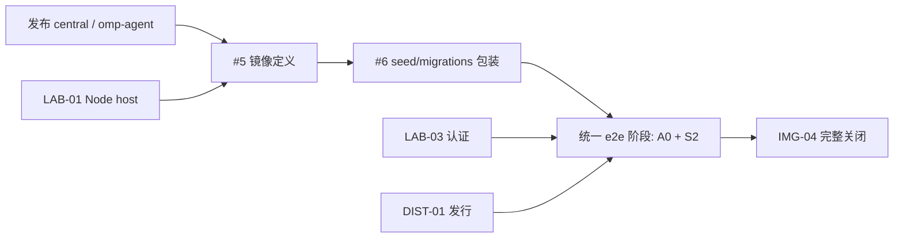

## 必须先读

- 决策树根：[D8 MVP 验收定义与实现计划](https://github.com/Pepgent/PM/issues/8)。
- [D8 §4.2 切片表](https://github.com/Pepgent/PM/blob/main/evidence/decisions/D8-mvp-scope.md#L219-L391)；[本切片原始行](https://github.com/Pepgent/PM/blob/main/evidence/decisions/D8-mvp-scope.md#L246)：范围、依赖、验收与档位。
- [D2-20](https://github.com/Pepgent/PM/blob/main/evidence/decisions/D2-components.md#L57)：本切片继承的组件归属与行为契约。
- [D7-19](https://github.com/Pepgent/PM/blob/main/evidence/decisions/D7-lab-backend.md#L79)：本切片继承的组件归属与行为契约。
- [D2-11](https://github.com/Pepgent/PM/blob/main/evidence/decisions/D2-components.md#L48)：本切片继承的组件归属与行为契约。
- [D2-13](https://github.com/Pepgent/PM/blob/main/evidence/decisions/D2-components.md#L50)：本切片继承的组件归属与行为契约。
- 交付顺序依据：LEDGER U32（“引入过多的中间环节做e2e而不是把东西开发好后再做e2e测试是你一开始规划的就有问题”）与 Argon D10 意图裁决 1.1【定】：开发期只做本仓检查，跨组件 live 验收在全部组件开发完成后的统一 e2e 阶段执行。

## 目标 / what

lab-web 镜像：IMG-01 加 remote CLI、Node、apps/web 构建产物（D7:79）；容器启动时用 installer 安装发行 tar，做法与 central 相同（D2:57 D2-20）

## 责任与范围

- 所属仓库：`Pepgent/images`。
- 切片 ID：`IMG-04`。
- 解锁：S2。
- 档位 / tier：`low`。
- 按已通过的 D2–D8 实施；不在本 issue 重议跨仓库设计，不扩大或缩小该行范围。

## 交付边界与编排

本 issue 保留 IMG-04 的完整 D8 验收，作为收口根，不由基础镜像 PR 提前关闭。部署生命周期沿 D7-19：发行安装命令成功后才启动 Node，发行定制与认证实现仍由各自仓库维护。

开发期由两个 child 交付 images 侧包装，各自只做本仓检查；完整验收在统一 e2e 阶段执行。

- [镜像定义 child](https://github.com/Pepgent/images/issues/5) 维护 images 的构建/运行包装，消费 Pepgent 已提交的 production build 和发布的 central 镜像。
- [seed/migrations 包装 child](https://github.com/Pepgent/images/issues/6) 让镜像保留 seed 所需 migrations，并支持先 seed、installer 成功后 exec Node 的启动顺序。
- 源码仅从 origin/main 的干净 checkout 导出已提交文件，构建上下文不包含 `.git`、本机 node_modules/dist 或未跟踪 `.env`。镜像不烘焙用户定制、目录或凭据；部署方在同一 HOME 上先执行 installer 再 exec Node。

完整关闭要求：二进制与包装由两个 child 的本仓证据证明；`/api/auth/*`、真实浏览器会话与安装后工具清单由统一 e2e 阶段证明，任何一项缺失都保持本根 open。

## 验收 / acceptance

容器启动后，`/api/auth/*` 有响应；`omp`、`omp-rpc-mux`、`remote` 都可执行；按 A0 第 ① 项的办法检查，lab-web 里 `omp` 的工具清单含 `soroi_eval`、`soroi_task`

验收执行与记录遵循 [D8-11 / D8-12](https://github.com/Pepgent/PM/blob/main/evidence/decisions/D8-mvp-scope.md#L82-L83) 及 [§3 验收矩阵](https://github.com/Pepgent/PM/blob/main/evidence/decisions/D8-mvp-scope.md#L102-L151)，在统一 e2e 阶段执行。完整相关 runtime 路径与权威方下游结果必须留证；只写定义、类型检查、构建或容器存活不代表完成。不得将 hash 验证作为证据。

## 依赖关系

- Depends on: [IMG-01](https://github.com/Pepgent/images/issues/1)。
- Depends on: [LAB-01](https://github.com/Pepgent/Pepgent/issues/8)。
- Depends on: [LAB-03](https://github.com/Pepgent/Pepgent/issues/12)（认证与 `/api/auth/*`）。
- Depends on: [DIST-01](https://github.com/Pepgent/soroi/issues/199)（发行与 installer）。

## 执行与异步状态

本根只记录范围、依赖和完整关闭结论；实现与本仓证据放对应 child 的 PR，跨组件验收证据由统一 e2e 阶段写回本根。每个代码 PR 只关闭一个 child；child 合并不关闭本根。

## Coordinator 启动

